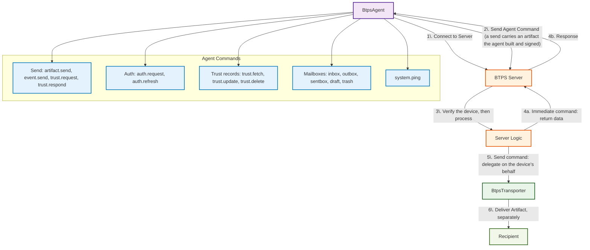

# BTPS Agent Overview

The **BTPS Agent** (`BtpsAgent`) is a specialized client class that extends `BtpsClient` to send commands to BTPS servers. It provides a high-level API for executing agent actions such as sending artifacts, managing trust relationships, and performing system operations through a secure, authenticated connection.

## What is BtpsAgent?

- A command-oriented client for sending agent actions to BTPS servers
- Handles authentication, delegation, and command execution
- Automatically creates nested transporter artifacts for delivery operations
- Manages agent identity and cryptographic operations
- Provides validation and error handling for all command types

## Core Features

- **Command-based API**: Send structured commands with validation and error handling
- **Automatic artifact nesting**: Creates transporter artifacts for delivery operations
- **Agent authentication**: Supports device authentication and delegation
- **Comprehensive validation**: Validates all command parameters and documents
- **Event-driven responses**: Handles server responses and error conditions
- **Cryptographic security**: Signs every command, and encrypts a document it sends when asked to

## Architecture and Workflow

## Command Flow

1. **Connection**: BtpsAgent establishes a secure TLS connection to the BTPS server
2. **Command Execution**: Sends agent command with optional document payload
3. **Server Processing**: Server validates, processes, and routes the command
4. **Response Handling**: Agent receives and processes server responses. For a send command, the response says the server accepted the artifact; delivery to the recipient happens afterwards, and the recipient's answer does not come back on this connection
5. **Error Management**: Comprehensive error handling for all failure scenarios

## Supported Commands

### System Commands

- **`system.ping`**: Health check and connectivity test
- **`auth.request`**: Device authentication and delegation setup
- **`auth.refresh`**: Renew the device's session, or move it to a new key

### Trust Management

- **`trust.request`**: Send trust request to establish relationship (sent to the other side)
- **`trust.respond`**: Respond to a pending trust request (sent to the requester)
- **`trust.fetch`**: List the user's trust requests, received and sent, with their status
- **`trust.update`**: Change one of the user's trust records, e.g. revoke or block it
- **`trust.delete`**: Remove trust records

`trust.fetch`, `trust.update` and `trust.delete` act on the user's own records at their provider; nothing is sent to the other side.

### Document Delivery

- **`artifact.send`**: Send documents (invoices) to recipients
- **`event.send`**: Send a lifecycle event (paid, disputed, ...) about a document received

### Storage

- **`inbox.fetch`**, **`inbox.seen`**, **`inbox.delete`**: Received artifacts
- **`outbox.fetch`**, **`outbox.cancel`**: Artifacts waiting to be delivered
- **`sentbox.fetch`**, **`sentbox.delete`**: Artifacts already sent
- **`draft.fetch`**, **`draft.create`**, **`draft.update`**, **`draft.delete`**: Drafts
- **`trash.fetch`**, **`trash.delete`**: Deleted artifacts

The protocol defines these commands; the provider's server stores and answers them.

## Agent Identity and Authentication

BtpsAgent requires:

- **Agent ID**: Unique identifier for the agent instance
- **Identity**: BTPS identity (e.g., `billing$company.com`)
- **Cryptographic Keys**: Private/public key pair for signing and encryption
- **Authentication**: Optional device authentication for delegation

## Use Cases

- **SaaS Applications**: Send invoices and business documents
- **Mobile Apps**: Device-based delegation and authentication
- **Enterprise Systems**: Automated trust management and document delivery
- **Integration Platforms**: Connect existing systems to BTPS network

## Key Benefits

- **Simplified API**: High-level command interface abstracts complexity
- **Automatic Security**: Built-in signing, encryption, and validation
- **Error Resilience**: Comprehensive retry logic and error handling
- **Event-Driven**: Asynchronous response handling with event callbacks
- **Type Safety**: Full TypeScript support with comprehensive type definitions

---

Continue to [Setup](./setup.md) to get started, or see [Commands](./commands.md) for detailed command specifications.
