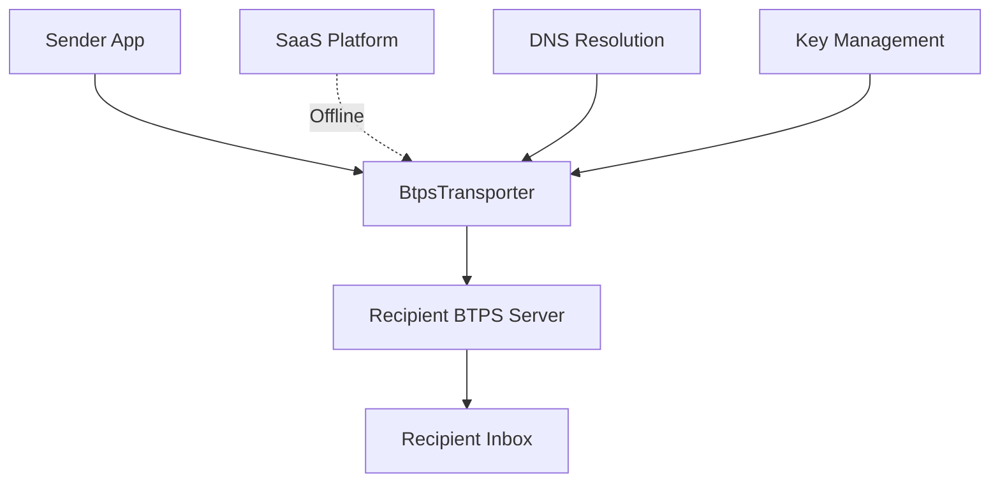
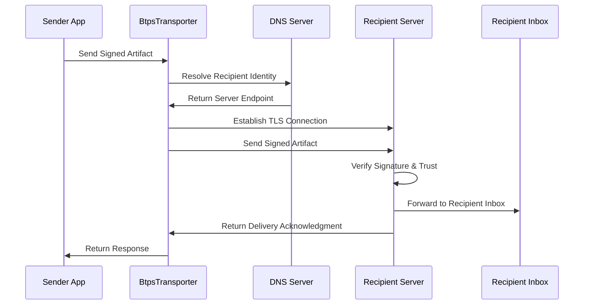

# BTPS Transporter Overview

The **BTPS Transporter** (`BtpsTransporter`) is a connection management and message delivery service that handles direct message delivery between BTPS servers. It manages a pool of `BtpsClient` connections and provides efficient artifact transport with automatic connection lifecycle management, retry logic, and connection pooling.

## 🏗️ Architecture Overview



**Key Characteristics:**

- **Direct Delivery**: Sends artifacts directly to recipient servers
- **SaaS-Independent**: Works even when sender's SaaS is offline
- **End-to-End**: Supports full end-to-end encryption
- **Bring Your Own Key**: Enables user-managed key scenarios
- **Server-to-Server**: Designed for server-side delivery operations
- **Connection Pooling**: Manages multiple `BtpsClient` connections efficiently
- **Automatic Lifecycle**: Handles connection creation, reuse, and cleanup
- **TTL Management**: Automatic connection expiration and refresh
- **Event-Driven**: Comprehensive event system for connection monitoring
- **High Performance**: Optimized for high-volume message delivery

## 🎯 Core Purpose

The BtpsTransporter serves as the primary delivery mechanism for BTPS artifacts, enabling:

### **1. Direct Server-to-Server Communication**

- Transports signed artifacts between BTPS servers
- Handles TLS connections and message delivery
- Manages connection lifecycle and retry logic

### **2. SaaS-Independent Delivery**

- Delivers messages without requiring sender's SaaS to be online
- Enables offline-capable message sending
- Supports distributed and federated architectures

### **3. End-to-End Encryption Support**

- Handles encrypted artifact delivery
- Supports user-managed keys (Bring Your Own Key)
- Maintains cryptographic integrity during transport

### **4. Platform Integration**

- Used by BTPS servers for artifact forwarding
- Enables mobile apps with direct delivery capabilities
- Supports hybrid SaaS + user-managed key scenarios

## 🔄 Message Flow



## 🏛️ Component Architecture

### **Core Components**

| Component                 | Purpose              | Responsibility                                                                           |
| ------------------------- | -------------------- | ---------------------------------------------------------------------------------------- |
| **BtpsClient**            | Base Transport Layer | TLS connections, retry logic, event handling                                             |
| **Artifact Validation**   | Message Integrity    | Schema validation, format verification                                                   |
| **Response Verification** | Security             | Verifying the receiver's signed answers; artifacts arrive already signed (`signEncrypt`) |
| **Connection Management** | Network Layer        | Connection lifecycle, error handling                                                     |

### **Key Methods**

```typescript
class BtpsTransporter {
  // Transport a complete artifact to recipient
  async transport(
    to: string,
    artifact: BTPTransporterArtifact,
    clientOptions?: BTPClientOptions,
  ): Promise<BTPClientResponse>;

  // Transport multiple artifacts to the same recipient efficiently
  async transportBatch(
    to: string,
    artifacts: BTPTransporterArtifact[],
    clientOptions?: BTPClientOptions,
  ): Promise<BTPClientResponse[]>;

  // Register a connection for a recipient. clientOptions replace the
  // transporter's own options for this connection, so they include `to`.
  async registerConnection(
    to: string,
    clientOptions?: BTPClientOptions,
    override?: boolean,
  ): Promise<BTPConnection>;

  // Get connection metrics and status
  getMetrics(): BTPTransporterMetrics;
  getConnections(): BTPConnection[];
  getConnection(id: string): BTPConnection | undefined;
}
```

## 🎯 Use Cases

### **1. Connection Pooling for High-Volume Delivery**

**Scenario**: BTPS server managing multiple connections for efficient artifact delivery

```typescript
// Server-side connection pooling
const transporter = new BtpsTransporter({
  maxConnections: 100,
  connectionTTLSeconds: 300,
  maxRetries: 3,
  retryDelayMs: 1000,
});

// Transport single artifact
const result = await transporter.transport('recipient$client.com', signedArtifact);

// Transport multiple artifacts to the same recipient efficiently
const artifacts = [signedArtifact1, signedArtifact2, signedArtifact3];
const batchResults = await transporter.transportBatch('recipient$client.com', artifacts);
```

**Benefits:**

- Handles server-to-server communication
- Manages connection pooling and retry logic
- Provides delivery acknowledgments
- Supports high-volume message processing
- Efficient connection reuse across multiple deliveries
- Automatic connection lifecycle management
- Built-in connection pooling and TTL management
- High-performance message delivery

### **2. Connection Management and Monitoring**

**Scenario**: Application, such as a mobile app with user-managed keys, requiring fine-grained control over BTPS connections

```typescript
// Connection management with monitoring
const transporter = new BtpsTransporter({
  maxConnections: 50,
  connectionTTLSeconds: 600,
  maxRetries: 5,
  retryDelayMs: 2000,
});

// Register connections explicitly
await transporter.registerConnection('recipient$client.com');

// Monitor connection status
const connections = transporter.getConnections();
const metrics = transporter.getMetrics();

// Custom client options for a new connection to this recipient
const result = await transporter.transport('other$client.com', artifact, {
  to: 'other$client.com',
  maxRetries: 1,
});
```

**Benefits:**

- Works offline (no SaaS dependency)
- Full end-to-end encryption
- User controls their own keys
- Direct recipient communication
- Explicit connection lifecycle control
- Real-time connection monitoring and metrics
- Custom client options per transport
- Connection pooling with TTL management

### **3. Event-Driven Connection Monitoring**

**Scenario**: Application requiring real-time connection event handling

```typescript
// Event-driven connection monitoring
const transporter = new BtpsTransporter({
  maxConnections: 25,
  connectionTTLSeconds: 300,
});

// Listen to connection events
transporter.on('connectionConnected', (connectionId) => {
  console.log(`Connection established: ${connectionId}`);
});

transporter.on('connectionEnd', (connectionId, endInfo) => {
  console.log(`Connection ended: ${connectionId}`, endInfo);
});

transporter.on('connectionError', (connectionId, errorInfo) => {
  console.error(`Connection error: ${connectionId}`, errorInfo);
});

// Transport with automatic connection management
const result = await transporter.transport('recipient$client.com', artifact);
```

**Benefits:**

- Real-time connection event monitoring
- Automatic connection lifecycle management
- Comprehensive error handling and reporting
- Event-driven architecture for monitoring

## 🔐 Connection and Queue Management Model

### **Connection Lifecycle**

- **Automatic Creation**: Connections created on-demand during transport
- **TTL Management**: Automatic connection expiration and cleanup
- **Connection Pooling**: Efficient reuse of established connections
- **Override Support**: Ability to replace existing connections

### **Queue Management**

- **Message Queuing**: Each BtpsClient connection maintains its own request queue
- **Batch Processing**: `transportBatch` efficiently processes multiple artifacts over the same connection
- **Queue Size Control**: Configurable `maxQueue` per connection to handle batch sizes
- **Queue Overflow**: A send beyond `maxQueue` is answered at once with a "request queue full" error

### **Connection Security**

- **TLS**: All connections use TLS encryption via underlying BtpsClient
- **Certificate Validation**: Server certificate verification
- **Connection Integrity**: Ensures message delivery integrity

### **Connection Monitoring**

- **Event System**: Comprehensive event-driven monitoring
- **Metrics Tracking**: Real-time connection metrics and status
- **Error Handling**: Detailed error reporting and recovery
- **Connection Status**: Live connection state monitoring

## 🚀 Key Features

### **1. Connection Pooling**

- Efficient management of multiple BtpsClient connections
- Automatic connection lifecycle management
- Configurable connection limits and TTL
- Connection reuse for improved performance

### **2. Event-Driven Architecture**

- Comprehensive event system for connection monitoring
- Real-time connection status updates
- Error event handling and reporting
- Connection lifecycle event tracking

### **3. High Performance**

- Connection pooling reduces connection overhead
- Efficient artifact transport with minimal latency
- Optimized for high-volume message delivery
- Automatic connection cleanup and management

### **4. Flexible Configuration**

- Configurable connection limits and TTL
- Custom client options per transport
- Override support for connection management
- Comprehensive metrics and monitoring
- Queue management for batch transport optimization

### **5. Standards Compliance**

- Full BTPS protocol compliance via underlying BtpsClient
- RFC-compliant TLS implementation
- Industry-standard connection management patterns

## 🔄 Comparison with BtpsAgent

| Feature              | BtpsTransporter                      | BtpsAgent                          |
| -------------------- | ------------------------------------ | ---------------------------------- |
| **Primary Use**      | Connection pooling and management    | Server command interface           |
| **Architecture**     | Connection manager (uses BtpsClient) | Direct client with crypto          |
| **Connection Model** | Pooled connections with TTL          | Single connection per instance     |
| **Message Types**    | Complete artifacts                   | Commands and queries               |
| **Use Cases**        | High-volume delivery, monitoring     | Inbox management, trust operations |

## 🎯 When to Use BtpsTransporter

### **Choose BtpsTransporter when:**

- ✅ Sending messages directly to recipients
- ✅ Need offline message delivery capability
- ✅ User manages their own cryptographic keys
- ✅ Building server-to-server communication
- ✅ Implementing end-to-end encryption
- ✅ Need SaaS-independent operation
- ✅ Need efficient connection pooling for high-volume delivery
- ✅ Require connection lifecycle management and monitoring
- ✅ Building applications with multiple recipient connections
- ✅ Need event-driven connection monitoring
- ✅ Require connection metrics and status tracking
- ✅ Building server-side artifact forwarding systems

### **Choose BtpsAgent when:**

- ✅ Managing inbox, drafts, and sent messages
- ✅ Need trust relationship management
- ✅ Require SaaS-managed authentication
- ✅ Building mobile apps with SaaS integration
- ✅ Need delegated device operations

## 🔧 Integration Patterns

### **Pattern 1: High-Volume Connection Pooling**

```typescript
// Server-side connection pooling for high-volume delivery
const transporter = new BtpsTransporter({
  maxConnections: 100,
  connectionTTLSeconds: 300,
  maxRetries: 3,
  retryDelayMs: 1000,
});

// Efficient delivery to multiple recipients
await transporter.transport('recipient1$client.com', artifact1);
await transporter.transport('recipient2$client.com', artifact2);
await transporter.transport('recipient3$client.com', artifact3);
```

### **Pattern 2: Batch Transport with Queue Management**

```typescript
// Configure transporter for batch processing
const transporter = new BtpsTransporter({
  maxConnections: 50,
  connectionTTLSeconds: 300,
  maxQueue: 200, // Default queue size for individual connections
});

// Register connection with custom queue size for large batches
await transporter.registerConnection('client$domain.com', {
  to: 'client$domain.com',
  maxQueue: 500, // Ensure queue can handle large batch size
});

// Transport large batch efficiently over that connection
const largeBatch = [artifact1, artifact2, artifact3 /* ... 200 more artifacts */];
const results = await transporter.transportBatch('client$domain.com', largeBatch);
```

### **Pattern 3: Event-Driven Connection Monitoring**

```typescript
// Connection monitoring with event handling
const transporter = new BtpsTransporter({
  maxConnections: 50,
  connectionTTLSeconds: 600,
});

// Monitor connection events
transporter.on('connectionConnected', (id) => console.log(`Connected: ${id}`));
transporter.on('connectionEnd', (id, info) => console.log(`Ended: ${id}`, info));
transporter.on('connectionError', (id, error) => console.error(`Error: ${id}`, error));

// Transport with automatic connection management
await transporter.transport('recipient$client.com', artifact);
```

### **Pattern 4: Explicit Connection Management**

```typescript
// Explicit connection lifecycle control
const transporter = new BtpsTransporter({
  maxConnections: 25,
  connectionTTLSeconds: 300,
});

// Register connections explicitly
await transporter.registerConnection('recipient$client.com');

// Monitor connection status
const connections = transporter.getConnections();
const metrics = transporter.getMetrics();

// Change an existing connection's options, and its TTL to 10 minutes
transporter.updateConnection('recipient$client.com', { maxRetries: 1 }, 600);
await transporter.transport('recipient$client.com', artifact);
```

## 📋 Queue Management Guidelines

### **Understanding Queue vs Connection Management**

- **Transporter `maxConnections`**: Controls how many different recipient connections to maintain
- **BtpsClient `maxQueue`**: Controls how many concurrent requests per connection
- **Batch Size**: Should not exceed the `maxQueue` setting for the target connection
- **Default Queue Size**: 100 requests per connection (may need adjustment for large batches)

### **Queue Management Best Practices**

1. **For Small Batches (< 50 artifacts)**: Use default `maxQueue` settings
2. **For Large Batches (50-200 artifacts)**: Increase `maxQueue` to `batchSize + 20`
3. **For Very Large Batches (> 200 artifacts)**: Consider splitting into smaller batches
4. **Monitor Queue Usage**: Watch for "request queue full" errors and adjust accordingly

### **Queue Configuration Examples**

```typescript
// Small batch - use default settings
const smallBatch = [artifact1, artifact2, artifact3];
await transporter.transportBatch('client$domain.com', smallBatch);

// Medium batch - increase the queue of the existing connection
const mediumBatch = [
  /* 100 artifacts */
];
transporter.updateConnection('client$domain.com', { maxQueue: 120 }); // batchSize + 20
await transporter.transportBatch('client$domain.com', mediumBatch);

// Large batch to a new recipient - register its connection with a large queue
await transporter.registerConnection('big-client$domain.com', {
  to: 'big-client$domain.com',
  maxQueue: 500, // Large queue for big batches
});
const largeBatch = [
  /* 400 artifacts */
];
await transporter.transportBatch('big-client$domain.com', largeBatch);
```

Options passed to `transport()` or `transportBatch()` apply only when they open a new connection; for one that exists, use `updateConnection`.

---

Continue to [Setup](./setup.md) to learn how to configure and use BtpsTransporter in your applications.
