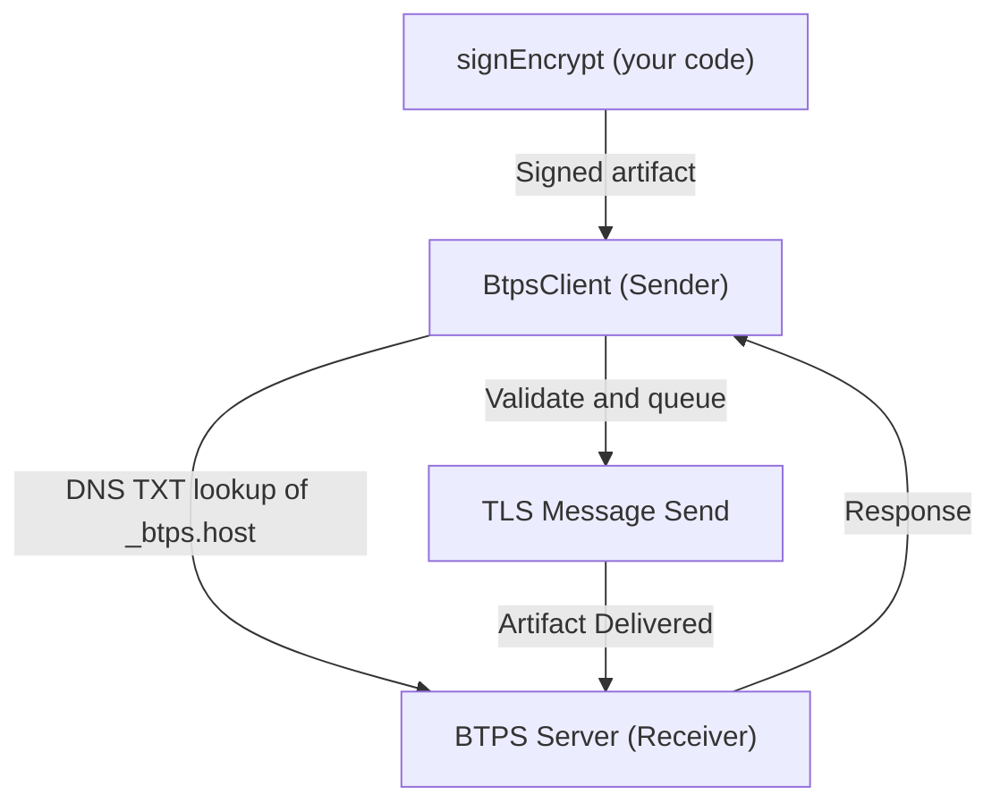

# BTPS Client SDK Overview

The **BTPS Client SDK** (`BtpsClient`) enables you to send secure, trust-based billing and business documents using the BTPS protocol. It abstracts away the complexity of DNS-based recipient resolution, cryptographic signing, encryption, and secure delivery over TLS, providing a simple API for sending BTPS artifacts.

## What is BtpsClient?

- A high-level client for creating Agents and Transporter for BTPS protocol messages (trust requests, trust responses, invoices, and more)
- Handles DNS discovery, public key resolution, and protocol compliance
- Sends artifacts you have signed (and encrypted) with `signEncrypt`; `BtpsAgent` signs its own commands
- Manages TLS connections, retries, and error handling
- Provides event-driven connection management and backpressure handling

## Core Features

- **Secure message delivery**: All messages are signed and (optionally) encrypted end-to-end
- **DNS-based recipient resolution**: Looks up recipient server and public key via DNS
- **Automatic retries**: Retries a failed connection after `retryDelayMs`, up to `maxRetries`
- **Backpressure and queueing**: Queues messages if the network is slow or busy
- **Comprehensive error handling**: Categorizes and surfaces connection, protocol, and application errors
- **Simple API**: Just call `send()` with your artifact, or use `connect()` for advanced control

## Protocol Flow

- **Step 1:** Your code encrypts and signs the document with `signEncrypt`; `BtpsClient` does not sign or encrypt
- **Step 2:** Client looks up the recipient's BTPS server (host and selector) in the `_btps.host` DNS record
- **Step 3:** Client checks the artifact's shape and sends it over a secure TLS connection
- **Step 4:** Server verifies, processes, and responds

## Use Cases

- Constructing Agent and Transporter for BTPS protocol which are used in:
  - Sending trust requests to establish relationships
  - Sending invoices, bills, or business documents securely
  - Automating billing workflows in SaaS, fintech, and enterprise apps
  - Integrating with existing accounting or ERP systems

---

Continue to [Setup](./setup.md) to get started, or see [Examples](./examples.md) for advanced usage patterns.
