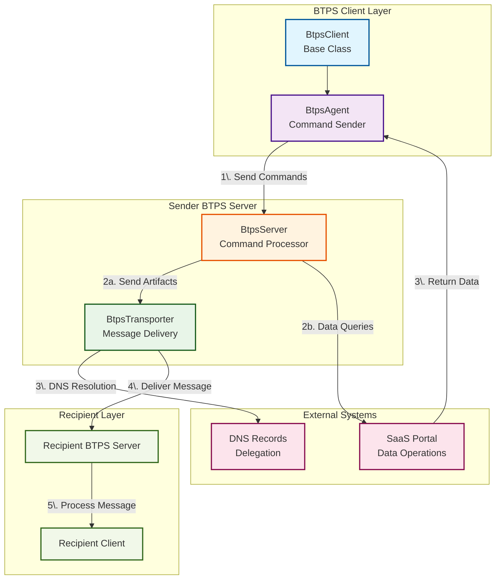

# Setting Up the BTPS Client

This guide walks you through installing, configuring, and using the BTPS Client SDK (`BtpsClient`) to send secure, trust-based messages.

## Overview

**BtpsClient** is a low-level TLS client that provides the core infrastructure for secure BTPS communication. It handles TLS connections, DNS resolution, artifact validation, message queuing, and cryptographic verification. **Important**: BtpsClient does NOT sign artifacts - it expects pre-signed artifacts and will validate server responses that contain signatures. This class is primarily used internally by `BtpsAgent` and `BtpsTransporter` for their specific use cases.

### Architecture and Purpose

BtpsClient is designed as a foundational transport layer that provides:

- **TLS Connection Management**: Automatic connection establishment and lifecycle
- **DNS Resolution**: BTPS host and public key resolution via DNS TXT records
- **Artifact Validation**: Schema validation and cryptographic verification
- **Message Queuing**: Request/response correlation with timeout handling
- **Error Handling**: Comprehensive error classification and retry logic

### Use Case - BtpsClient

**Important Note**: BtpsClient is primarily used internally by the SDK. For most use cases, you should use:

- **BtpsAgent**: For sending commands to BTPS servers and managing inbox operations
- **BtpsTransporter**: For connection pooling and high-volume artifact delivery

This setup guide is primarily useful for developers who want to:

- Create custom transport layers with specific requirements
- Build specialized clients that need direct TLS control
- Implement custom connection management logic
- Gain low-level control over BTPS communication

**For most developers**: Use BtpsAgent and BtpsTransporter directly instead of BtpsClient. This class is exported for advanced use cases only.

### BTPS Client Architecture



### How It Works

1. **BtpsClient** establishes TLS connections to BTPS servers using DNS resolution
2. **Artifacts** are validated against BTPS schemas before transmission
3. **Messages** are queued with correlation IDs for request/response matching
4. **Responses** are verified cryptographically and returned to callers
5. **Connections** are managed automatically with retry logic and error handling

### Key Features

- **DNS-based host resolution** via the recipient domain's `_btps.host` TXT record
- **TLS secure communication** with automatic connection management
- **Artifact validation** using Zod schemas before transmission
- **Built-in message queuing** with request/response correlation over the same connection
- **Concurrent sending** - multiple artifacts can be sent simultaneously using the same socket
- **Cryptographic verification** of server responses (does NOT sign artifacts)
- **Comprehensive error handling** with retry logic

## 1. Installation

Install the SDK from npm (Node.js 24 or higher):

```bash
npm install @btps/sdk
```

## 2. BtpsClient Constructor Options

The `BtpsClient` constructor accepts the following options:

| Option                | Type   | Required | Description                                                                                        |
| --------------------- | ------ | -------- | -------------------------------------------------------------------------------------------------- |
| `to`                  | string | Yes      | Recipient identity (e.g., `billing$yourdomain.com`)                                                |
| `maxRetries`          | number | No       | Max connection retry attempts (default: 5)                                                         |
| `retryDelayMs`        | number | No       | Delay between retries in ms (default: 1000)                                                        |
| `connectTimeoutMs`    | number | No       | How long to wait to connect, in ms (at least and by default 5000)                                  |
| `replyTimeoutMs`      | number | No       | How long `send()` waits for the answer, in ms (at least 10000, default 20000)                      |
| `connectionTimeoutMs` | number | No       | Closes an idle connection (no send waiting for an answer) after this long; off when not set        |
| `btpMtsOptions`       | object | No       | Additional TLS options (excluding host/port)                                                       |
| `host`                | string | No       | Override DNS with custom host (for dev/testing)                                                    |
| `hostSelector`        | string | No       | With `host`: the selector of the host's key (default: 'btps1')                                     |
| `hostOperator`        | string | No       | With `host`: the identity operating that host, which signs its lookup answers (otherwise from DNS) |
| `version`             | string | No       | With `host`: the protocol version (default: the SDK's, '1.1.0')                                    |
| `port`                | number | No       | Override default port 3443 (for dev/testing)                                                       |
| `maxQueue`            | number | No       | Maximum queue size for request handling (default: 100)                                             |

## 3. Retry & Timeout Options

The client provides robust retry and timeout controls for reliable delivery:

- **`maxRetries`**: Maximum number of connection retry attempts (default: 5). If a connection fails with a retryable error (e.g., a network timeout), the client retries up to this many times before giving up.
- **`retryDelayMs`**: Delay (in milliseconds) between retry attempts (default: 1000ms).
- **`connectTimeoutMs`**: How long to wait for the TLS connection to be established. If it is reached, the client retries (if retries remain). At least 5000.
- **`replyTimeoutMs`**: How long `send()` waits for the server's answer. At least 10000, 20000 by default, so every receiver can count on that long to answer.
- **`connectionTimeoutMs`**: Closes the connection after this long with nothing waiting for an answer; the next `send()` reconnects. It never closes a connection while a send is waiting.

A value below a minimum is raised to the minimum, with a warning.

**Example:**

```js
const client = new BtpsClient({
  to: 'billing$yourdomain.com',
  maxRetries: 3, // Try up to 3 times
  retryDelayMs: 2000, // Wait 2 seconds between retries
  connectTimeoutMs: 5000, // Give up connecting after 5 seconds
  replyTimeoutMs: 20000, // Wait up to 20 seconds for each answer
});
```

**Best Practices:**

- For production, set `maxRetries` and `retryDelayMs` to balance reliability and user experience.
- Use a lower `maxRetries` for fast-fail development/testing.
- Monitor error events to understand retry behavior and tune these values for your environment.

## 4. Basic Client Setup

```js
import { BtpsClient } from '@btps/sdk/client';

const client = new BtpsClient({
  to: 'billing$yourdomain.com',
  maxRetries: 3,
  retryDelayMs: 1000,
});
```

## 5. Sending Artifacts

The `BtpsClient` uses a simple send/receive pattern where you send artifacts and receive responses. Connections are managed automatically and **multiple artifacts can be sent concurrently over the same connection** using the built-in queuing system. **Important**: BtpsClient does NOT sign artifacts - you must sign your artifacts before sending them, with `signEncrypt` from `@btps/sdk/crypto`. Unsigned artifacts will be rejected by the server.

### 5.1 Basic Send and Receive

```js
import { randomUUID } from 'crypto';
import { parseIdentity } from '@btps/sdk';
import { BtpsClient } from '@btps/sdk/client';
import { signEncrypt } from '@btps/sdk/crypto';

const from = 'billing$yourdomain.com';
const to = 'billing$client.com';
const { accountName, domainName } = parseIdentity(from);

// Sign the artifact before sending (REQUIRED). A trust request is sent
// unencrypted: there is no trust yet.
const { payload: signedArtifact, error } = await signEncrypt(
  to,
  { accountName, domainName, pemFiles: { privateKey, publicKey } },
  {
    version: '1.1.0',
    type: 'TRUST_REQ',
    from,
    to,
    selector: 'btps1', // the selector your own key is published under
    document: {
      id: randomUUID(),
      name: 'Your Company Name',
      email: 'billing@yourdomain.com',
      reason: 'To send monthly invoices',
      phone: '+1234567890',
    },
  },
  { signature: { algorithmHash: 'sha256' } },
);
if (error) throw error;

const client = new BtpsClient({ to, maxRetries: 3, retryDelayMs: 1000 });

try {
  const result = await client.send(signedArtifact);

  if (result.error) {
    console.error('Error:', result.error.message);
  } else {
    console.log('Response:', result.response);
  }
} finally {
  client.destroy(); // Clean up resources
}
```

To encrypt a document, pass `encryption: { algorithm: 'aes-256-gcm', mode: 'standardEncrypt' }` alongside `signature`: `signEncrypt` looks up the recipient's public key and encrypts to it.

### 5.2 Event-Based Monitoring

For monitoring connection events:

```js
const client = new BtpsClient({
  to: 'billing$client.com',
});

// Listen to connection events
client.on('connected', (info) => {
  console.log('Connected to:', info.identity);
  console.log('Retries used:', info.retries);
});

client.on('message', (msg) => {
  console.log('Received message:', msg.response);
  console.log('Valid signature:', msg.validSignature); // Always present for signed responses
});

client.on('error', (errInfo) => {
  console.error('Error:', errInfo.error.message);
  console.log('Will retry:', errInfo.willRetry);
  console.log('Retries left:', errInfo.retriesLeft);
});

client.on('end', (endInfo) => {
  console.log('Connection ended:', endInfo);
});

client.on('close', (endInfo) => {
  console.log('Connection closed:', endInfo);
});

// Send signed artifact
const result = await client.send(signedArtifact);
```

### 5.3 Concurrent Sending

BtpsClient supports sending multiple artifacts concurrently over the same connection using its built-in queuing system:

```js
const client = new BtpsClient({
  to: 'billing$client.com',
});

// artifacts: each signed with signEncrypt, as in 5.1
const results = await Promise.all(artifacts.map((artifact) => client.send(artifact)));

// Process results
results.forEach((result, index) => {
  if (result.error) {
    console.error(`Artifact ${index} failed:`, result.error.message);
  } else {
    console.log(`Artifact ${index} succeeded:`, result.response);
  }
});

client.destroy();
```

### 5.4 Queue Management

The client automatically manages the request queue and connection reuse. When the queue is full, `send()` answers at once with an error rather than waiting:

```js
// Set custom queue size (default: 100)
const client = new BtpsClient({
  to: 'billing$client.com',
  maxQueue: 50, // Limit concurrent requests
});

const result = await client.send(signedArtifact);
if (result.error?.message.includes('request queue full')) {
  console.log('Queue is full, consider reducing concurrent requests');
}
```

## 6. Signature Validation

BtpsClient automatically validates server responses that contain signatures:

### 6.1 Response Validation

```js
client.on('message', (msg) => {
  if (msg.validSignature) {
    console.log('Server response is cryptographically verified');
    console.log('Response:', msg.response);
  } else {
    console.error('Server response signature verification failed');
    console.error('Error:', msg.error);
  }
});
```

### 6.2 Error Handling for Invalid Signatures

```js
client.on('error', (errInfo) => {
  if (errInfo.error.code === 'BTP_ERROR_SIG_VERIFICATION') {
    console.error('Server response signature verification failed');
    console.error('Details:', errInfo.error.meta);
  }
});
```

## 7. Development & Testing Overrides

You can override DNS resolution for local development:

```js
const devClient = new BtpsClient({
  to: 'test$local.com',
  host: 'localhost', // Override DNS resolution
  port: 3443, // Override default port
  btpMtsOptions: {
    rejectUnauthorized: false, // For self-signed certificates in dev
  },
});
```

## 8. Error Handling and Retries

The client provides comprehensive error handling with automatic retries:

### 8.1 Retryable vs Non-Retryable Errors

**Retryable Errors:**

- Network timeouts
- Connection failures
- Temporary server unavailability

**Non-Retryable Errors:**

- Invalid identity format
- DNS resolution failures
- Signature verification failures
- Protocol violations

### 8.2 Error Event Information

Error events provide detailed information:

```js
client.on('error', (errInfo) => {
  console.error('Error:', errInfo.error.message);
  console.log('Will retry:', errInfo.willRetry);
  console.log('Retries left:', errInfo.retriesLeft);
  console.log('Attempt number:', errInfo.attempt + 1);
});
```

## 9. Connection Lifecycle Management

### 9.1 Available Methods

- **`send(artifact, timeoutMs?)`**: Send an artifact and wait for response (`timeoutMs` replaces `replyTimeoutMs` for this send, at least 10000)
- **`resolveIdentity(identity, from, receiverPrivatePem?)`**: Ask the identity's host for its public key, for an identity with no DNS key record
- **`update(options)`**: Update client options dynamically
- **`getConnectionStates()`**: Get current connection state
- **`destroy()`**: Immediately destroy the client and clean up resources; sends still waiting are answered with an error
- **`getProtocolVersion()`**: Get the BTPS protocol version

### 9.2 Connection States

The client manages several internal states:

- **isConnecting**: Establishing TLS connection
- **isConnected**: Ready to send artifacts
- **isDraining**: Handling backpressure (network is slow)
- **isDestroyed**: Client has been cleaned up
- **shouldRetry**: Whether retries are allowed

## 10. Best Practices

- **Always sign artifacts**: Use `signEncrypt` before sending artifacts
- **Always handle errors**: Check for `result.error` after sending artifacts
- **Use proper cleanup**: Call `destroy()` when done with the client to free resources
- **Monitor connection events**: Use event listeners to track connection status
- **Validate artifacts**: Ensure your artifacts match the expected BTPS schema
- **Handle timeouts**: Keep the reply wait at its default unless you have a reason; it has a minimum
- **Use connection pooling**: For high-volume scenarios, use BtpsTransporter instead
- **Monitor queue size**: Set `maxQueue` appropriately to prevent memory issues
- **Verify signatures**: Always check `validSignature` in message events
- **Leverage concurrent sending**: Send multiple artifacts simultaneously over the same connection

### 10.1 Resource Management

```js
const client = new BtpsClient({
  to: 'recipient$domain.com',
});

try {
  // signedArtifact: signed with signEncrypt, as in 5.1
  const result = await client.send(signedArtifact);
  // Process result
} finally {
  // Always clean up resources
  client.destroy();
}
```

---

Continue to [Examples](./examples.md) for advanced usage patterns, or see [Debugging](./debugging.md) for troubleshooting tips.
