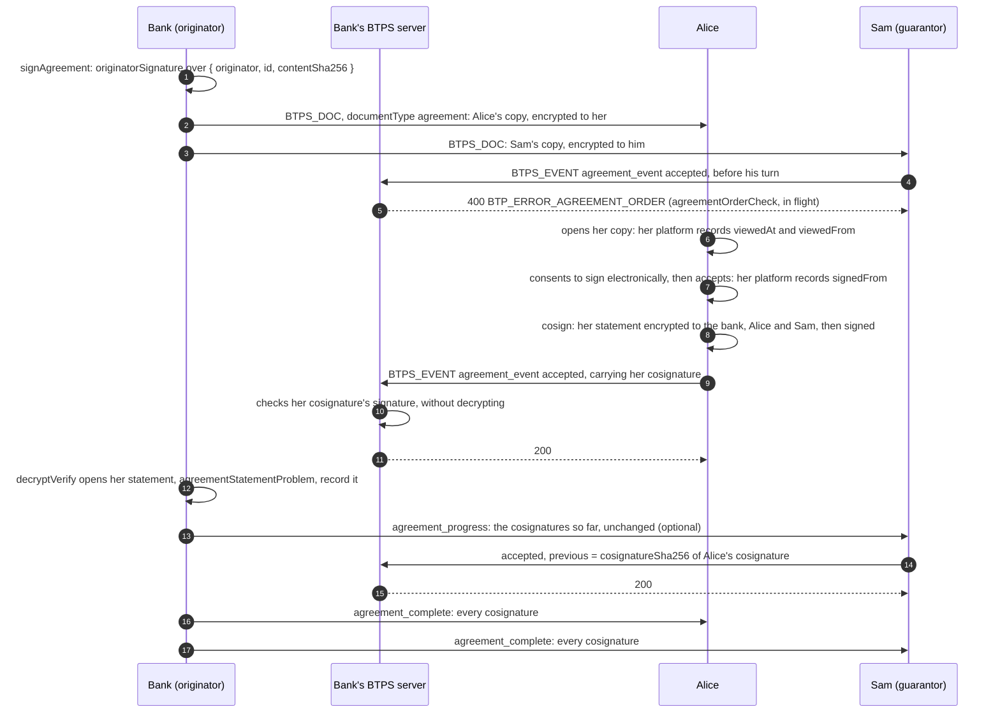

# Agreements

> **Since 1.2.** An agreement travels in `1.2.0` artifacts only.

**What it is.** `agreement` is a fifth document type: a letter that asks its signers to accept it, such as a loan contract, a tenancy or a phone plan. Each signer answers `accepted` or `declined` with a signed statement, in turn or in any order, and the originator collects the answers into an [evidence bundle](./evidenceBundles.md) anyone can check offline.

**Why.** Contracts are still signed by email links and portals. Over BTPS the agreement and every answer are signed artifacts between parties who already trust each other, so the proof of who accepted what, and when, is in the artifacts themselves.

**Since 1.2 (rc.4), each answer travels as a cosignature.** BTPS encrypts a document, signs over the ciphertext, and lets every server check the signature before anything is decrypted. A signer's statement now works the same way: it is encrypted once to the originator and every signer, signed over that ciphertext, and carried on the event's envelope. Every BTPS server on the way checks the signer's signature on receipt. Who signed, and in what order, is readable. What each signer said is encrypted.

An agreement travels under a trust that grants `send:agreement` (`send:letter` never covers one).

## The flow, in turn



With `signingOrder: "any"`, signers answer in any order and no statement names a `previous`. A `declined` answer ends a sequential agreement: no one answers after it. Each signer's server checks every forwarded cosignature again on receipt, and each signer opens the statements with its own key.

## The agreement

Each signer gets its own copy, encrypted to it; every copy has the same content, so any copy checks offline. This is the golden vectors' agreement, with its originator's real signature:

```json btps=document:BTPS_DOC
{
  "type": "agreement",
  "title": "Home loan agreement",
  "id": "AGR-1",
  "salt": "MDEyMzQ1Njc4OWFiY2RlZjAxMjM0NTY3ODlhYmNkZWY=",
  "issuedAt": "2026-10-19T00:00:00.000Z",
  "body": {
    "format": "markdown",
    "content": "# Home loan\n\nThe terms are attached. Each of you accepts them in turn."
  },
  "attachments": [
    {
      "content": "JVBERi0xLjcgSG9tZSBsb2FuIHRlcm1zOiA2LjElIHAuYS4gb3ZlciAzMCB5ZWFycw==",
      "type": "application/pdf",
      "filename": "terms.pdf",
      "size": 49,
      "sha256": "879045b6f068c6187f025ba1ef44bfa5976c9826e68e6fe6f1956c8ea2044b01"
    }
  ],
  "acceptance": {
    "by": "2026-11-30T00:00:00.000Z",
    "terms": ["879045b6f068c6187f025ba1ef44bfa5976c9826e68e6fe6f1956c8ea2044b01"],
    "signers": [
      { "address": "alice$client.example" },
      { "address": "sam$guarantor.example" },
      { "address": "loans$bank.example" }
    ],
    "signingOrder": "sequential"
  },
  "originatorSignature": {
    "selector": "btps1",
    "signature": {
      "algorithmHash": "sha256",
      "value": "cz889mCrNDhiOutUfkf/fzwlTqrWl5KekO3DcGHH+itwH6aJBcjxFtjH6F9L/8olXpNRbUI4P2FKYEBQHiKyH1tazcNxyM474OM+DYDcZTlBDMooG5PAN1LuIE6hzbreNcCpCj5ZHbK43fAoxkfJzRC1TK4CkFDPCo18K3vTiQl4njMA9zFGMOM02gT/1eVhtp/0eM6RRmfjo7hZ7VMUEoT5GVe+mIS0dhlP7a0B9h1Kd/X9zbGIU4uAb4tJ2ihT1FtKWEppW8dW1XLEZwcVPeQ7prTMdBZ1LOzC06p8bHrQuWaQ0lOnkSiTkO9cOnDEM1vBLLR7sd++gXOyBndnTA==",
      "fingerprint": "P3jb2C0c6XutGbtPyrDjDfY+M8IICzA5Ym8YkTZerAs="
    }
  }
}
```

| Field                     | Means                                                                                                                                                                    |
| ------------------------- | ------------------------------------------------------------------------------------------------------------------------------------------------------------------------ |
| `salt`                    | since rc.4: 32 random bytes, base64. Every cosignature carries `contentSha256` readable, and the salt stops it from confirming a guess at a standard agreement's text    |
| `acceptance.signers`      | who accepts it: 1 to 20 addresses, each once. The originator may be one (a bank that countersigns). Signed content, so it cannot change after sending                    |
| `acceptance.signingOrder` | `sequential` (in list order) or `any`                                                                                                                                    |
| `acceptance.terms`        | the SHA-256 of each attachment that is a term. May be empty: an acceptance always covers the whole signed content                                                        |
| `acceptance.by`           | optional deadline: each answer is signed no later than it                                                                                                                |
| `originatorSignature`     | the originator's signature over `{ originator, id, contentSha256 }`, where `contentSha256` is the SHA-256 of the agreement's RFC 8785 form without `originatorSignature` |

A letter never carries `acceptance`, and an agreement always does, so the type and the block cannot disagree. This agreement's `contentSha256` is `85aa77265b21d30739eb1aa19e17db6fc832f674319c763ed7ce8de5fc2d53bf`.

## An answer

A signer answers with an `agreement_event` in a `BTPS_EVENT`, whose `relatesTo` names its own copy. The event says what happened, and names the agreement:

```json btps=document:BTPS_EVENT
{
  "type": "agreement_event",
  "id": "b38feac1-e0f1-4afb-85d2-4fbd1965357c",
  "occurredAt": "2026-11-02T09:14:52.000Z",
  "eventType": "accepted",
  "agreement": {
    "originator": "loans$bank.example",
    "id": "AGR-1",
    "contentSha256": "85aa77265b21d30739eb1aa19e17db6fc832f674319c763ed7ce8de5fc2d53bf"
  }
}
```

The signed statement is not in the event. It travels on the artifact's envelope, as its one **cosignature**: the statement encrypted to the bank, Alice and Sam, and Alice's signature over that ciphertext. Shortened, with placeholders:

```json sketch
{
  "version": "1.2.0",
  "id": "b38feac1-e0f1-4afb-85d2-4fbd1965357c",
  "type": "BTPS_EVENT",
  "from": "alice$client.example",
  "to": "loans$bank.example",
  "relatesTo": "ID-OF-ALICES-COPY",
  "document": "BASE64-OF-THE-ENCRYPTED-EVENT",
  "cosignatures": [
    {
      "ref": { "originator": "loans$bank.example", "id": "AGR-1", "contentSha256": "85aa…53bf" },
      "signer": "alice$client.example",
      "selector": "btps1",
      "artifactId": "b38feac1-e0f1-4afb-85d2-4fbd1965357c",
      "statementSha256": "SHA-256-OF-THE-ENCRYPTED-STATEMENT",
      "recipients": [
        { "identity": "alice$client.example", "fingerprint": "…", "wrappedKey": "…" },
        "…"
      ],
      "encryption": { "algorithm": "aes-256-gcm", "iv": "…", "authTag": "…" },
      "ciphertext": "BASE64-OF-THE-ENCRYPTED-STATEMENT",
      "signature": { "algorithmHash": "sha256", "value": "…", "fingerprint": "…" }
    }
  ],
  "…": "…"
}
```

A whole cosignature, real, with what each field says, is in the specification: [Cosignatures](../protocol/specifications/transporter-artifact.md#cosignatures).

The statement it encrypts, once opened. Here Alice viewed and accepted in Chrome on a Mac: her platform took the user agent, and the OS and browser versions from the User-Agent Client Hints Chrome sent.

```json btps=statement
{
  "agreement": {
    "originator": "loans$bank.example",
    "id": "AGR-1",
    "contentSha256": "85aa77265b21d30739eb1aa19e17db6fc832f674319c763ed7ce8de5fc2d53bf"
  },
  "terms": ["879045b6f068c6187f025ba1ef44bfa5976c9826e68e6fe6f1956c8ea2044b01"],
  "signer": "alice$client.example",
  "artifactId": "b38feac1-e0f1-4afb-85d2-4fbd1965357c",
  "decision": "accepted",
  "signedAt": "2026-11-02T09:14:52.000Z",
  "visualSignature": { "type": "typed", "text": "Alice Ng" },
  "consent": {
    "electronic": true,
    "disclosureSha256": "9cf72b4504a4459f146c90afd9ba6b84146bd182f49551d051c2a4af26662175",
    "at": "2026-11-02T09:13:05.000Z"
  },
  "viewedAt": "2026-11-02T09:02:41.000Z",
  "viewedFrom": {
    "ip": "203.0.113.24",
    "userAgent": "Mozilla/5.0 (Macintosh; Intel Mac OS X 10_15_7) AppleWebKit/537.36 (KHTML, like Gecko) Chrome/131.0.0.0 Safari/537.36",
    "device": {
      "os": "macOS",
      "osVersion": "15.1.0",
      "browser": "Google Chrome",
      "browserVersion": "131.0.6778.86"
    }
  },
  "signedFrom": {
    "ip": "203.0.113.24",
    "userAgent": "Mozilla/5.0 (Macintosh; Intel Mac OS X 10_15_7) AppleWebKit/537.36 (KHTML, like Gecko) Chrome/131.0.0.0 Safari/537.36",
    "device": {
      "os": "macOS",
      "osVersion": "15.1.0",
      "browser": "Google Chrome",
      "browserVersion": "131.0.6778.86"
    }
  }
}
```

- **Identity or device.** A cosignature with `selector` was signed by the signer's identity key, which may be a managed key its provider holds. One signed on a device has no `selector`. It travels first in the device's own delegated artifact, whose delegation stands for it, and when the originator forwards it, the originator adds `delegatedArtifact`: that artifact, as it arrived, so the cosignature stays checkable offline. The key kind is a fact of the cosignature, never a field.
- **`artifactId`** (since rc.4) is the `id` of the artifact that first delivers the statement: the answer itself, whose event has the same `id`. On a device it is the device's delegated artifact's. The cosignature names the same id, so the statement cannot be moved into another artifact.
- **`previous`**, in a sequential agreement, on every statement after the first: the SHA-256 of the cosignature before it (`cosignatureSha256`), signature included.
- **`terms`** repeats the agreement's terms exactly; **`signedAt`** is the signer's own signed time, which the deadline is checked against.
- **`visualSignature`**, optional, on an acceptance only: the signer's own signature, typed (`{ type: "typed", text }`) or drawn (`{ type: "drawn", strokes }`), with a letter's limits. It is inside the statement, so the signature covers it: another one, or none, no longer checks. A platform may require one before it lets its user accept.
- **`consent`**, optional, on an acceptance only: the signer's consent to sign electronically, `{ electronic: true, disclosureSha256, at }`. `disclosureSha256` is the SHA-256 of the disclosure the signer's platform showed it, in that platform's own words; `at` is when it agreed, no later than `signedAt`. BTPS carries the fact; each platform writes and versions its own wording. A decline with a `consent` is refused.
- **`viewedAt`**, optional, on an acceptance or a decline: when the signer first viewed the agreement, no later than `signedAt`.
- **Why both exist.** Laws on electronic signatures (Australia's Electronic Transactions Act 1999, ESIGN and UETA in the US, eIDAS in the EU) and some courts expect evidence that the signer agreed to sign electronically, and of when it viewed the document. Both are inside the statement, so the signature covers them: changing or removing either no longer checks. They travel into the evidence bundle with it, so any platform's evidence shows them, not only the originator's own records. A statement without them stays valid. Whether either is required is the platform's choice.
- **`viewedFrom`** and **`signedFrom`**, optional: where the signer viewed the agreement from (only with a `viewedAt`; a `viewedFrom` without one is refused) and where it answered from, on an acceptance or a decline. Each is `{ ip, userAgent, device }`, at least one of the three: the IP address the request came from (IPv4 or IPv6), the user agent its browser or app sent (printable ASCII, at most 256 characters), and the device, `{ os, osVersion, model, browser, browserVersion, app, appVersion, id }`, at least one, each printable ASCII of at most 100 characters (`id`, 128). `id` is the platform's own identifier for a device it registered, such as an app installation, not a fingerprint.
- **What a context is.** The signer's platform's observation: it saw the request, and a browser reports what it reports. It is not proof of location or device. How much is known, and how accurately, is the platform's: a browser may give only a user agent (some expose the OS and model through User-Agent Client Hints), a native app its OS, version, model and registered device id. BTPS only carries the fields. The signature covers them, so they cannot be changed afterwards, and they travel into the evidence bundle and to every party the statement is forwarded to.
- **Privacy.** An IP address and device details are personal information in many jurisdictions. A platform that records them should tell the signer before it signs, for example in the disclosure `consent.disclosureSha256` names, that they are recorded and shared with the agreement's parties. Every field is optional, so a platform may leave them out; a statement without them stays valid.
- **Who sees what.** Every server on the way reads the cosignature's envelope fields: the agreement it answers, who signed, the order, and who can open it. Only the originator and the signers can open the statement. It is padded to a multiple of 4,096 characters before it is encrypted, so its length does not tell an acceptance from a decline.
- **An answer is final.** It is never withdrawn; a change is a new agreement.

A decline may carry a note, in its event. Its statement never carries a `consent` or a `visualSignature`. This one was viewed and answered in the signer's platform's phone app, which knows more of its device than a browser says: its model, its version and the id the platform registered it under.

```json btps=document:BTPS_EVENT
{
  "type": "agreement_event",
  "id": "47117573-3c10-46f5-8be7-8cb646f43b9f",
  "occurredAt": "2026-11-02T09:05:33.000Z",
  "eventType": "declined",
  "agreement": {
    "originator": "loans$bank.example",
    "id": "AGR-1",
    "contentSha256": "85aa77265b21d30739eb1aa19e17db6fc832f674319c763ed7ce8de5fc2d53bf"
  },
  "message": { "format": "markdown", "content": "The rate is not what we discussed." }
}
```

Its statement, which its cosignature encrypts:

```json btps=statement
{
  "agreement": {
    "originator": "loans$bank.example",
    "id": "AGR-1",
    "contentSha256": "85aa77265b21d30739eb1aa19e17db6fc832f674319c763ed7ce8de5fc2d53bf"
  },
  "terms": ["879045b6f068c6187f025ba1ef44bfa5976c9826e68e6fe6f1956c8ea2044b01"],
  "signer": "alice$client.example",
  "artifactId": "47117573-3c10-46f5-8be7-8cb646f43b9f",
  "decision": "declined",
  "signedAt": "2026-11-02T09:05:33.000Z",
  "viewedAt": "2026-11-02T08:47:19.000Z",
  "viewedFrom": {
    "ip": "2001:db8:4c2a::1f",
    "userAgent": "ExampleApp/4.3.0 (iPhone; iOS 18.1.1)",
    "device": {
      "os": "iOS",
      "osVersion": "18.1.1",
      "model": "iPhone16,2",
      "app": "ExampleApp",
      "appVersion": "4.3.0",
      "id": "inst-5c0e2b7a-3f41-4d8e-9a6b-1e2f3a4b5c6d"
    }
  },
  "signedFrom": {
    "ip": "2001:db8:4c2a::1f",
    "userAgent": "ExampleApp/4.3.0 (iPhone; iOS 18.1.1)",
    "device": {
      "os": "iOS",
      "osVersion": "18.1.1",
      "model": "iPhone16,2",
      "app": "ExampleApp",
      "appVersion": "4.3.0",
      "id": "inst-5c0e2b7a-3f41-4d8e-9a6b-1e2f3a4b5c6d"
    }
  }
}
```

The originator's own events, `agreement_progress` (before a sequential signer's turn) and `agreement_complete` (once all have answered), carry no statements either. Their artifacts carry the cosignatures so far, or every one, in order and unchanged, never the agreement again. The originator may forward its own cosignature with them when it is also a signer.

## The code

From the agreement journey (`tests/e2e/agreements.e2e.test.ts`), which runs this flow over real servers.

### The originator sends

```ts
import { signAgreement } from '@btps/sdk/trust';

const agreement = await signAgreement(
  {
    type: 'agreement',
    title: 'Home loan agreement',
    id: 'AGR-1',
    salt: crypto.randomBytes(32).toString('base64'), // since rc.4: 32 random bytes
    issuedAt: new Date().toISOString(),
    body: { format: 'markdown', content: '# Home loan\n\nThe terms are attached.' },
    attachments: [terms], // { content, type, filename, size, sha256 }
    acceptance: {
      by: '2026-11-30T00:00:00.000Z',
      terms: [terms.sha256],
      signers: [{ address: 'alice$client.example' }, { address: 'sam$guarantor.example' }],
      signingOrder: 'sequential',
    },
  },
  { originator: 'loans$bank.example', selector: 'btps1', pemFiles: bankKeys },
);

// One copy per signer, encrypted to each, as a BTPS_DOC with documentType 'agreement'.
for (const signer of signers) {
  const copy = await signEncrypt(
    signer,
    bankSender,
    {
      version: '1.2.0',
      type: 'BTPS_DOC',
      from: bank,
      to: signer,
      selector: 'btps1',
      documentType: 'agreement',
      document: agreement,
    },
    encrypted,
  );
  // Record each copy sent: an answer's relatesTo names it.
}
```

### A signer answers

The signer writes its statement, encrypts and signs it with `cosign`, and sends it on the answer's envelope. The answer's `id`, the event's `id` and the statement's `artifactId` are one id.

```ts
import { agreementRef, cosign, cosignatureSha256 } from '@btps/sdk/trust';
import { signEncrypt } from '@btps/sdk/crypto';

const id = crypto.randomUUID(); // the answer artifact's id
const statement = {
  agreement: agreementRef(agreement, 'loans$bank.example'),
  terms: agreement.acceptance.terms,
  signer: 'sam$guarantor.example',
  artifactId: id, // since rc.4: the artifact that delivers it
  decision: 'accepted' as const,
  signedAt: new Date().toISOString(),
  previous: cosignatureSha256(alicesCosignature), // sequential, after the first
  visualSignature: { type: 'typed' as const, text: 'Sam Lee' }, // optional, an acceptance only
  consent: { electronic: true as const, disclosureSha256, at: consentedAt }, // optional, an acceptance only
  viewedAt: firstView.at, // optional, no later than signedAt
  viewedFrom: firstView.from, // optional, only with viewedAt: where your platform saw it viewed
  // Optional, as your platform saw this request: at least one of ip, userAgent and device.
  signedFrom: { ip: request.ip, userAgent: request.headers['user-agent'] },
};

// Encrypted once to the bank and every signer, then signed with Sam's identity key.
const cosignature = await cosign({
  statement,
  recipients: [bank, alice, sam].map((party) => ({
    identity: party.identity,
    publicKey: party.publicKey, // each party's public key, PEM
  })),
  by: { selector: 'btps1', pemFiles: samKeys },
});

// A BTPS_EVENT to the bank, relatesTo Sam's copy, the cosignature on its envelope.
const { payload: answer, error } = await signEncrypt(
  'loans$bank.example',
  samSender,
  {
    version: '1.2.0',
    type: 'BTPS_EVENT',
    id,
    from: 'sam$guarantor.example',
    to: 'loans$bank.example',
    selector: 'btps1',
    relatesTo: samsCopyId,
    cosignatures: [cosignature],
    document: {
      type: 'agreement_event',
      id,
      occurredAt: new Date().toISOString(),
      eventType: 'accepted',
      agreement: agreementRef(agreement, 'loans$bank.example'),
    },
  },
  encrypted,
);
```

On a device, `cosign` is given the device's key and no `selector` (`by: { pemFiles: deviceKeys }`, or `{ signer }` for a key held elsewhere). The cosignature then travels in the device's own delegated artifact, whose `id` is the statement's `artifactId`. When the originator forwards it, it adds `delegatedArtifact`, that artifact as it arrived.

`cosign` does not check the statement. A statement that breaks its rules, such as a `consent` on a decline, still signs: the originator's `decryptVerify` refuses it when it opens it.

### The originator checks the order, in flight

The order of the answers is the originator's data, so the server never checks it; the originator's platform adds `agreementOrderCheck` with its own record of each agreement. It refuses an answer out of turn **before it is opened**, from the envelope alone:

```js
import { agreementOrderCheck } from '@btps/sdk/server/core';

export default function createMiddleware() {
  return [
    agreementOrderCheck({
      // The platform's record of the agreement whose copy `relatesTo` names, sent by
      // `originator` to `signer`: its signers, signingOrder, and the answers so far.
      answers: ({ relatesTo, signer, originator }) =>
        agreements.answersByCopy({ copyId: relatesTo, signer, originator }),
    }),
  ];
}
```

Each answer taken goes into that record by its cosignature's `cosignatureSha256`, which the next statement names as `previous`. In the journey, Sam answering before Alice is refused `400 BTP_ERROR_AGREEMENT_ORDER`, and Alice answering twice is refused the same way.

### The originator checks the statement, once opened

`decryptVerify` opens the answer and, with it, the statement in each cosignature the bank is a recipient of: `cosigned` holds them by position, each held to exactly what was signed.

```ts
import { decryptVerify } from '@btps/sdk/crypto';
import { agreementStatementProblem } from '@btps/sdk/trust';

const { payload, cosigned, error } = await decryptVerify(senderPublicKey, artifact, bankKey);
if (error) return refuse(error);
const [cosignature] = artifact.cosignatures; // an answer carries exactly its signer's
const [statement] = cosigned; // its statement, opened
const answer = { ...payload.document, cosignature, statement }; // eventType, agreement, and both

const problem = agreementStatementProblem(
  { from: artifact.from, to: artifact.to },
  answer,
  agreement, // the originator's own copy
  takenSoFar, // { cosignature, statement } for each answer already taken, in order
);
if (problem) return refuse(problem);
takenSoFar.push({ cosignature, statement });
```

It checks the statement is its event's decision, names this agreement and its terms exactly, is its sender's own, was signed by the deadline, and follows the order (`agreementOrderProblem` for its `previous`, against the `cosignatureSha256` of the last answer taken). Signatures are not part of it: the bank's server checked the cosignature on receipt, and `decryptVerify` held the opened statement to it.

It does not check `visualSignature`, `consent`, `viewedAt`, `viewedFrom` or `signedFrom` either: their rules are the statement's structure. `decryptVerify` refuses a statement that breaks them when it opens it, with `BTP_ERROR_SIG_VERIFICATION`. No server on the way can read a statement, so none refuses it on arrival.

## Errors

| Code                            | Status | Who refuses                                    | When                                                                                                                                                                                                                                                                                    |
| ------------------------------- | ------ | ---------------------------------------------- | --------------------------------------------------------------------------------------------------------------------------------------------------------------------------------------------------------------------------------------------------------------------------------------- |
| `BTP_ERROR_AGREEMENT_ORDER`     | 400    | `agreementOrderCheck` (the originator's)       | an answer from someone not listed, a second answer, a sequential answer before its turn, or anything after a decline                                                                                                                                                                    |
| `BTP_ERROR_SIG_VERIFICATION`    | 401    | every server on the way                        | since rc.4: a cosignature not signed by its signer, one that does not follow the one before it, a signer twice, cosignatures about two agreements, or an answer carrying another signer's cosignature or naming another artifact                                                        |
| `BTP_ERROR_SIG_VERIFICATION`    | 401    | `decryptVerify`                                | since rc.4: a cosignature for the receiver that does not open, is not exactly what was signed, breaks the statement's own rules (a `consent` on a decline, a `viewedFrom` without a `viewedAt`), or names another agreement than its event                                              |
| `BTP_ERROR_PERMISSION`          | 403    | the receiver's server                          | an agreement under a trust that does not grant `send:agreement`                                                                                                                                                                                                                         |
| `BTP_ERROR_VALIDATION`          | 400    | the receiver's server, or `decryptVerify`      | an agreement without `acceptance` or `salt`, a letter with `acceptance`, a `withdrawn` naming an answer, an event whose agreement's originator is neither its `from` nor its `to`, an event carrying `statement` or `statements`, `cosignatures` on anything but a `1.2.0` `BTPS_EVENT` |
| `BTP_ERROR_VERSION_UNSUPPORTED` | 400    | a 1.1 receiver                                 | an agreement is `1.2.0` only                                                                                                                                                                                                                                                            |
| (a problem, not a code)         | —      | `agreementStatementProblem` (the originator's) | the opened statement does not answer its agreement                                                                                                                                                                                                                                      |

## Protocol and platform

| The protocol (the server)                                                             | The platform (you)                                                       |
| ------------------------------------------------------------------------------------- | ------------------------------------------------------------------------ |
| checks an answer's structure, signatures (every cosignature's), trust and permissions | keeps each agreement's signers, order and answers taken                  |
| never checks the order: it is the originator's data                                   | adds `agreementOrderCheck`; runs `agreementStatementProblem` once opened |
| `decryptVerify` opens each cosignature for you and holds it to what was signed        | sends `agreement_progress` and `agreement_complete` when it chooses      |
|                                                                                       | builds the [evidence bundle](./evidenceBundles.md)                       |

The rules in full: [Agreement](../protocol/specifications/transporter-artifact.md#agreement), [Agreement events](../protocol/specifications/transporter-artifact.md#agreement-events) and [Cosignatures](../protocol/specifications/transporter-artifact.md#cosignatures).
