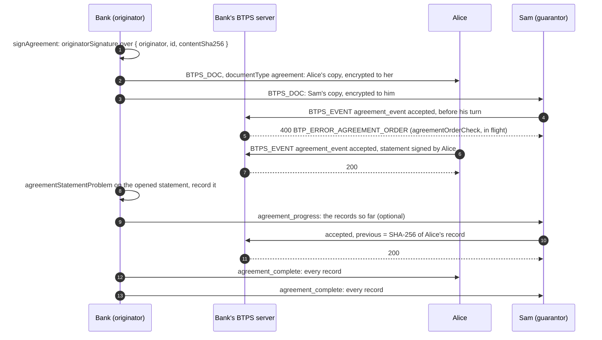

# Agreements

> **Since 1.2.** An agreement travels in `1.2.0` artifacts only.

**What it is.** `agreement` is a fifth document type: a letter that asks its signers to accept it, such as a loan contract, a tenancy or a phone plan. Each signer answers `accepted` or `declined` with a signed statement, in turn or in any order, and the originator collects the answers into an [evidence bundle](./evidenceBundles.md) anyone can check offline.

**Why.** Contracts are still signed by email links and portals. Over BTPS the agreement and every answer are signed artifacts between parties who already trust each other, so the proof of who accepted what, and when, is in the artifacts themselves.

An agreement travels under a trust that grants `send:agreement` (`send:letter` never covers one).

## The flow, in turn



With `signingOrder: "any"`, signers answer in any order and no statement names a `previous`. A `declined` answer ends a sequential agreement: no one answers after it.

## The agreement

Each signer gets its own copy, encrypted to it; every copy has the same content, so any copy checks offline.

```json btps=document:BTPS_DOC
{
  "type": "agreement",
  "title": "Home loan agreement",
  "id": "AGR-1",
  "issuedAt": "2026-10-19T00:00:00.000Z",
  "body": {
    "format": "markdown",
    "content": "# Home loan\n\nThe terms are attached. Each of you accepts them in turn."
  },
  "attachments": [
    {
      "content": "JVBERi0xLjcgSG9tZSBsb2FuIHRlcm1zOiA2LjElIHAuYS4gb3ZlciAzMCB5ZWFycw==",
      "type": "application/pdf",
      "filename": "terms.pdf",
      "size": 49,
      "sha256": "879045b6f068c6187f025ba1ef44bfa5976c9826e68e6fe6f1956c8ea2044b01"
    }
  ],
  "acceptance": {
    "by": "2026-11-30T00:00:00.000Z",
    "terms": ["879045b6f068c6187f025ba1ef44bfa5976c9826e68e6fe6f1956c8ea2044b01"],
    "signers": [
      { "address": "alice$client.example" },
      { "address": "sam$guarantor.example" },
      { "address": "loans$bank.example" }
    ],
    "signingOrder": "sequential"
  },
  "originatorSignature": {
    "selector": "btps1",
    "signature": {
      "algorithmHash": "sha256",
      "value": "BASE64-SIGNATURE",
      "fingerprint": "BASE64-FINGERPRINT"
    }
  }
}
```

| Field                     | Means                                                                                                                                                                    |
| ------------------------- | ------------------------------------------------------------------------------------------------------------------------------------------------------------------------ |
| `acceptance.signers`      | who accepts it: 1 to 20 addresses, each once. The originator may be one (a bank that countersigns). Signed content, so it cannot change after sending                    |
| `acceptance.signingOrder` | `sequential` (in list order) or `any`                                                                                                                                    |
| `acceptance.terms`        | the SHA-256 of each attachment that is a term. May be empty: an acceptance always covers the whole signed content                                                        |
| `acceptance.by`           | optional deadline: each answer is signed no later than it                                                                                                                |
| `originatorSignature`     | the originator's signature over `{ originator, id, contentSha256 }`, where `contentSha256` is the SHA-256 of the agreement's RFC 8785 form without `originatorSignature` |

A letter never carries `acceptance`, and an agreement always does, so the type and the block cannot disagree.

## An answer

A signer answers with an `agreement_event` in a `BTPS_EVENT`, whose `relatesTo` names its own copy. Its `statement` is a **statement record**: the signed statement, and how it was signed.

```json btps=document:BTPS_EVENT
{
  "type": "agreement_event",
  "id": "5d6e7f80-9102-4a3b-8c4d-5e6f708192a3",
  "occurredAt": "2026-11-02T00:00:00.000Z",
  "eventType": "accepted",
  "agreement": {
    "originator": "loans$bank.example",
    "id": "AGR-1",
    "contentSha256": "fabe09ee458f0f7b3091ff62d7927edee1a7e6b4a74695c6ffa0c928ad861ebc"
  },
  "statement": {
    "statement": {
      "agreement": {
        "originator": "loans$bank.example",
        "id": "AGR-1",
        "contentSha256": "fabe09ee458f0f7b3091ff62d7927edee1a7e6b4a74695c6ffa0c928ad861ebc"
      },
      "terms": ["879045b6f068c6187f025ba1ef44bfa5976c9826e68e6fe6f1956c8ea2044b01"],
      "signer": "alice$client.example",
      "decision": "accepted",
      "signedAt": "2026-11-02T00:00:00.000Z"
    },
    "selector": "btps1",
    "signature": {
      "algorithmHash": "sha256",
      "value": "BASE64-SIGNATURE",
      "fingerprint": "BASE64-FINGERPRINT"
    }
  }
}
```

- **Identity or device.** A record with `selector` was signed by the signer's identity key, which may be a managed key its provider holds. One signed on a device carries instead `delegatedArtifact`: the whole event artifact that delivered it, as it arrived, which the originator adds on receipt so the record stays checkable offline. The key kind is a fact of the record, never a field.
- **`previous`**, in a sequential agreement, on every statement after the first: the SHA-256 of the record before it (`statementRecordSha256`), signature included.
- **`terms`** repeats the agreement's terms exactly; **`signedAt`** is the signer's own signed time, which the deadline is checked against.
- **An answer is final.** It is never withdrawn; a change is a new agreement.

A decline may carry a note:

```json btps=document:BTPS_EVENT
{
  "type": "agreement_event",
  "id": "6e7f8091-a213-4b4c-9d5e-6f708192a3b4",
  "occurredAt": "2026-11-02T00:00:00.000Z",
  "eventType": "declined",
  "agreement": {
    "originator": "loans$bank.example",
    "id": "AGR-1",
    "contentSha256": "fabe09ee458f0f7b3091ff62d7927edee1a7e6b4a74695c6ffa0c928ad861ebc"
  },
  "statement": {
    "statement": {
      "agreement": {
        "originator": "loans$bank.example",
        "id": "AGR-1",
        "contentSha256": "fabe09ee458f0f7b3091ff62d7927edee1a7e6b4a74695c6ffa0c928ad861ebc"
      },
      "terms": ["879045b6f068c6187f025ba1ef44bfa5976c9826e68e6fe6f1956c8ea2044b01"],
      "signer": "alice$client.example",
      "decision": "declined",
      "signedAt": "2026-11-02T00:00:00.000Z"
    },
    "selector": "btps1",
    "signature": {
      "algorithmHash": "sha256",
      "value": "BASE64-SIGNATURE",
      "fingerprint": "BASE64-FINGERPRINT"
    }
  },
  "message": { "format": "markdown", "content": "The rate is not what we discussed." }
}
```

The originator's own events, `agreement_progress` (the records so far, before a sequential signer's turn) and `agreement_complete` (every record, once all have answered), carry `statements` instead: records only, never the agreement again.

## The code

From the agreement journey (`tests/e2e/agreements.e2e.test.ts`), which runs this flow over real servers.

### The originator sends

```ts
import { signAgreement } from '@btps/sdk/trust';

const agreement = await signAgreement(
  {
    type: 'agreement',
    title: 'Home loan agreement',
    id: 'AGR-1',
    issuedAt: new Date().toISOString(),
    body: { format: 'markdown', content: '# Home loan\n\nThe terms are attached.' },
    attachments: [terms], // { content, type, filename, size, sha256 }
    acceptance: {
      by: '2026-11-30T00:00:00.000Z',
      terms: [terms.sha256],
      signers: [{ address: 'alice$client.example' }, { address: 'sam$guarantor.example' }],
      signingOrder: 'sequential',
    },
  },
  { originator: 'loans$bank.example', selector: 'btps1', pemFiles: bankKeys },
);

// One copy per signer, encrypted to each, as a BTPS_DOC with documentType 'agreement'.
for (const signer of signers) {
  const copy = await signEncrypt(
    signer,
    bankSender,
    {
      version: '1.2.0',
      type: 'BTPS_DOC',
      from: bank,
      to: signer,
      selector: 'btps1',
      documentType: 'agreement',
      document: agreement,
    },
    encrypted,
  );
  // Record each copy sent: an answer's relatesTo names it.
}
```

### A signer answers

```ts
import { agreementRef, signStatement, statementRecordSha256 } from '@btps/sdk/trust';

const record = await signStatement(
  {
    agreement: agreementRef(agreement, 'loans$bank.example'),
    terms: agreement.acceptance.terms,
    signer: 'sam$guarantor.example',
    decision: 'accepted',
    signedAt: new Date().toISOString(),
    previous: statementRecordSha256(alicesRecord), // sequential, after the first
  },
  { selector: 'btps1', pemFiles: samKeys },
);
// Sent as a BTPS_EVENT to the bank, relatesTo Sam's copy, carrying:
const event = {
  type: 'agreement_event',
  id: eventId, // the artifact's own id
  occurredAt: new Date().toISOString(),
  eventType: 'accepted',
  agreement: agreementRef(agreement, 'loans$bank.example'),
  statement: record,
};
```

On a device, `signStatementOnDevice` signs with the device key, and the originator completes the record with `deviceStatementRecord` and the delegated artifact that delivered it.

### The originator checks the order, in flight

The order of the answers is the originator's data, so the server never checks it; the originator's platform adds `agreementOrderCheck` with its own record of each agreement. It refuses an answer out of turn **before it is opened**, from the envelope alone:

```js
import { agreementOrderCheck } from '@btps/sdk/server/core';

export default function createMiddleware() {
  return [
    agreementOrderCheck({
      // The platform's record of the agreement whose copy `relatesTo` names, sent by
      // `originator` to `signer`: its signers, signingOrder, and the answers so far.
      answers: ({ relatesTo, signer, originator }) =>
        agreements.answersByCopy({ copyId: relatesTo, signer, originator }),
    }),
  ];
}
```

In the journey, Sam answering before Alice is refused `400 BTP_ERROR_AGREEMENT_ORDER`, and Alice answering twice is refused the same way.

### The originator checks the statement, once opened

```ts
import { agreementStatementProblem, statementRecordSha256 } from '@btps/sdk/trust';

const problem = agreementStatementProblem(
  { from: artifact.from, to: artifact.to },
  openedEvent, // the agreement_event
  agreement, // the originator's own copy
  takenSoFar, // the statement records already taken, in order
);
if (problem) return refuse(problem);
takenSoFar.push(openedEvent.statement);
```

It checks the statement is its event's decision, names this agreement and its terms exactly, is its sender's own, was signed by the deadline, and follows the order (`agreementOrderProblem` for its `previous`). Signatures are `statementSignatureFacts`' ([Evidence bundles](./evidenceBundles.md)).

## Errors

| Code                            | Status | Who refuses                                    | When                                                                                                                                                          |
| ------------------------------- | ------ | ---------------------------------------------- | ------------------------------------------------------------------------------------------------------------------------------------------------------------- |
| `BTP_ERROR_AGREEMENT_ORDER`     | 400    | `agreementOrderCheck` (the originator's)       | an answer from someone not listed, a second answer, a sequential answer before its turn, or anything after a decline                                          |
| `BTP_ERROR_PERMISSION`          | 403    | the receiver's server                          | an agreement under a trust that does not grant `send:agreement`                                                                                               |
| `BTP_ERROR_VALIDATION`          | 400    | the receiver's server, or `decryptVerify`      | an agreement without `acceptance`, a letter with it, a `withdrawn` naming an answer, an event whose agreement's originator is neither its `from` nor its `to` |
| `BTP_ERROR_VERSION_UNSUPPORTED` | 400    | a 1.1 receiver                                 | an agreement is `1.2.0` only                                                                                                                                  |
| (a problem, not a code)         | —      | `agreementStatementProblem` (the originator's) | the opened statement does not answer its agreement                                                                                                            |

## Protocol and platform

| The protocol (the server)                                       | The platform (you)                                                       |
| --------------------------------------------------------------- | ------------------------------------------------------------------------ |
| checks an answer's structure, signatures, trust and permissions | keeps each agreement's signers, order and answers taken                  |
| never checks the order: it is the originator's data             | adds `agreementOrderCheck`; runs `agreementStatementProblem` once opened |
|                                                                 | sends `agreement_progress` and `agreement_complete` when it chooses      |
|                                                                 | builds the [evidence bundle](./evidenceBundles.md)                       |

The rules in full: [Agreement](../protocol/specifications/transporter-artifact.md#agreement) and [Agreement events](../protocol/specifications/transporter-artifact.md#agreement-events).
