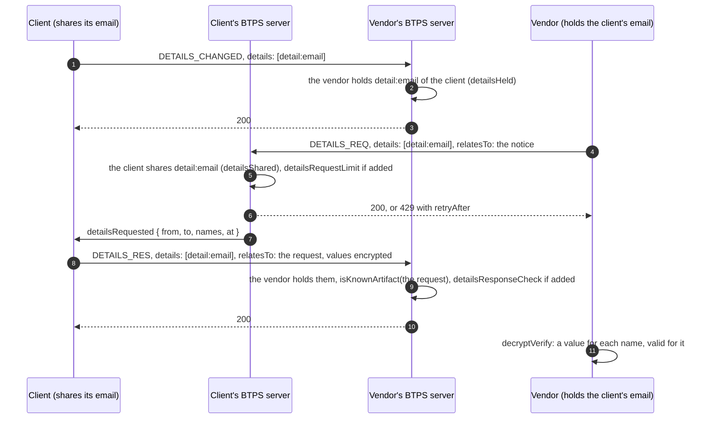

# Details refresh

> **Since 1.2.** The three details types travel in `1.2.0` artifacts only.

**What it is.** Each side of an active trust with [permissions](./trustPermissions.md) can tell the other that its details changed, ask for them again, and answer, but only for the details it already holds by that trust. Three artifact types, each delivered like any other:

| Type              | Says                  | Envelope (signed, readable)                                                     | Document                              |
| ----------------- | --------------------- | ------------------------------------------------------------------------------- | ------------------------------------- |
| `DETAILS_CHANGED` | "my details changed"  | `details`: the names that changed                                               | no values; an optional `message`      |
| `DETAILS_REQ`     | "send me these again" | `details`: the names wanted; `relatesTo` (optional): the notice it follows      | no values; an optional `message`      |
| `DETAILS_RES`     | "here they are"       | `details`: the names it answers; `relatesTo` (required): the request it answers | the values, by name, always encrypted |

**Why.** A business's address or a person's email changes. Rather than a new trust request, the side that holds a detail fetches it again, and only that detail: the record's `detailsHeld` (what this side holds of the other) and `detailsShared` (what it gave) bound every step, and the names are checked on the envelope without opening anything.

It works over the trust in either direction.

## The flow



## The artifacts

The notice, readable, with no values:

```json btps=transporter
{
  "version": "1.2.0",
  "id": "1a2b3c4d-5e6f-4708-9a1b-2c3d4e5f6071",
  "issuedAt": "2026-11-08T02:00:00.000Z",
  "type": "DETAILS_CHANGED",
  "from": "pay$client.example",
  "to": "billing$vendor.example",
  "selector": "btps1",
  "details": ["detail:email"],
  "document": { "message": { "format": "text", "content": "New email from December." } },
  "encryption": null,
  "signature": {
    "algorithmHash": "sha256",
    "value": "BASE64-SIGNATURE",
    "fingerprint": "BASE64-FINGERPRINT"
  }
}
```

The request, following the notice:

```json btps=transporter
{
  "version": "1.2.0",
  "id": "2b3c4d5e-6f70-4819-8a2b-3c4d5e6f7182",
  "issuedAt": "2026-11-08T02:01:00.000Z",
  "type": "DETAILS_REQ",
  "from": "billing$vendor.example",
  "to": "pay$client.example",
  "selector": "btps1",
  "details": ["detail:email"],
  "relatesTo": "1a2b3c4d-5e6f-4708-9a1b-2c3d4e5f6071",
  "document": {},
  "encryption": null,
  "signature": {
    "algorithmHash": "sha256",
    "value": "BASE64-SIGNATURE",
    "fingerprint": "BASE64-FINGERPRINT"
  }
}
```

The response, naming the request it answers. Its values are always encrypted:

```json btps=transporter
{
  "version": "1.2.0",
  "id": "3c4d5e6f-7081-492a-9b3c-4d5e6f708193",
  "issuedAt": "2026-11-08T02:02:00.000Z",
  "type": "DETAILS_RES",
  "from": "pay$client.example",
  "to": "billing$vendor.example",
  "selector": "btps1",
  "details": ["detail:email"],
  "relatesTo": "2b3c4d5e-6f70-4819-8a2b-3c4d5e6f7182",
  "document": "BASE64-OF-THE-ENCRYPTED-DOCUMENT",
  "encryption": {
    "algorithm": "aes-256-gcm",
    "encryptedKey": "BASE64-KEY",
    "iv": "BASE64-IV",
    "type": "standardEncrypt",
    "authTag": "BASE64-TAG"
  },
  "signature": {
    "algorithmHash": "sha256",
    "value": "BASE64-SIGNATURE",
    "fingerprint": "BASE64-FINGERPRINT"
  }
}
```

Opened, its document holds each name's value, as in a trust answer:

```json btps=document:DETAILS_RES
{ "detail:email": "bob@client.example" }
```

A response may answer part of a request: it names only what it carries.

## The code

### Sending, from a device

Each step is its own agent action. The device's provider checks the names first, from the user's own record of the trust, as the receiver will.

```ts
await agent.command('details.changed', 'billing$vendor.example', {}, { details: ['detail:email'] });

await agent.command('details.request', 'pay$client.example', {}, { details: ['detail:email'] });

await agent.command(
  'details.respond',
  'billing$vendor.example',
  { 'detail:email': 'bob@client.example' },
  {
    details: ['detail:email'],
    relatesTo: requestId,
    encryption: { algorithm: 'aes-256-gcm', mode: 'standardEncrypt' },
  },
);
```

### The platform's two checks

Both read records only the platform keeps, so they are middleware the platform adds, off until it does (`@btps/sdk/server/core`). From the feature journey (`tests/e2e/features.e2e.test.ts`):

```js
import { detailsRequestLimit, detailsResponseCheck } from '@btps/sdk/server/core';

export default function createMiddleware() {
  return [
    // A response answers a DETAILS_REQ its receiver sent to its sender, and names only what it asked.
    detailsResponseCheck({
      getArtifact: ({ artifactId, from, to }) => artifacts.envelope({ artifactId, from, to }),
    }),
    // Last, so only taken requests count: the provider's own limit, e.g. ten a month per trust.
    detailsRequestLimit(async ({ from, to }) =>
      (await counts.thisMonth(from, to)) < 10
        ? true
        : { retryAfter: await counts.secondsToNextMonth() },
    ),
  ];
}
```

In the journey, a second request over a limit of one is answered `429` with `retryAfter: 60`, and a response naming `detail:address` to a request for `detail:email` is refused: "detail:address was not asked for".

### Hearing about them

```ts
server.on('detailsRequested', ({ from, to, names, at }) =>
  audit.record('asked', { from, to, names, at }),
);
// On the device's provider: each response that passed every check.
server.on('detailsShared', ({ from, to, names, at }) =>
  audit.record('shared', { from, to, names, at }),
);
```

## Errors

| Code                             | Status | Who refuses                                       | When                                                                                                                                        |
| -------------------------------- | ------ | ------------------------------------------------- | ------------------------------------------------------------------------------------------------------------------------------------------- |
| `BTP_ERROR_DETAILS_NOT_HELD`     | 403    | the receiving server, and a device's own provider | a name the receiver does not hold (a notice or response) or the answerer does not share (a request); a trust without permissions holds none |
| `BTP_ERROR_PERMISSION`           | 403    | the receiving server                              | a response whose request the receiver does not know (`isKnownArtifact`)                                                                     |
| `BTP_ERROR_PERMISSION`           | 403    | `detailsResponseCheck` (the platform's)           | a response to a request its receiver did not send to its sender, or naming what it did not ask; the reason is in the message                |
| `BTP_ERROR_DETAILS_RATE_LIMITED` | 429    | `detailsRequestLimit` (the platform's)            | over the provider's own limit; `status.retryAfter` says how many seconds to wait                                                            |
| `BTP_ERROR_VALIDATION`           | 400    | `decryptVerify`                                   | an opened response whose values do not match its names                                                                                      |
| `BTP_ERROR_VALIDATION`           | 400    | a 1.1 server                                      | it does not know these types, so the sender is not told it speaks 1.1                                                                       |

The receiving server's refusals reach the sender as themselves, with their code, so its platform can say which detail the trust does not cover.

`isKnownArtifact` is the trust store's: a platform that takes details responses records the requests it sends. `JsonTrustStore` keeps no artifacts, so a server using it as is takes no `DETAILS_RES`.

## Protocol and platform

| The protocol (the server)                                     | The platform (you)                                                                         |
| ------------------------------------------------------------- | ------------------------------------------------------------------------------------------ |
| checks every name against `detailsHeld` / `detailsShared`     | writes those records when the trust is answered                                            |
| checks a response answers a known request (`isKnownArtifact`) | records the requests it sends, so `isKnownArtifact` can answer                             |
| refuses unopened, from the envelope                           | adds `detailsResponseCheck` and `detailsRequestLimit` if it wants them; sets its own limit |
| `decryptVerify` checks the opened values                      | saves the new values and shows who fetched what (`detailsRequested`, `detailsShared`)      |

Plain functions for a platform that checks another way: `detailsNamesRefusal`, `detailsRequestRefusal`, `detailsProblem` (`@btps/sdk/trust`). The rules in full: [Details refresh](../protocol/specifications/transporter-artifact.md#details-refresh).
