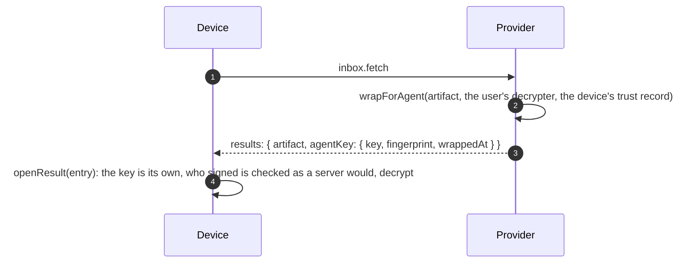
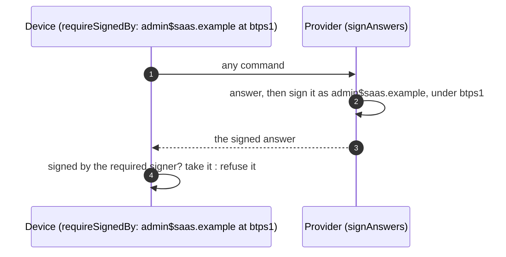

# Devices

> **Since 1.2.** Each of the four below; sync travels in `1.2.0` artifacts only.

A device (a phone, a desktop app) acts for its user through the user's provider, with its own key and a delegation. This page covers four things a device relies on. Refresh tokens and key rotation have their own page: [Refresh tokens](./refreshTokens.md).

| What                                                | Why                                                                                           |
| --------------------------------------------------- | --------------------------------------------------------------------------------------------- |
| **A device's own key to its documents**             | a device opens an encrypted document without the provider ever decrypting it for it           |
| **Signed answers, and a device that requires them** | a device knows an answer came from its own provider, not from whoever answered the connection |
| **Sync**                                            | the user's other devices see what one device sent                                             |
| **`meta.delivery`**                                 | a device sees whether each send was delivered, by its provider's own record                   |

## A device's own key to its documents

The provider wraps an encrypted artifact's content key again, to the device that asked, and returns it with the query result as `agentKey`. The artifact itself is untouched, so its signature still verifies.



```json btps=response
{
  "version": "1.2.0",
  "id": "a1b2c3d4-e5f6-4071-8a9b-0c1d2e3f4a5b",
  "issuedAt": "2026-11-08T04:00:00.000Z",
  "type": "btps_response",
  "reqId": "f0e1d2c3-b4a5-4697-8879-6a5b4c3d2e1f",
  "status": { "ok": true, "code": 200 },
  "document": {
    "results": [
      {
        "artifact": {
          "version": "1.2.0",
          "id": "6f0d8e2a-7b1c-4e3d-9a5f-1c2b3d4e5f60",
          "issuedAt": "2026-11-08T01:00:00.000Z",
          "type": "BTPS_DOC",
          "from": "billing$vendor.example",
          "to": "alice$saas.example",
          "selector": "btps1",
          "document": "BASE64-OF-THE-ENCRYPTED-DOCUMENT",
          "encryption": {
            "algorithm": "aes-256-gcm",
            "encryptedKey": "BASE64-KEY",
            "iv": "BASE64-IV",
            "type": "standardEncrypt",
            "authTag": "BASE64-TAG"
          },
          "signature": {
            "algorithmHash": "sha256",
            "value": "BASE64-SIGNATURE",
            "fingerprint": "BASE64-FINGERPRINT"
          }
        },
        "agentKey": {
          "key": "BASE64-KEY-WRAPPED-TO-THE-DEVICE",
          "fingerprint": "BASE64-DEVICE-KEY-FINGERPRINT",
          "wrappedAt": "2026-11-08T04:00:00.000Z"
        }
      }
    ]
  }
}
```

From the device journey (`tests/e2e/devices.e2e.test.ts`).

**The provider**, answering `inbox.fetch`:

```ts
import { wrapForAgent } from '@btps/sdk/server';
import { PemDecrypter } from '@btps/sdk/crypto';
import { computeAgentTrustId } from '@btps/sdk/trust';

const identityDecrypter = new PemDecrypter({ privateKey: userPrivateKey }); // or a KMS-backed Decrypter with unwrapKey
const device = await trustStore.getById(computeAgentTrustId(artifact.agentId, user));
const results = await Promise.all(
  inbox.map(async (received) =>
    received.encryption && device
      ? { artifact: received, agentKey: await wrapForAgent(received, identityDecrypter, device) }
      : { artifact: received },
  ),
);
```

**The device:**

```ts
const { response } = await agent.command('inbox.fetch', user, { limit: 10 });
for (const entry of response.document.results) {
  const { payload, error } = await agent.openResult(entry);
  // payload.document is the opened document; another device's key gets an error, not a document.
}
```

`openResult` refuses a key wrapped to another device key: a device that has just rotated finishes moving to its new key first.

## Signed answers, and a device that requires them

A server with `signAnswers` signs every answer, errors included, as its `serverIdentity` under its `selector`. A client with `requireSignedBy` takes no answer but one signed by that signer, and refuses any other **before it looks up a key**.



```ts
// The provider: one key pair, its operator's, signs identity-lookup answers and every answer.
const server = new BtpsServer({
  serverIdentity: { identity: 'admin$saas.example', publicKey, privateKey, selector: 'btps1' },
  signAnswers: true,
  // ...
});

// The device pins its provider's operator.
const agent = new BtpsAgent({
  agent: { id: agentId, identityKey: devicePrivateKey, identityCert: devicePublicKey },
  btpIdentity: 'alice$saas.example',
  requireSignedBy: { identity: 'admin$saas.example', selector: 'btps1' },
});
```

**One key pair.** `serverIdentity` is the domain's operator, whose key already signs identity-lookup answers, so a provider keeps one key pair and its app pins the operator. Every 1.1 and 1.2 client takes a lookup answer only from the operator.

A client acts on an answer's `status.closing` only once the answer is taken: with `requireSignedBy`, only in one signed as required ([Protocol versions](./versions.md#the-closing-signal)).

## Sync

A device's sync is an `artifact.send` to the user's **own** address that names the send it copies on its envelope, `syncOf: { id, sha256 }` (`syncOfArtifact` computes it). Its provider files it unopened, for the user's other devices.

```ts
import { syncOfArtifact } from '@btps/sdk/crypto';

await agent.command('artifact.send', user, copyOfTheDocument, {
  signature: { algorithmHash: 'sha256' },
  syncOf: syncOfArtifact(theSentArtifact),
});
```

The artifact it carries:

```json btps=transporter
{
  "version": "1.2.0",
  "id": "7c6b5a49-3827-4615-8c4d-3e2f1a0b9c8d",
  "issuedAt": "2026-11-08T04:05:00.000Z",
  "type": "BTPS_DOC",
  "from": "alice$saas.example",
  "to": "alice$saas.example",
  "selector": "btps1",
  "syncOf": {
    "id": "6f0d8e2a-7b1c-4e3d-9a5f-1c2b3d4e5f60",
    "sha256": "bbbbbbbbbbbbbbbbbbbbbbbbbbbbbbbbbbbbbbbbbbbbbbbbbbbbbbbbbbbbbbbb"
  },
  "document": "BASE64-OF-THE-ENCRYPTED-DOCUMENT",
  "encryption": {
    "algorithm": "aes-256-gcm",
    "encryptedKey": "BASE64-KEY",
    "iv": "BASE64-IV",
    "type": "standardEncrypt",
    "authTag": "BASE64-TAG"
  },
  "signature": {
    "algorithmHash": "sha256",
    "value": "BASE64-SIGNATURE",
    "fingerprint": "BASE64-FINGERPRINT"
  }
}
```

A sync is only from and to the same address, only in `1.2.0`, and only inside a device's `artifact.send`. A server refuses one sent to it directly (`BTP_ERROR_SYNC_NOT_ALLOWED`), before its signature is checked.

## `meta.delivery` on the sentbox

A `sentbox.fetch` result may carry each send's outcome by the provider's own record:

```json btps=response
{
  "version": "1.2.0",
  "id": "b2c3d4e5-f607-4182-9a3b-4c5d6e7f8091",
  "issuedAt": "2026-11-08T04:10:00.000Z",
  "type": "btps_response",
  "reqId": "e1d2c3b4-a596-4877-8695-a4b3c2d1e0f9",
  "status": { "ok": true, "code": 200 },
  "document": {
    "results": [
      {
        "artifact": {
          "version": "1.2.0",
          "id": "6f0d8e2a-7b1c-4e3d-9a5f-1c2b3d4e5f60",
          "issuedAt": "2026-11-08T01:00:00.000Z",
          "type": "BTPS_DOC",
          "from": "alice$saas.example",
          "to": "billing$vendor.example",
          "selector": "btps1",
          "document": "BASE64-OF-THE-ENCRYPTED-DOCUMENT",
          "encryption": {
            "algorithm": "aes-256-gcm",
            "encryptedKey": "BASE64-KEY",
            "iv": "BASE64-IV",
            "type": "standardEncrypt",
            "authTag": "BASE64-TAG"
          },
          "signature": {
            "algorithmHash": "sha256",
            "value": "BASE64-SIGNATURE",
            "fingerprint": "BASE64-FINGERPRINT"
          }
        },
        "meta": { "delivery": { "status": "delivered", "at": "2026-11-08T01:00:01.000Z" } }
      }
    ]
  }
}
```

`status` is `pending`, `delivered` or `failed`, with the error `code` when it failed.

## Errors

| Code                         | Status | Who refuses                        | When                                                                             |
| ---------------------------- | ------ | ---------------------------------- | -------------------------------------------------------------------------------- |
| `BTP_ERROR_SIG_VERIFICATION` | 401    | the device, with `requireSignedBy` | an answer not signed by the required signer, under the required selector         |
| `BTP_ERROR_SYNC_NOT_ALLOWED` | 403    | any server                         | a sync sent to it directly, not inside a device's `artifact.send`                |
| an error, no payload         | —      | `openResult`                       | an `agentKey` wrapped to another key, or an artifact whose signer does not check |

## Protocol and platform

The protocol defines `agentKey`, `syncOf`, `meta.delivery` and signed answers. Wrapping keys, filing syncs for the user's other devices, keeping each send's delivery record, and turning on `signAnswers` are the provider's; requiring a signature is the device app's. The rules in full: [Sync](../protocol/specifications/transporter-artifact.md#sync), [Agent Artifact](../protocol/specifications/agent-artifact.md).
