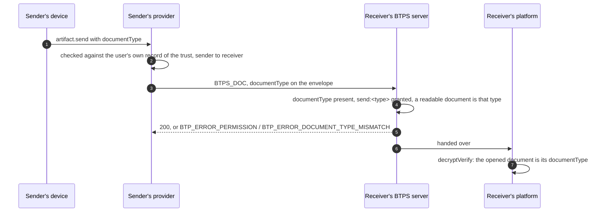

# A send's document type

> **Since 1.2.** `documentType` travels in `1.2.0` artifacts only.

**What it is.** Under a trust with [permissions](./trustPermissions.md), every `BTPS_DOC` names its type on the envelope, `documentType` (`invoice`, `receipt`, `payslip`, `letter` or `agreement`), and the receiving server refuses it unless the trust grants `send:<documentType>`.

**Why.** The document is usually encrypted, so the server cannot read its type. The name on the envelope is signed and readable, so the server checks it on arrival, and the receiver's platform checks once it opens the document that it is the type the envelope named. A receiver who granted invoices only gets invoices only.

A trust without permissions (one made before 1.2, or with a 1.1 provider) takes any document type, and sends under it carry no `documentType`. Events need none: `relatesTo` ties each to the document it is about.

## The flow



## The artifact

A readable invoice sent under a trust that grants `send:invoice`:

```json btps=transporter
{
  "version": "1.2.0",
  "id": "6f0d8e2a-7b1c-4e3d-9a5f-1c2b3d4e5f60",
  "issuedAt": "2026-11-08T01:00:00.000Z",
  "type": "BTPS_DOC",
  "from": "billing$vendor.example",
  "to": "pay$client.example",
  "selector": "btps1",
  "documentType": "invoice",
  "document": {
    "type": "invoice",
    "title": "November",
    "id": "INV-1001",
    "issuedAt": "2026-11-08T01:00:00.000Z",
    "totalAmount": { "amount": 150000, "currency": "AUD" },
    "lineItems": {
      "columns": ["Item", "Amount"],
      "rows": [{ "Item": "Website build", "Amount": 150000 }]
    }
  },
  "encryption": null,
  "signature": {
    "algorithmHash": "sha256",
    "value": "BASE64-SIGNATURE",
    "fingerprint": "BASE64-FINGERPRINT"
  }
}
```

Encrypted, the envelope is the same and `document` is the ciphertext: the server checks the name, and `decryptVerify` checks the type when the receiver opens it.

A send whose type is not granted is answered:

```json btps=response
{
  "version": "1.2.0",
  "id": "0b1c2d3e-4f50-4617-8293-a4b5c6d7e8f9",
  "issuedAt": "2026-11-08T01:00:01.000Z",
  "type": "btps_error",
  "reqId": "6f0d8e2a-7b1c-4e3d-9a5f-1c2b3d4e5f60",
  "status": {
    "ok": false,
    "code": 403,
    "error": "BTP_ERROR_PERMISSION",
    "message": "This trust does not permit it"
  }
}
```

## The code

### From a device

`artifact.send` takes `documentType`. Before it goes, the device's own provider checks it as the receiver will, from the user's own record of the trust in its direction.

```ts
const result = await agent.command('artifact.send', 'pay$client.example', invoice, {
  documentType: 'invoice',
  encryption: { algorithm: 'aes-256-gcm', mode: 'standardEncrypt' },
});
```

### From a platform's server

Put `documentType` on the payload `signEncrypt` signs. `signEncrypt` refuses to sign a document that is not its `documentType`, before it encrypts it.

```ts
const { payload, error } = await signEncrypt(
  to,
  { accountName, domainName, pemFiles },
  {
    version: '1.2.0',
    type: 'BTPS_DOC',
    from,
    to,
    selector: 'btps1',
    documentType: 'invoice',
    document: invoice,
  },
  {
    signature: { algorithmHash: 'sha256' },
    encryption: { algorithm: 'aes-256-gcm', mode: 'standardEncrypt' },
  },
);
```

### On the receiving side

Nothing to add: the server checks the envelope on arrival, and `decryptVerify` checks the opened document. `documentTypeProblem(artifact, record)` (`@btps/sdk/trust`) runs the arrival check alone, for a platform that checks before it decides anything.

The feature journey (`tests/e2e/permissions.e2e.test.ts`) tries all five document types under every grant: each is taken exactly when its `send:` name is granted, and `send:letter` never covers an agreement.

## Errors

| Code                               | Status | Who refuses                                                                               | When                                                                                   |
| ---------------------------------- | ------ | ----------------------------------------------------------------------------------------- | -------------------------------------------------------------------------------------- |
| `BTP_ERROR_PERMISSION`             | 403    | the receiving server, and the sender's own provider for a device                          | no `documentType` under a trust with permissions, or `send:<documentType>` not granted |
| `BTP_ERROR_DOCUMENT_TYPE_MISMATCH` | 400    | the receiving server (readable), `decryptVerify` (opened), `signEncrypt` (before sending) | the document is not the type its envelope names                                        |
| `BTP_ERROR_VALIDATION`             | 400    | the receiving server                                                                      | `documentType` on another artifact type, or in a `1.1.0` artifact                      |

## Protocol and platform

The server does every check here, on arrival, from the trust record the platform wrote. The platform's only part is to grant `send:` names when the user does ([Trust permissions](./trustPermissions.md)), and to set `documentType` when it sends. The rules in full: [A send's document type](../protocol/specifications/transporter-artifact.md#a-sends-document-type).
