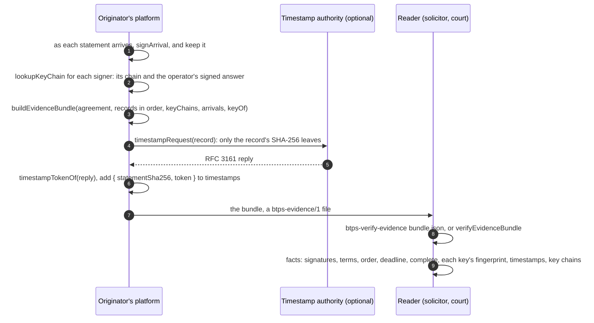

# Evidence bundles and trusted timestamps

> **Since 1.2.**

**What it is.** An evidence bundle is one file a party to an [agreement](./agreements.md) makes to show what was agreed: the signed agreement, every signer's statement record in order, and the public key behind each signature. Anyone can check it offline, with no provider, no network and no decryption key, in code or from the command line. A bundle may also carry an RFC 3161 **trusted timestamp** for each statement, from a timestamp authority, so it still proves when a statement was signed after keys have rotated. And it may keep each signer's **[key chain](./keyRotation.md)**, and when each statement **arrived**, so it shows when each key was valid long after it was rotated away or expired.

**Why.** A dispute goes to a solicitor or a court, who has neither the parties' providers nor their keys. The bundle carries everything needed, and reports facts, never a verdict.

Whoever receives a bundle sees everything in it, by design. BTPS never publishes one; a party chooses to make and disclose it.

## The flow



## The bundle

A shortened bundle, one signer and one key shown:

```json btps=bundle
{
  "format": "btps-evidence/1",
  "originator": "loans$bank.example",
  "agreement": {
    "type": "agreement",
    "title": "Home loan agreement",
    "id": "AGR-1",
    "issuedAt": "2026-10-19T00:00:00.000Z",
    "body": { "format": "markdown", "content": "# Home loan\n\nThe terms are attached." },
    "acceptance": {
      "by": "2026-11-30T00:00:00.000Z",
      "terms": [],
      "signers": [{ "address": "alice$client.example" }],
      "signingOrder": "any"
    },
    "originatorSignature": {
      "selector": "btps1",
      "signature": {
        "algorithmHash": "sha256",
        "value": "BASE64-SIGNATURE",
        "fingerprint": "BASE64-FINGERPRINT"
      }
    }
  },
  "statements": [
    {
      "statement": {
        "agreement": {
          "originator": "loans$bank.example",
          "id": "AGR-1",
          "contentSha256": "fabe09ee458f0f7b3091ff62d7927edee1a7e6b4a74695c6ffa0c928ad861ebc"
        },
        "terms": [],
        "signer": "alice$client.example",
        "decision": "accepted",
        "signedAt": "2026-11-02T00:00:00.000Z"
      },
      "selector": "btps1",
      "signature": {
        "algorithmHash": "sha256",
        "value": "BASE64-SIGNATURE",
        "fingerprint": "BASE64-FINGERPRINT"
      }
    }
  ],
  "keys": [
    {
      "identity": "loans$bank.example",
      "selector": "btps1",
      "publicKey": "-----BEGIN PUBLIC KEY-----\nMIIBIjANBg…\n-----END PUBLIC KEY-----",
      "fingerprint": "P3jb2C0c6XutGbtPyrDjDfY+M8IICzA5Ym8YkTZerAs="
    }
  ],
  "timestamps": [
    {
      "statementSha256": "4c1d2e3f405162738495a6b7c8d9e0f1a2b3c4d5e6f708192a3b4c5d6e7f8091",
      "token": "BASE64-OF-THE-RFC-3161-TOKEN"
    }
  ],
  "keyChains": [
    {
      "identity": "loans$bank.example",
      "records": [
        {
          "rotation": {
            "type": "btps.keyRotation.v1",
            "identity": "loans$bank.example",
            "from": {
              "selector": "btps1",
              "fingerprint": "P3jb2C0c6XutGbtPyrDjDfY+M8IICzA5Ym8YkTZerAs=",
              "publicKey": "MIIBIjANBgkqhkiG9w0BAQEFAAOCAQ8AMIIBCgKCAQEA"
            },
            "to": {
              "selector": "btps2",
              "fingerprint": "q7Lw0Zt2b8VdXc5Ko3Rj9Hs6Fe1Gm4Na8Pu2Ty5Wi0E=",
              "publicKey": "MIIBIjANBgkqhkiG9w0BAQEFAAOCAQ8AMIIBCgKCAQEB"
            },
            "at": "2026-11-10T00:00:00.000Z",
            "expiry": "planned",
            "prev": null
          },
          "signatures": [
            {
              "by": "from",
              "algorithmHash": "sha256",
              "value": "BASE64-SIGNATURE",
              "fingerprint": "P3jb2C0c6XutGbtPyrDjDfY+M8IICzA5Ym8YkTZerAs="
            },
            {
              "by": "to",
              "algorithmHash": "sha256",
              "value": "BASE64-SIGNATURE",
              "fingerprint": "q7Lw0Zt2b8VdXc5Ko3Rj9Hs6Fe1Gm4Na8Pu2Ty5Wi0E="
            }
          ]
        }
      ]
    }
  ],
  "arrivals": [
    {
      "statementSha256": "4c1d2e3f405162738495a6b7c8d9e0f1a2b3c4d5e6f708192a3b4c5d6e7f8091",
      "arrivedAt": "2026-11-02T00:00:03.000Z",
      "receivedBy": "loans$bank.example",
      "selector": "btps1",
      "signature": {
        "algorithmHash": "sha256",
        "value": "BASE64-SIGNATURE",
        "fingerprint": "P3jb2C0c6XutGbtPyrDjDfY+M8IICzA5Ym8YkTZerAs="
      }
    }
  ]
}
```

A key counts only when its fingerprint is its own: a bundle cannot pair one key with another's fingerprint. Here the bank rotated `btps1` to `btps2` after the agreement: DNS may no longer have `btps1`, and its chain still carries it. `keyChains[].operatorAnswer`, when the builder keeps it, is the operator's signed answer that served the chain, whole. Its key, like every key in the bundle, is whatever the builder put there.

## What a reader learns

`verifyEvidenceBundle` reports `BTPEvidenceFacts`:

| Fact                       | Means                                                                                                                                                                                                                                                                             |
| -------------------------- | --------------------------------------------------------------------------------------------------------------------------------------------------------------------------------------------------------------------------------------------------------------------------------- |
| `contentSha256`            | the agreement's content hash, as the bundle holds it                                                                                                                                                                                                                              |
| `originatorSignatureValid` | the originator's signature is over this content                                                                                                                                                                                                                                   |
| `originatorKey`            | the key it was checked with: `{ identity, selector, fingerprint }`                                                                                                                                                                                                                |
| `originatorKeyChain`       | that key against the originator's key chain, when the bundle has one (below)                                                                                                                                                                                                      |
| `termsAttached`            | each term is the SHA-256 of one of its attachments, as attached                                                                                                                                                                                                                   |
| `statements[]`             | each statement: `signatureValid`, `keyKind` (`identity` or `device`, with `delegatedBy` and `attestedBy`), `key` (and a device's `delegationKey`), `agreementMatches`, `termsMatch`, `withinDeadline`, `inOrder`, and its `timestamp`, `arrival` and `keyChain`, when it has them |
| `keysConfirmedOnline`      | `false` unless checked `online`: then true when every signing key is confirmed as its identity's, by its chain or DNS                                                                                                                                                             |
| `complete`                 | every fact above holds, and every signer accepted, once                                                                                                                                                                                                                           |

**What `complete` means, plainly.** The bundle is consistent with the keys it carries. It does **not** say each key was its identity's when it signed: a bundle forged with fresh keys labelled as the parties is consistent too. That is why every fingerprint is printed: a reader who needs more anchors the key chains on a fingerprint they kept (`anchors`, `--anchor`), or checks the keys online (`online`, `--online`). Providers make that possible: they never reuse a selector for a different key, and publish a key rotation record for every new key ([Key rotation](./keyRotation.md)).

**A key chain** reports, for a signing key: whether the chain is valid and the key is in it, whether it is anchored, and on what; whether a lost key's rotation in it is unconfirmed (`authorityUnverified`); the operator's answer, when the bundle keeps one (`operatorAnswer`: who signed it, whether its signature holds, whether it is for this chain, and whether the operator's key is anchored). An operator's answer confirms a lost key's rotation only when its key is anchored as the operator of the chain identity's domain: the fingerprint you name for that domain (`operators`, `--operator <domain>=<fingerprint>`), or, online, the key of the operator DNS names there (`--online`). A forger can sign an "operator's answer" with a key they put in the bundle themselves, and a counterparty whose key you kept could sign one for anyone, so a plain `--anchor` never confirms an answer, and an answer by a key nobody named confirms nothing; when the key was rotated away (`rotatedAt`) or expired (`expiredImmediately`); whether the time the signer claims is in the key's window (`signedInWindow`), and the timestamp's time too (`signedInWindowIndependently`). When an owner expires its key from before a statement that, by its timestamp or its signed arrival, had already arrived, `disownedAfterTheFact` says so. The facts in full: [In an evidence bundle](../protocol/specifications/key-rotation.md#in-an-evidence-bundle). A key chain fact never changes `complete`.

**A timestamp** reports `imprintMatches` (over this statement), `signatureValid`, `time`, `authority`, `timestampingKeyUsage` (the signer's certificate is a timestamp authority's: its one extended key usage is timeStamping, critical, as RFC 3161 requires, so a TLS server's certificate under a trusted root is not) and `trusted`, given the roots the reader trusts. A timestamp never changes `complete`.

## The code

### Build it

From the agreement journey (`tests/e2e/agreements.e2e.test.ts`):

```ts
import { buildEvidenceBundle } from '@btps/sdk/trust';

const bundle = buildEvidenceBundle(
  { originator: 'loans$bank.example', agreement, statements: records },
  // The public key behind each signature: the originator's, each identity's, a device's delegator's and attestor's.
  (identity, selector) => keys.lookup(identity, selector),
);
```

It refuses to build without every key it needs (`BTP_ERROR_RESOLVE_PUBKEY`).

### Keep key chains and arrivals

Sign an arrival as each statement arrives, and keep it with the record. When you build, look up each signing identity's chain, with the operator's answer that served it:

```ts check
import { createDefaultKeyResolver, type PemKeys } from '@btps/sdk/crypto';
import {
  signArrival,
  statementRecordSha256,
  type BTPEvidenceKeyChain,
  type BTPStatementRecord,
} from '@btps/sdk/trust';

// As a statement arrives: when, signed by you, then.
export const arrived = (record: BTPStatementRecord, you: string, selector: string, keys: PemKeys) =>
  signArrival(
    {
      statementSha256: statementRecordSha256(record),
      arrivedAt: new Date().toISOString(),
      receivedBy: you,
      selector,
    },
    { pemFiles: keys },
  );

// When you build: each signing identity's chain, asking its host as you.
export async function keyChainsFor(
  identities: string[],
  you: string,
): Promise<BTPEvidenceKeyChain[]> {
  const resolver = createDefaultKeyResolver({ from: you });
  const chains: BTPEvidenceKeyChain[] = [];
  for (const identity of identities) {
    const lookup = await resolver.resolveKeyChain?.(identity);
    if (lookup?.status === 'chain' && lookup.records.length > 0) {
      chains.push({ identity, records: lookup.records, operatorAnswer: lookup.answer });
    }
  }
  return chains;
}
```

Pass them to `buildEvidenceBundle` as `keyChains` and `arrivals`. A key `keyOf` no longer finds, its DNS record retired, is taken from its identity's chain; the keys of the operators and of the arrivals' signer join `keys`.

### Add a trusted timestamp

```ts
import { timestampRequest, timestampTokenOf, statementRecordSha256 } from '@btps/sdk/trust';

const query = await timestampRequest(record); // only the record's SHA-256 leaves the provider
const reply = await fetch('https://tsa.example/rfc3161', {
  method: 'POST',
  headers: { 'content-type': 'application/timestamp-query' },
  body: query,
});
const token = await timestampTokenOf(new Uint8Array(await reply.arrayBuffer()));
bundle.timestamps = [
  ...(bundle.timestamps ?? []),
  { statementSha256: statementRecordSha256(record), token },
];
```

`timestampTokenOf` refuses a reply that granted no token (`BTP_ERROR_VALIDATION`).

### Check it

```ts
import { verifyEvidenceBundle, describeEvidenceFacts } from '@btps/sdk/trust';

const facts = await verifyEvidenceBundle(bundle, {
  trustedTimestampRoots: [tsaRootPem],
  anchors: [keptFingerprint], // a signing key's fingerprint you kept, as its identity's key when you saw it
  operators: { 'client.example': keptOperatorFingerprint }, // a domain's operator's key you kept
});
console.log(describeEvidenceFacts(facts));
```

To confirm each key online as well, pass `online: { resolveKeyChain, retiredKeyGraceSeconds: 0 }`, with a key resolver's `resolveKeyChain`.

From the command line:

```sh
npx -p @btps/sdk btps-verify-evidence bundle.json
npx -p @btps/sdk btps-verify-evidence bundle.json --json
npx -p @btps/sdk btps-verify-evidence bundle.json --timestamp-root tsa-root.pem
npx -p @btps/sdk btps-verify-evidence bundle.json --anchor P3jb2C0c6XutGbtPyrDjDfY+M8IICzA5Ym8YkTZerAs=
npx -p @btps/sdk btps-verify-evidence bundle.json --operator client.example=MKuYNEiUPBKA3VWHwxjZgEgC6axgI3wq9J60E6Yq/ys=
npx -p @btps/sdk btps-verify-evidence bundle.json --online 'you$your.example'
```

`--anchor` and `--operator` are repeatable. `--online` asks each signing identity's host for its chain as the identity you give, and checks DNS.

| Exit code | Means                                                    |
| --------- | -------------------------------------------------------- |
| `0`       | the agreement is complete                                |
| `1`       | it is not; the facts say why                             |
| `2`       | the file could not be read, or is not an evidence bundle |

A key chain fact and an online check never change the exit code. The printed facts end with each key's fingerprint and "keys from the bundle, not confirmed online", unless `--online` confirmed them. The security suite reads a bundle forged with fresh keys this way, and checks that both are shown (`tests/security/reviewFixes.security.test.ts`).

## Errors

| Code                       | Status | Who refuses            | When                                                                                     |
| -------------------------- | ------ | ---------------------- | ---------------------------------------------------------------------------------------- |
| `BTP_ERROR_VALIDATION`     | 400    | `verifyEvidenceBundle` | not an evidence bundle (another format, a missing originator, a record signed both ways) |
| `BTP_ERROR_RESOLVE_PUBKEY` | 401    | `buildEvidenceBundle`  | a key it needs cannot be found                                                           |
| `BTP_ERROR_VALIDATION`     | 400    | `timestampTokenOf`     | the authority granted no token                                                           |

Anything else is a fact, not an error: a signature that does not hold, a term not attached, an answer late or out of order, a key out of its window, a key that cannot be confirmed online.

## Protocol and platform

The protocol defines the file, the signatures and what each fact means. Building a bundle, getting timestamps, signing arrivals, keeping key chains, and deciding when a party may have one are the platform's. Choosing which timestamp authorities to trust is the reader's. The rules in full: [The evidence bundle](../protocol/specifications/transporter-artifact.md#the-evidence-bundle).
