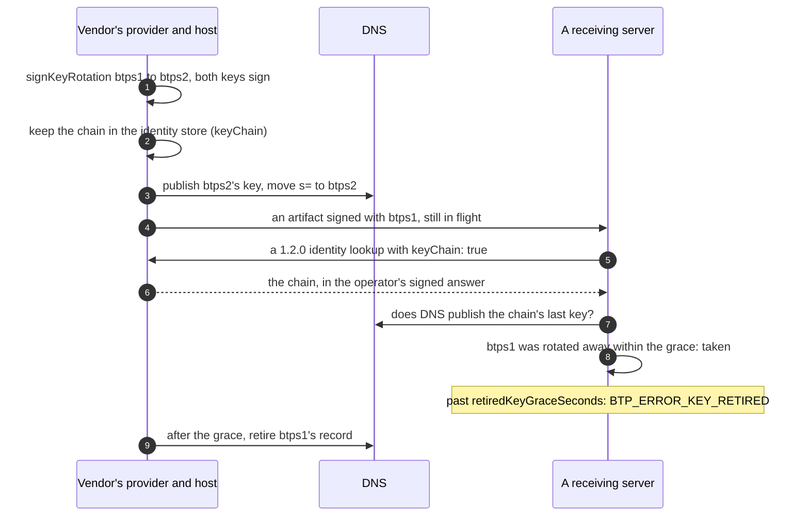

# Key rotation

> **Since 1.2.**

**What it is.** An identity's keys form a **key chain**: each new key is introduced by a signed rotation record that hands over from the old one. The identity's host serves the chain, and every 1.2 server checks each arriving signature's key against it. Old keys can then be deleted and their DNS records retired, and what they signed stays verifiable, in [evidence bundles](./evidenceBundles.md) too.

**Why.** In 1.1 a key was its DNS record. Removing the record broke every signature the key had made; keeping it let a stolen key sign forever. With a chain:

| What                         | How                                                                                                                       |
| ---------------------------- | ------------------------------------------------------------------------------------------------------------------------- |
| **A planned rotation**       | the old key and the new one both sign it. The old key is taken for `retiredKeyGraceSeconds` (a day), then refused         |
| **A compromised key**        | rotated with immediate expiry, from when it was compromised (`compromisedSince`): refused at once, whatever DNS still has |
| **A lost key**               | the new key alone signs; its rotation counts once the operator or DNS confirms it                                         |
| **A compromise found later** | an expiry record, signed by the current key, expires a key the identity already left                                      |
| **Stored documents**         | a side-car opens each one with the new key, so the old private key can be deleted                                         |
| **Evidence**                 | a bundle keeps each signer's chain, so a reader sees when each key was valid, years later                                 |

**Nothing changes until an identity rotates.** An identity that never rotated has no chain, and its key is checked by DNS, as in 1.1.

## The flow



## The records

A planned rotation, signed by both keys:

```json btps=keyChainRecord
{
  "rotation": {
    "type": "btps.keyRotation.v1",
    "identity": "billing$vendor.example",
    "from": {
      "selector": "btps1",
      "fingerprint": "P3jb2C0c6XutGbtPyrDjDfY+M8IICzA5Ym8YkTZerAs=",
      "publicKey": "MIIBIjANBgkqhkiG9w0BAQEFAAOCAQ8AMIIBCgKCAQEA"
    },
    "to": {
      "selector": "btps2",
      "fingerprint": "q7Lw0Zt2b8VdXc5Ko3Rj9Hs6Fe1Gm4Na8Pu2Ty5Wi0E=",
      "publicKey": "MIIBIjANBgkqhkiG9w0BAQEFAAOCAQ8AMIIBCgKCAQEB"
    },
    "at": "2026-11-10T00:00:00.000Z",
    "expiry": "planned",
    "prev": null
  },
  "signatures": [
    {
      "by": "from",
      "algorithmHash": "sha256",
      "value": "BASE64-SIGNATURE",
      "fingerprint": "P3jb2C0c6XutGbtPyrDjDfY+M8IICzA5Ym8YkTZerAs="
    },
    {
      "by": "to",
      "algorithmHash": "sha256",
      "value": "BASE64-SIGNATURE",
      "fingerprint": "q7Lw0Zt2b8VdXc5Ko3Rj9Hs6Fe1Gm4Na8Pu2Ty5Wi0E="
    }
  ]
}
```

A key the identity already left, found compromised from before it was left, signed by the identity's current key:

```json btps=keyChainRecord
{
  "expiry": {
    "type": "btps.keyExpiry.v1",
    "identity": "billing$vendor.example",
    "key": { "selector": "btps1", "fingerprint": "P3jb2C0c6XutGbtPyrDjDfY+M8IICzA5Ym8YkTZerAs=" },
    "compromisedSince": "2026-11-05T00:00:00.000Z",
    "reason": "compromised",
    "at": "2026-11-25T00:00:00.000Z",
    "prev": "4c1d2e3f405162738495a6b7c8d9e0f1a2b3c4d5e6f708192a3b4c5d6e7f8091"
  },
  "signatures": [
    {
      "by": "current",
      "algorithmHash": "sha256",
      "value": "BASE64-SIGNATURE",
      "fingerprint": "q7Lw0Zt2b8VdXc5Ko3Rj9Hs6Fe1Gm4Na8Pu2Ty5Wi0E="
    }
  ]
}
```

A verifier computes each fingerprint from its key and refuses a record that states another. The chain rules, anchoring and the validity windows are in the [specification](../protocol/specifications/key-rotation.md).

## The code

### Rotate a key

The provider signs the record, keeps the chain, publishes the new key, and moves `s=`:

```ts check
import { keyChainRecordHash, signKeyRotation, type BTPKeyChainRecord } from '@btps/sdk/trust';
import type { PemKeys } from '@btps/sdk/crypto';

export async function rotate(
  identity: string,
  chain: BTPKeyChainRecord[],
  from: { selector: string; keys: PemKeys },
  to: { selector: string; keys: PemKeys },
): Promise<BTPKeyChainRecord[]> {
  const last = chain.at(-1);
  const record = await signKeyRotation(
    {
      identity,
      from: { selector: from.selector },
      to: { selector: to.selector }, // a new selector, never one the identity used before
      at: new Date().toISOString(),
      prev: last ? keyChainRecordHash(last) : null,
    },
    { from: { pemFiles: from.keys }, to: { pemFiles: to.keys } },
  );
  // Store it on the identity's record (keyChain), which getKeyChain gives the host.
  return [...chain, record];
}
```

A key held in a KMS signs as `{ signer }` instead of `{ pemFiles }`, without leaving it.

### A compromised or lost key

```ts check
import { keyChainRecordHash, signKeyRotation, type BTPKeyChainRecord } from '@btps/sdk/trust';
import type { PemKeys } from '@btps/sdk/crypto';

export async function rotateLost(
  identity: string,
  chain: BTPKeyChainRecord[],
  lost: { selector: string; publicKey: string },
  to: { selector: string; keys: PemKeys },
  compromisedSince: string,
): Promise<BTPKeyChainRecord> {
  const last = chain.at(-1);
  return signKeyRotation(
    {
      identity,
      from: lost, // a lost key cannot sign: the record names its public key
      to: { selector: to.selector },
      at: new Date().toISOString(),
      prev: last ? keyChainRecordHash(last) : null,
      expiry: 'immediate',
      compromisedSince,
      reason: 'lost',
    },
    { to: { pemFiles: to.keys } },
  );
}
```

A compromised key you still hold signs too, with `reason: 'compromised'`. Then **remove its DNS record at once**: a receiver that cannot reach your host checks the key by DNS alone.

### A compromise found later

A key the identity already rotated away from may turn out to have been compromised before it was left. Nothing rotates: the identity's **current** key signs an expiry record naming the old key, from when it was compromised:

```ts check
import { getFingerprintFromPem, type PemKeys } from '@btps/sdk/crypto';
import { keyChainRecordHash, signKeyExpiry, type BTPKeyChainRecord } from '@btps/sdk/trust';

export async function expireLeftKey(
  identity: string,
  chain: BTPKeyChainRecord[],
  left: { selector: string; publicKey: string },
  current: PemKeys,
  compromisedSince: string,
): Promise<BTPKeyChainRecord[]> {
  const last = chain.at(-1);
  if (!last) throw new Error('an identity that never rotated has no key it left');
  const record = await signKeyExpiry(
    {
      identity,
      // Under a selector the chain names it under, and never the current key.
      key: { selector: left.selector, fingerprint: getFingerprintFromPem(left.publicKey) },
      compromisedSince, // when it may first have been compromised; never after `at`
      reason: 'compromised',
      at: new Date().toISOString(),
      prev: keyChainRecordHash(last),
    },
    { pemFiles: current },
  );
  return [...chain, record];
}
```

From then on a 1.2 server refuses the old key at once (`BTP_ERROR_KEY_REVOKED`), and an evidence bundle reports what it signed from `compromisedSince` on as out of its window. Remove its DNS record too, if it is still there.

### On the receiving server

Nothing to write: a 1.2 server asks the sender's host for its chain and checks each key against it. Two options set how:

```ts
const server = new BtpsServer({
  // ...
  retiredKeyGraceSeconds: 86_400, // how long a key rotated away as planned still signs
  keyChainMaxCacheSeconds: 300, // the longest a chain is kept, so a revoked key is refused within it
});
```

A `keyResolver` that gives chains itself (`resolveKeyChain`) keeps each no longer than `keyChainMaxCacheSeconds`.

### Delete an old private key

Verifying never needs a private key; opening a stored document does. Before deleting one, give each document encrypted to it a side-car, and check it opens:

```ts check
import { contentKeyOpens, wrapContentKeyFor, type BTPContentKeySidecar } from '@btps/sdk/crypto';
import type { BTPTransporterArtifact } from '@btps/sdk/server';

export async function sidecarsFor(
  stored: BTPTransporterArtifact[],
  oldPrivateKey: string,
  newKeys: { publicKey: string; privateKey: string },
): Promise<Map<string, BTPContentKeySidecar>> {
  const sidecars = new Map<string, BTPContentKeySidecar>();
  for (const artifact of stored) {
    if (!artifact.encryption) continue;
    const sidecar = await wrapContentKeyFor(artifact, oldPrivateKey, newKeys.publicKey);
    if (!(await contentKeyOpens(artifact, sidecar, newKeys.privateKey))) {
      throw new Error(`the side-car for ${artifact.id} does not open it: keep the old key`);
    }
    sidecars.set(artifact.id, sidecar);
  }
  // Keep each beside its artifact. Delete the old private key only now.
  return sidecars;
}
```

`decryptVerify(senderKey, artifact, newPrivateKey, sidecar.encryptedKey)` opens it, and still verifies its untouched signature.

## Errors

| Code                       | Status | Who refuses | When                                                                                   |
| -------------------------- | ------ | ----------- | -------------------------------------------------------------------------------------- |
| `BTP_ERROR_KEY_RETIRED`    | 401    | the server  | a key rotated away as planned, past `retiredKeyGraceSeconds`                           |
| `BTP_ERROR_KEY_REVOKED`    | 401    | the server  | an expired key, at once, whatever the artifact's own time says                         |
| `BTP_ERROR_RESOLVE_PUBKEY` | 401    | the server  | no key of the chain, a chain that fails its checks, or a chain not ending at a DNS key |

## Protocol and platform

The protocol defines the records, the chain rules, and how a server checks a key against a chain. Signing records, keeping the chain, publishing and retiring DNS records, side-cars, and when to rotate are the provider's. The rules in full: [Key Rotation](../protocol/specifications/key-rotation.md). A step-by-step guide for operators: [Rotating keys](../protocol/keyRotation.md).
