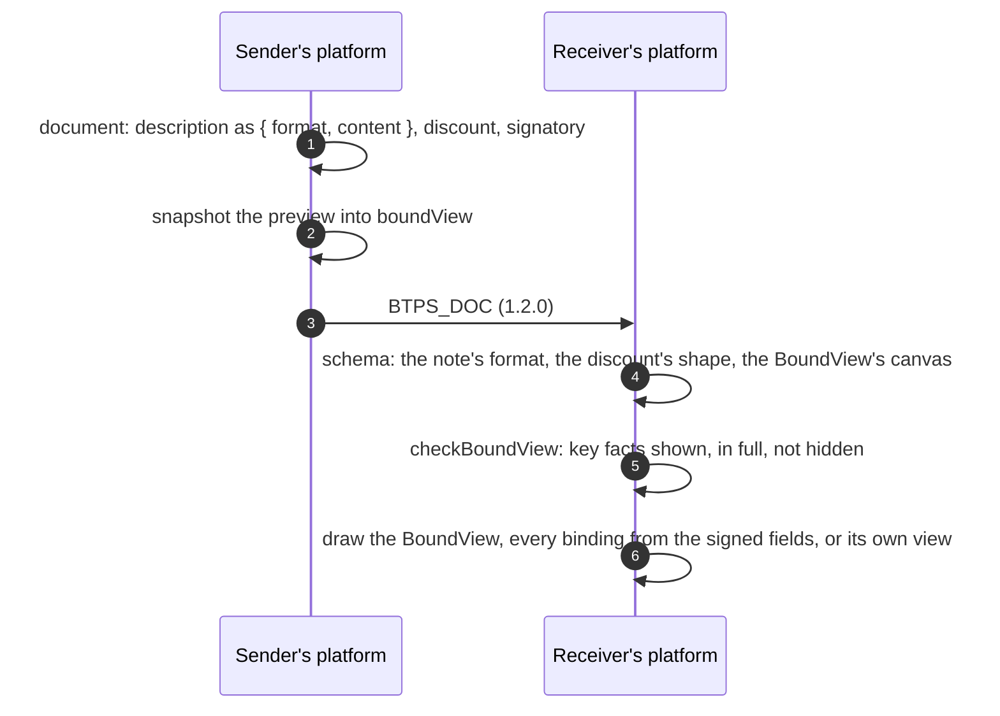

# Notes, discounts and BoundView

> **Since 1.2.** Each travels in `1.2.0` artifacts only. A document without them reads exactly as before in a `1.1.0` artifact.

Four things a document can say about itself: how its notes are written, what was taken off, how it looked when it was sent, and who signed a letter off.

| What                                 | Why                                                                                                                       |
| ------------------------------------ | ------------------------------------------------------------------------------------------------------------------------- |
| **Notes say how they are written**   | a note in markdown renders as markdown, not as asterisks                                                                  |
| **Discounts**                        | an invoice or receipt says what was taken off, before tax, instead of hiding it in a line                                 |
| **BoundView**                        | a receiver on any provider sees the document as the sender saw it in its preview, with every fact drawn from signed data |
| **A letter's signatory**             | a letter or an agreement carries the sender's sign-off: a name, a title and a typed or drawn signature                    |

## The flow



## Notes

An invoice's and a receipt's `description`, an event's `message`, and a trust request's or answer's `message` may be `{ format: "text" | "markdown", content }`. A plain string is still taken, read as `text`. Under `1.2.0`, a note's content is at most 5,000 characters.

## Discounts

An invoice or receipt may carry `discount`: `{ amount }` in minor units, or `{ percent }` in whole basis points (1 to 10,000, so `1000` is 10%), applied before tax. Under `1.2.0`, a line's own `discount` cell is an amount of at least 0.

## BoundView

What you see is what was signed. A document carries its BoundView in its top-level `boundView` field: a signed canvas captured from the sender's own preview when it is sent. Text that shows a fact is a **binding** to a signed field, never text: the receiver draws the field's value. Fonts travel as glyph outlines and images as pixels, so nothing is fetched and no font or image file is read. The receiver checks the BoundView wherever the document is opened, and shows its own view of the data when a check fails.

Why BoundView was created, and what email, signed PDFs and e-invoicing networks cannot do: [Why BoundView was created](../protocol/specifications/boundview/why.md).

:::tip You build none of it
Design your preview in HTML as you already do; `@btps/boundview` turns it into a BoundView when you send, and draws a received BoundView into a picture you display. The SDK checks every BoundView it opens without being asked. [Using BoundView](../protocol/specifications/boundview/using.md) is all a platform needs.
:::

```ts
import { snapshotBoundView, renderBoundView } from '@btps/boundview';

const boundView = await snapshotBoundView(previewElement, document); // in the browser showing the preview
await agent.command('artifact.send', to, { ...document, boundView });

const png = await renderBoundView(openedDocument); // null when the view failed a check
```

| Who | What happens |
| --- | --- |
| The sender | `snapshotBoundView` captures the preview, binds every fact to its field, and checks the result before the document is signed |
| The receiver | The SDK checks the BoundView wherever the document is opened, on the server or on the device. `renderBoundView` gives a PNG to display, or `null` |
| The receiving app | Shows the verified sender, the title, the attachments, the references, the payment link and an all-details view around the BoundView, and its own view of the data when a check fails |

An invoice with a markdown note and a discount, with line roles a BoundView binds to:

```json btps=document:BTPS_DOC
{
  "type": "invoice",
  "title": "November",
  "id": "INV-1002",
  "issuedAt": "2026-11-08T06:00:00.000Z",
  "totalAmount": { "amount": 135000, "currency": "AUD" },
  "lineItems": {
    "columns": ["Item", "Amount"],
    "roles": { "Item": "description", "Amount": "lineTotal" },
    "rows": [{ "Item": "Website build", "Amount": 150000 }]
  },
  "description": { "format": "markdown", "content": "**Thank you** for your business." },
  "discount": { "percent": 1000 }
}
```

:::note For implementers
The format itself, for anyone building their own builder or renderer, is specified on [BoundView](../protocol/specifications/boundview/overview.md#the-specification), with a full invoice and a letter on its [examples](../protocol/specifications/boundview/examples.md) page.
:::

## A letter's signatory

A letter or an agreement carries its sender's sign-off in `signatory`, signed with it: a name, a title, and a visual signature, typed (set in the open-licence script font Caveat) or drawn as integer strokes on a 1,000 by 300 canvas, never markup. It has the same shape as the visual signature an agreement's signer gives when it accepts.

```json btps=document:BTPS_DOC
{
  "type": "letter",
  "title": "Your new plan",
  "id": "LET-7",
  "issuedAt": "2026-11-08T06:00:00.000Z",
  "body": { "format": "markdown", "content": "Dear Alice,\n\nYour new plan starts on 1 December." },
  "signatory": {
    "name": "Jo Bloggs",
    "title": "Customer care",
    "visualSignature": { "type": "drawn", "strokes": [[10, 200, 120, 80, 240, 210, 380, 90]] }
  }
}
```

**Such a signature is decoration and proves no agreement.** To be bound by a document, send an [agreement](./agreements.md).

## The code

Nothing new to call to send these: they are fields of the document a platform already sends. From a device, the `artifact.send` checks them under the version the agent will stamp; from a server, `signEncrypt` does. A receiver's SDK checks a BoundView with `checkBoundView` when it opens the document. The feature journey (`tests/e2e/features.e2e.test.ts`) sends an invoice with a markdown note, a discount and a BoundView, and a letter with its signatory, and each arrives intact.

## Errors

| Code                   | Status | Who refuses                                                                     | When                                                                                                                                                                                                                                         |
| ---------------------- | ------ | ------------------------------------------------------------------------------- | -------------------------------------------------------------------------------------------------------------------------------------------------------------------------------------------------------------------------------------------- |
| `BTP_ERROR_VALIDATION` | 400    | the receiving server (readable), `decryptVerify` (opened), the sender's own SDK | a note over 5,000 characters or of another format, a discount with both or neither field or out of range, a BoundView that breaks its schema or a limit or binds a field the document lacks, a signatory's stroke off its canvas, or any of these in a `1.1.0` artifact |

:::note A failed check is not an error
A BoundView that is well formed but fails a check is not an error: the document is accepted and the receiver shows its own view of the data ([Checks](../protocol/specifications/boundview/checks.md#two-outcomes)).
:::

## Protocol and platform

The protocol checks the shapes and the BoundView's checks. What a sender's labels say is the sender's, as its notes are; the sender's SDK warns when a label looks like a fact that is not bound. How a receiver shows a BoundView, beside the verified sender, the title, the attachments and the all-details view, is described on [Using BoundView](../protocol/specifications/boundview/using.md#what-the-receiving-app-shows-around-a-boundview).
