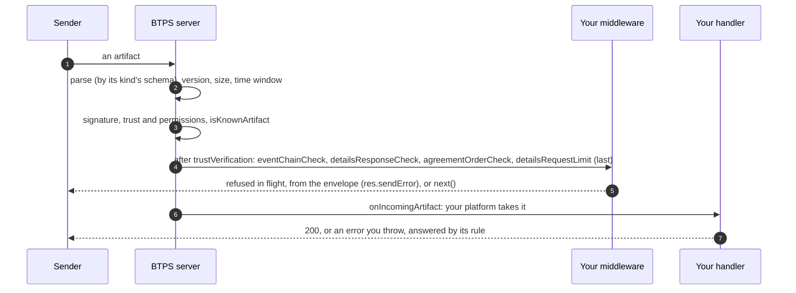

# Your platform's checks

> **Since 1.2.** The four middleware and the plain functions below.

**What it is.** A BTPS server checks an artifact's structure, its signatures, the trust and its permissions, and `isKnownArtifact`, and reads no other record of the platform's. Everything that needs a record only the platform keeps (an invoice's events, the requests it sent, an agreement's answers, its own limits) is the platform's to check. The SDK ships those checks two ways: as **middleware**, which refuses in flight, and as **plain functions**, for a platform that checks another way.

**Why.** The server stays the same for every platform; what a platform keeps, and how, stays its own. Each check is off until the platform adds it, with its own lookup.

## The flow



## The four middleware

All from `@btps/sdk/server/core`. Each runs after the server's trust check, and refuses from the envelope, encrypted or not, without opening anything.

| Middleware                              | Refuses                                                                                      | With your lookup                           | Plain function                                  |
| --------------------------------------- | -------------------------------------------------------------------------------------------- | ------------------------------------------ | ----------------------------------------------- |
| `eventChainCheck({ getEvent })`         | a `withdrawn` or `follows` that breaks the chain ([Withdrawing](./withdrawingProposals.md))  | an earlier event's facts                   | `lifecycleEventChainProblem`                    |
| `detailsResponseCheck({ getArtifact })` | a `DETAILS_RES` naming what its request did not ask ([Details refresh](./detailsRefresh.md)) | the request's envelope                     | `detailsProblem`, `detailsRequestRefusal`       |
| `agreementOrderCheck({ answers })`      | an agreement's answer out of turn ([Agreements](./agreements.md))                            | the agreement's signers, order and answers | `agreementTurnProblem`, `agreementOrderProblem` |
| `detailsRequestLimit(allow)`            | a `DETAILS_REQ` over your own limit, with `retryAfter`                                       | your count                                 | none: the limit is yours                        |

```js
import {
  agreementOrderCheck,
  detailsRequestLimit,
  detailsResponseCheck,
  eventChainCheck,
} from '@btps/sdk/server/core';

export default function createMiddleware() {
  return [
    eventChainCheck({ getEvent: ({ id, from, to }) => events.facts({ id, from, to }) }),
    detailsResponseCheck({ getArtifact: (query) => artifacts.envelope(query) }),
    agreementOrderCheck({ answers: (query) => agreements.answersByCopy(query) }),
    // Last, so it counts only what every other check took.
    detailsRequestLimit(async ({ from, to }) =>
      (await counts.thisMonth(from, to)) < 10
        ? true
        : { retryAfter: await counts.secondsToNextMonth() },
    ),
  ];
}
```

## What a sender is told of an error

Where an error comes from decides what the sender sees, not how it looks:

- **Your own answers go as plain objects through `res.sendError`**, and are sent as you wrote them: a `{ code, message, status }` of your own (for example `PROVIDER_ALREADY_RECEIVED`, 409), or a BTPS constant with something added to its message (a support reference).
- **Anything thrown, or an error you caught and pass on,** is told only as a BTPS constant: its status, and its message, or that message followed by `: ` and a detail. Any other (a database's duplicate-key error, an SDK's `{ status: 403, code: 'AccessDenied' }`) goes out as the generic `500`, and its detail stays with your server. So never pass a caught error to `res.sendError` to explain a refusal: send your own answer.
- **`retryAfter`:** a 429 sent as a `BTPErrorException` from a BTPS constant, whose `meta.retryAfter` is whole seconds, goes out with `status.retryAfter`, in a `1.2.0` answer. Nothing else from `meta` reaches the wire, and `cause` never does.

```json btps=response
{
  "version": "1.2.0",
  "id": "293a4b5c-6d7e-48f9-a0b1-c2d3e4f50617",
  "issuedAt": "2026-11-08T08:00:00.000Z",
  "type": "btps_error",
  "reqId": "3a4b5c6d-7e8f-49a0-b1c2-d3e4f5061728",
  "status": {
    "ok": false,
    "code": 429,
    "error": "BTP_ERROR_DETAILS_RATE_LIMITED",
    "message": "Too many details requests on this trust. Ask again later",
    "retryAfter": 60
  }
}
```

```js
// A refusal of your own, in middleware: as given.
return res.sendError({
  code: 'PROVIDER_ALREADY_RECEIVED',
  message: 'This artifact was already received',
  status: 409,
});
// A BTPS refusal with a wait: from its constant.
return res.sendError(new BTPErrorException(BTP_ERROR_RATE_LIMITER, { meta: { retryAfter: 30 } }));
```

## The server's own limits

| Option                       | Default            | What it bounds                                                                                                      |
| ---------------------------- | ------------------ | ------------------------------------------------------------------------------------------------------------------- |
| `maxArtifactSizeKb`          | 65,536 (64 MB)     | one artifact's size, before it is read in full                                                                      |
| `maxArtifactAgeSeconds`      | 300                | how far `issuedAt` may be from the server's clock                                                                   |
| `maxInFlightPerConnection`   | 32                 | requests one connection may have handled at once; a request is in flight until its answer is written, signed or not |
| `maxArtifactsInFlight`       | 2 (since 1.2)      | artifacts the whole server reads and handles at once, over every connection; a place is held until it is answered   |
| `maxArtifactsWaiting`        | 100 (since 1.2)    | artifacts waiting for a place, unread; the next is answered `BTP_ERROR_TEMPORARILY_UNAVAILABLE` (503)               |
| `maxConsecutiveInvalidLines` | 10 (since 1.2)     | unreadable lines in a row on one connection: the last is answered, with `status.closing`, and the connection ends   |
| `connectionTimeoutMs`        | 30,000             | how long a connection with nothing in flight stays open                                                             |
| `retiredKeyGraceSeconds`     | 86,400 (since 1.2) | how long a key its identity rotated away from as planned still signs ([Key rotation](./keyRotation.md))             |
| `keyChainMaxCacheSeconds`    | 300 (since 1.2)    | how long a key chain is trusted from a cache: the longest a revoked key can still be taken                          |
| `maxAttachments`             | 20 (since 1.2)     | attachments in an unencrypted `1.2.0` document, by type, 20 to 1,000; an encrypted one is counted when opened       |

A line is checked against the schema of the kind of artifact it is taken for, and nothing else, and every list is refused cheaply when it is too long, before its signature is checked. See [Limits](../protocol/specifications/limits.md).

:::note Sizing a server for very large artifacts
A server holds each artifact whole while it reads it, parses it and verifies its signature, so its memory grows with the size of each artifact arriving at once. Measured on the receiving server alone, over TLS: a 187 MB signed and encrypted letter carrying ten 10.5 MB PDFs was accepted in about 3 s, and the server's memory peaked about 510 to 600 MB above what it used before the letter arrived, about three times the artifact's size.

- Since 1.2, the default `maxArtifactSizeKb` is 64 MB, and it is also the minimum: every server takes that much, about 30 MB of files once encoded and encrypted. A 64 MB artifact needs about 190 MB while it is read. Keep the default unless your platform needs more.
- If you raise it, size the server's memory at about three times its largest artifact for each one that may arrive at once, on top of what it uses otherwise.
- For example, ten 10 MB files make an artifact of about 190 MB, which needs about 600 MB for that artifact. A 512 MB container, fine at the default, is too small for it, while 1.5 to 2 GB takes one or two at once.
- Since 1.2, `maxArtifactsInFlight` is 2 by default: two 64 MB artifacts need about 380 MB, so a server that sets nothing fits a 512 MB container. Set it from your memory, so the server reads no more at once than it holds: about the memory you have for artifacts ÷ (3 × the largest artifact you accept). A 2 GB container with about 1.2 GB of it for artifacts of up to 190 MB (about 600 MB each) takes 2. Small artifacts are rarely the limit on memory: a 1 MB invoice takes about 3 MB. They hold places, though: a place is held until its artifact is answered (its verification, its key lookups, the handler), whatever its size, so a busy server raises `maxArtifactsInFlight` for more small artifacts at once.
- The rest wait their turn, in order of arrival, up to `maxArtifactsWaiting` (100 by default). A waiting artifact is not read, so TCP holds its sender and it costs the server no memory. The next one is answered `BTP_ERROR_TEMPORARILY_UNAVAILABLE` (503), and its sender sends it again later, as a provider's outbox does.
- To take more at once, run more server instances behind a load balancer, each with its own places.

This holds until chunked encryption comes in a later release: files will travel as separately encrypted parts, so no one artifact is held whole. To work out the limit itself, see [Large documents](../protocol/specifications/limits.md#large-documents).
:::

## Errors you hear about

```ts
const server = new BtpsServer({
  // ...
  onError: (error) => log.error(error.toJSON()), // every failed artifact; no token or code is ever in an error
});
```

With `onError` (or `onError` middleware), the server no longer also writes each failed artifact to `console.error`.

## Caching key lookups

Every key lookup, the server's and the client's, goes through one option, `keyResolver`, so a provider can cache keys; BTPS itself caches nothing. `createDefaultKeyResolver` is the lookup to wrap. See [Caching Key Lookups](../server/advancedUsages.md#caching-key-lookups).

```ts check
import { createDefaultKeyResolver, type BtpsKeyResolver } from '@btps/sdk/crypto';

const KEY_CACHE_MS = 5 * 60_000; // so a removed DNS record stops counting
// Your server's own identity: a key not in DNS is asked of its host as this.
const lookup = createDefaultKeyResolver({ from: 'admin$saas.example' });
const cache = new Map<string, { key: string; until: number }>();

// Given to BtpsServer as `keyResolver`, beside the rest of its options.
export const keyResolver: BtpsKeyResolver = {
  async resolvePublicKey(identity, selector, use) {
    const id = `${identity} ${selector} ${use}`;
    const kept = cache.get(id);
    if (kept && kept.until > Date.now()) return kept.key;
    const key = await lookup.resolvePublicKey(identity, selector, use);
    if (key) cache.set(id, { key, until: Date.now() + KEY_CACHE_MS }); // only keys found
    return key;
  },
};
```

Cache only keys found, so a newly published key is found at once. Give the default lookup `from`: without it, it finds keys in DNS only, and the server refuses a signature by a hosted identity, whose key is not in DNS ([Finding a signature key](../protocol/specifications/key-rotation.md#finding-a-signature-key)). A resolver that gives key chains too (`resolveKeyChain`) keeps each no longer than the server's `keyChainMaxCacheSeconds` ([Rotating keys](../whats-new/version-1-2-migration.md#rotating-keys)).

The feature journey (`tests/e2e/features.e2e.test.ts`) checks that a caching resolver looks a sender's key up once over three events.

## Protocol and platform

| The server checks                                     | Your platform checks                                                                      |
| ----------------------------------------------------- | ----------------------------------------------------------------------------------------- |
| structure, by the artifact's kind; size, age, version | an invoice's events: `eventChainCheck`                                                    |
| signatures, delegations, attestations, cosignatures   | details responses against the requests you sent: `detailsResponseCheck`                   |
| the trust and its permissions; `isKnownArtifact`      | an agreement's order: `agreementOrderCheck`, then `agreementStatementProblem` once opened |
| in-flight, invalid-line and size limits               | your own limits: `detailsRequestLimit`                                                    |

When to register each, for a provider upgrading from 1.1: [Migrating from 1.1 to 1.2](../whats-new/version-1-2-migration.md#4-register-the-checks-12-leaves-to-you).
