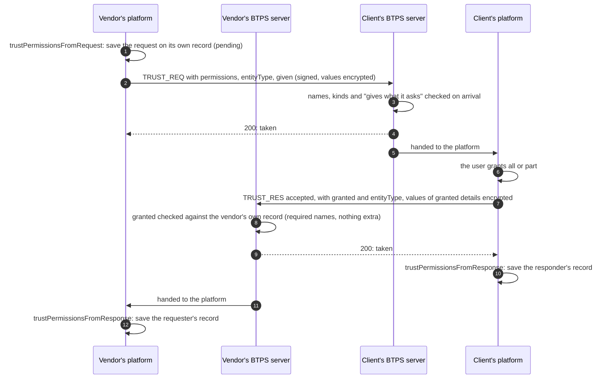

# Trust permissions

> **Since 1.2.** The permission fields travel in `1.2.0` artifacts only.

**What it is.** A trust request lists exactly what it asks for, the way an app's sign-in screen shows what it will get, and the receiver grants all of it or part of it:

- **what may be sent**: one `send:` name per document type (`send:invoice`, `send:receipt`, `send:payslip`, `send:letter`, `send:agreement`);
- **which details each side holds of the other**: one `detail:` name per detail (`detail:legalName`, `detail:profile`, `detail:email`, `detail:phone`, `detail:address`, `detail:taxNo`, `detail:dob` for a person, `detail:registrationNumber` for an organisation);
- **required or optional**: a grant that leaves out a required name is refused; an optional one may be left out.

**Why.** A receiver sees what it agrees to, can say yes to invoices and no to letters, and both sides know which details they may hold and later refresh ([Details refresh](./detailsRefresh.md)). Each name travels on the envelope, **signed and readable**, so the receiving server checks it on arrival without decrypting anything. The **values** (a date of birth, an address) are in the document, always encrypted.

A trust without permissions (one made before 1.2, or with a 1.1 provider) is all or nothing: any document type, no details by name.

## The flow



The server **only reads** trust records; the platform writes them, with the two helpers. A record's `permissions` is what every later check reads.

## The request

The vendor asks for invoices (required) and receipts (optional), and for the client's legal name (required) and address (optional). An organisation that asks for details gives the same kinds of its own, in `given`; its values travel in the encrypted document.

```json btps=transporter
{
  "version": "1.2.0",
  "id": "4c1b2a40-1d7e-4f38-9a3a-5b6f2c7d8e90",
  "issuedAt": "2026-11-08T00:00:00.000Z",
  "type": "TRUST_REQ",
  "from": "billing$vendor.example",
  "to": "pay$client.example",
  "selector": "btps1",
  "permissions": [
    { "name": "send:invoice", "required": true },
    { "name": "send:receipt", "required": false },
    { "name": "detail:legalName", "required": true },
    { "name": "detail:address", "required": false }
  ],
  "entityType": "organisation",
  "given": ["detail:legalName", "detail:address"],
  "document": "BASE64-OF-THE-ENCRYPTED-DOCUMENT",
  "encryption": {
    "algorithm": "aes-256-gcm",
    "encryptedKey": "BASE64-KEY",
    "iv": "BASE64-IV",
    "type": "standardEncrypt",
    "authTag": "BASE64-TAG"
  },
  "signature": {
    "algorithmHash": "sha256",
    "value": "BASE64-SIGNATURE",
    "fingerprint": "BASE64-FINGERPRINT"
  }
}
```

Opened, the document gives each name in `given` its value: in the request's own field where there is one (`detail:legalName` is `name`, `detail:address` is `address`), otherwise in `own`, by name.

```json btps=document:TRUST_REQ
{
  "id": "4c1b2a40-1d7e-4f38-9a3a-5b6f2c7d8e90",
  "name": "Vendor Pty Ltd",
  "email": "billing@vendor.example",
  "reason": "To send you invoices",
  "phone": "+61 2 0000 0000",
  "address": "1 Example Street, Sydney NSW 2000"
}
```

## The answer

The client grants the required names and one optional one: invoices and the legal name, and receipts, but not the address. Its `entityType` says what owns its address, and the document holds the value of each granted detail.

```json btps=transporter
{
  "version": "1.2.0",
  "id": "8a2e5f10-3b4c-4d6e-8f90-a1b2c3d4e5f6",
  "issuedAt": "2026-11-08T00:05:00.000Z",
  "type": "TRUST_RES",
  "from": "pay$client.example",
  "to": "billing$vendor.example",
  "selector": "btps1",
  "granted": ["send:invoice", "send:receipt", "detail:legalName"],
  "entityType": "person",
  "document": "BASE64-OF-THE-ENCRYPTED-DOCUMENT",
  "encryption": {
    "algorithm": "aes-256-gcm",
    "encryptedKey": "BASE64-KEY",
    "iv": "BASE64-IV",
    "type": "standardEncrypt",
    "authTag": "BASE64-TAG"
  },
  "signature": {
    "algorithmHash": "sha256",
    "value": "BASE64-SIGNATURE",
    "fingerprint": "BASE64-FINGERPRINT"
  }
}
```

```json btps=document:TRUST_RES
{
  "id": "res-1",
  "decision": "accepted",
  "decidedAt": "2026-11-08T00:05:00.000Z",
  "decidedBy": "pay$client.example",
  "details": { "detail:legalName": "Robert Smith" }
}
```

## What each side saves

`trustPermissionsFromRequest` and `trustPermissionsFromResponse` (`@btps/sdk/trust`) compute the records. The vendor's own record of the trust, once the answer is taken:

```json btps=permissions
{
  "requested": [
    { "name": "send:invoice", "required": true },
    { "name": "send:receipt", "required": false },
    { "name": "detail:legalName", "required": true },
    { "name": "detail:address", "required": false }
  ],
  "granted": ["send:invoice", "send:receipt", "detail:legalName"],
  "detailsHeld": ["detail:legalName"],
  "detailsShared": ["detail:legalName", "detail:address"]
}
```

`detailsHeld` are the details this side holds of the other; `detailsShared` the details it gave. The client's record is the mirror image: it holds the vendor's legal name and address, and shared its own legal name.

## The code

### Vendor: ask, from a platform's server

As the permissions journey does (`tests/e2e/permissions.e2e.test.ts`): save the request on the vendor's own record, then sign and send it.

```ts
import { signEncrypt } from '@btps/sdk/crypto';
import { BtpsTransporter } from '@btps/sdk/client';
import { computeTrustId, trustPermissionsFromRequest } from '@btps/sdk/trust';

const permissions = [
  { name: 'send:invoice', required: true },
  { name: 'send:receipt', required: false },
  { name: 'detail:legalName', required: true },
  { name: 'detail:address', required: false },
];
const issuedAt = new Date().toISOString();

// The requester's own record: pending until answered.
await trustStore.create(
  {
    senderId: vendor,
    receiverId: client,
    status: 'pending',
    // ...the rest of the trust record
    permissions: trustPermissionsFromRequest({ permissions, issuedAt }),
  },
  computeTrustId(vendor, client),
);

const { payload, error } = await signEncrypt(
  client,
  { accountName: 'billing', domainName: 'vendor.example', pemFiles: vendorKeys },
  {
    version: '1.2.0',
    type: 'TRUST_REQ',
    from: vendor,
    to: client,
    selector: 'btps1',
    issuedAt,
    permissions,
    entityType: 'organisation',
    given: ['detail:legalName', 'detail:address'],
    document: {
      id: crypto.randomUUID(),
      name: 'Vendor Pty Ltd',
      email: 'billing@vendor.example',
      reason: 'To send you invoices',
      phone: '+61 2 0000 0000',
      address: '1 Example Street, Sydney NSW 2000',
    },
  },
  {
    signature: { algorithmHash: 'sha256' },
    encryption: { algorithm: 'aes-256-gcm', mode: 'standardEncrypt' },
  },
);
if (error) throw error;
const { response } = await new BtpsTransporter({}).transport(client, payload);
```

`signEncrypt` asks the receiver's server its version first. To a 1.1 server the request goes as 1.1 allows, without the permission fields, and the result says so in `shaped` ([Protocol versions](./versions.md)).

### Vendor: ask, from a device

A device sends the same request through its provider with `trust.request`'s options; the agent checks the artifact as its provider will before it goes.

```ts
const result = await agent.command(
  'trust.request',
  'pay$client.example',
  {
    id: crypto.randomUUID(),
    name: 'Vendor Pty Ltd',
    email: 'billing@vendor.example',
    reason: 'To send you invoices',
    phone: '+61 2 0000 0000',
    address: '1 Example Street, Sydney NSW 2000',
  },
  {
    permissions,
    entityType: 'organisation',
    given: ['detail:legalName', 'detail:address'],
    encryption: { algorithm: 'aes-256-gcm', mode: 'standardEncrypt' },
  },
);
```

### Client: grant, and save

The client grants from what was asked. Its platform answers, then saves its own record from the request it received:

```ts
import { computeTrustId, trustPermissionsFromResponse } from '@btps/sdk/trust';

const granted = ['send:invoice', 'send:receipt', 'detail:legalName'];
// Sent like the request: type 'TRUST_RES', with `granted` and `entityType` on the envelope.
const answer = {
  version: '1.2.0',
  type: 'TRUST_RES',
  from: client,
  to: vendor,
  selector: 'btps1',
  granted,
  entityType: 'person',
  document: {
    id: 'res-1',
    decision: 'accepted',
    decidedAt: new Date().toISOString(),
    decidedBy: client,
    details: { 'detail:legalName': 'Robert Smith' },
  },
};

// Once the vendor's server has taken it, each side saves its record.
const records = trustPermissionsFromResponse({ granted }, request);
await trustStore.update(computeTrustId(vendor, client), {
  status: 'accepted',
  permissions: records.responder, // the client's; the vendor saves records.requester
});
```

## Changing a trust later

Either side of an active trust can ask for a different set later: a `TRUST_REQ` with `change: true`, listing the **whole** set now wanted. It is the one trust request an active trust takes.

- The receiving platform saves a change it takes as `pendingChange` on its own record, until its user answers. `trustPermissionsFromRequest(request, current)` does this for the requester's record: the trust keeps running on its old grant meanwhile.
- **One at a time:** a second change while one is pending is refused, as is a change to a trust that is not active.
- The answer is an ordinary accepted `TRUST_RES`, whose `granted` is checked against the pending change.

The permissions journey adds `send:letter` and `detail:email` to a trust that granted `send:invoice`, then removes all but `send:letter`; after each answer, exactly the granted sends and details are taken.

## Errors

| Code                            | Status | Who refuses                                 | When                                                                                                                                                                                                                                                                                                    |
| ------------------------------- | ------ | ------------------------------------------- | ------------------------------------------------------------------------------------------------------------------------------------------------------------------------------------------------------------------------------------------------------------------------------------------------------- |
| `BTP_ERROR_VALIDATION`          | 400    | the receiving server, on arrival            | a name that is not the protocol's, a name twice, `permissions` without a `send:` name, `permissions` or `granted` without `entityType`, a request that does not give what it asks for, a person's `detail:registrationNumber` or an organisation's `detail:dob`, values on a readable request or answer |
| `BTP_ERROR_VALIDATION`          | 400    | `decryptVerify`, when the platform opens it | values that do not match their names, or not in their shapes                                                                                                                                                                                                                                            |
| `BTP_ERROR_PERMISSION_REQUIRED` | 403    | the requester's server, on the answer       | a required name not granted, or a record it cannot check                                                                                                                                                                                                                                                |
| `BTP_ERROR_PERMISSION`          | 403    | the requester's server, on the answer       | a name granted that was never asked for                                                                                                                                                                                                                                                                 |
| `BTP_ERROR_TRUST_NOT_ALLOWED`   | 403    | the receiving server                        | a plain request on an active trust (a change is the one it takes), a change to a trust that is not active, or a second change while one is pending. All read "not allowed" on the wire, so a stranger learns nothing of the trust's state                                                               |
| `BTP_ERROR_VERSION_UNSUPPORTED` | 400    | the sender's own SDK                        | a request to a 1.1 server with `versionFallback: false`                                                                                                                                                                                                                                                 |

## Protocol and platform

| The protocol (the server)                                                       | The platform (you)                                                                        |
| ------------------------------------------------------------------------------- | ----------------------------------------------------------------------------------------- |
| checks every name, kind and "gives what it asks" on arrival                     | decides what to ask for, and shows the user what is asked                                 |
| checks an answer's `granted` against the requester's record                     | saves both records, with `trustPermissionsFromRequest` and `trustPermissionsFromResponse` |
| refuses a send whose type is not granted ([Document types](./documentTypes.md)) | answers the user's grant, all or part                                                     |
| refuses a second pending change                                                 | saves `pendingChange` and answers it when the user does                                   |

Helpers in `@btps/sdk/trust`: `trustRequestProblem`, `trustResponseProblem` (the values, once opened), `trustGrantProblem` (a grant against a record), `trustPermissionsFromRequest`, `trustPermissionsFromResponse`, `DOCUMENT_TYPES`, `SEND_PERMISSIONS`, `DETAIL_PERMISSIONS`. The rules in full: [Trust permissions](../protocol/specifications/transporter-artifact.md#trust-permissions).
