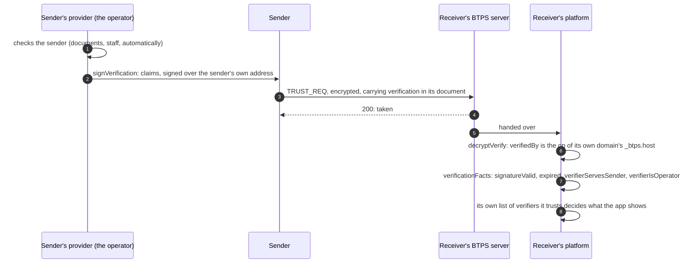

# Verification

> **Since 1.2.** `verification` travels in `1.2.0` artifacts only.

**What it is.** A provider that has checked who a sender is (by documents, by staff, or automatically) can sign a statement of what it checked, and the sender's trust request carries it: `verification`, in the request's document. The receiver gets the facts it needs to decide whether to believe it.

**Why.** "Is this invoice really from my energy company?" A receiver can see that a trusted provider checked the sender's legal name, without the protocol deciding for it. **BTPS verifies no one and labels no one verified.** It gives a standard place for the statement, the checks only cryptography can do, and the facts; whose verifications to trust is each provider's own decision.

## The flow



## The statement

Opened, the request's document carries the statement. Its claims use the protocol's names only: `entityType`, and `detail:` names with their values in their shapes.

```json btps=document:TRUST_REQ
{
  "id": "req-verified",
  "name": "Acme Pty Ltd",
  "email": "billing@acme.example",
  "reason": "To send you invoices",
  "phone": "+61 2 0000 0001",
  "verification": {
    "verifiedBy": "admin$saas.example",
    "claims": {
      "entityType": "organisation",
      "detail:legalName": "Acme Pty Ltd",
      "detail:registrationNumber": { "number": "51824753556", "country": "AU" }
    },
    "verifiedAt": "2026-11-01T00:00:00.000Z",
    "expiresAt": "2027-11-01T00:00:00.000Z",
    "selector": "btps1",
    "signature": {
      "algorithmHash": "sha256",
      "value": "BASE64-SIGNATURE",
      "fingerprint": "BASE64-FINGERPRINT"
    }
  }
}
```

- **The signature** is `verifiedBy`'s, at its `selector`, over the RFC 8785 form of `{ subject, claims, verifiedAt, expiresAt, verifiedBy, selector }`, where `subject` is the request's `from`. A statement cannot be copied into anyone else's request.
- **It is values**, so a request that carries one is encrypted.
- **Its verifier runs a BTPS server**: `verifiedBy` is the operator (`op`) in its own domain's `_btps.host`. A customer address on a SaaS (`jane$saas.example`, whose `op` is `admin$saas.example`) may not verify. Another operator may: an identity-check service running its own server, or a self-hoster who is its own `op`.

## The facts

`verificationFacts(request)` reports, for the opened request, and refuses nothing:

| Fact                   | Means                                                                                                  |
| ---------------------- | ------------------------------------------------------------------------------------------------------ |
| `signatureValid`       | the signature is `verifiedBy`'s, over this sender's address and these claims                           |
| `expired`              | `expiresAt` has passed                                                                                 |
| `verifierServesSender` | `verifiedBy` is on the domain of the operator named in the sender's `_btps.host`, not the sender's own |
| `verifierIsOperator`   | `verifiedBy` is that operator: the serving provider's own signing identity                             |

`verifierServesSender` shows a custom-domain or BYOK user signing for themselves: they control their own DNS or key, but cannot publish keys under their provider's domain.

## The code

From the feature journey (`tests/e2e/features.e2e.test.ts`).

### The sender's provider signs

```ts
import { signVerification } from '@btps/sdk/trust';

const verification = await signVerification(
  {
    subject: 'bob$client.example', // the sender: the request's `from`
    claims: { entityType: 'person', 'detail:legalName': 'Robert Smith' },
    verifiedAt: new Date().toISOString(),
    expiresAt: new Date(Date.now() + 365 * 86_400_000).toISOString(),
  },
  // The provider's operator, its one key pair; or `signer` for a key held elsewhere.
  { verifiedBy: 'admin$client.example', selector: 'btps1', pemFiles: operatorKeys },
);
```

The sender puts it in its trust request's document, as `verification`, and sends the request encrypted, as any trust request ([Trust permissions](./trustPermissions.md)).

### The receiver checks

```ts
import { verificationFacts } from '@btps/sdk/trust';

// `payload` is the opened request: decryptVerify has already refused a verifier who is no operator.
const facts = await verificationFacts({ from: artifact.from, document: payload.document });
// { signatureValid: true, expired: false, verifierServesSender: true, verifierIsOperator: true }

const trusted = myVerifiers.includes(payload.document.verification.verifiedBy);
if (facts.signatureValid && !facts.expired && trusted) {
  ui.show(`Verified by ${payload.document.verification.verifiedBy}`);
}
```

**Always name the verifier** ("Verified by …"), never a bare "Verified". The trust stays pending until the receiver's user answers, verified or not.

## Errors

| Code                    | Status | Who refuses                          | When                                                                                                                                              |
| ----------------------- | ------ | ------------------------------------ | ------------------------------------------------------------------------------------------------------------------------------------------------- |
| `BTP_ERROR_VALIDATION`  | 400    | `decryptVerify`, opening the request | `verifiedBy` is not the operator of its own domain ("the verifier does not run a BTPS server"), or claims under a name that is not the protocol's |
| `BTP_ERROR_RESOLVE_DNS` | —      | `decryptVerify`, opening the request | the verifier's `_btps.host` could not be looked up: try again; it judges no one                                                                   |
| `BTP_ERROR_VALIDATION`  | 400    | the receiving server, on arrival     | a readable request carrying a verification: it is values, so it is always encrypted                                                               |

A bad signature or an expired statement is not refused: they are facts (`signatureValid: false`, `expired: true`) for the receiver to weigh.

## Protocol and platform

| The protocol                                 | The platform (you)                                              |
| -------------------------------------------- | --------------------------------------------------------------- |
| a standard place and shape for the statement | decides whom it verifies, and how                               |
| refuses a verifier who runs no BTPS server   | keeps its own list of verifiers it trusts, even among operators |
| reports the cryptographic facts              | decides what its app shows, always naming the verifier          |

The rules in full: [Verification](../protocol/specifications/transporter-artifact.md#verification).
