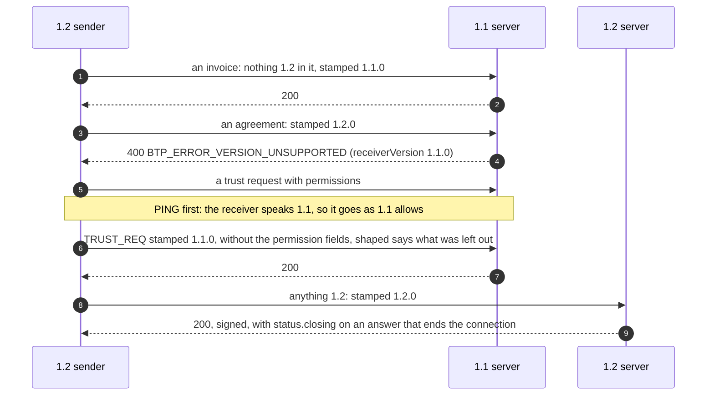

# Protocol versions

> **Since 1.2.** How a 1.2 provider and a 1.1 provider talk.

**What it is.** A 1.2 server takes any `1.1.x` and `1.2.x` artifact. A 1.2 sender stamps each artifact `1.1.0` whenever everything in it can be said in 1.1, and `1.2.0` only when it uses something 1.2 adds. So a 1.1 and a 1.2 provider always talk, and a 1.2 feature never reaches a 1.1 server that cannot understand it.

**Why.** Providers upgrade one at a time. Nothing a 1.1 provider sends today changes, and a 1.2 provider loses nothing by talking to one.

## The flow



## Stamping

`artifactVersion` decides: `1.1.0` unless the artifact uses something 1.2 adds (permission fields, `documentType`, `syncOf`, an agreement, a `withdrawn`, a note with a format, a discount, a template's values, and the rest). Identity lookups and control artifacts are always `1.1.0`, so every 1.1 and 1.2 server answers them. The agent and `signEncrypt` stamp for you.

## A 1.2 artifact to a 1.1 server

| Sent                                            | A 1.1.3 server answers                                                                         |
| ----------------------------------------------- | ---------------------------------------------------------------------------------------------- |
| any artifact stamped `1.2.0`                    | `400 BTP_ERROR_VERSION_UNSUPPORTED`; it is not delivered                                       |
| `DETAILS_CHANGED`, `DETAILS_REQ`, `DETAILS_RES` | `400 BTP_ERROR_VALIDATION`: it does not know the type, and refuses before it reads the version |
| a trust request with permissions                | taken, shaped to 1.1 (below)                                                                   |

The sender is told the receiver's version: `send` returns an `error` with `code: BTP_ERROR_VERSION_UNSUPPORTED` and `meta.receiverVersion`, beside the server's `response`.

```json btps=response
{
  "version": "1.1.0",
  "id": "e5f60718-293a-44b5-8c6d-7e8f9a0b1c2d",
  "issuedAt": "2026-11-08T07:00:00.000Z",
  "type": "btps_error",
  "reqId": "f6071829-3a4b-45c6-9d7e-8f9a0b1c2d3e",
  "status": {
    "ok": false,
    "code": 400,
    "error": "BTP_ERROR_VERSION_UNSUPPORTED",
    "message": "This server does not support the artifact protocol version: supports 1.1.0 to 1.1.0"
  }
}
```

Every one of these is proven against the published `@btps/sdk` 1.1.3, both ways, in the versions journey (`tests/e2e/versions.e2e.test.ts`).

## A trust request, shaped for a 1.1 receiver

Before it signs a trust request **with permissions**, the agent or `signEncrypt` asks the receiver's server its version with one `PING`. To a 1.1 server it goes as 1.1 allows: without `permissions`, `given`, `entityType` and `change`, and without `own` and `verification`, stamped `1.1.0`. The result says so:

```ts
const { payload, shaped } = await signEncrypt(to, sender, request, options);
// shaped: { sentAs: '1.1.0', leftOut: ['permissions', 'given', 'entityType'] }
```

- `versionFallback: false` refuses instead, with `BTP_ERROR_VERSION_UNSUPPORTED` and `meta.receiverVersion`.
- If the receiver's server cannot be asked, nothing is sent: a version is never guessed.
- A request without permissions is never asked about, so it costs no round trip.

A trust made under 1.1 keeps working; once both sides run 1.2, either may send a `change` to add permissions ([Trust permissions](./trustPermissions.md#changing-a-trust-later)).

## Asking a server its version

```ts
const { version } = await client.getServerVersion(); // from its answer to a PING
const { response } = await client.resolveIdentity('bob$client.example', from);
// response.serverVersion: from the host's signed answer, when the host answered
```

The `v` in `_btps.host` is a hint only: a sender learns what a server speaks from the version of its answers.

## The closing signal

A server that ends a connection after an answer (a refusal that ends it, `QUIT`, an idle timeout, too many unreadable lines) says so on that answer, in a `1.2.0` response: `status.closing: true`. The end can reach the client after the answer does. A client that reads `closing` writes nothing more to that connection, so its next send goes on a new one instead of failing with `BTP_ERROR_CONNECTION_ENDED`.

```json btps=response
{
  "version": "1.2.0",
  "id": "07182930-4a5b-46c7-8e9f-a0b1c2d3e4f5",
  "issuedAt": "2026-11-08T07:05:00.000Z",
  "type": "btps_error",
  "reqId": "18293a4b-5c6d-47e8-9fa0-b1c2d3e4f506",
  "status": {
    "ok": false,
    "code": 429,
    "error": "BTP_ERROR_RATE_LIMITER",
    "message": "Too many request than its allowed",
    "closing": true
  }
}
```

- The server adds it before the answer is signed, so it is signed with the rest.
- A client that requires its server's signature (`requireSignedBy`) acts on it only in an answer signed as required.
- A 1.1 server's answers say nothing; with one, the client still lets in only an end that has already arrived, as in 1.1.
- A 1.1.3 client reads a 1.2 answer carrying `closing` like any other.

## Errors

| Code                            | Status | Who                                                              | When                                                                                  |
| ------------------------------- | ------ | ---------------------------------------------------------------- | ------------------------------------------------------------------------------------- |
| `BTP_ERROR_VERSION_UNSUPPORTED` | 400    | a 1.1 server; the sender's own SDK with `versionFallback: false` | a `1.2.0` artifact to a 1.1 server; the error's `meta.receiverVersion` is its version |
| `BTP_ERROR_VALIDATION`          | 400    | a 1.1 server                                                     | a details artifact: a type it does not know                                           |
| `BTP_ERROR_VALIDATION`          | 400    | a 1.2 server                                                     | a 1.2-only field in a `1.1.0` artifact, or `status.closing` in a `1.1.0` response     |

## Protocol and platform

Stamping, asking and shaping are the SDK's, automatically. What to do when a receiver speaks 1.1 (send as 1.1 allows, or refuse) is the platform's choice, through `versionFallback`. What changes for a 1.1 provider that upgrades is in [Migrating from 1.1 to 1.2](../whats-new/version-1-2-migration.md).
