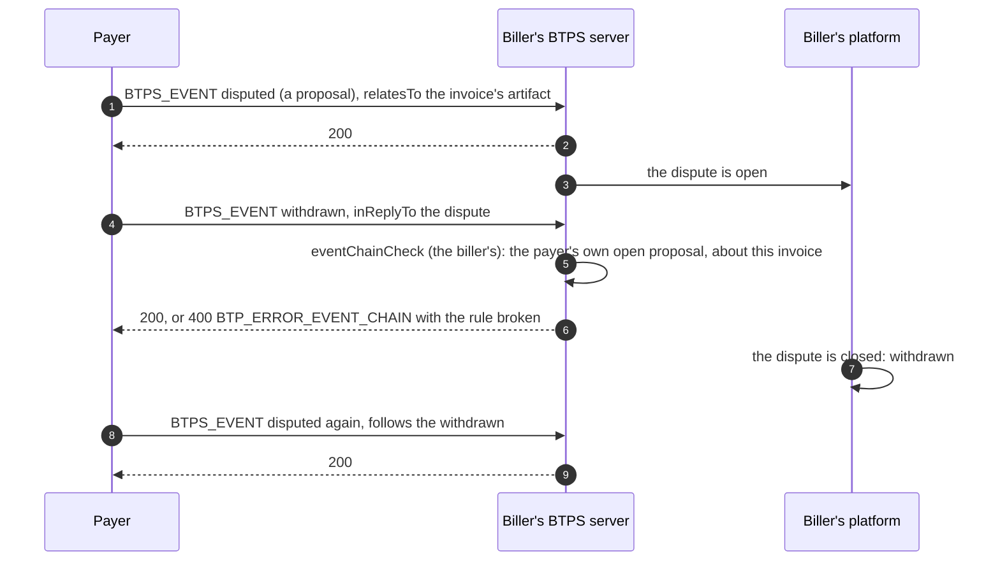

# Withdrawing a proposal

> **Since 1.2.** `withdrawn` and `follows` travel in `1.2.0` artifacts only.

**What it is.** A payer who sent a proposal about an invoice (`paid`, `partially_paid`, `disputed` or `refund_requested`) that has not been answered can take it back with a `withdrawn` event, naming the proposal in `inReplyTo`. Later, the payer may propose again: a new proposal that names the `withdrawn` it follows in `follows`, so the chain stays traceable (`disputed` → `withdrawn` → `disputed`).

**Why.** A proposal sent by mistake (a dispute filed on the wrong invoice, a `paid` marked too early) would otherwise stay open until the biller answered it. The payer who sent it closes it instead, and the biller need not answer.

The rules:

- only the payer who sent the proposal withdraws it, never the invoice's issuer, whose own recorded `paid` is final;
- only while it is open: an answered proposal stays answered;
- a withdrawal is final, with no answer;
- `withdrawn` and `follows` travel in `1.2.0` artifacts only: a 1.1 receiver takes neither.

## The flow



## The events

The withdrawal, readable so the check runs in flight:

```json btps=transporter
{
  "version": "1.2.0",
  "id": "0b7f1f1e-6c1a-4a8e-9a57-6f0c1b9e2d3a",
  "issuedAt": "2026-11-08T03:00:00.000Z",
  "type": "BTPS_EVENT",
  "from": "pay$client.example",
  "to": "billing$vendor.example",
  "selector": "btps1",
  "relatesTo": "6f0d8e2a-7b1c-4e3d-9a5f-1c2b3d4e5f60",
  "document": {
    "type": "lifecycle_event",
    "id": "0b7f1f1e-6c1a-4a8e-9a57-6f0c1b9e2d3a",
    "occurredAt": "2026-11-08T03:00:00.000Z",
    "document": {
      "from": "billing$vendor.example",
      "id": "INV-1001",
      "sha256": "aaaaaaaaaaaaaaaaaaaaaaaaaaaaaaaaaaaaaaaaaaaaaaaaaaaaaaaaaaaaaaaa"
    },
    "eventType": "withdrawn",
    "inReplyTo": "3c8e7a2b-5d4f-4e1a-8b6c-9d0e1f2a3b4c"
  },
  "encryption": null,
  "signature": {
    "algorithmHash": "sha256",
    "value": "BASE64-SIGNATURE",
    "fingerprint": "BASE64-FINGERPRINT"
  }
}
```

The proposal sent again, naming the withdrawal it follows:

```json btps=document:BTPS_EVENT
{
  "type": "lifecycle_event",
  "id": "9a8b7c6d-5e4f-4a3b-8c2d-1e0f9a8b7c6d",
  "occurredAt": "2026-11-09T00:00:00.000Z",
  "document": {
    "from": "billing$vendor.example",
    "id": "INV-1001",
    "sha256": "aaaaaaaaaaaaaaaaaaaaaaaaaaaaaaaaaaaaaaaaaaaaaaaaaaaaaaaaaaaaaaaa"
  },
  "eventType": "disputed",
  "reason": "amount_wrong",
  "follows": "0b7f1f1e-6c1a-4a8e-9a57-6f0c1b9e2d3a"
}
```

Only a proposal carries `follows`, and only a reply or a `withdrawn` carries `inReplyTo`.

## The code

### The payer withdraws

A `withdrawn` is an ordinary event: from a device with `event.send` (whose `relatesTo` names the invoice's artifact), or from a platform's server with `signEncrypt`.

```ts
await agent.command(
  'event.send',
  'billing$vendor.example',
  {
    type: 'lifecycle_event',
    id: crypto.randomUUID(),
    occurredAt: new Date().toISOString(),
    document: { from: 'billing$vendor.example', id: 'INV-1001', sha256: invoiceSha256 },
    eventType: 'withdrawn',
    inReplyTo: disputeId,
  },
  { relatesTo: invoiceArtifactId },
);
```

### The biller checks the chain

The chain is the receiving platform's to check, from the events it holds; the server never checks it. The SDK ships the check as middleware, off until added. From the feature journey (`tests/e2e/features.e2e.test.ts`):

```js
import { eventChainCheck } from '@btps/sdk/server/core';

export default function createMiddleware() {
  return [
    eventChainCheck({
      // The platform's own facts of an earlier event between the two parties:
      // { eventType, from, state: 'open' | 'answered' | 'withdrawn', document: { from, id } }
      getEvent: ({ id, from, to }) => events.facts({ id, from, to }),
    }),
  ];
}
```

With `getEvent` it checks every rule; without it, only that the payer sent it. It refuses an **unencrypted** event in flight. For an encrypted event, the platform runs the same rules once it opens it, with `lifecycleEventChainProblem` and `lifecycleEventSenderProblem` (`@btps/sdk/server`).

In the journey, the payer's withdrawal of its own open dispute is taken, while a `withdrawn` naming an unknown event and one sent by the biller are refused with `BTP_ERROR_EVENT_CHAIN`. The second says "only the payer".

## Errors

| Code                    | Status | Who refuses                                                     | When                                                                                                                                                                                                                                                                                                            |
| ----------------------- | ------ | --------------------------------------------------------------- | --------------------------------------------------------------------------------------------------------------------------------------------------------------------------------------------------------------------------------------------------------------------------------------------------------------- |
| `BTP_ERROR_EVENT_CHAIN` | 400    | `eventChainCheck` (the receiver's), or the platform once opened | a `withdrawn` or `follows` from the invoice's issuer; a `withdrawn` naming no event between the two, a reply, the other party's proposal, another invoice's, or one already answered or withdrawn; a `follows` naming anything but a `withdrawn` about the same invoice. The sender is told which rule it broke |
| `BTP_ERROR_VALIDATION`  | 400    | the receiving server                                            | `inReplyTo` on a proposal, `follows` on a reply, or either in a `1.1.0` artifact                                                                                                                                                                                                                                |

## Protocol and platform

The protocol defines `withdrawn`, `inReplyTo` and `follows`, and their shapes. The chain (who sent what, what is open) is in the platform's own records, so checking it is the platform's: add `eventChainCheck` with your `getEvent`, or run `lifecycleEventChainProblem` once you open an event. The rules in full: [Lifecycle Event](../protocol/specifications/transporter-artifact.md#4-lifecycle-event-btps_event).
