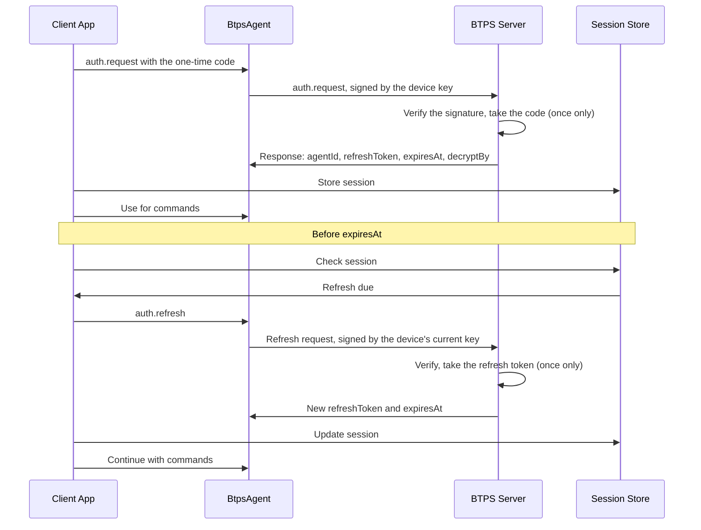

# BTPS Client Authentication

This guide shows you how to implement authentication and refresh token logic in your BTPS client application. It covers using the built-in `InMemoryAuthSessionStore` and creating custom session stores for production use.

## Overview

BTPS client authentication involves:

1. **Requesting authentication** from the BTPS server using an auth token
2. **Storing session information** locally
3. **Managing token refresh** when sessions expire

## Authentication Flow



Refresh before `expiresAt`: once the device record has expired, a refresh is refused (`BTP_ERROR_TRUST_NOT_ALLOWED`) and the device must register again with a new code. Each refresh token works once; the response carries the next one. A refresh may also move the device to a new key, with a proof signed by that key (`BtpsAuthentication.rotateKey`).

## 1. Using BtpsAuthentication with InMemoryAuthSessionStore

The `BtpsAuthentication` class provides a high-level interface for authentication, while `InMemoryAuthSessionStore` handles session storage. This approach is recommended over manual command handling.

### Basic Usage

```typescript
import { getFingerprintFromPem } from '@btps/sdk/crypto';
import type { BTPKeyPair } from '@btps/sdk/crypto';
import { BtpsAuthentication, InMemoryAuthSessionStore } from '@btps/sdk/authentication';
import type { AuthSession } from '@btps/sdk/authentication';

class AuthenticationManager {
  private sessionStore: InMemoryAuthSessionStore;

  constructor() {
    this.sessionStore = new InMemoryAuthSessionStore();
  }

  // keyPair is this device's key: the server registers its public half, and
  // every later command and refresh is signed with it until the device rotates
  // to a new key (see Rotating the Device Key).
  async authenticate(
    identity: string,
    authToken: string,
    keyPair: BTPKeyPair,
  ): Promise<AuthSession> {
    const result = await BtpsAuthentication.authenticate(identity, authToken, keyPair, {
      deviceName: 'Your App',
      appVersion: '1.0.0',
    });

    if (!result.success || !result.response) {
      throw new Error(`Authentication failed: ${result.error?.message || 'Unknown error'}`);
    }

    // Create session object from response
    const { agentId, refreshToken, expiresAt, decryptBy } = result.response.document;
    const session: AuthSession = {
      agentId,
      userIdentity: identity,
      token: authToken,
      refreshToken,
      publicKeyFingerprint: getFingerprintFromPem(keyPair.publicKey),
      createdAt: new Date().toISOString(),
      expiresAt,
      decryptBy,
    };

    // Store session
    await this.sessionStore.store(session);
    return session;
  }

  async refreshSession(
    identity: string,
    agentId: string,
    refreshToken: string,
    keyPair: BTPKeyPair, // the same key the agent authenticated with
  ): Promise<AuthSession> {
    const currentSession = await this.sessionStore.getByAgentId(agentId);

    if (!currentSession) {
      throw new Error('No session found to refresh');
    }

    // Refresh session using BtpsAuthentication
    const result = await BtpsAuthentication.refreshSession(
      agentId,
      identity,
      refreshToken,
      keyPair,
      {
        deviceName: 'Your App',
        appVersion: '1.0.0',
      },
    );

    if (!result.success || !result.response) {
      throw new Error(`Token refresh failed: ${result.error?.message || 'Unknown error'}`);
    }

    // Update session with new tokens
    const { refreshToken: newRefreshToken, expiresAt } = result.response.document;
    const updatedSession: AuthSession = {
      ...currentSession,
      refreshToken: newRefreshToken,
      expiresAt,
    };

    // Update stored session
    await this.sessionStore.store(updatedSession);
    return updatedSession;
  }

  async getSession(agentId: string): Promise<AuthSession | undefined> {
    return this.sessionStore.getByAgentId(agentId);
  }
}
```

## 2. Using with Your Application

```typescript
import { BtpsAgent, BtpsTransporter } from '@btps/sdk/client';
import { getBTPKeyPair } from '@btps/sdk/crypto';
import type { BTPKeyPair } from '@btps/sdk/crypto';

class AppClient {
  private agent?: BtpsAgent;
  private transporter?: BtpsTransporter;
  private authManager: AuthenticationManager;
  private identity: string;
  private userType: 'managed' | 'byok';
  private keyPair: BTPKeyPair;
  private agentId?: string;

  constructor(identity: string, userType: 'managed' | 'byok') {
    this.identity = identity;
    this.userType = userType;
    this.authManager = new AuthenticationManager();
    // One key for this device, generated once and kept (in production, in the
    // device's own secure storage)
    this.keyPair = getBTPKeyPair();
  }

  async initialize(authToken: string): Promise<void> {
    // Authenticate and get session
    const session = await this.authManager.authenticate(this.identity, authToken, this.keyPair);
    this.agentId = session.agentId;

    // The agent signs with the key the server just registered
    this.agent = new BtpsAgent({
      agent: {
        id: session.agentId, // Use the agent ID from authentication
        identityKey: this.keyPair.privateKey,
        identityCert: this.keyPair.publicKey,
      },
      btpIdentity: this.identity,
    });

    // Initialize BtpsTransporter for BYOK users
    if (this.userType === 'byok') {
      this.transporter = new BtpsTransporter({
        maxConnections: 10,
        connectionTTLSeconds: 300,
        maxRetries: 3,
        retryDelayMs: 1000,
      });
    }
  }

  async queryInboxes(): Promise<any> {
    if (!this.agent) {
      throw new Error('BtpsAgent not initialized');
    }

    const response = await this.agent.command('inbox.fetch', this.identity, {
      limit: 10,
      sort: 'desc',
    });

    if (response.error) {
      throw new Error(`Failed to query inboxes: ${response.error.message}`);
    }

    return response.response?.document;
  }

  async refreshSession(): Promise<void> {
    if (!this.agentId) {
      throw new Error('BtpsAgent not initialized');
    }

    const session = await this.authManager.getSession(this.agentId);
    if (!session) {
      throw new Error('No session found to refresh');
    }

    await this.authManager.refreshSession(
      this.identity,
      this.agentId,
      session.refreshToken,
      this.keyPair,
    );
  }
}

// Usage
const client = new AppClient('billing$yourdomain.com', 'byok');

// Initialize with auth token from your SaaS platform
await client.initialize('YDVKSEU4CEEW');

// Use the client
const inboxes = await client.queryInboxes();
```

## 3. Rotating the Device Key

A refresh keeps the device's key: the server refuses a refresh that names a different key without a proof signed by it (`BTP_ERROR_KEY_ROTATION_PROOF`), so a refresh token alone can never move a device to someone else's key. To move to a new key, use `rotateKey`. The current key signs the request and the new key signs a proof, so the server accepts the new key only from the device holding both. It keeps the old key's fingerprint in the device's key history.

```typescript
import { getBTPKeyPair } from '@btps/sdk/crypto';
import { BtpsAuthentication } from '@btps/sdk/authentication';

const newKeyPair = getBTPKeyPair();

const result = await BtpsAuthentication.rotateKey(
  session.agentId,
  identity,
  session.refreshToken,
  currentKeyPair, // the key the server holds for this device today
  newKeyPair,
  { deviceName: 'Your App' },
);

if (!result.success || !result.response) {
  throw new Error(`Key rotation failed: ${result.error?.message || 'Unknown error'}`);
}

// From now on the device signs with newKeyPair: create the BtpsAgent with it,
// store the new refresh token, and delete the old private key.
```

A device's access also ends on its own: the server gives each device an expiry, and only a refresh extends it. A stolen key stops working when the device expires or the user revokes it. Rotate on a schedule that suits your app, for example each time the app updates.

## 4. Advanced Examples

For advanced authentication patterns, custom session stores, and production implementations, see:

- **[Authentication Examples](../../protocol/authentication/examples.md)** - Comprehensive examples including MongoDB, Redis, and production patterns
- **[Authentication Flow](../../protocol/authentication/authenticationFlow.md)** - Detailed authentication flow documentation
- **[BtpsAuthentication](../../protocol/authentication/btpsAuthentication.md)** - Complete API reference

## Key Points

1. **Use BtpsAuthentication class**: Provides high-level authentication interface
2. **Use InMemoryAuthSessionStore for development**: Simple and effective for testing
3. **Agent ID comes from server**: The server provides the agent ID during authentication
4. **One key per device**: Generate it once with `getBTPKeyPair()`, keep it, and use it to authenticate, send commands and refresh; move to a new one with `rotateKey`
5. **Handle token refresh**: Refresh sessions when they expire

## Next Steps

- **[BtpsAgent](./btpsAgent.md)** - Advanced BtpsAgent usage and commands
- **[BtpsTransporter](./btpsTransporter.md)** - Message delivery with BtpsTransporter
