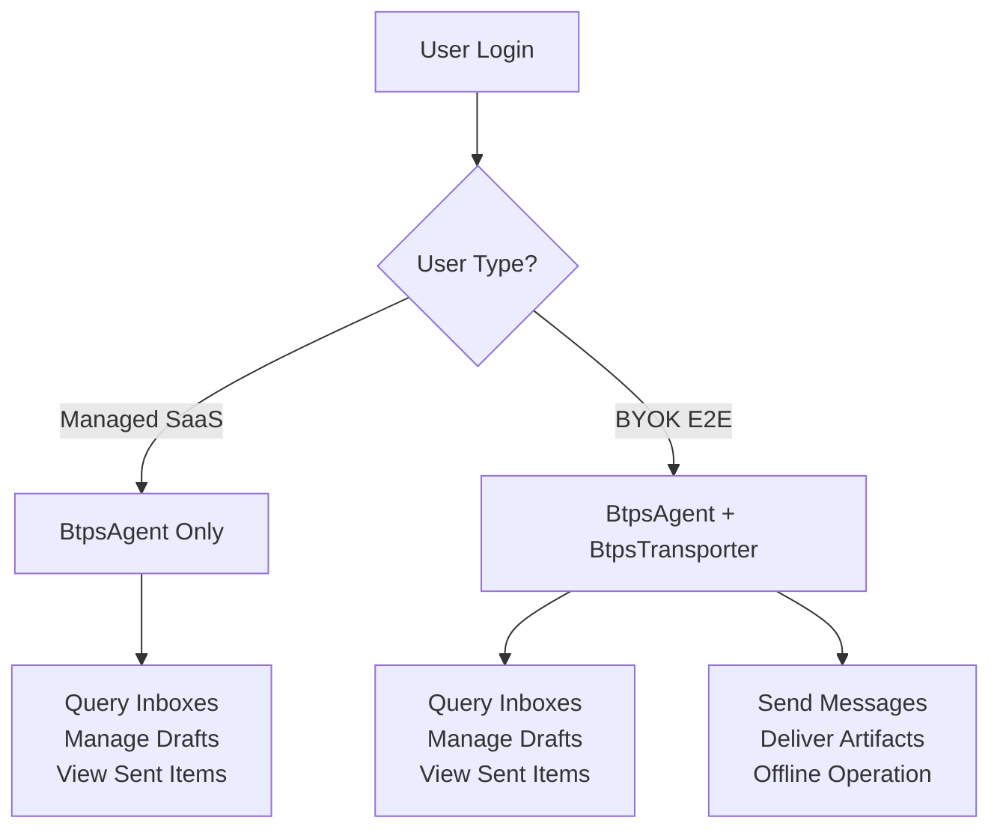

# BTPS Client Setup Guide

This guide shows you how to create a BTPS client application that dynamically chooses between `BtpsAgent` and `BtpsTransporter` based on whether the user is a managed SaaS user or a BYOK (Bring Your Own Key) user.

## Overview

BTPS client applications are similar to IMAP applications - they're dynamic and live within user apps. The application presents a login interface asking for:

1. **User Identity** (e.g., `billing$yourdomain.com`)
2. **User Type** (Managed SaaS user or BYOK E2E custom domain user)

Based on the user type, the app will use either:

- **BtpsAgent**: For managed users and BYOK users (for querying inboxes, drafts, etc.)
- **BtpsTransporter**: For BYOK users (for sending messages independently)

## Application Architecture



## 1. Basic Application Structure

```typescript
import { BtpsAgent, BtpsTransporter } from '@btps/sdk/client';
import { InMemoryAuthSessionStore } from '@btps/sdk/authentication';
import { readFileSync } from 'fs';

interface UserConfig {
  identity: string;
  userType: 'managed' | 'byok';
  privateKey?: string;
  publicKey?: string;
}

class BTPSClientApp {
  private agent?: BtpsAgent;
  private transporter?: BtpsTransporter;
  private sessionStore: InMemoryAuthSessionStore;

  constructor() {
    this.sessionStore = new InMemoryAuthSessionStore();
  }

  async initialize(userConfig: UserConfig) {
    // Implementation will be shown below
  }
}
```

## 2. User Type Selection

During login, your application should ask users to choose their type:

- **Managed User**: Uses SaaS-provided keys and server
- **BYOK User**: Brings their own keys and can operate independently

This choice determines which BTPS clients to initialize.

## 3. Conditional Client Setup

```typescript
import { BtpsAgent, BtpsTransporter } from '@btps/sdk/client';
import { readFileSync } from 'fs';

async initialize(userConfig: UserConfig) {
  const { identity, userType } = userConfig;

  // Load or generate key pair for the application
  const privateKey = userConfig.privateKey || readFileSync('./keys/private.pem', 'utf8');
  const publicKey = userConfig.publicKey || readFileSync('./keys/public.pem', 'utf8');

  // All users need BtpsAgent for querying storage
  this.agent = new BtpsAgent({
    agent: {
      id: 'temp', // Until authentication; then create a new BtpsAgent with the agent ID it returns
      identityKey: privateKey,
      identityCert: publicKey,
    },
    btpIdentity: identity,
    host: 'localhost',
    port: 3443,
    maxRetries: 3,
    retryDelayMs: 1000,
    connectTimeoutMs: 5000, // at least 5000
    replyTimeoutMs: 20000, // at least 10000
    btpMtsOptions: { rejectUnauthorized: false }, // local development only
  });

  // Only BYOK users need BtpsTransporter for independent message delivery
  if (userType === 'byok') {
    this.transporter = new BtpsTransporter({
      maxConnections: 10,
      connectionTTLSeconds: 300,
      maxRetries: 3,
      retryDelayMs: 1000,
      connectTimeoutMs: 5000,
      replyTimeoutMs: 20000,
    });
  }

  // Note: Authentication will be handled in the next guide
  console.log('Clients initialized successfully');
}
```

Every timeout, its minimum and the other client limits are on [Limits](../../protocol/specifications/limits.md#client-and-transporter-settings).

## 4. Basic Usage Examples

### Querying Inboxes (All Users)

```typescript
async queryInboxes() {
  if (!this.agent) {
    throw new Error('BtpsAgent not available');
  }

  // Note: Authentication is required before this will work
  const response = await this.agent.command('inbox.fetch', this.userConfig!.identity, {
    limit: 10,
    sort: 'desc'
  });

  if (response.error) {
    throw new Error(`Failed to query inboxes: ${response.error.message}`);
  }

  return response.response?.document;
}
```

### Sending Messages (BYOK Users Only)

```typescript
import { parseIdentity } from '@btps/sdk';
import { signEncrypt } from '@btps/sdk/crypto';
import type { BTPTransporterArtifact } from '@btps/sdk/server';

async sendMessage(to: string, document: any) {
  if (!this.transporter) {
    throw new Error('BtpsTransporter not available for managed users');
  }

  const from = this.userConfig!.identity;
  const { accountName, domainName } = parseIdentity(from)!;

  // Sign with your own key and encrypt to the receiver's published key.
  // signEncrypt fills in id and issuedAt.
  const { payload: artifact, error } = await signEncrypt(
    to,
    {
      accountName,
      domainName,
      pemFiles: {
        privateKey: readFileSync('./keys/private.pem', 'utf8'),
        publicKey: readFileSync('./keys/public.pem', 'utf8'),
      },
    },
    {
      version: '1.1.0',
      type: 'BTPS_DOC',
      from,
      to,
      selector: 'btps1', // the selector your own key is published under
      document,
    },
    {
      signature: { algorithmHash: 'sha256' },
      encryption: { algorithm: 'aes-256-gcm', mode: 'standardEncrypt' },
    },
  );
  if (error) throw error;

  // Deliver the artifact
  const response = await this.transporter.transport(to, artifact as BTPTransporterArtifact);

  if (response.error) {
    throw new Error(`Failed to deliver message: ${response.error.message}`);
  }

  return response.response;
}
```

## 5. Complete Application Example

```typescript
class BTPSClientApp {
  private agent?: BtpsAgent;
  private transporter?: BtpsTransporter;
  private userConfig?: UserConfig;

  async login(identity: string, userType: 'managed' | 'byok') {
    this.userConfig = { identity, userType };
    await this.initialize(this.userConfig);
  }

  async getInboxes() {
    return this.queryInboxes();
  }

  async sendInvoice(to: string, invoiceData: any) {
    if (this.userConfig?.userType === 'managed') {
      // For managed users, send through SaaS server
      return this.agent?.command('artifact.send', to, invoiceData);
    } else {
      // For BYOK users, send directly
      return this.sendMessage(to, invoiceData);
    }
  }

  async getDrafts() {
    return this.agent?.command('draft.fetch', this.userConfig!.identity, {
      limit: 10,
      sort: 'desc',
    });
  }

  async getSentItems() {
    return this.agent?.command('sentbox.fetch', this.userConfig!.identity, {
      limit: 10,
      sort: 'desc',
    });
  }
}

// Usage
const app = new BTPSClientApp();

// Managed user
await app.login('billing$saascompany.com', 'managed');

// BYOK user
await app.login('billing$yourdomain.com', 'byok');

// Use the app (authentication required first)
const inboxes = await app.getInboxes();
const sentItems = await app.getSentItems();
```

## 6. Next Steps

This setup guide covers the basic structure of a BTPS client application. The next steps are:

1. **Authentication**: Learn how to authenticate with BTPS servers and manage sessions
2. **Advanced BtpsAgent Usage**: Explore all available commands and storage operations
3. **Advanced BtpsTransporter Usage**: Learn about message delivery patterns and offline operation

## Key Points

1. **User type is a choice**: Ask users during login whether they are managed or BYOK users
2. **Load keys from files**: Use `readFileSync()` to load private/public keys from PEM files
3. **Agent ID comes from server**: The server provides the agent ID during authentication
4. **All users need BtpsAgent**: For querying inboxes, drafts, and sent items
5. **Only BYOK users need BtpsTransporter**: For independent message delivery
6. **Pre-sign artifacts**: BtpsTransporter requires artifacts to be pre-signed before sending
7. **Connection pooling**: BtpsTransporter manages connections with TTL and maxConnections

## Next Steps

- **[Authentication](./authentication.md)** - Detailed authentication implementation
- **[BtpsAgent](./btpsAgent.md)** - Advanced BtpsAgent usage
- **[BtpsTransporter](./btpsTransporter.md)** - Advanced BtpsTransporter usage
