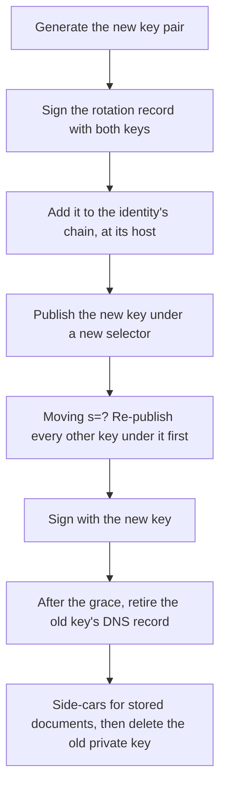

# Rotating keys

An identity's key signs everything it sends, and is the key documents to it are encrypted to. Rotating it moves the identity to a new key without breaking what the old one signed.

Since 1.2, every rotation is a signed record in the identity's **key chain**, which its host serves and every 1.2 server checks each arriving key against. So an old key can be retired from DNS, and its private key deleted, while what it signed stays verifiable, and a compromised key is refused at once, whatever DNS still has. This page is the operator's walk-through: the DNS records, a planned rotation step by step, a compromised or lost key, and deleting the old private key. The code is in the [Key rotation](../features/keyRotation.md) guide, and the rules in the [specification](./specifications/key-rotation.md).

## The DNS records

### Key records, by selector

Each key of an identity is published under a **selector**:

```
<selector>._btps.identity.<account>.<domain>
```

`<account>` is the part of the address before `$`: `billing$vendorcorp.com` publishes at `<selector>._btps.identity.billing.vendorcorp.com`.

```dns
btps1._btps.identity.billing.vendorcorp.com. IN TXT "v=1.1.0;k=rsa;p=MIIBIjANBgkqhkiG9w0BAQEFAAOCAQ8AMIIBCgKCAQEA..."
```

- `v=1.1.0`: the protocol version
- `k=rsa`: the key type. Every key is RSA, at least 2048 bits
- `p=`: the public key, the DER SPKI in base64, without PEM headers

**A new key always gets a new selector.** A selector names one key for the life of the identity; a provider MUST never reuse one for a different key. Name them so they never repeat: `btps1`, `btps2`, ..., or `2026q4`.

### The host record

```dns
_btps.host.vendorcorp.com. IN TXT "v=1.1.0;u=btps.vendorcorp.com:3443;s=btps2;op=admin$vendorcorp.com"
```

- `u=`: the BTPS host and port
- `s=`: the domain's current selector
- `op=`: the domain's operator, which delegates, attests and answers identity lookups for the domain ([The Domain Operator](./specifications/overview.md#the-domain-operator)). Rotating keys never changes it: the operator is an identity, not a key

**`s=` is domain-wide.** Receivers look up keys under it for every address on the domain. Before you change it, every identity on the domain, and the operator, must have a key under the new selector.

## A planned rotation, step by step



1. **Generate the new key pair.**

   ```bash
   openssl genrsa -out btps2.key.pem 2048
   openssl rsa -in btps2.key.pem -pubout -out btps2.pub.pem
   ```

2. **Sign the rotation record** with the old key and the new one (`signKeyRotation`), its `prev` the hash of the chain's last record (`keyChainRecordHash`), or `null` for the first. `at` is when the new key starts signing.

3. **Add it to the identity's chain**, kept on the identity's record in your identity store (`keyChain`). From now on the host answers chain lookups with it. A host answers for an identity whose keys are in DNS from the chain alone.

4. **Publish the new key** under its new selector.

5. **If `s=` moves:** publish a key under the new selector for **every** identity on the domain first, and the operator's. An identity that is not rotating **re-publishes its unchanged key** under the new selector: the same key, which needs no record. Then change `s=`. A 1.2 server takes a chain only when its last key is one DNS publishes, at the chain's last selector or at `s=`.

6. **Sign with the new key**, naming its selector.

7. **Retire the old key's DNS record after the grace.** A 1.2 receiver takes a key rotated away as planned for `retiredKeyGraceSeconds` (a day, by default) after the rotation, and then refuses it (`BTP_ERROR_KEY_RETIRED`), whatever DNS has. A 1.1 receiver reads DNS only: while you talk to 1.1 peers, keep the record at least that long, so artifacts already in flight are taken.

8. **Delete the old private key** once stored documents no longer need it ([below](#deleting-the-old-private-key)).

| When                      | What                                                                                   |
| ------------------------- | -------------------------------------------------------------------------------------- |
| Day 0                     | sign the record, keep the chain, publish the new key, move `s=`, sign with the new key |
| After the grace (a day)   | retire the old key's DNS record                                                        |
| Once every side-car opens | delete the old private key                                                             |

## A compromised key

1. **Rotate with immediate expiry**, both keys signing, with `compromisedSince` the earliest time the key may have been compromised and `reason: 'compromised'`. A 1.2 receiver refuses the key at once (`BTP_ERROR_KEY_REVOKED`), even for an artifact dated before `compromisedSince`: a thief can date an artifact as they like.
2. **Remove the old key's DNS record at once.** This is a rule, not a choice. A receiver that cannot reach your host checks the key by DNS alone, and only a removed record refuses it then (`BTP_ERROR_RESOLVE_PUBKEY`), within its DNS time-to-live and any key cache.
3. **Publish the new key, and move `s=`** as in a planned rotation.
4. **Take anything already encrypted to the key as exposed.** Side-cars protect what is stored from now on, not what a thief already copied.

**Found later?** A key the identity already rotated away from may turn out to have been compromised before it was left. The identity's current key signs an expiry record (`signKeyExpiry`) naming it and its `compromisedSince`, and the old key is refused from then on; remove its DNS record too, if it is still there. The expiry is dated when it is declared, and an evidence bundle shows a statement that had already arrived before it ([In an evidence bundle](./specifications/key-rotation.md#in-an-evidence-bundle)).

## A lost key

A key you no longer hold cannot sign its own rotation. The new key alone signs a rotation with immediate expiry and `reason: 'lost'`, which names the lost key's public key. Such a rotation counts only where its authority is confirmed online: by the operator's signed answer, for an identity whose keys only its host knows, or by DNS publishing the new key. Offline, it is reported as unconfirmed. Remove the lost key's DNS record at once, as for a compromised key.

## Deleting the old private key

Verifying never needs a private key; opening a document does, and one key both signs and is encrypted to. A signed artifact is never changed, so before deleting an old private key:

1. wait until nothing more is encrypted to it: the DNS time-to-live of its record, caches, `maxArtifactAgeSeconds` and retries;
2. give each stored document encrypted to it a **side-car**, the content key wrapped to the new key (`wrapContentKeyFor`), kept beside it, outside its signature;
3. confirm every side-car opens its document with the new key (`contentKeyOpens`), and only then delete the old private key.

The [Key rotation](../features/keyRotation.md#delete-an-old-private-key) guide has the code.

## What a receiver does

A 1.2 server asks the sender's host for its chain on each arrival, keeps it for at most `keyChainMaxCacheSeconds` (300 seconds by default), and checks the key against it:

| The key                                                        | The server                                     |
| -------------------------------------------------------------- | ---------------------------------------------- |
| the chain's current key                                        | takes it                                       |
| rotated away as planned, within the grace                      | takes it                                       |
| rotated away as planned, past the grace                        | refuses: `BTP_ERROR_KEY_RETIRED` (401)         |
| expired                                                        | refuses at once: `BTP_ERROR_KEY_REVOKED` (401) |
| no key of the chain                                            | refuses: `BTP_ERROR_RESOLVE_PUBKEY`            |
| no chain: never rotated, a 1.1 host, or a host it cannot reach | checks the key by DNS, as in 1.1               |

A provider's own `keyResolver` that gives chains keeps each no longer than `keyChainMaxCacheSeconds` too: that is the longest a revoked key can still be taken.

## Troubleshooting

```bash
# The key records, old and new
dig TXT btps1._btps.identity.billing.vendorcorp.com
dig TXT btps2._btps.identity.billing.vendorcorp.com

# The host record: the current selector and the operator
dig TXT _btps.host.vendorcorp.com
```

| A receiver refuses with    | Look at                                                                                                                                      |
| -------------------------- | -------------------------------------------------------------------------------------------------------------------------------------------- |
| `BTP_ERROR_KEY_RETIRED`    | something still signs with the old key: move it to the new key and selector                                                                  |
| `BTP_ERROR_KEY_REVOKED`    | the key is expired by the chain: sign with the current key                                                                                   |
| `BTP_ERROR_RESOLVE_PUBKEY` | the chain's last key is not in DNS at its selector or at `s=`; an identity not re-published under a new `s=`; or a record not yet propagated |

For the rules in full, see the [Key Rotation specification](./specifications/key-rotation.md).
