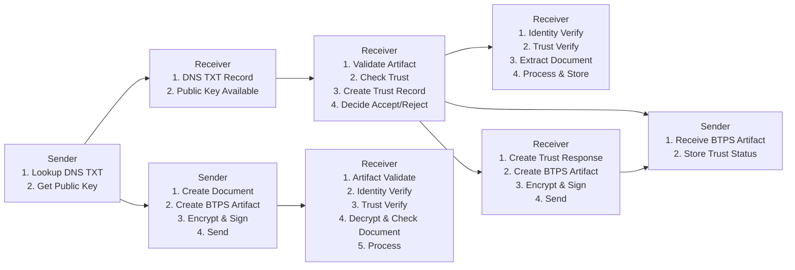
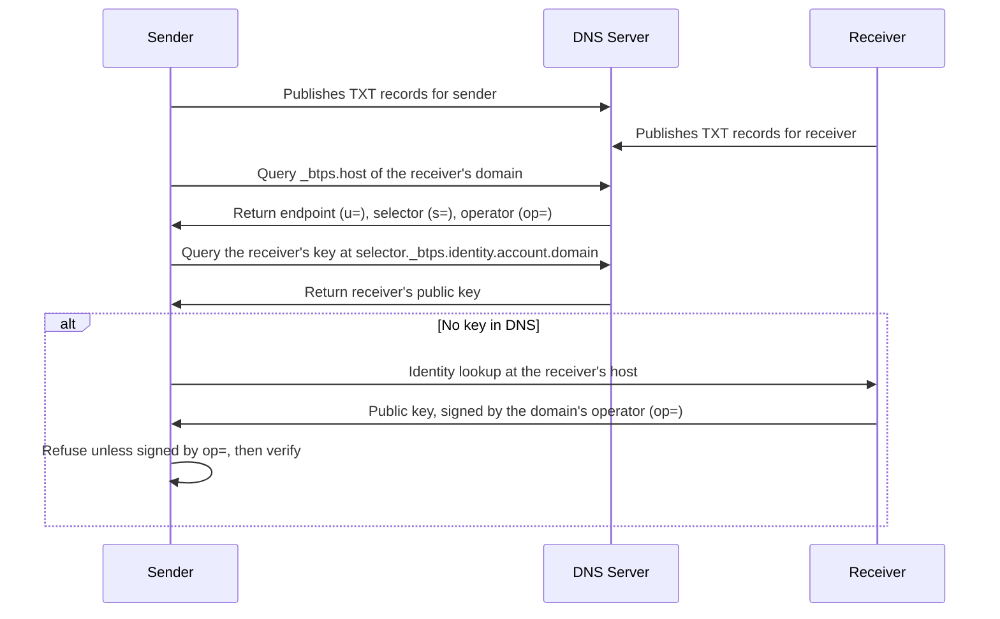
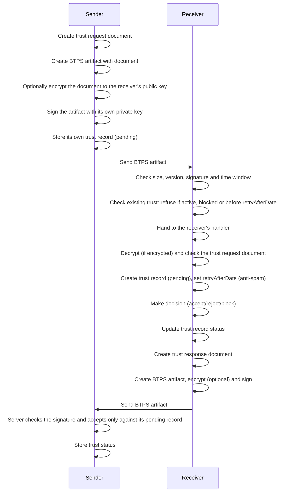
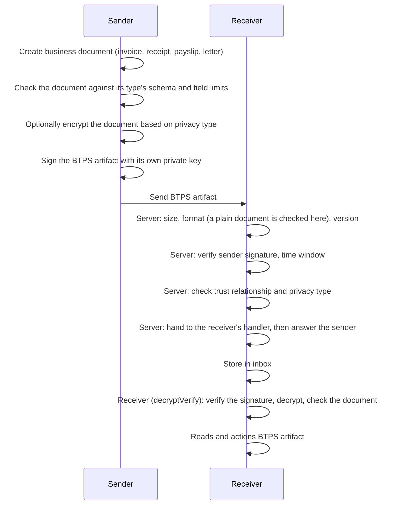
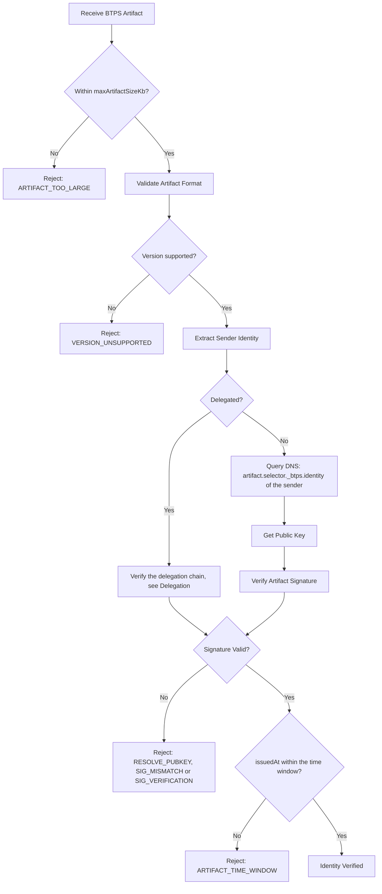
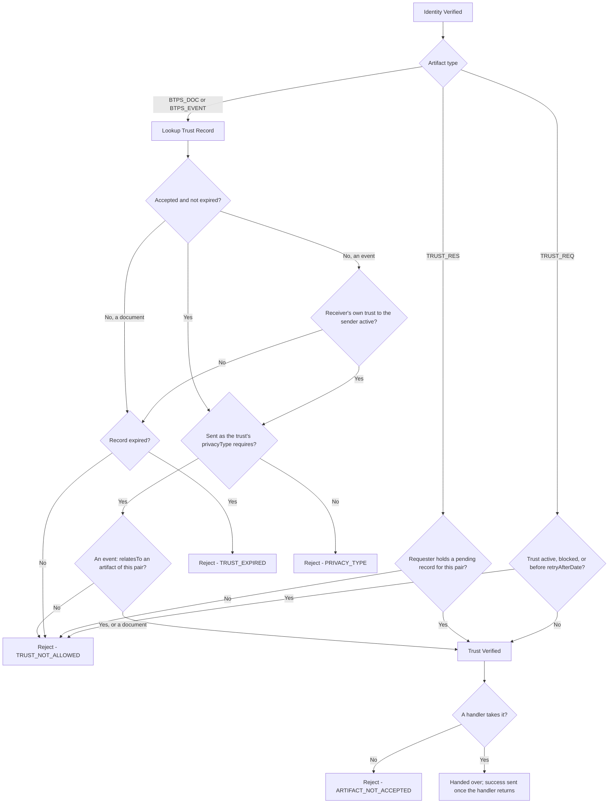
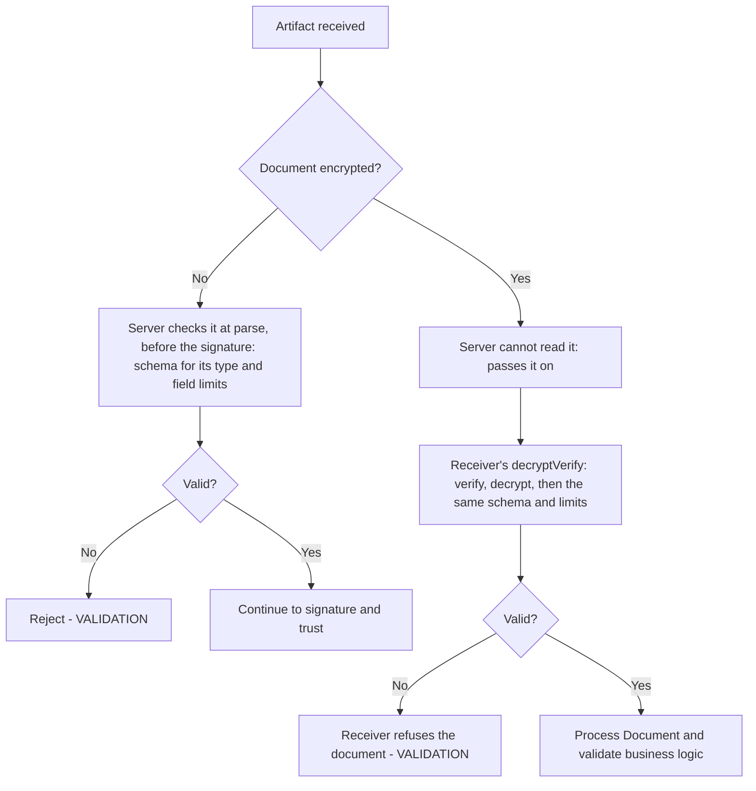

# BTPS Message transmission Flow

## Overview

The BTPS (Billing Trust Protocol Secure) message flow defines how **BTPS Artifacts** are securely exchanged between organizations. A BTPS Artifact is the complete message envelope that contains a **BTPS Document** (the actual business content) along with metadata, signatures, and encryption.

**Key Distinction:**

- **BTPS Artifact**: Complete message envelope with metadata, signatures, and encryption
- **BTPS Document**: The actual business content inside the artifact (invoice, trust request, etc.)

This protocol ensures that only trusted, verified parties can send and receive sensitive business documents through a series of cryptographic and trust-based security checks.

---

## High-Level Message Flow



---

## BTPS Artifact vs BTPS Document

### BTPS Artifact (Complete Message Envelope)

```json
{
  "version": "1.1.0",
  "issuedAt": "2025-01-15T10:30:00Z",
  "id": "btps_1234567890abcdef",
  "type": "TRUST_REQ",
  "from": "billing$vendorcorp.com",
  "to": "pay$client.com",
  "selector": "btps1",
  "document": {
    // BTPS Document content goes here can be string if encrypted
  },
  "signature": {
    "algorithmHash": "sha256",
    "value": "base64-encoded-signature",
    "fingerprint": "sha256-base64-fingerprint"
  },
  "encryption": {
    "algorithm": "aes-256-gcm",
    "encryptedKey": "base64-encoded-encrypted-key",
    "iv": "base64-encoded-initialization-vector",
    "type": "standardEncrypt",
    "authTag": "authTagString"
  }
}
```

### BTPS Document (Business Content)

The `document` field contains the actual business content:

**Trust Request Document:**

```json
{
  "id": "uniqueUuid",
  "name": "Acme Corporation",
  "email": "billing@acme.com",
  "reason": "To send monthly service invoices",
  "phone": "+1-555-0123"
}
```

**Invoice Document:**

```json
{
  "title": "Monthly Service Invoice",
  "id": "INV-2025-001",
  "totalAmount": {
    "amount": 150000,
    "currency": "USD"
  },
  "lineItems": {...}
}
```

---

## Detailed Message Flow Process

### Phase 1: Identity Discovery

**Purpose**: Establish cryptographic identity and discover communication endpoints.



**Steps:**

1. **Host Lookup**: Sender reads the receiver domain's `_btps.host` record: its BTPS server, key selector and operator
2. **Key Lookup**: Sender reads the receiver's public key at `<selector>._btps.identity.<account>.<domain>`
3. **Fallback**: If DNS has no key, the sender asks the receiver's host, and accepts the answer only when the domain's operator signed it
4. **No caching by the SDK**: `signEncrypt` looks the key up on every call; cache it yourself if you need to

**DNS TXT Record Format:**

```
_btps.host.<domain>:                         v=1.1.0; u=<btps_host:port>; s=<selector>; op=<operator_identity>
<selector>._btps.identity.<account>.<domain>: v=1.1.0; k=rsa; p=<base64_public_key>
```

See [DNS records](./specifications/overview.md) for each field.

---

### Phase 2: Trust Establishment

**Purpose**: Establish explicit, directional trust relationship between organizations.



**Trust Request Flow:**

1. **Document Creation**: Sender creates trust request document with business details
2. **Artifact Creation**: Sender creates BTPS artifact containing the document
3. **Encryption**: Optionally, the document is encrypted with the receiver's public key
4. **Cryptographic Signing**: BTPS artifact, including any ciphertext, signed with the sender's private key
5. **Transmission**: BTPS artifact sent to receiver's BTPS server; the sender keeps a `pending` record of its request
6. **Server Checks**: Receiver's server checks size, version, the sender's signature and the time window
7. **Trust Check**: A request is refused while trust is already active, blocked, or before `retryAfterDate`; the sender sees `BTP_ERROR_TRUST_NOT_ALLOWED`
8. **Decryption**: Receiver decrypts the document with its own private key, if it was encrypted
9. **Trust Record Creation**: Receiver creates trust record with `pending` status
10. **Anti-Spam Protection**: `retryAfterDate` set (recommended: 24 hours)
11. **Decision Process**: Receiver reviews trust request document and makes decision
12. **Response Creation**: Receiver creates trust response document
13. **Response Artifact**: Receiver creates, optionally encrypts, and signs the BTPS artifact
14. **Response Transmission**: Trust response sent back to the sender's server, which accepts it only if it holds a `pending` record for that request
15. **Storage**: Both parties store trust relationship status

**Trust Response Types:**

- **`accepted`**: Trust relationship established, documents can be sent
- **`rejected`**: Trust request denied, can retry after `retryAfterDate`
- **`blocked`**: Sender permanently blocked, no future requests allowed

---

### Phase 3: Document Exchange

**Purpose**: Securely exchange business documents between trusted parties.



**Document Exchange Flow:**

1. **Document Creation**: Sender creates business document (invoice, receipt, payslip or letter)
2. **Document Check**: The sender's SDK checks it against its type's schema and field limits before encrypting
3. **Encryption**: Document encrypted based on agreed privacy type:
   - **`unencrypted`**: No encryption (public documents)
   - **`encrypted`**: Full end-to-end encryption (sensitive documents)
   - **`mixed`**: Either is accepted
4. **Cryptographic Signing**: BTPS artifact, including any ciphertext, signed with the sender's private key
5. **Transmission**: BTPS artifact sent to receiver's BTPS server
6. **Server Checks**: Size, format and version, then the sender's signature and the time window
7. **Trust Verification**: Receiver's server checks the sender is trusted and sent with the agreed privacy type
8. **Hand-over**: The artifact goes to the receiver's handler; the sender gets its answer once the handler returns
9. **Storage**: Document stored in receiver's inbox system
10. **Decryption**: The receiver verifies the signature again, decrypts with its own private key, and checks the document (`decryptVerify`)
11. **Processing**: Document processed by the receiver's application

The server never decrypts: a document sent in the clear is checked at the server, an encrypted one only by the receiver after decrypting.

---

## Security Verification Process

### Identity Verification



### Trust Verification



### Document Validation



The rules are the same at every provider: the sender's SDK checks a document before encrypting it, and the receiver's after decrypting it.

On the wire, a trust refusal reads `BTP_ERROR_TRUST_NOT_ALLOWED`, except an expired trust (`BTP_ERROR_TRUST_EXPIRED`) and a privacy-type mismatch (`BTP_ERROR_PRIVACY_TYPE`). The server keeps the precise reason for its own logs.

---

## Message Types and Flow

### 1. Trust Request Artifact

**Purpose**: Establish trust relationship between organizations.

**Flow:**

```
Sender → Receiver: Trust Request BTPS Artifact
Receiver → Sender: Trust Response BTPS Artifact
```

**BTPS Artifact Structure:**

```json
{
  "version": "1.1.0",
  "id": "trust_1234567890",
  "type": "TRUST_REQ",
  "from": "billing$vendor.com",
  "to": "pay$client.com",
  "selector": "btps1",
  "document": {
    "id": "uniqueUuid",
    "name": "Vendor Corp",
    "email": "billing@vendor.com",
    "reason": "To send monthly invoices",
    "phone": "+1-555-0123"
  },
  "signature": {...},
  "encryption": {...}
}
```

### 2. Trust Response Artifact

**Purpose**: Respond to trust requests with accept, reject, or block decision.

**Flow:**

```
Receiver → Sender: Trust Response BTPS Artifact
```

**BTPS Artifact Structure:**

```json
{
  "version": "1.1.0",
  "id": "response_1234567890",
  "type": "TRUST_RES",
  "from": "pay$client.com",
  "to": "billing$vendor.com",
  "selector": "btps1",
  "document": {
    "id": "uniqueUuid",
    "decision": "accepted",
    "decidedAt": "2025-01-15T11:00:00Z",
    "decidedBy": "admin@client.com"
  },
  "signature": {...},
  "encryption": {...}
}
```

### 3. Invoice Artifact

**Purpose**: Send secure billing documents between trusted parties.

**Flow:**

```
Sender → Receiver: Invoice BTPS Artifact
```

**BTPS Artifact Structure:**

```json
{
  "version": "1.1.0",
  "id": "invoice_1234567890",
  "type": "BTPS_DOC",
  "from": "billing$vendor.com",
  "to": "pay$client.com",
  "selector": "btps1",
  "document": {
    "type": "invoice",
    "title": "Monthly Service Invoice",
    "id": "INV-2025-001",
    "issuedAt": "2025-01-15T10:30:00Z",
    "totalAmount": {
      "amount": 150000,
      "currency": "USD"
    },
    "lineItems": {...}
  },
  "signature": {...},
  "encryption": {...}
}
```

---

## Error Handling and Recovery

### Common Error Scenarios

**1. Identity Verification Failures**

- Invalid DNS TXT record
- Expired or revoked public key
- Invalid cryptographic signature on BTPS artifact
- **Recovery**: Contact sender to update DNS records

**2. Trust Verification Failures**

- No trust relationship exists
- Trust relationship expired
- Sender is blocked
- **Recovery**: Initiate new trust request process

**3. Document Validation Failures**

- Invalid document format within BTPS artifact
- Missing required fields in document
- Business logic violations in document
- **Recovery**: Sender must correct and resend BTPS artifact

### Error Response Codes

- **400 Bad Request**: Invalid BTPS artifact format
- **401 Unauthorized**: Invalid signature or identity
- **403 Forbidden**: No trust relationship or blocked sender
- **404 Not Found**: Receiver not found or endpoint unavailable
- **429 Too Many Requests**: Rate limiting or spam protection
- **500 Internal Server Error**: Server processing error

---

## Performance and Scalability

### Throughput Considerations

- **Trust Requests**: ~100-1,000 BTPS artifacts/second per server
- **Document Exchange**: ~10,000-100,000 BTPS artifacts/second per server
- **DNS Lookups**: Cached to reduce latency
- **Cryptographic Operations**: Optimized for high throughput

### Scalability Features

- **Horizontal Scaling**: Multiple BTPS servers per organization
- **Load Balancing**: Distribute traffic across servers
- **Caching**: Cache DNS records and trust relationships
- **Async Processing**: Non-blocking BTPS artifact processing

---

## Monitoring and Audit

### Message Tracking

- **Unique Artifact IDs**: Every BTPS artifact has a unique identifier
- **Timestamps**: All operations timestamped for audit
- **Status Tracking**: Track BTPS artifact delivery and processing status
- **Error Logging**: Comprehensive error logging and alerting

### Audit Requirements

- **Trust Decisions**: Who made what decision when
- **Document Flow**: Complete audit trail of BTPS artifact exchange
- **Security Events**: Log all security-related events
- **Compliance Reporting**: Automated compliance reporting

---

## Summary

The BTPS message flow ensures secure, trusted, and verifiable document exchange through:

1. **Identity Discovery**: DNS-based identity resolution
2. **Trust Establishment**: Explicit, directional trust relationships
3. **Secure Exchange**: Cryptographically signed and encrypted BTPS artifacts
4. **Document Processing**: Extraction and validation of BTPS documents from artifacts
5. **Verification**: Multi-layer security verification at every step
6. **Audit Trail**: Complete logging for compliance and security

**Key Concepts:**

- **BTPS Artifact**: Complete message envelope with metadata, signatures, and encryption
- **BTPS Document**: Business content (invoice, trust request, etc.) contained within the artifact
- **Trust Relationship**: Explicit, directional trust between organizations
- **Cryptographic Security**: End-to-end encryption and digital signatures

This protocol provides enterprise-grade security while maintaining high performance and scalability for business document exchange.
