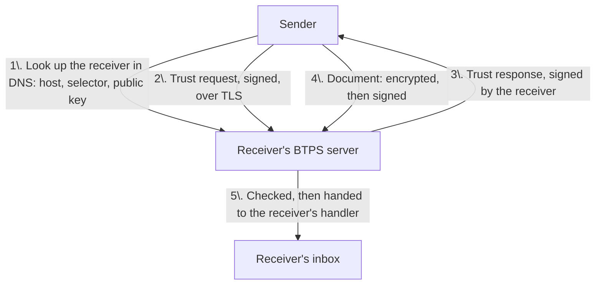

# BTPS Protocol Overview

## Introduction

BTPS (Billing Trust Protocol Secure) is a trust-based, cryptographically verifiable protocol for secure, consent-based exchange of billing documents and trust relationships. It is inspired by DKIM but specialized for billing/invoice workflows, with robust identity, trust, and key rotation mechanisms. Only trusted users can send bills/invoices. The protocol uses TLS for transport security.

What 1.2 adds: [What's new in 1.2](../whats-new/version-1-2.md). Each feature, with its flow and working code, has a guide under [Features](../features/trustPermissions.md).

## Protocol Architecture

### Visual Protocol Flow



Or, as ASCII:

```
┌────────────┐  1. DNS: _btps.host + public key  ┌──────────────────┐
│            │  ─────────────────────────────▶   │                  │
│            │  2. Trust request (signed)        │                  │
│  Sender    │  ─────────────────────────────▶   │  Receiver's      │ ──▶ Inbox
│            │  3. Trust response (signed)       │  BTPS server     │  (5. after
│            │  ◀─────────────────────────────   │                  │   its checks)
│            │  4. Document (encrypted + signed) │                  │
│            │  ─────────────────────────────▶   │                  │
└────────────┘                                   └──────────────────┘
```

Every message travels over TLS, one JSON artifact per line; there is no HTTP. If the receiver's key is not in DNS, the sender asks the receiver's host instead, and accepts the answer only when the domain's operator signed it.

## Key Concepts

| Concept           | Description                                                       |
| ----------------- | ----------------------------------------------------------------- |
| `btps-address`    | Like email, but uses `$`: e.g. `finance$company.com`              |
| DNS Discovery     | TXT records used to verify public keys and protocol support       |
| Trust Store       | Each server keeps its own trust records; they are never published |
| Consent Handshake | Sender must initiate a trust request, and be approved             |
| Signed Delivery   | Every artifact is signed; documents are encrypted to the receiver |
| Inbox             | Self-hosted or SaaS-based inbox endpoints handle delivery         |

## Protocol Flow: Step by Step

### 1. Discovery

Sender does a DNS Host and Identity TXT lookup for:

- `_btps.host.vendor.com` - Host lookup retrieves:

  - version
  - host address
  - selector key for protocol support
  - operator: the identity that runs the domain's BTPS server and alone may delegate, attest or answer identity lookups for it.

- `btps1._btps.identity.finance.vendor.com` - Identity lookup retrieves:

  - key type
  - version (`v=1.2.0` for a 1.2 host: readers report it, never check it) and
  - public key for protocol support.

  When DNS has no key for the identity, the sender asks the domain's host (an identity lookup), and takes the answer only when the operator signed it.

### 2. Request Consent

Sender creates a signed trust request (`TRUST_REQ`) and sends it to the receiver. In it, the sender can name an expiry date, a privacy type and, since 1.2, the [trust permissions](../features/trustPermissions.md) it asks for: which document types it may send, and which details each side holds.

### 3. Receiver Accepts, Rejects or blocks temporarily or permanently

The receiver answers with a signed trust response (`TRUST_RES`), and both sides keep a trust record in their own trust store:

- If accepted, the trust is active and the sender may send documents
- If rejected, no messages are allowed; with a `retryAfterDate`, a new request is refused until it passes
- If blocked, no messages are allowed, and every new request is refused until the receiver changes the record

A new trust request is refused while a trust is active or blocked, or before its `retryAfterDate`. The sender is told only `BTP_ERROR_TRUST_NOT_ALLOWED`: the receiver's reason stays with the receiver. Since 1.2, a request with `change: true` changes an active trust, asking for the whole set of permissions now wanted, unless a change is already pending.

### 4. Message Delivery

Only after trust is established can sender post signed+encrypted messages to receiver's inbox.

### 5. Revocation

Receiver can revoke or block a trust any time by updating the record in its own trust store (a JSON file or a database). Nothing is sent: the sender's next artifact is refused.

## Goals

- Reduce spam and unauthorized billing messages
- Enable federated, DNS-based identity without central authority
- Support SaaS and self-hosted workflows
- Provide cryptographic security and audit trails
- Enable automated trust establishment and key rotation

## Problems we solved

Sending and receiving bills, whether via email or online systems, involves numerous user problems and pain points. Here are the key issues and how SaaS solutions can address them:

## User Problems

### Security & Trust Issues

- **Data Security Concerns**: Users worry about sensitive financial information being compromised during transmission
- **Identity Verification**: Difficulty in verifying the authenticity of billing entities
- **Fraud Vulnerability**: Risk of fake invoices and business email compromise attacks

### Integration & Workflow Problems

- **Poor System Integration**: Billing systems don't connect well with accounting software, CRM systems, or ERP platforms
- **Manual Data Entry**: Time-consuming manual processes for invoice processing and reconciliation
- **Inconsistent Formats**: Different vendors use various invoice formats and standards

### Operational Inefficiencies

- **Payment Complexity**: Multiple payment methods and processes across different vendors
- **Tracking Difficulties**: Poor visibility into payment status and invoice lifecycle
- **Notification Gaps**: Inadequate alerts for due dates, leading to late payments and penalties

### Accessibility & User Experience

- **Platform Complexity**: Difficult navigation for non-technical users
- **Accessibility Barriers**: Limited support for users with disabilities
- **Mobile Limitations**: Poor mobile experience for on-the-go bill management

## 🛠️ SaaS Solutions

### Enhanced Security & Trust

- **End-to-End Encryption**: Secure transmission of all billing data
- **Cryptographic Verification**: Digital signatures and identity verification
- **Fraud Prevention**: Automated detection of suspicious billing patterns
- **Audit Trails**: Complete logging of all billing transactions

### Seamless Integration

- **API-First Design**: Easy integration with existing business systems
- **Standardized Formats**: Consistent invoice and payment formats
- **Automated Workflows**: Reduced manual intervention in billing processes
- **Real-time Sync**: Instant updates across all connected platforms

### Streamlined Operations

- **Unified Payment Processing**: Single platform supporting multiple payment methods
- **Smart Notifications**: Intelligent alerts via preferred communication channels
- **Automated Reconciliation**: Automatic matching of payments to invoices
- **Advanced Analytics**: Insights into billing patterns and cash flow

### Improved User Experience

- **Intuitive Design**: User-friendly interfaces for all skill levels
- **Mobile Optimization**: Full functionality across all devices
- **Accessibility Compliance**: WCAG-compliant design for inclusive access
- **Customization Options**: Personalized dashboards and notification preferences

## 🌟 Additional Benefits

### Environmental Impact

- **Paperless Operations**: Complete digital transformation reducing environmental footprint
- **Carbon Footprint Reduction**: Lower energy consumption compared to traditional billing

### Cost Efficiency

- **Reduced Processing Costs**: Automation lowers manual processing expenses
- **Faster Payment Cycles**: Improved cash flow through streamlined processes
- **Compliance Automation**: Reduced regulatory compliance overhead

### Scalability

- **Enterprise-Ready**: Scales from small businesses to global corporations
- **Multi-Currency Support**: Handles international billing requirements
- **Cloud Infrastructure**: Reliable, always-available service

By addressing these core pain points with modern, secure, and user-centered SaaS solutions, organizations can transform their billing processes from a source of frustration into a competitive advantage.

## File-based Trust for Lightweight and Self Hosting

For simple or self-hosted BTPS servers, `JsonTrustStore` keeps trust records in a JSON file on the server, at a path you choose (the example server uses `.well-known/btps-trust.json`). The file is the server's private storage: it is never served or published, and no other party reads it. This approach is ideal for small vendors or those who want zero-infrastructure, file-based trust management.

For larger organizations or advanced deployments, BTPS supports pluggable trust storage. You can implement your own TrustStore backend by extending the `AbstractTrustStore` class provided by the SDK. This allows you to connect to any database system you prefer (e.g., MongoDB, SQL, cloud storage) by implementing the required methods for trust management.

- **Simple/self-hosted:** Use `JsonTrustStore` with a local JSON file
- **Enterprise/advanced:** Implement a custom TrustStore (e.g., database-backed) by extending `AbstractTrustStore`

This flexibility ensures BTPS can scale from static file hosting to full enterprise integration.

## Security Best Practices

### Cryptographic Security

- **Key Strength**: Use RSA keys of 2048 bits or more
- **Key Rotation**: Rotate keys under new selectors and, since 1.2, record each rotation in the identity's signed key chain ([Key rotation](../features/keyRotation.md))
- **Algorithms**: RSASSA-PKCS1-v1_5 with SHA-256 for signatures, AES-256-GCM for documents and RSA-OAEP with SHA-256 for its key ([algorithms](./security/algorithm.md))
- **Random Generation**: Use cryptographically secure random number generators

### Network Security

- **TLS Transport**: Always use TLS 1.2+ for all communications
- **Certificate Validation**: Validate TLS certificates properly
- **DNSSEC**: Enable DNSSEC to protect identity records from tampering
- **Firewall Rules**: Restrict access to BTPS ports (default 3443)

### Identity Management

- **Domain Control**: Only publish identity records for domains you control
- **Key Storage**: Store private keys securely with appropriate access controls
- **Identity Verification**: Verify sender identities before establishing trust
- **Regular Audits**: Periodically audit trust relationships and key usage

### Trust Management

- **Trust Validation**: Always verify trust before accepting messages
- **Privacy Enforcement**: Enforce agreed privacy requirements strictly
- **Trust Expiration**: Monitor and renew trust relationships before expiration
- **Access Control**: Implement proper access controls for trust store management

### Operational Security

- **Logging**: Log all trust operations and message deliveries
- **Monitoring**: Monitor for unusual patterns or failed verification attempts
- **Backup**: Regularly backup trust stores and key materials
- **Incident Response**: Have procedures for key compromise and trust revocation

## License

Apache 2.0 — Open to all contributors committed to consent-first, privacy-safe infrastructure.
