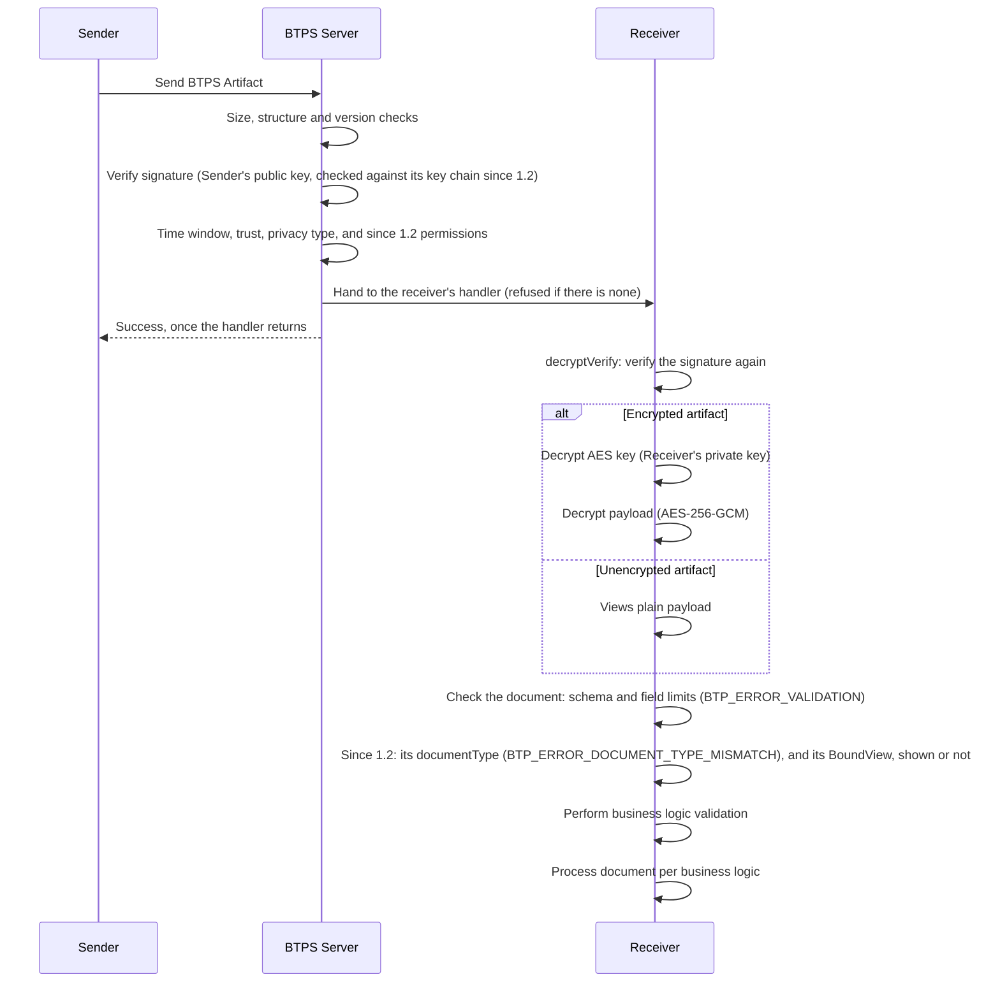
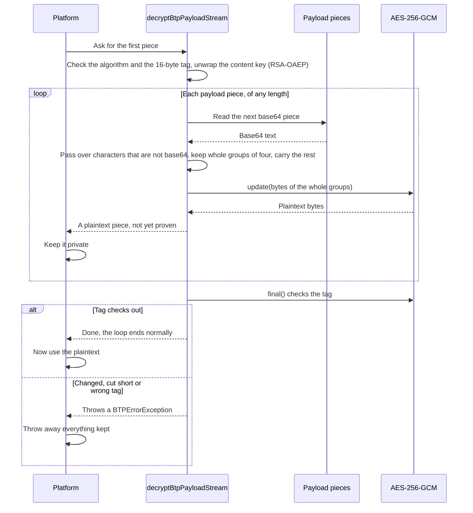

# Decryption & Verification in BTPS

BTPS ensures that only the intended recipient can decrypt and verify the authenticity of received messages. The process combines asymmetric and symmetric cryptography, as well as digital signature verification.

## Decryption & Verification Workflow

1. **Artifact Reception:** BTPS server receives the BTPS Artifact from sender.
2. **Artifact Validation:** BTPS server checks the artifact's size, structure, format and protocol version.
3. **Signature Verification:** BTPS server verifies the sender's digital signature using the sender's public key from DNS, then the time window, trust and privacy type.
4. **Forward to Receiver:** BTPS server hands the verified artifact to the receiver's handler, and answers the sender once the handler returns.
5. **Receiver Processing:** Receiver obtains the BTPS Artifact from their inbox endpoint.
6. **Key Decryption:** If the artifact is encrypted, receiver decrypts the AES key using their private RSA key.
7. **Payload Decryption:** If encrypted, receiver decrypts the payload using the AES key and IV. If not encrypted, the payload is used as-is.
8. **Document Extraction:** The decrypted (or plain) payload is parsed into the original document.
9. **Business Logic Validation:** Receiver performs additional validation specific to their SaaS platform or business requirements.
10. **Process & Action:** The document is further processed by the receiver and action is then performed accordingly per business logic.

## How `decryptVerify` Works

- The BTPS client uses the `decryptVerify` function to:
  1. Validates the artifact structure and format
  2. Parse the sender's identity and resolve their public key.
  3. Verify the artifact's signature using the sender's public key.
  4. If the artifact's `encryption` field is present, decrypt the AES key and then the payload.
  5. If the artifact is unencrypted (`encryption` is null), use the payload as-is after signature verification.
  6. Check what it decrypted as the server checks an unencrypted artifact on arrival: a document must match its type's schema and field limits, under the artifact's version; an event (`BTPS_EVENT`) must be a valid lifecycle or (since 1.2) agreement event, its `id` must be the artifact's `id`, and what it names must be between the artifact's `from` and `to`; since 1.2, a trust request's or answer's values must match the names on its envelope, a details response's values its `details`, and a verification's verifier must be its domain's operator. Otherwise it returns a `BTP_ERROR_VALIDATION` error and no payload.
  7. Since 1.2, refuse an opened document that is not the `documentType` its envelope names (`BTP_ERROR_DOCUMENT_TYPE_MISMATCH`), and check a document's BoundView: the result says whether it may be shown (`boundView`).
  8. Return the verified and decrypted (or plain) document for further processing: `{ payload, error, boundView }`.

Since 1.2, `decryptVerify(senderPubPem, artifact, receiverKey, contentKey?)` takes an optional `contentKey`: a side-car's `encryptedKey`, so a document stays readable after the receiver's old private key is deleted ([Key rotation](../../features/keyRotation.md#delete-an-old-private-key)).

The server cannot read an encrypted event, so this is where it is checked. A platform that decrypts with `decryptBtpPayload` directly skips this check; use `decryptVerify` to receive events.

## BTPS Server Role

**Important:** The BTPS server validates artifact structure and verifies the sender's digital signature to ensure message authenticity and integrity. It does **not** decrypt artifacts as user or user controlled platform owns the private key to decrypt. Decryption and additional business logic validation are performed by the receiver's client application after receiving the artifact.

## Sequence Diagram



## Example Decrypted Artifact

`decryptVerify`'s `payload`: the artifact as it arrived, its `document` now opened, and `encryption` kept as it was signed:

```json sketch
{
  "version": "1.2.0",
  "id": "3a7c9d51-be4f-41a2-8260-5f8ead2c4137",
  "issuedAt": "2026-11-08T12:00:00.000Z",
  "type": "BTPS_DOC",
  "from": "billing$vendor.com",
  "to": "pay$client.com",
  "selector": "btps1",
  "documentType": "invoice",
  "document": {
    "type": "invoice",
    "title": "Monthly Service Invoice",
    "id": "INV-2025-001",
    "issuedAt": "2026-11-08T12:00:00.000Z",
    "totalAmount": {
      "amount": 150000,
      "currency": "USD"
    },
    "lineItems": {
      "columns": ["Description", "Amount"],
      "rows": [{ "Description": "Monthly service", "Amount": 150000 }]
    }
  },
  "encryption": {
    "algorithm": "aes-256-gcm",
    "encryptedKey": "BASE64-KEY",
    "iv": "BASE64-IV",
    "type": "standardEncrypt",
    "authTag": "BASE64-TAG"
  },
  "signature": {
    "algorithmHash": "sha256",
    "value": "BASE64-SIGNATURE",
    "fingerprint": "BASE64-FINGERPRINT"
  }
}
```

## Large payloads, a piece at a time

Since 1.2. `decryptBtpPayload` and `encryptBtpPayload` hold the whole payload and the whole document in memory at once. That is fine for an invoice. It is not for a large document, such as an agreement carrying many PDFs (around 100 MB), that a platform views, stores or forwards. Three functions in `@btps/sdk/crypto` do the same work a piece at a time:

| Function                               | Does what this does, a piece at a time |
| -------------------------------------- | -------------------------------------- |
| `decryptBtpPayloadStream`              | `decryptBtpPayload`                    |
| `decryptBtpPayloadStreamWithDecrypter` | `decryptBtpPayloadWithDecrypter`       |
| `encryptBtpPayloadStream`              | `encryptBtpPayload`                    |

**Nothing about the artifact or the wire format changes.** These functions read and write exactly today's artifacts: the same base64 `document` and the same `encryption`. A receiver cannot tell how a payload was written, and a sender cannot tell how it will be read. Only how your platform holds the payload changes. The existing functions are unchanged.

Streaming changes what your platform holds in memory, not what a receiver's server accepts: an artifact still has to fit the receiver's [artifact size](../specifications/limits.md#artifact-size).

### When to use them

- **Use them** when a document is too large to hold in memory comfortably: to open a stored payload for viewing, to write a decrypted copy to storage, or to encrypt a large document as you write it out.
- **Use `decryptVerify` and `signEncrypt`** for everything else. The stream functions are low level, like `decryptBtpPayload`: they do not check the signature, the document type or the document's schema.
- **Only on Node.js**, or a runtime with Node's `crypto` module. The functions take any `AsyncIterable` or `Iterable` ([BTPPayloadPieces](../../sdk/typesAndInterfaces.md#btppayloadpieces)), not a Node stream type, but they decrypt and encrypt with Node's `crypto`. A browser's WebCrypto has no streaming AES-GCM, so these functions do not run in a browser.

### Not trusted until the end

AES-GCM proves a payload only at its end, when the last piece is read and its tag is checked. Every piece before that is plaintext no one has proven yet.

:::danger A piece is not trusted until the loop finishes without throwing

Do not send any piece on (for example, write it to an HTTP response), show it, store it as final, or act on it, until the `for await` loop has ended without throwing. A payload that was changed or cut short gives plaintext pieces as normal, and throws only when the last piece is read. By then, a piece you sent on has already reached its reader.

Finishing without throwing proves only that the AES-GCM tag checked out. It does not verify the artifact's signature, who sent it, or a trust between you. Check those separately, as you do today, with `decryptVerify` or `verifySignature`.

:::

Wrong: each piece reaches the user before the payload is proven.

```ts
// Wrong: do not do this
for await (const piece of decryptBtpPayloadStream(payload, encryption, receiverPrivateKeyPem)) {
  res.write(piece); // sent before the tag is checked
}
res.end();
```

Right: keep the pieces somewhere private, and use them only after the loop ends.

```ts check
import type { ServerResponse } from 'http';
import { decryptBtpPayloadStream, type BTPEncryption } from '@btps/sdk/crypto';

export async function sendDocument(
  payload: AsyncIterable<string>,
  encryption: BTPEncryption,
  receiverPrivateKeyPem: string,
  res: ServerResponse,
): Promise<void> {
  const held: Uint8Array[] = []; // private: nothing leaves until the loop ends
  try {
    for await (const piece of decryptBtpPayloadStream(payload, encryption, receiverPrivateKeyPem)) {
      held.push(piece);
    }
  } catch (error) {
    held.length = 0; // never proven: throw it away
    throw error;
  }
  // The loop ended without throwing: the tag checked out. Only now send it.
  res.end(Buffer.concat(held));
}
```

For a payload too large to hold, the private place is a temporary file, as in [Reading a stored payload in slices](#reading-a-stored-payload-in-slices).

There is no separate result or `verified` promise. The generator either ends normally or throws.

### What decrypting does

| What happens                                                                      | What you see                                                                                                                               |
| --------------------------------------------------------------------------------- | ------------------------------------------------------------------------------------------------------------------------------------------ |
| The payload is valid                                                              | The loop ends normally. Only now may the pieces be used                                                                                    |
| The payload was changed, cut short, or its tag is wrong                           | A `BTPErrorException` with the same code `decryptBtpPayload` answers with, thrown when the last piece is read                              |
| The payload was encrypted to another key                                          | `BTP_ERROR_DECRYPTION_UNINTENDED`, thrown at the start, before any piece is read                                                           |
| An algorithm other than `aes-256-gcm`, or an `authTag` that is not 16 bytes       | `BTP_ERROR_UNSUPPORTED_ENCRYPT`, thrown at the start                                                                                       |
| `decryptBtpPayloadStreamWithDecrypter` with a `Decrypter` that has no `unwrapKey` | `BTP_ERROR_UNSUPPORTED_ENCRYPT`, thrown at the start                                                                                       |
| The source of pieces throws                                                       | That error comes out of the loop, as a `BTPErrorException`: unchanged if it is one, otherwise with its message, and its `name` as the code |
| Your code stops early (`break`, `return`)                                         | Nothing is verified. Nothing read so far may be used                                                                                       |
| The generator is never iterated                                                   | Nothing runs: no key is unwrapped and no piece is read                                                                                     |
| A piece holds characters that are not base64                                      | They are passed over, exactly as `decryptBtpPayload` passes them over. If the payload was corrupted, the tag check fails at the end        |

The plaintext is not parsed, and no document type is checked: that is yours. The plaintext is the document's JSON text. To refuse what `decryptBtpPayload` refuses, run `assertStrictJson` on the text before you parse it.



### Reading a stored payload in slices

A platform that stores the artifact's base64 `document` reads it back a slice at a time, decrypts it into a temporary file, and moves the file into place only once the loop has ended. Slices can be any length: the function carries a partial group of base64 characters over to the next slice.

```ts check
import { createWriteStream } from 'fs';
import { rename, rm } from 'fs/promises';
import { pipeline } from 'stream/promises';
import { decryptBtpPayloadStream, type BTPEncryption } from '@btps/sdk/crypto';

// Your storage: `length` characters of the stored base64 payload from `offset`, '' past its end.
export interface PayloadStore {
  read(id: string, offset: number, length: number): Promise<string>;
}

const SLICE = 64 * 1024;

async function* slices(store: PayloadStore, id: string): AsyncGenerator<string> {
  for (let offset = 0; ; offset += SLICE) {
    const slice = await store.read(id, offset, SLICE);
    if (slice === '') return;
    yield slice;
  }
}

export async function openToFile(
  store: PayloadStore,
  id: string,
  encryption: BTPEncryption,
  receiverPrivateKeyPem: string,
  path: string,
): Promise<void> {
  const temporary = `${path}.partial`; // private to your platform, never served
  try {
    await pipeline(
      decryptBtpPayloadStream(slices(store, id), encryption, receiverPrivateKeyPem),
      createWriteStream(temporary, { mode: 0o600 }),
    );
  } catch (error) {
    await rm(temporary, { force: true }); // never proven: throw it away
    throw error;
  }
  await rename(temporary, path); // proven: now it is the document
}
```

`decryptBtpPayloadStreamWithDecrypter` works the same way, through a [Decrypter](./keyManagement.md#keys-held-elsewhere-signer-and-decrypter) that holds the private key elsewhere. It needs the Decrypter's optional `unwrapKey`: the key holder unwraps only the content key, and the AES-GCM step runs locally. `PemDecrypter` has it.

### Encrypting a large document

`encryptBtpPayloadStream` takes the document's JSON text (`JSON.stringify` of the document) in pieces of text or bytes. A character split between two text pieces is kept whole. It returns two things:

- `payload`, the base64 payload a piece at a time, to write as it comes;
- `encryption`, a promise of the artifact's `encryption`, which settles only once `payload` has been read to its end, because the tag is known only then.

So the order is fixed: **read `payload` to its end, writing each piece, then `await encryption`.** Awaiting `encryption` first waits forever, because nothing reads `payload`. If anything fails, the loop over `payload` throws, and `encryption` rejects with the same error.

No document type is checked, because the whole document is never held: validate the document before you encrypt it.

```ts check
import { createReadStream } from 'fs';
import { encryptBtpPayloadStream, type BTPEncryption } from '@btps/sdk/crypto';

// Your storage: the payload is appended a piece at a time, then its encryption is kept beside it.
export interface PayloadWriter {
  append(id: string, piece: string): Promise<void>;
  finish(id: string, encryption: BTPEncryption): Promise<void>;
}

export async function encryptFromFile(
  documentPath: string, // the document's JSON text, already validated
  receiverPublicKeyPem: string,
  store: PayloadWriter,
  id: string,
): Promise<void> {
  const { payload, encryption } = encryptBtpPayloadStream(
    createReadStream(documentPath),
    receiverPublicKeyPem,
    { algorithm: 'aes-256-gcm', mode: 'standardEncrypt' },
  );
  // 1. Read payload to its end, writing each piece as it comes.
  for await (const piece of payload) await store.append(id, piece);
  // 2. Only then await encryption: it is settled now.
  await store.finish(id, await encryption);
}
```

The stored pieces, joined, are the artifact's `document`, and `encryption` is its `encryption`.

Given the same content key and IV, `encryptBtpPayloadStream` writes exactly the payload and tag `encryptBtpPayload` writes. In normal use the content key, the IV and the RSA-OAEP wrap are random, so no two calls give the same output, whichever function makes them. What matters is that the two read each other's payloads:

| Encrypted with            | Decrypted with            | Works |
| ------------------------- | ------------------------- | ----- |
| `encryptBtpPayload`       | `decryptBtpPayload`       | Yes   |
| `encryptBtpPayload`       | `decryptBtpPayloadStream` | Yes   |
| `encryptBtpPayloadStream` | `decryptBtpPayload`       | Yes   |
| `encryptBtpPayloadStream` | `decryptBtpPayloadStream` | Yes   |

Each function's entry is in the [SDK reference](../../sdk/apiReference.md#decryptbtppayloadstream).

## Notes

- If signature verification fails, the artifact is rejected.
- If decryption fails, the artifact is rejected and an error is logged.
- If the artifact is unencrypted, only signature verification is performed.
- Only after successful verification and decryption (if needed) is the document processed.
- The BTPS server acts as a trusted intermediary that verifies signatures but does not decrypt content.
