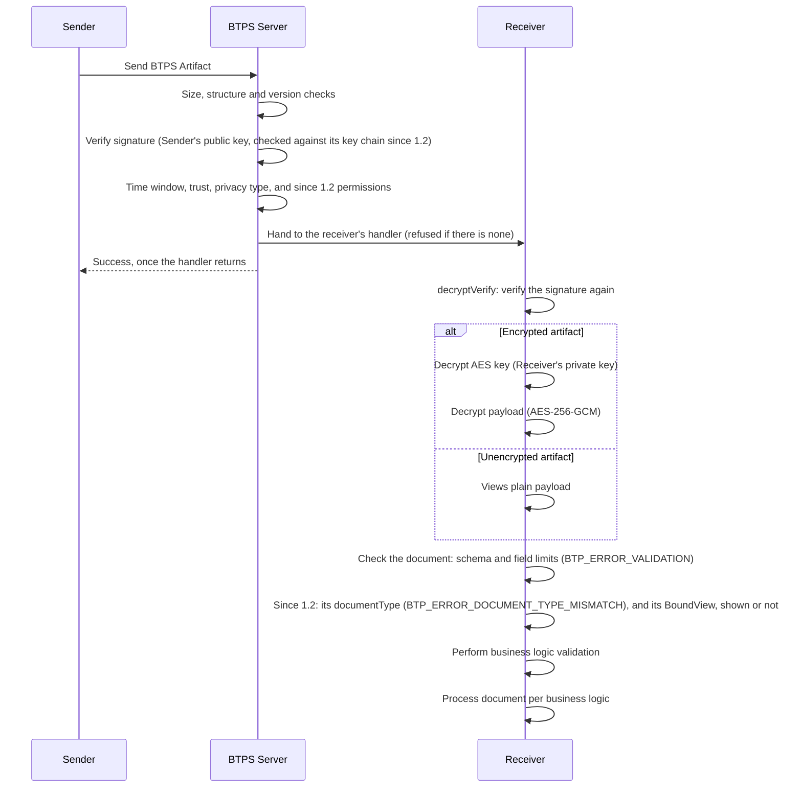
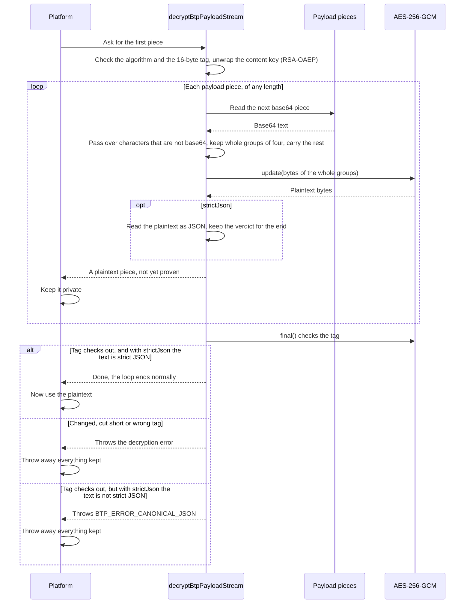
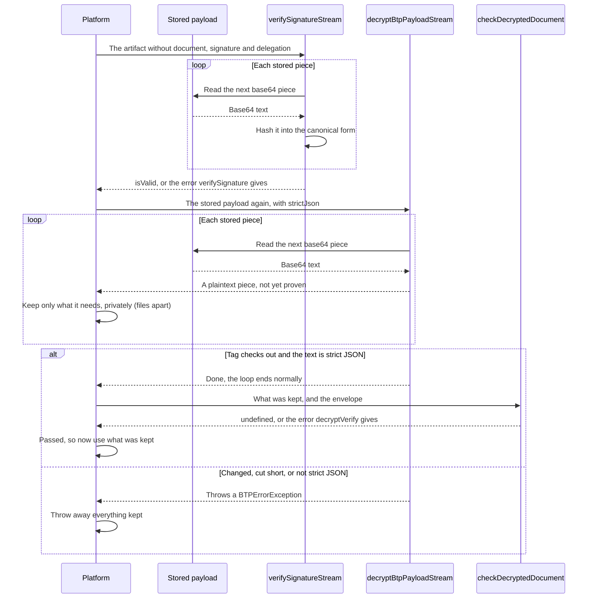

# Decryption & Verification in BTPS

BTPS ensures that only the intended recipient can decrypt and verify the authenticity of received messages. The process combines asymmetric and symmetric cryptography, as well as digital signature verification.

## Decryption & Verification Workflow

1. **Artifact Reception:** BTPS server receives the BTPS Artifact from sender.
2. **Artifact Validation:** BTPS server checks the artifact's size, structure, format and protocol version.
3. **Signature Verification:** BTPS server verifies the sender's digital signature using the sender's public key from DNS, then the time window, trust and privacy type.
4. **Forward to Receiver:** BTPS server hands the verified artifact to the receiver's handler, and answers the sender once the handler returns.
5. **Receiver Processing:** Receiver obtains the BTPS Artifact from their inbox endpoint.
6. **Key Decryption:** If the artifact is encrypted, receiver decrypts the AES key using their private RSA key.
7. **Payload Decryption:** If encrypted, receiver decrypts the payload using the AES key and IV. If not encrypted, the payload is used as-is.
8. **Document Extraction:** The decrypted (or plain) payload is parsed into the original document.
9. **Business Logic Validation:** Receiver performs additional validation specific to their SaaS platform or business requirements.
10. **Process & Action:** The document is further processed by the receiver and action is then performed accordingly per business logic.

## How `decryptVerify` Works

- The BTPS client uses the `decryptVerify` function to:
  1. Validates the artifact structure and format
  2. Parse the sender's identity and resolve their public key.
  3. Verify the artifact's signature using the sender's public key.
  4. If the artifact's `encryption` field is present, decrypt the AES key and then the payload.
  5. If the artifact is unencrypted (`encryption` is null), use the payload as-is after signature verification.
  6. Check what it decrypted as the server checks an unencrypted artifact on arrival: a document must match its type's schema and field limits, under the artifact's version; an event (`BTPS_EVENT`) must be a valid lifecycle or (since 1.2) agreement event, its `id` must be the artifact's `id`, and what it names must be between the artifact's `from` and `to`; since 1.2, a trust request's or answer's values must match the names on its envelope, a details response's values its `details`, and a verification's verifier must be its domain's operator. Otherwise it returns a `BTP_ERROR_VALIDATION` error and no payload.
  7. Since 1.2, refuse an opened document that is not the `documentType` its envelope names (`BTP_ERROR_DOCUMENT_TYPE_MISMATCH`), and check a document's BoundView: the result says whether it may be shown (`boundView`).
  8. Since 1.2 (rc.4), for an event that carries `cosignatures`: check each names the document the opened event is about, and open each one the receiver is a recipient of, held to exactly what its signer signed. The statements are in `cosigned`, by position, `null` where the receiver is not a recipient. One that does not hold is a `BTP_ERROR_SIG_VERIFICATION` error and no payload, and so is a cosignature for the receiver when no `receiverKey` is given: a statement addressed to the receiver is never skipped ([Cosignatures](../specifications/transporter-artifact.md#what-the-receiver-checks)).
  9. Return the verified and decrypted (or plain) document for further processing: `{ payload, error, boundView, cosigned }`.

Since 1.2, `decryptVerify(senderPubPem, artifact, receiverKey, contentKey?, cosignatureKeys?)` takes an optional `contentKey`: a side-car's `encryptedKey`, so a document stays readable after the receiver's old private key is deleted ([Key rotation](../../features/keyRotation.md#delete-an-old-private-key)), or a device's `agentKey.key`. Since 1.2 (rc.4), `cosignatureKeys` does the same for each cosignature's content key, by position: a device's `agentKey.cosignatureKeys`.

The server cannot read an encrypted event, so this is where it is checked. A platform that decrypts with `decryptBtpPayload` directly skips this check; use `decryptVerify` to receive events, or run the same checks with `checkDecryptedDocument` (since 1.2, see [Checking the document](#checking-the-document)).

## BTPS Server Role

**Important:** The BTPS server validates artifact structure and verifies the sender's digital signature to ensure message authenticity and integrity. It does **not** decrypt artifacts as user or user controlled platform owns the private key to decrypt. Decryption and additional business logic validation are performed by the receiver's client application after receiving the artifact.

## Sequence Diagram



## Example Decrypted Artifact

`decryptVerify`'s `payload`: the artifact as it arrived, its `document` now opened, and `encryption` kept as it was signed:

```json sketch
{
  "version": "1.2.0",
  "id": "3a7c9d51-be4f-41a2-8260-5f8ead2c4137",
  "issuedAt": "2026-11-08T12:00:00.000Z",
  "type": "BTPS_DOC",
  "from": "billing$vendor.com",
  "to": "pay$client.com",
  "selector": "btps1",
  "documentType": "invoice",
  "document": {
    "type": "invoice",
    "title": "Monthly Service Invoice",
    "id": "INV-2025-001",
    "issuedAt": "2026-11-08T12:00:00.000Z",
    "totalAmount": {
      "amount": 150000,
      "currency": "USD"
    },
    "lineItems": {
      "columns": ["Description", "Amount"],
      "rows": [{ "Description": "Monthly service", "Amount": 150000 }]
    }
  },
  "encryption": {
    "algorithm": "aes-256-gcm",
    "encryptedKey": "BASE64-KEY",
    "iv": "BASE64-IV",
    "type": "standardEncrypt",
    "authTag": "BASE64-TAG"
  },
  "signature": {
    "algorithmHash": "sha256",
    "value": "BASE64-SIGNATURE",
    "fingerprint": "BASE64-FINGERPRINT"
  }
}
```

## Large payloads, a piece at a time

Since 1.2. `decryptBtpPayload` and `encryptBtpPayload` hold the whole payload and the whole document in memory at once. That is fine for an invoice. It is not for a large document, such as an agreement carrying many PDFs (around 100 MB), that a platform views, stores or forwards. Six functions in `@btps/sdk/crypto` do the same work a piece at a time:

| Function                               | Does what this does, a piece at a time |
| -------------------------------------- | -------------------------------------- |
| `decryptBtpPayloadStream`              | `decryptBtpPayload`                    |
| `decryptBtpPayloadStreamWithDecrypter` | `decryptBtpPayloadWithDecrypter`       |
| `encryptBtpPayloadStream`              | `encryptBtpPayload`                    |
| `signBtpPayloadStream`                 | `signBtpPayload`                       |
| `signBtpPayloadStreamWithSigner`       | `signBtpPayloadWithSigner`             |
| `verifySignatureStream`                | `verifySignature`                      |

Two more run the checks `decryptVerify` and `signEncrypt` run on a document, so a platform that works a piece at a time holds the document to the same rules: `checkDecryptedDocument` and `checkDocumentToSend` ([Checking the document](#checking-the-document)).

**Nothing about the artifact or the wire format changes.** These functions read and write exactly today's artifacts: the same base64 `document`, the same `encryption` and the same `signature`. A receiver cannot tell how a payload was written or signed, and a sender cannot tell how it will be read. Only how your platform holds the payload changes. The existing functions keep their API, results and errors.

Streaming changes what your platform holds in memory, not what a receiver's server accepts: an artifact still has to fit the receiver's [artifact size](../specifications/limits.md#artifact-size).

### When to use them

| Choice                                                                        | For whom                                                   | What it means                                                                                                                                                                                                                                                          |
| ----------------------------------------------------------------------------- | ---------------------------------------------------------- | ---------------------------------------------------------------------------------------------------------------------------------------------------------------------------------------------------------------------------------------------------------------------- |
| `decryptVerify` and `signEncrypt`                                             | Most platforms                                             | Simple, with every check built in. Since 1.2 they are lighter on a large document ([below](#lighter-whole-functions)), but the caller still holds the whole document once                                                                                              |
| The stream functions, with `checkDecryptedDocument` and `checkDocumentToSend` | Platforms that serve large documents to many users at once | Memory stays flat, whatever the document's size. The platform runs the steps itself: [Opening a large artifact, start to finish](#opening-a-large-artifact-start-to-finish) and [Sending a large artifact, start to finish](#sending-a-large-artifact-start-to-finish) |

- **The stream functions are low level**, like `decryptBtpPayload`: each does one step. Decrypting does not check the signature, the document type or the document's schema. Follow the recipes below, which add each check `decryptVerify` and `signEncrypt` make.
- **Only on Node.js**, or a runtime with Node's `crypto` module. The functions take any `AsyncIterable` or `Iterable` ([BTPPayloadPieces](../../sdk/typesAndInterfaces.md#btppayloadpieces)), not a Node stream type, but they decrypt, encrypt, sign and verify with Node's `crypto`. A browser's WebCrypto has no streaming AES-GCM, so these functions do not run in a browser.

### Lighter whole functions

Since 1.2, the whole functions do less work on a large document, with the same API, results and errors:

- `signBtpPayload` and `verifySignature` hash an artifact's text `document` (an encrypted artifact's payload) a piece at a time, instead of building a whole canonical copy of the artifact.
- `decryptBtpPayload` and `decryptBtpPayloadWithDecrypter` check strict JSON with a tokenizer first, which builds nothing, and ask `assertStrictJson` only of text the tokenizer refuses.

`decryptVerify` and `signEncrypt` call these, so they benefit with no change. Measured on a 105 MB agreement (10 PDFs, a 176 MB payload):

| Measure                                           | Before   | Since 1.2 |
| ------------------------------------------------- | -------- | --------- |
| `decryptBtpPayload`                               | 1,012 ms | 349 ms    |
| `signBtpPayload`                                  | 424 ms   | 150 ms    |
| `verifySignature`                                 | 351 ms   | 139 ms    |
| Extra memory to sign and verify a 140 MB artifact | +406 MB  | +140 MB   |

All 797 protocol vectors pass unchanged.

### Not trusted until the end

AES-GCM proves a payload only at its end, when the last piece is read and its tag is checked. Every piece before that is plaintext no one has proven yet.

:::danger A piece is not trusted until the loop finishes without throwing

Do not send any piece on (for example, write it to an HTTP response), show it, store it as final, or act on it, until the `for await` loop has ended without throwing. A payload that was changed or cut short gives plaintext pieces as normal, and throws only when the last piece is read. By then, a piece you sent on has already reached its reader.

Finishing without throwing proves only that the AES-GCM tag checked out. It does not verify the artifact's signature, who sent it, or a trust between you. Check those separately, as you do today, with `decryptVerify` or `verifySignature`, or with `verifySignatureStream` without holding the payload whole ([Opening a large artifact, start to finish](#opening-a-large-artifact-start-to-finish)).

:::

Wrong: each piece reaches the user before the payload is proven.

```ts
// Wrong: do not do this
for await (const piece of decryptBtpPayloadStream(payload, encryption, receiverPrivateKeyPem)) {
  res.write(piece); // sent before the tag is checked
}
res.end();
```

Right: keep the pieces somewhere private, and use them only after the loop ends.

```ts check
import type { ServerResponse } from 'http';
import { decryptBtpPayloadStream, type BTPEncryption } from '@btps/sdk/crypto';

export async function sendDocument(
  payload: AsyncIterable<string>,
  encryption: BTPEncryption,
  receiverPrivateKeyPem: string,
  res: ServerResponse,
): Promise<void> {
  const held: Uint8Array[] = []; // private: nothing leaves until the loop ends
  try {
    for await (const piece of decryptBtpPayloadStream(payload, encryption, receiverPrivateKeyPem)) {
      held.push(piece);
    }
  } catch (error) {
    held.length = 0; // never proven: throw it away
    throw error;
  }
  // The loop ended without throwing: the tag checked out. Only now send it.
  res.end(Buffer.concat(held));
}
```

For a payload too large to hold, the private place is a temporary file, as in [Reading a stored payload in slices](#reading-a-stored-payload-in-slices).

There is no separate result or `verified` promise. The generator either ends normally or throws.

### What decrypting does

| What happens                                                                      | What you see                                                                                                                               |
| --------------------------------------------------------------------------------- | ------------------------------------------------------------------------------------------------------------------------------------------ |
| The payload is valid                                                              | The loop ends normally. Only now may the pieces be used                                                                                    |
| The payload was changed, cut short, or its tag is wrong                           | A `BTPErrorException` with the same code `decryptBtpPayload` answers with, thrown when the last piece is read                              |
| The payload was encrypted to another key                                          | `BTP_ERROR_DECRYPTION_UNINTENDED`, thrown at the start, before any piece is read                                                           |
| An algorithm other than `aes-256-gcm`, or an `authTag` that is not 16 bytes       | `BTP_ERROR_UNSUPPORTED_ENCRYPT`, thrown at the start                                                                                       |
| `decryptBtpPayloadStreamWithDecrypter` with a `Decrypter` that has no `unwrapKey` | `BTP_ERROR_UNSUPPORTED_ENCRYPT`, thrown at the start                                                                                       |
| The source of pieces throws                                                       | That error comes out of the loop, as a `BTPErrorException`: unchanged if it is one, otherwise with its message, and its `name` as the code |
| Your code stops early (`break`, `return`)                                         | Nothing is verified. Nothing read so far may be used                                                                                       |
| The generator is never iterated                                                   | Nothing runs: no key is unwrapped and no piece is read                                                                                     |
| A piece holds characters that are not base64                                      | They are passed over, exactly as `decryptBtpPayload` passes them over. If the payload was corrupted, the tag check fails at the end        |
| With `{ strictJson: true }`, the proven plaintext is not strict JSON              | `BTP_ERROR_CANONICAL_JSON`, thrown after the last piece is read and the tag has checked out                                                |
| With `{ strictJson: true }`, the payload was changed and is not JSON either       | Its decryption error, thrown when the last piece is read. A tampered payload never throws `BTP_ERROR_CANONICAL_JSON`                       |

The plaintext is not parsed, and no document type is checked: that is yours. The plaintext is the document's JSON text. To refuse what `decryptBtpPayload` refuses, pass `{ strictJson: true }` ([Holding the plaintext to strict JSON](#holding-the-plaintext-to-strict-json)), and check the document with `checkDecryptedDocument` ([Checking the document](#checking-the-document)).



### Holding the plaintext to strict JSON

`decryptBtpPayload` refuses plaintext that is not strict JSON: text that is not JSON, or that names a member twice in any object, so two parsers cannot read different values from the same signed bytes. Since 1.2, `decryptBtpPayloadStream` and `decryptBtpPayloadStreamWithDecrypter` take `{ strictJson: true }`, which holds the plaintext to the same rule as it is read, without building it whole.

- **The verdict waits for the proof.** Plaintext that is not strict JSON throws `BTP_ERROR_CANONICAL_JSON`, but only after the last piece is read and the AES-GCM tag has checked out. A payload that was tampered with throws its decryption error first, so a changed payload is never reported as bad JSON.
- **It is stricter in two stated ways.** A raw control character inside a string is refused, where `assertStrictJson` lets it through and `JSON.parse` then refuses it. Objects and arrays nested more than 1024 deep are refused, where `assertStrictJson` runs out of stack at a depth that depends on the machine. A BTPS document nests a few levels deep.
- **The pieces are still not trusted until the loop ends.** The option adds a check at the end. It does not make a piece safe to use sooner.

```ts check
import { decryptBtpPayloadStream, type BTPEncryption } from '@btps/sdk/crypto';

export async function openStrict(
  payload: AsyncIterable<string>,
  encryption: BTPEncryption,
  receiverPrivateKeyPem: string,
  keep: (piece: Uint8Array) => Promise<void>, // somewhere private
): Promise<void> {
  const pieces = decryptBtpPayloadStream(payload, encryption, receiverPrivateKeyPem, {
    strictJson: true,
  });
  for await (const piece of pieces) await keep(piece);
  // Ended without throwing: the tag checked out, and the text is strict JSON.
}
```

### Reading a stored payload in slices

A platform that stores the artifact's base64 `document` reads it back a slice at a time, decrypts it into a temporary file, and moves the file into place only once the loop has ended. Slices can be any length: the function carries a partial group of base64 characters over to the next slice.

```ts check
import { createWriteStream } from 'fs';
import { rename, rm } from 'fs/promises';
import { pipeline } from 'stream/promises';
import { decryptBtpPayloadStream, type BTPEncryption } from '@btps/sdk/crypto';

// Your storage: `length` characters of the stored base64 payload from `offset`, '' past its end.
export interface PayloadStore {
  read(id: string, offset: number, length: number): Promise<string>;
}

const SLICE = 64 * 1024;

async function* slices(store: PayloadStore, id: string): AsyncGenerator<string> {
  for (let offset = 0; ; offset += SLICE) {
    const slice = await store.read(id, offset, SLICE);
    if (slice === '') return;
    yield slice;
  }
}

export async function openToFile(
  store: PayloadStore,
  id: string,
  encryption: BTPEncryption,
  receiverPrivateKeyPem: string,
  path: string,
): Promise<void> {
  const temporary = `${path}.partial`; // private to your platform, never served
  try {
    await pipeline(
      decryptBtpPayloadStream(slices(store, id), encryption, receiverPrivateKeyPem),
      createWriteStream(temporary, { mode: 0o600 }),
    );
  } catch (error) {
    await rm(temporary, { force: true }); // never proven: throw it away
    throw error;
  }
  await rename(temporary, path); // proven: now it is the document
}
```

`decryptBtpPayloadStreamWithDecrypter` works the same way, through a [Decrypter](./keyManagement.md#keys-held-elsewhere-signer-and-decrypter) that holds the private key elsewhere. It needs the Decrypter's optional `unwrapKey`: the key holder unwraps only the content key, and the AES-GCM step runs locally. `PemDecrypter` has it.

### Encrypting a large document

`encryptBtpPayloadStream` takes the document's JSON text (`JSON.stringify` of the document) in pieces of text or bytes. A character split between two text pieces is kept whole. It returns two things:

- `payload`, the base64 payload a piece at a time, to write as it comes;
- `encryption`, a promise of the artifact's `encryption`, which settles only once `payload` has been read to its end, because the tag is known only then.

So the order is fixed: **read `payload` to its end, writing each piece, then `await encryption`.** Awaiting `encryption` first waits forever, because nothing reads `payload`. If anything fails, the loop over `payload` throws, and `encryption` rejects with the same error.

No document type is checked, because the whole document is never held: check the document before you encrypt it, with `checkDocumentToSend` ([Checking the document](#checking-the-document)).

```ts check
import { createReadStream } from 'fs';
import { encryptBtpPayloadStream, type BTPEncryption } from '@btps/sdk/crypto';

// Your storage: the payload is appended a piece at a time, then its encryption is kept beside it.
export interface PayloadWriter {
  append(id: string, piece: string): Promise<void>;
  finish(id: string, encryption: BTPEncryption): Promise<void>;
}

export async function encryptFromFile(
  documentPath: string, // the document's JSON text, already validated
  receiverPublicKeyPem: string,
  store: PayloadWriter,
  id: string,
): Promise<void> {
  const { payload, encryption } = encryptBtpPayloadStream(
    createReadStream(documentPath),
    receiverPublicKeyPem,
    { algorithm: 'aes-256-gcm', mode: 'standardEncrypt' },
  );
  // 1. Read payload to its end, writing each piece as it comes.
  for await (const piece of payload) await store.append(id, piece);
  // 2. Only then await encryption: it is settled now.
  await store.finish(id, await encryption);
}
```

The stored pieces, joined, are the artifact's `document`, and `encryption` is its `encryption`.

Given the same content key and IV, `encryptBtpPayloadStream` writes exactly the payload and tag `encryptBtpPayload` writes. In normal use the content key, the IV and the RSA-OAEP wrap are random, so no two calls give the same output, whichever function makes them. What matters is that the two read each other's payloads:

| Encrypted with            | Decrypted with            | Works |
| ------------------------- | ------------------------- | ----- |
| `encryptBtpPayload`       | `decryptBtpPayload`       | Yes   |
| `encryptBtpPayload`       | `decryptBtpPayloadStream` | Yes   |
| `encryptBtpPayloadStream` | `decryptBtpPayload`       | Yes   |
| `encryptBtpPayloadStream` | `decryptBtpPayloadStream` | Yes   |

### Signing and verifying a piece at a time

An artifact's signature covers its RFC 8785 canonical form, `document` included ([Signature](./signature.md)). For an encrypted artifact, `document` is the base64 payload, so signing and verifying it normally means holding it whole. Three functions read it a piece at a time instead:

| Function                         | Takes                                                    | Gives                                                                                          |
| -------------------------------- | -------------------------------------------------------- | ---------------------------------------------------------------------------------------------- |
| `signBtpPayloadStream`           | `artifact`, `payload`, the sender's PEM key pair         | The signature `signBtpPayload({ ...artifact, document }, keys)` gives, the same bytes          |
| `signBtpPayloadStreamWithSigner` | `artifact`, `payload`, a `Signer` with `signDigest`      | The same signature, made through a key held elsewhere                                          |
| `verifySignatureStream`          | `artifact`, `payload`, the `signature`, the sender's key | The answer `verifySignature({ ...artifact, document }, signature, key)` gives, errors included |

- `artifact` is the artifact without its `document`: as you would pass it to `signBtpPayload` or `verifySignature`, less that one field. To verify, that is the artifact as it arrived without `document`, `signature` and `delegation`, as `decryptVerify` gives it to `verifySignature`.
- `payload` is the document's text in pieces of any length: for an encrypted artifact, the base64 payload, as `encryptBtpPayloadStream` gives it or as you stored it.
- **Nothing changes on the wire.** A signature made by `signBtpPayload` verifies with `verifySignatureStream`, and one made by `signBtpPayloadStream` verifies with `verifySignature`. The errors are the same too, including `BTP_ERROR_SIG_MISMATCH` when the signature's fingerprint is not the key's.
- **Through a `Signer`,** the key holder is asked to sign the SHA-256 digest of what is signed, with the `Signer`'s optional `signDigest`. A `Signer` without it is refused with `BTP_ERROR_UNSUPPORTED_ENCRYPT`. `PemSigner` has it, and a KMS signer adds it in a few lines ([Example: AWS KMS](./keyManagement.md#example-aws-kms)).

### Checking the document

`decryptVerify` checks a document once it has decrypted it, and `signEncrypt` checks one before it encrypts it, because no server can read it in between. Since 1.2 both run exported functions, so a platform that decrypts or encrypts a piece at a time runs exactly the same checks:

| Function                 | Runs                                                                                                                                                                                                                         | Returns                                   |
| ------------------------ | ---------------------------------------------------------------------------------------------------------------------------------------------------------------------------------------------------------------------------- | ----------------------------------------- |
| `checkDecryptedDocument` | What `decryptVerify` runs after decrypting: the type's schema and the rules between the document and its envelope, that it is the type `envelope.documentType` names, and, for a trust request, that its verifier may verify | `Promise<BTPErrorException \| undefined>` |
| `checkDocumentToSend`    | What `signEncrypt` runs before encrypting: that the document is the type `envelope.documentType` names, then its type's schema                                                                                               | `BTPErrorException \| undefined`          |

Each returns `undefined` when the document passes, and otherwise the error `decryptVerify` or `signEncrypt` answers with.

**Files held apart.** A platform that serves large documents usually writes each attachment's file somewhere private as it decrypts, and keeps the rest of the document. That document, each attachment's `content` empty (`''`) with its `size` and `sha256` as sent, is checked as it is: the schema checks nothing of an attachment's content. The same holds before sending.

**A BoundView where it is drawn.** By default, the document's BoundView is checked here. Pass `{ boundView: 'whereDrawn' }` only when the BoundView is drawn with `@btps/boundview`'s `renderBoundView`, which checks it before it draws and draws none that fails. Otherwise leave the option out.

### Opening a large artifact, start to finish

What `decryptVerify` does in one call, a platform that streams does in three steps. The payload is read twice, once to verify and once to decrypt, and never held whole.

1. **Verify the signature** with `verifySignatureStream`, over the stored payload pieces.
2. **Decrypt** with `decryptBtpPayloadStream` and `{ strictJson: true }`, keeping only what the platform needs, such as each file written to a private place and the rest of the document. Nothing kept is used until the loop ends without throwing.
3. **Check the document** with `checkDecryptedDocument`, on what was kept, with its files held apart.



The example leaves reading the JSON to your platform (`DocumentKeeper`): a streaming JSON reader that writes each attachment's `content` to a private file and keeps the rest.

```ts check
import { BTPErrorException, BTP_ERROR_SIG_VERIFICATION } from '@btps/sdk/error';
import {
  checkDecryptedDocument,
  decryptBtpPayloadStream,
  verifySignatureStream,
  type BTPDocumentEnvelope,
  type BTPEncryption,
  type BTPSignature,
} from '@btps/sdk/crypto';

// Your storage: the artifact as it arrived, its base64 document stored apart.
export interface StoredArtifact {
  envelope: BTPDocumentEnvelope & { encryption: BTPEncryption }; // without document, signature, delegation
  signature: BTPSignature;
  payload(): AsyncIterable<string>; // the stored payload, from its start, each time it is called
}

// Yours: reads the document's JSON text as it comes, writes each attachment's
// content to a private file, and keeps the rest of the document.
export interface DocumentKeeper {
  add(piece: Uint8Array): Promise<void>;
  kept(): unknown; // the document, each attachment's content '' and its size and sha256 kept
  publish(): Promise<void>; // proven and checked: the files become the document's
  discard(): Promise<void>; // never proven, or refused: throw everything away
}

export async function openLargeArtifact(
  stored: StoredArtifact,
  senderPublicKeyPem: string,
  receiverPrivateKeyPem: string,
  keeper: DocumentKeeper,
): Promise<unknown> {
  // 1. The signature, over the stored payload.
  const { isValid, error } = await verifySignatureStream(
    stored.envelope,
    stored.payload(),
    stored.signature,
    senderPublicKeyPem,
  );
  if (!isValid) throw error ?? new BTPErrorException(BTP_ERROR_SIG_VERIFICATION);

  // 2. Decrypt, held to strict JSON. Nothing kept is used until the loop ends.
  try {
    const pieces = decryptBtpPayloadStream(
      stored.payload(),
      stored.envelope.encryption,
      receiverPrivateKeyPem,
      { strictJson: true },
    );
    for await (const piece of pieces) await keeper.add(piece);
  } catch (decryptError) {
    await keeper.discard();
    throw decryptError;
  }

  // 3. The checks decryptVerify runs, on what was kept, its files held apart.
  const document = keeper.kept();
  const problem = await checkDecryptedDocument(document, stored.envelope);
  if (problem) {
    await keeper.discard();
    throw problem;
  }
  await keeper.publish();
  return document;
}
```

`decryptVerify` also returns `boundView`, whether the document's BoundView may be shown. A platform that draws the BoundView with `renderBoundView` has that answer where it draws, and can pass `{ boundView: 'whereDrawn' }` in step 3.

### Sending a large artifact, start to finish

What `signEncrypt` does in one call, a platform that streams does in three steps:

1. **Check the document** with `checkDocumentToSend`, its files held apart.
2. **Encrypt** with `encryptBtpPayloadStream`: read `payload` to its end, storing each piece, then `await encryption`.
3. **Sign** with `signBtpPayloadStream` (or `signBtpPayloadStreamWithSigner`) over the stored payload pieces. The artifact's `encryption` is signed too and is known only after step 2, so this reads the stored payload a second time.

Unlike `signEncrypt`, these functions fill in nothing: set the artifact's `version`, `id` and `issuedAt` yourself, and find the receiver's public key yourself.

```ts check
import {
  checkDocumentToSend,
  encryptBtpPayloadStream,
  signBtpPayloadStream,
  type BTPDocumentEnvelope,
  type BTPEncryption,
  type BTPSignature,
  type PemKeys,
} from '@btps/sdk/crypto';

// Your storage: the payload is appended a piece at a time, then read back from its start.
export interface PayloadStore {
  append(id: string, piece: string): Promise<void>;
  read(id: string): AsyncIterable<string>;
}

export async function sealLargeArtifact(
  envelope: BTPDocumentEnvelope, // version, id, issuedAt, type, from, to, selector, documentType
  document: unknown, // the document, each attachment's content '' and its size and sha256 set
  documentJson: AsyncIterable<string | Uint8Array>, // the whole document's JSON text, files included
  receiverPublicKeyPem: string,
  senderKeys: PemKeys,
  store: PayloadStore,
): Promise<{
  artifact: Record<string, unknown> & { encryption: BTPEncryption };
  signature: BTPSignature;
}> {
  const id = String(envelope.id);

  // 1. The checks signEncrypt runs before it encrypts.
  const problem = checkDocumentToSend(document, envelope);
  if (problem) throw problem;

  // 2. Encrypt: read payload to its end, storing each piece, then await encryption.
  const { payload, encryption } = encryptBtpPayloadStream(documentJson, receiverPublicKeyPem, {
    algorithm: 'aes-256-gcm',
    mode: 'standardEncrypt',
  });
  for await (const piece of payload) await store.append(id, piece);
  const artifact = { ...envelope, encryption: await encryption };

  // 3. Sign over the stored payload: encryption is signed too, so this is a second read.
  const signature = await signBtpPayloadStream(artifact, store.read(id), senderKeys);
  return { artifact, signature };
}
```

The artifact to send is `artifact` with `document`, the stored pieces joined, and `signature`.

Each function's entry is in the [SDK reference](../../sdk/apiReference.md#decryptbtppayloadstream).

## Notes

- If signature verification fails, the artifact is rejected.
- If decryption fails, the artifact is rejected and an error is logged.
- If the artifact is unencrypted, only signature verification is performed.
- Only after successful verification and decryption (if needed) is the document processed.
- The BTPS server acts as a trusted intermediary that verifies signatures but does not decrypt content.
