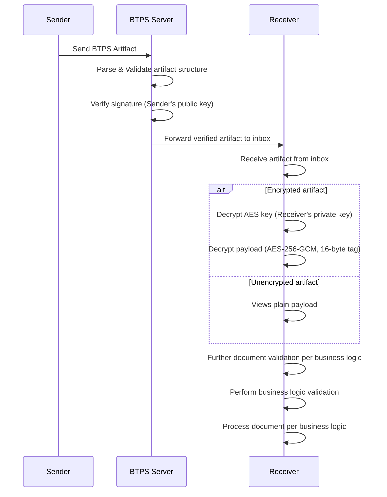

# Decryption & Verification in BTPS

BTPS ensures that only the intended recipient can decrypt and verify the authenticity of received messages. The process combines asymmetric and symmetric cryptography, as well as digital signature verification.

## Decryption & Verification Workflow

1. **Artifact Reception:** BTPS server receives the BTPS Artifact from sender.
2. **Artifact Validation:** BTPS server validates the artifact structure and format.
3. **Signature Verification:** BTPS server verifies the sender's digital signature over the artifact's RFC 8785 (JCS) canonical form, using the sender's public key at the artifact's `signatureSelector` (from DNS, or from the sender's host when DNS has no record). An RSA key under 2048 bits is refused.
4. **Forward to Receiver:** BTPS server forwards the verified artifact to the receiver's inbox endpoint.
5. **Receiver Processing:** Receiver obtains the BTPS Artifact from their inbox endpoint.
6. **Key Decryption:** If the artifact is encrypted, the receiver's `Decrypter` unwraps the AES key (RSA-OAEP, SHA-256) with the receiver's private RSA key at the artifact's `encryptionSelector` (in KMS, for `KmsDecrypter`).
7. **Payload Decryption:** If encrypted, receiver decrypts the payload with AES-256-GCM, using the AES key, the IV and the 16-byte tag. If not encrypted, the payload is used as-is.
8. **Document Extraction:** The decrypted (or plain) payload is parsed into the original document.
9. **Business Logic Validation:** Receiver performs additional validation specific to their SaaS platform or business requirements.
10. **Process & Action:** The document is further processed by the receiver and action is then performed accordingly per business logic.

## How `decryptVerify` Works

- The BTPS client uses the `decryptVerify` function to:
  1. Validates the artifact structure and format
  2. Parse the sender's identity and resolve their public key.
  3. Verify the artifact's signature using the sender's public key.
  4. If the artifact's `encryption` field is present, decrypt the AES key and then the payload.
  5. If the artifact is unencrypted (`encryption` is null), use the payload as-is after signature verification.
  6. Return the verified and decrypted (or plain) document for further processing.

## Where the Private Key Lives: the `Decrypter` (BTPS 1.1)

The SDK never needs the receiver's private key itself. It decrypts through a `Decrypter`, which unwraps the AES key and opens the document:

```ts
interface Decrypter {
  readonly algorithm: 'aes-256-gcm';
  decrypt(request: {
    encryptedKey: Uint8Array; // the RSA-OAEP-wrapped AES-256 key
    iv: Uint8Array;
    ciphertext: Uint8Array;
    authTag: Uint8Array; // exactly 16 bytes
    additionalData?: Uint8Array;
  }): Promise<Uint8Array>;
}
```

- **`KmsDecrypter`** is for production. The private key stays in KMS: KMS unwraps the AES key, and the AES-256-GCM step runs locally.
- **`PemDecrypter`** holds a PEM key in the process. It is for tests and the interim only.

Every decryption path in the SDK takes a `Decrypter`: `decryptBtpPayload`, `decryptVerify`, and the client's `resolveIdentity` and `decryptVerifyArtifact`. A private key PEM is still accepted and wrapped in a `PemDecrypter`. All of them are exported from `@btps/sdk/crypto`.

```js
import { KmsDecrypter, decryptVerify, resolveSignatureKey } from '@btps/sdk/crypto';

const decrypter = new KmsDecrypter({ client: kms, keyId: 'alias/btps-decrypt' });
const { payload, error } = await decryptVerify(
  await resolveSignatureKey(artifact),
  artifact,
  decrypter, // or (encryptionSelector) => the Decrypter for that key
);
```

**The tag:** an AES-GCM authentication tag that is not exactly 16 bytes is refused on every decryption path with `BTP_ERROR_VALIDATION`, before any key is used. A shorter tag is a weaker guarantee, not a shorter form of the same one.

**Additional data:** a `Decrypter` passes `additionalData` to the tag check unchanged.

## BTPS Server Role

**Important:** The BTPS server validates artifact structure and verifies the sender's digital signature to ensure message authenticity and integrity. It does **not** decrypt artifacts as user or user controlled platform owns the private key to decrypt. Decryption and additional business logic validation are performed by the receiver's client application after receiving the artifact.

## Sequence Diagram



## Example Decrypted Artifact

```json
{
  "document": {
    "schemaVersion": 2,
    "type": "invoice",
    "id": "INV-2025-001",
    "issuedAt": "2025-01-15T10:30:00.000Z",
    "title": "Monthly Service Invoice",
    "totalAmount": { "amount": 150000, "currency": "USD" },
    "lineItems": {
      "columns": ["Description", "Amount"],
      "rows": [{ "Description": "Monthly service", "Amount": 150000 }]
    }
  },
  "signature": {
    "algorithmHash": "sha256",
    "value": "...",
    "fingerprint": "..."
  }
}
```

## Notes

- If signature verification fails, the artifact is rejected.
- If decryption fails, the artifact is rejected and an error is logged.
- If the artifact is unencrypted, only signature verification is performed.
- Only after successful verification and decryption (if needed) is the document processed.
- The BTPS server acts as a trusted intermediary that verifies signatures but does not decrypt content.
