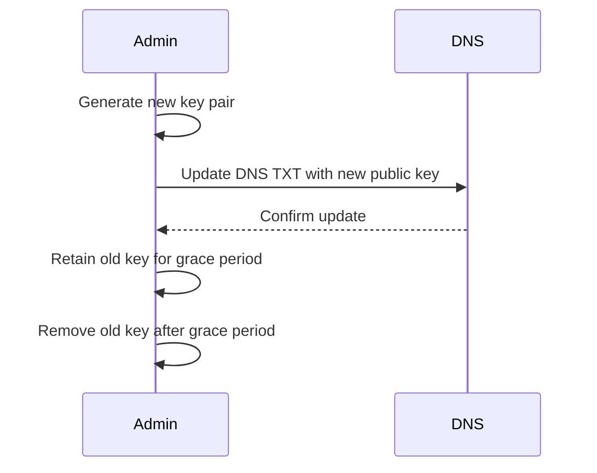

# Key Management in BTPS

Proper key management is essential for maintaining the security and trust of the BTPS protocol. This includes key generation, rotation, and revocation.

## Key Management Flow

## Key Generation
- Keys are RSA, 2048 bits at least. A smaller key is refused for signing, verifying and encrypting (`BTP_ERROR_KEY_TOO_SMALL`).
- In production a key is held in KMS and used through a `Signer` and a `Decrypter`; PEM files are for tests and the interim only.
- Public keys are published in DNS TXT records at `<selector>._btps.identity.<account>.<domain>`, or answered by the address's host for an identity with no DNS record.

## Key Rotation
- Keys should be rotated regularly to maintain forward secrecy.
- When rotating keys:
  1. Generate a new key pair.
  2. Publish the new public key at a new selector (or in the host's identity store), and sign with that selector from then on: artifacts name it as `signatureSelector`.
  3. Notify trusted parties if required.
  4. Keep the old private key for as long as documents encrypted to it may still arrive: they name it as `encryptionSelector`.
- BTPS maintains a key history for audit and compliance.

## Key Revocation
- If a key is compromised, immediately revoke it by removing it from DNS (or the host's identity store) and updating trust records.
- Notify all trusted parties of the revocation.
- Update trust relationships to require re-establishment with the new key.

## Best Practices
- Never share private keys; only publish public keys.
- Use secure storage for private keys (e.g., HSM, encrypted disk).
- Monitor and log all key management operations.
- Automate key rotation and revocation where possible.
