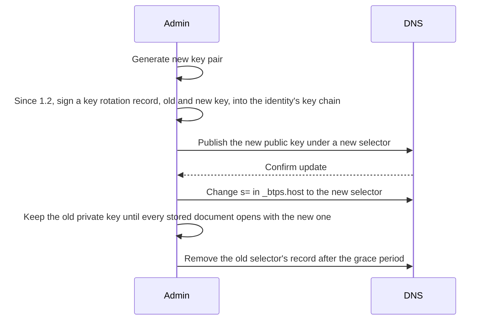

# Key Management in BTPS

Proper key management is essential for maintaining the security and trust of the BTPS protocol. This includes key generation, rotation, and revocation.

## Key Management Flow



## Key Generation

- Keys are generated using strong, industry-standard algorithms (RSA, 2048 bits or more).
- Keys are stored in PEM format for compatibility and portability.
- Public keys are published via DNS TXT records, or served by the host's identity lookup, for discovery.

## Key Rotation

- Keys should be rotated regularly, so a key that leaks unnoticed stops being taken. Rotation is not forward secrecy: a document stays readable by whoever holds the private key it was encrypted to.
- When rotating keys:
  1. Generate a new key pair.
  2. Since 1.2, sign a rotation record with both keys (`signKeyRotation`) and keep it in the identity's key chain (the identity store's `keyChain`), which the identity's host serves. Receivers then take the old key for `retiredKeyGraceSeconds` (a day by default) and refuse it after.
  3. Publish the new public key under a new selector, then change `s=` in `_btps.host` to it. Don't overwrite the old selector's record: receivers verify each artifact with the key at the selector it names. See [Key Rotation](../keyRotation.md).
  4. Keep the old private key until every document encrypted to it opens with the new one: wrap each content key again (`wrapContentKeyFor`) and confirm it (`contentKeyOpens`) before deleting the old key.
- A device's key history is kept on its trust record (`keyHistory`); an identity's, since 1.2, in its key chain.

## Key Revocation

- If a key is compromised, rotate away from it with immediate expiry (`expiry: 'immediate'`, with `compromisedSince` and `reason`) and remove its DNS record at once. Since 1.2, a receiver refuses the key at once (`BTP_ERROR_KEY_REVOKED`), whatever DNS still has. A compromise found after the identity already left the key is an expiry record (`signKeyExpiry`), signed by the current key.
- A 1.1 receiver checks only DNS: removing the record is what stops it taking the key.
- Notify trusted parties if your platform's policy requires it. See [Key rotation](../../features/keyRotation.md) for every case.

## Keys Held Elsewhere: Signer and Decrypter

A private key does not have to be given to the SDK. It can stay in a key management service (such as AWS KMS, Google Cloud KMS or Azure Key Vault), in an HSM, or in the user's own device, where it never leaves the hardware. The SDK then asks for a signature or a decryption instead of reading the key:

- A **`Signer`** signs bytes and reports its public key.
- A **`Decrypter`** decrypts a document: it unwraps the AES key with RSA-OAEP and opens the AES-256-GCM ciphertext.

Both are interfaces in `@btps/sdk/crypto`. They import nothing, so they also work in a browser or a mobile runtime. Signing and decrypting through them is async, because the key holder is usually a network call away.

The SDK ships `PemSigner` and `PemDecrypter` for a PEM key held in the process. For anything else, a platform writes its own, usually in a few lines; the SDK depends on no vendor's library. Every place that takes a PEM key also takes one held elsewhere:

| Where                                                              | PEM key                               | Key held elsewhere                                           |
| ------------------------------------------------------------------ | ------------------------------------- | ------------------------------------------------------------ |
| `BtpsServer`, `serverIdentity`                                     | `publicKey` and `privateKey`          | `signer`                                                     |
| `BtpsAgent`, `agent`                                               | `identityKey` and `identityCert`      | `signer`, and `decrypter` to read encrypted answers          |
| `BtpsDelegator`                                                    | `privateKey`                          | `signer`                                                     |
| `BtpsDelegator.delegateArtifact`, `onBehalfOf`                     | `keyPair` as a PEM key pair           | `keyPair` as a `Signer`                                      |
| `BtpsAuthentication.authenticate` / `refreshSession` / `rotateKey` | `keyPair` as a PEM key pair           | `keyPair` as a `Signer`                                      |
| `signEncrypt`, `sender`                                            | `pemFiles`                            | `signer`                                                     |
| `decryptVerify`                                                    | the receiver's PEM private key        | a `Decrypter`                                                |
| Low level                                                          | `signBtpPayload`, `decryptBtpPayload` | `signBtpPayloadWithSigner`, `decryptBtpPayloadWithDecrypter` |
| Low level, a piece at a time (since 1.2)                           | `decryptBtpPayloadStream`             | `decryptBtpPayloadStreamWithDecrypter`, with `unwrapKey`     |
| Low level, signing a piece at a time (since 1.2)                   | `signBtpPayloadStream`                | `signBtpPayloadStreamWithSigner`, with `signDigest`          |

A signature made through a `Signer` is byte-for-byte the one `signBtpPayload` makes with the same key, so the receiver cannot tell, and needs no change.

Since 1.2, a `Signer` may also have the optional `signDigest`: it signs the SHA-256 digest of what is signed, giving the same signature `sign` gives over the data. `signBtpPayloadStreamWithSigner` needs it, because it never holds a large artifact whole ([Signing and verifying a piece at a time](./decryption.md#signing-and-verifying-a-piece-at-a-time)), and refuses a `Signer` without it. `PemSigner` has it. A `Signer` without it works everywhere else.

### A device's own key to an encrypted document

Since 1.2, a device reads an encrypted document with its own key, so the identity's key never reaches the device. When the device fetches its results, its provider unwraps each encrypted artifact's AES content key with the identity's key and wraps it again to the device's registered key. `wrapForAgent` (`@btps/sdk/server`) does this. The result is `agentKey: { key, fingerprint, wrappedAt }` beside the result. The artifact itself is untouched, so the sender's signature still verifies. The device opens it with `BtpsAgent.openResult`, which:

1. checks that `fingerprint` is its own key's;
2. checks who signed the artifact, as a server does on arrival: the sender's own key, or a delegation, its attestation, and the delegated agent's signature (`verifyTransporterSignature`);
3. decrypts with its own key.

Since 1.2 (rc.4), the same holds for an agreement's [cosignatures](../specifications/transporter-artifact.md#cosignatures): `wrapForAgent` wraps each cosignature's content key that the identity can open again to the device key (`agentKey.cosignatureKeys`), and `openResult` opens those statements with the device key. An unencrypted artifact that carries cosignatures gets `cosignatureKeys` alone.

- **Only to the identity's own devices.** The provider wraps only to a device record of the identity whose key unwraps: the device that asked, as the server's agent authentication identified it. `wrapForAgent` cannot check that pairing.
- **It always wraps to the key the device's record holds now.** A device that has not finished moving to a new key sees from `fingerprint` that the wrap is not for the key it holds.
- **With a key held elsewhere,** the provider's `Decrypter` needs the optional `unwrapKey`, which returns the unwrapped AES key itself. `PemDecrypter` has it. A KMS decrypter already makes this call (KMS `Decrypt` on the wrapped key) inside `decrypt`, so `unwrapKey` is the same call without the AES step. `wrapForAgent` refuses a `Decrypter` without it, and so does `decryptBtpPayloadStreamWithDecrypter` ([Large payloads, a piece at a time](./decryption.md#large-payloads-a-piece-at-a-time)).

### Example: AWS KMS

The key is an asymmetric KMS key of spec `RSA_2048` (or larger): one key with usage `SIGN_VERIFY` for signing, and one with `ENCRYPT_DECRYPT` for decryption. KMS signs at most 4 KB of raw message, while an artifact can be much larger, so the signer sends KMS the SHA-256 digest with `MessageType: 'DIGEST'`, and KMS signs that. The signature is the same as over the whole message. That is what `signDigest` asks for, so the signer below has it too, and can sign a large artifact a piece at a time.

```ts
import { createHash, createPublicKey } from 'crypto';
import { DecryptCommand, GetPublicKeyCommand, KMSClient, SignCommand } from '@aws-sdk/client-kms';
import {
  assertFullLengthAuthTag,
  decryptAesGcm,
  getFingerprintFromPem,
  type Decrypter,
  type DecryptRequest,
  type Signer,
} from '@btps/sdk/crypto';

const kms = new KMSClient({});

export class KmsSigner implements Signer {
  readonly algorithm = 'RSASSA_PKCS1_V1_5_SHA_256';
  private readonly keyId: string;

  constructor(keyId: string) {
    this.keyId = keyId;
  }

  async sign(data: Uint8Array) {
    return this.signDigest(createHash('sha256').update(data).digest());
  }

  // Since 1.2, optional: signs a SHA-256 digest, for signBtpPayloadStreamWithSigner.
  async signDigest(digest: Uint8Array) {
    const { Signature } = await kms.send(
      new SignCommand({
        KeyId: this.keyId,
        Message: digest,
        MessageType: 'DIGEST',
        SigningAlgorithm: 'RSASSA_PKCS1_V1_5_SHA_256',
      }),
    );
    if (!Signature) throw new Error('KMS returned no signature');
    return Signature;
  }

  async getPublicKey() {
    const { PublicKey } = await kms.send(new GetPublicKeyCommand({ KeyId: this.keyId }));
    if (!PublicKey) throw new Error('KMS returned no public key');
    const publicKey = createPublicKey({ key: Buffer.from(PublicKey), format: 'der', type: 'spki' })
      .export({ format: 'pem', type: 'spki' })
      .toString();
    return { publicKey, fingerprint: getFingerprintFromPem(publicKey) };
  }
}

export class KmsDecrypter implements Decrypter {
  readonly algorithm = 'aes-256-gcm';
  private readonly keyId: string;

  constructor(keyId: string) {
    this.keyId = keyId;
  }

  async decrypt(request: DecryptRequest) {
    assertFullLengthAuthTag(request.authTag);
    // KMS unwraps the AES key; the document itself is decrypted here.
    return decryptAesGcm(Buffer.from(await this.unwrapKey(request.encryptedKey)), request);
  }

  // Since 1.2: the AES key itself, so wrapForAgent can wrap it again to a device.
  async unwrapKey(encryptedKey: Uint8Array) {
    const { Plaintext } = await kms.send(
      new DecryptCommand({
        KeyId: this.keyId,
        CiphertextBlob: encryptedKey,
        EncryptionAlgorithm: 'RSAES_OAEP_SHA_256',
      }),
    );
    if (!Plaintext) throw new Error('KMS returned no key');
    return Plaintext;
  }
}
```

Then pass them wherever a key is taken:

```ts
const server = new BtpsServer({
  serverIdentity: { identity: 'admin$yourdomain.com', signer: new KmsSigner(signingKeyArn) }, // the domain's operator
  trustStore,
  tlsOptions,
});

const { payload, error } = await decryptVerify(
  senderPublicKey,
  artifact,
  new KmsDecrypter(decryptionKeyArn),
);
```

The public key published in DNS for the identity is the KMS key's public key. A failure inside the key holder (KMS unreachable, access denied) fails the call that needed it; the SDK never falls back to another key.

## Best Practices

- Never share private keys; only publish public keys.
- Use secure storage for private keys (e.g., HSM, encrypted disk).
- Monitor and log all key management operations.
- Automate key rotation and revocation where possible.
