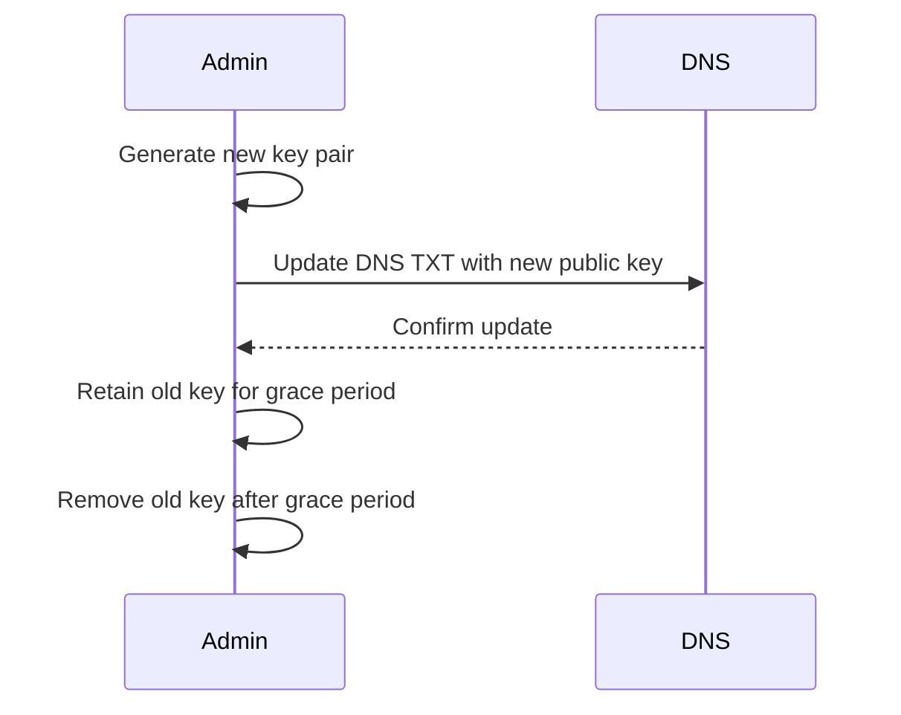

# Key Management in BTPS

Proper key management is essential for maintaining the security and trust of the BTPS protocol. This includes key generation, rotation, and revocation.

## Key Management Flow



## Key Generation
- Keys are generated using strong, industry-standard algorithms (RSA, 2048 bits or more).
- Keys are stored in PEM format for compatibility and portability.
- Public keys are published via DNS TXT records or .well-known endpoints for discovery.

## Key Rotation
- Keys should be rotated regularly to maintain forward secrecy.
- When rotating keys:
  1. Generate a new key pair.
  2. Update the DNS TXT record or .well-known endpoint with the new public key.
  3. Notify trusted parties if required.
  4. Retain the old key for a grace period to allow in-flight messages to be decrypted.
- BTPS maintains a key history for audit and compliance.

## Key Revocation
- If a key is compromised, immediately revoke it by removing it from DNS/.well-known and updating trust records.
- Notify all trusted parties of the revocation.
- Update trust relationships to require re-establishment with the new key.

## Keys Held Elsewhere: Signer and Decrypter

A private key does not have to be given to the SDK. It can stay in a key management service (such as AWS KMS, Google Cloud KMS or Azure Key Vault), in an HSM, or in the user's own device, where it never leaves the hardware. The SDK then asks for a signature or a decryption instead of reading the key:

- A **`Signer`** signs bytes and reports its public key.
- A **`Decrypter`** decrypts a document: it unwraps the AES key with RSA-OAEP and opens the AES-256-GCM ciphertext.

Both are interfaces in `@btps/sdk/crypto`. They import nothing, so they also work in a browser or a mobile runtime. Signing and decrypting through them is async, because the key holder is usually a network call away.

The SDK ships `PemSigner` and `PemDecrypter` for a PEM key held in the process. For anything else, a platform writes its own, usually in a few lines; the SDK depends on no vendor's library. Every place that takes a PEM key also takes one held elsewhere:

| Where                                                | PEM key                               | Key held elsewhere                                           |
| ---------------------------------------------------- | ------------------------------------- | ------------------------------------------------------------ |
| `BtpsServer`, `serverIdentity`                       | `publicKey` and `privateKey`          | `signer`                                                     |
| `BtpsAgent`, `agent`                                 | `identityKey` and `identityCert`      | `signer`, and `decrypter` to read encrypted answers          |
| `BtpsDelegator`                                      | `privateKey`                          | `signer`                                                     |
| `BtpsDelegator.delegateArtifact`, `onBehalfOf`       | `keyPair` as a PEM key pair           | `keyPair` as a `Signer`                                      |
| `BtpsAuthentication.authenticate` / `refreshSession` | `keyPair` as a PEM key pair           | `keyPair` as a `Signer`                                      |
| `signEncrypt`, `sender`                              | `pemFiles`                            | `signer`                                                     |
| `decryptVerify`                                      | the receiver's PEM private key        | a `Decrypter`                                                |
| Low level                                            | `signBtpPayload`, `decryptBtpPayload` | `signBtpPayloadWithSigner`, `decryptBtpPayloadWithDecrypter` |

A signature made through a `Signer` is byte-for-byte the one `signBtpPayload` makes with the same key, so the receiver cannot tell, and needs no change.

### Example: AWS KMS

The key is an asymmetric KMS key of spec `RSA_2048` (or larger): one key with usage `SIGN_VERIFY` for signing, and one with `ENCRYPT_DECRYPT` for decryption. KMS signs at most 4 KB of raw message, while an artifact can be much larger, so the signer sends KMS the SHA-256 digest and KMS signs that. The signature is the same as over the whole message.

```ts
import { createHash, createPublicKey } from 'crypto';
import { DecryptCommand, GetPublicKeyCommand, KMSClient, SignCommand } from '@aws-sdk/client-kms';
import {
  assertFullLengthAuthTag,
  decryptAesGcm,
  getFingerprintFromPem,
  type Decrypter,
  type DecryptRequest,
  type Signer,
} from '@btps/sdk/crypto';

const kms = new KMSClient({});

export class KmsSigner implements Signer {
  readonly algorithm = 'RSASSA_PKCS1_V1_5_SHA_256';
  private readonly keyId: string;

  constructor(keyId: string) {
    this.keyId = keyId;
  }

  async sign(data: Uint8Array) {
    const { Signature } = await kms.send(
      new SignCommand({
        KeyId: this.keyId,
        Message: createHash('sha256').update(data).digest(),
        MessageType: 'DIGEST',
        SigningAlgorithm: 'RSASSA_PKCS1_V1_5_SHA_256',
      }),
    );
    if (!Signature) throw new Error('KMS returned no signature');
    return Signature;
  }

  async getPublicKey() {
    const { PublicKey } = await kms.send(new GetPublicKeyCommand({ KeyId: this.keyId }));
    if (!PublicKey) throw new Error('KMS returned no public key');
    const publicKey = createPublicKey({ key: Buffer.from(PublicKey), format: 'der', type: 'spki' })
      .export({ format: 'pem', type: 'spki' })
      .toString();
    return { publicKey, fingerprint: getFingerprintFromPem(publicKey) };
  }
}

export class KmsDecrypter implements Decrypter {
  readonly algorithm = 'aes-256-gcm';
  private readonly keyId: string;

  constructor(keyId: string) {
    this.keyId = keyId;
  }

  async decrypt(request: DecryptRequest) {
    assertFullLengthAuthTag(request.authTag);
    // KMS unwraps the AES key; the document itself is decrypted here.
    const { Plaintext } = await kms.send(
      new DecryptCommand({
        KeyId: this.keyId,
        CiphertextBlob: request.encryptedKey,
        EncryptionAlgorithm: 'RSAES_OAEP_SHA_256',
      }),
    );
    if (!Plaintext) throw new Error('KMS returned no key');
    return decryptAesGcm(Buffer.from(Plaintext), request);
  }
}
```

Then pass them wherever a key is taken:

```ts
const server = new BtpsServer({
  serverIdentity: { identity: 'billing$yourdomain.com', signer: new KmsSigner(signingKeyArn) },
  trustStore,
  tlsOptions,
});

const { payload, error } = await decryptVerify(
  senderPublicKey,
  artifact,
  new KmsDecrypter(decryptionKeyArn),
);
```

The public key published in DNS for the identity is the KMS key's public key. A failure inside the key holder (KMS unreachable, access denied) fails the call that needed it; the SDK never falls back to another key.

## Best Practices
- Never share private keys; only publish public keys.
- Use secure storage for private keys (e.g., HSM, encrypted disk).
- Monitor and log all key management operations.
- Automate key rotation and revocation where possible.
