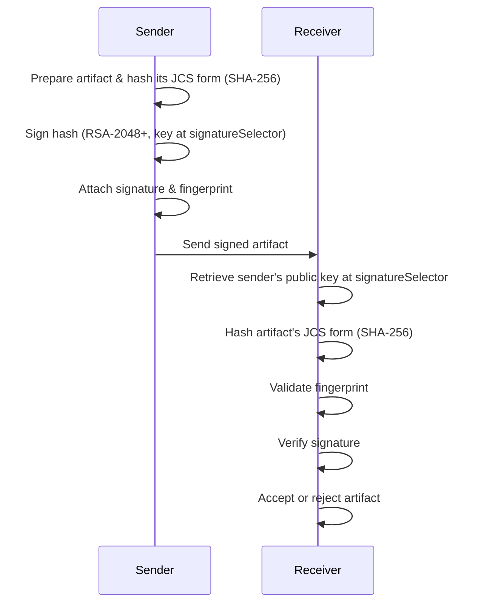

# Signature Signing & Verification in BTPS

BTPS uses digital signatures to ensure the authenticity and integrity of every message artifact exchanged between parties. This process is critical for preventing tampering and impersonation.

## Canonical Form (BTPS 1.1)

What is hashed and signed is the UTF-8 encoding of the [RFC 8785](https://www.rfc-editor.org/rfc/rfc8785) JSON Canonicalization Scheme (JCS) form of the artifact with its `signature` field removed: object keys sorted by UTF-16 code units, no insignificant whitespace, minimal string escaping, and ECMAScript number formatting. Any implementation (Node, a browser, Swift, Kotlin, a KMS client) produces the same bytes for the same artifact, whatever order it holds the keys in. Input with a duplicate member name, a lone UTF-16 surrogate, or a number outside an IEEE-754 double is refused. The SDK exposes this as `canonicalize` from `@btps/sdk/crypto`.

## Where the Private Key Lives: the `Signer` (BTPS 1.1)

The SDK never needs the private key itself. It signs through a `Signer`, which is handed the canonical bytes and returns the signature:

```ts
interface Signer {
  readonly algorithm: 'RSASSA_PKCS1_V1_5_SHA_256';
  sign(data: Uint8Array): Promise<Uint8Array>;
  getPublicKey(): Promise<{ publicKey: string; fingerprint: string }>;
}
```

- **`KmsSigner`** is for production. The key is created in KMS and never leaves it: the SDK sends KMS the bytes to sign and gets the signature back.
- **`PemSigner`** holds a PEM key in the process. It is for tests and the interim only.

Every signing path in the SDK takes a `Signer`: `signBtpPayload`, `signEncrypt` (`sender.signer`), `BtpsAgent` (`agent.signer`), `BtpsDelegator` (`signer`, and `onBehalfOf.signer`) and `BtpsServer` (`serverIdentity.signer`). Where a path used to take PEM keys it still does, and wraps them in a `PemSigner`. All of them are exported from `@btps/sdk/crypto`.

```js
import { KmsSigner, signBtpPayload } from '@btps/sdk/crypto';

const signer = new KmsSigner({ client: kms, keyId: 'alias/btps-sign' });
const signature = await signBtpPayload(artifactWithoutSignature, signer);
```

`client` is your adapter over your KMS SDK, with `sign({ keyId, message })` returning `{ signature }` and `getPublicKey({ keyId })` returning `{ publicKeyPem }`. A KMS failure reaches the caller as a `BTPErrorException` whose `meta.retryable` says whether a retry can help.

## Signature Workflow

### Signing (Sender Side)
1. **Payload Preparation:** The sender prepares the artifact (including metadata, payload and `signatureSelector`, the selector of the key it signs with).
2. **Hashing:** The sender computes a SHA-256 hash of the artifact's canonical form (JCS, above), without the `signature` field.
3. **Signature Generation:** The sender's `Signer` signs it with the private key (RSASSA-PKCS1-v1_5 with SHA-256), wherever that key is held.
4. **Fingerprint Calculation:** The sender's public key fingerprint is computed (SHA-256 of the public key DER).
5. **Signature Attachment:** The signature and fingerprint are attached to the artifact as the `signature` field.

### Verification (Receiver Side)
1. **Sender Identity Resolution:** The receiver parses the sender's identity and retrieves the sender's public key at the artifact's `signatureSelector` (from DNS, or from the sender's host when DNS has no record). An RSA key under 2048 bits is refused (`BTP_ERROR_KEY_TOO_SMALL`).
2. **Hashing:** The receiver computes a SHA-256 hash of the received artifact's canonical form (excluding the signature field).
3. **Fingerprint Validation:** The receiver computes the fingerprint of the sender's public key and compares it to the artifact's fingerprint.
4. **Signature Verification:** The receiver verifies the signature using the sender's public key and the computed hash.
5. **Result:** If the signature is valid and the fingerprint matches, the artifact is accepted as authentic; otherwise, it is rejected.

## Sequence Diagram



## Example Signature Field

```json
{
  "signature": {
    "algorithmHash": "sha256",
    "value": "...",
    "fingerprint": "..."
  }
}
```

## Notes
- The signature covers the entire artifact except the `signature` field, `version` and both selectors included, so changing any of them breaks it.
- The fingerprint ensures the correct public key is used for verification.
- If signature verification fails, the artifact is rejected and an error is logged. 