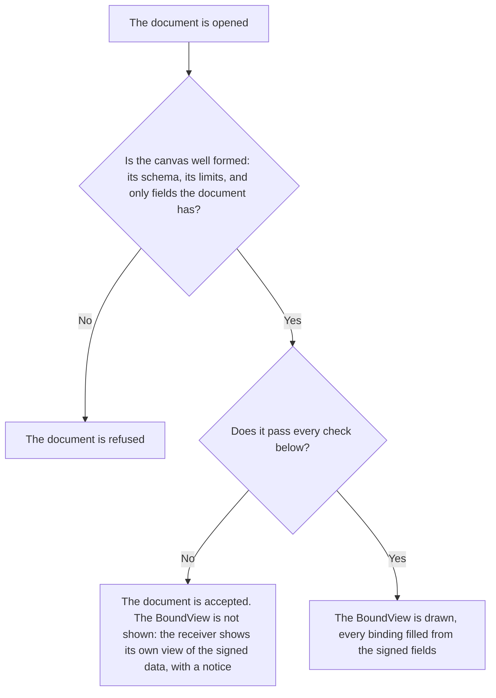

# Checks

:::info Reference for implementers
Part of the BoundView specification, for building your own builder or
renderer, or checking one. A platform that uses `@btps/boundview` does not need
it: the SDK runs these checks for you. See
[Using BoundView](./using.md#when-a-check-fails).
:::

A receiver checks a BoundView against the signed document **wherever the document
is opened**, before anything is shown: on the receiving server when it can
read the document, and on the receiver's device when only the device holds
the key. The SDK does both the same way (`checkBoundView`). A sender's SDK runs
the same checks before it signs, so an honest sender finds a problem before
sending.

| Where | When |
| --- | --- |
| The sender's SDK | Before it signs |
| The receiving server | When it can read the document |
| The receiver's device | When only the device holds the key |

## Two outcomes

| What is wrong | Outcome |
| --- | --- |
| The canvas breaks its [schema](./canvas.md) or a limit, or binds a field the document does not have, or a `text` element names a font that is only a `fallback` | The **document is refused**, as a document with any other malformed field is. |
| The canvas is well formed but fails a check below | The **document is accepted** and the **BoundView is not shown**. The receiver shows its own view of the signed data, with a notice saying why. |

:::note Never in part, never lost
A BoundView that fails a check is never shown in part, and the document behind it
is never lost.
:::

## The result

`checkBoundView(document, boundView)` gives `{ show: true }`, or
`{ show: false, problems }`, where each problem names the check that failed
and what it is about:

| Field | Type | Required | What it says |
| --- | --- | --- | --- |
| `check` | `wellFormed`, `keyFacts`, `shownInFull` or `notHidden` | Yes | The check that failed |
| `message` | string | Yes | Why, in words |
| `field` | string | No | The key fact it is about |
| `element` | number | No | The index in `elements` of the element it is about |

A document that is validated first never reaches the checks with a
malformed BoundView: it is refused. If a document reaches the check without
having been validated, and its BoundView turns out not to be well formed,
the BoundView is not shown, with a `wellFormed` problem.

## The checks

| Check | In short |
| --- | --- |
| [Key facts](#key-facts) | Every key fact of the document is on the BoundView, written from its signed value |
| [Shown in full](#shown-in-full) | Every bound value fits its box, with glyphs for every character |
| [Not hidden](#not-hidden) | Nothing covers a fact, and every fact stands out from what is behind it |
| [Nothing to fetch, nothing to run](#nothing-to-fetch-nothing-to-run) | Every value is one the schema names |

### Key facts

The BoundView shows each of its document's key facts at least once. The
tables below say, for each document type, which fields are key facts and
which may be left out. A field the document does not carry is not required.

A BoundView is the sender's own presentation, shown exactly as it was
signed. The signed data is the record, and the receiving app's **all
details** view shows every signed field, whether a BoundView is shown or
not. So a BoundView must show the key facts, and everything it shows is the
signed value, but it need not show every field. A design that does show
every field passes too.

A field may be left out when it is:

- **What the receiving app shows apart from the BoundView:** who sent it,
  verified, and who it is for.
- **What follows from what is shown:** a subtotal, and a discount the total
  already takes off.
- **What does not change what is owed, paid or said:** an issue date beside
  a due date, or how a payment was made.

#### Invoice

| Field | Must be shown |
| --- | --- |
| `id` | Yes |
| `dueAt` | Yes |
| `totalAmount` | Yes |
| `taxAmount` | Yes |
| `description`, the note | Yes |
| Each line's description and line total | Yes ([Line items](#line-items)) |
| `issuer.name` | No: the receiving app shows who sent it |
| `recipient.name` | No: the receiving app shows who it is for |
| `issuedAt` | No |
| `subtotalAmount` | No: it follows from the lines |
| `discount`, as `amount` or `percent` | No: the total already takes it off |
| A line's other cells: quantity, unit price, tax, a line's discount | No |
| Any other field, such as `title`, or the issuer's address or identifiers | No |

#### Receipt

| Field | Must be shown |
| --- | --- |
| `id` | Yes |
| `totalAmount` | Yes |
| `taxAmount` | Yes |
| `description`, the note | Yes |
| `payment.amount` | Yes |
| `payment.paidAt` | Yes |
| Each line's description and line total | Yes ([Line items](#line-items)) |
| `issuer.name` | No: the receiving app shows who sent it |
| `recipient.name` | No: the receiving app shows who it is for |
| `issuedAt` | No |
| `subtotalAmount` | No: it follows from the lines |
| `discount`, as `amount` or `percent` | No: the total already takes it off |
| `payment.method`, `payment.reference` | No: how it was paid does not change what was paid |
| A line's other cells: quantity, unit price, tax, a line's discount | No |
| Any other field, such as `title`, or the issuer's address or identifiers | No |

#### Payslip

| Field | Must be shown |
| --- | --- |
| `id` | Yes |
| `employee.name` | Yes |
| `payPeriod.start`, `payPeriod.end` | Yes |
| `payDate` | Yes |
| `gross`, `taxWithheld`, `net` | Yes |
| Each earning's `description` and `amount` | Yes |
| Each deduction's `description` and `amount` | Yes |
| Each contribution's `amount` | Yes. A contribution has no `description`. |
| `issuer.name`, the employer | No: the receiving app shows who sent it |
| `employee.employeeId` | No |
| `issuedAt` | No |
| `payRate` | No |
| `leave` | No |
| `yearToDate` | No |
| Any other field, such as `title`, or an earning's `category` or `rate` | No |

#### Letter

| Field | Must be shown |
| --- | --- |
| `issuedAt` | Yes |
| `body.content` | Yes, every word of it |
| `signatory.name`, `signatory.title` | Yes |
| `signatory.visualSignature` | Yes, as a [`signature`](./elements.md#signature) element |
| `issuer.name` | No: the receiving app shows who sent it |
| `recipient.name` | No: the receiving app shows who it is for |
| `id` | No |
| Any other field, such as `title`, or the issuer's address | No |

#### Agreement

As a letter, and `acceptance.by` must be shown too.

#### Line items

A line's description and line total are its cells in the columns
`lineItems.roles` names `description` and `lineTotal`. When the document
names no roles, every cell of every line is a key fact. A discount written
as a line item of its own is a line, and is shown as one.

#### When a key fact is shown

A key fact is shown when `text` elements write its value:

- **Bound to it, or to a field written the same.** An element bound to
  another field counts when it writes that field's value exactly as it would
  write the key fact's, in the same format. Equal values share: on a receipt
  whose total equals the amount paid, one element bound to `totalAmount`
  shows `payment.amount` too, and one date shows both `issuedAt` and
  `payment.paidAt` when they fall on the same day. A field written in
  markdown shares only with another written in markdown.
- **In full.** A value shown in pieces, each element bound to a
  [range](./bindings.md#ranges) of it, counts when its pieces, in one
  format, together cover every character that must be shown. A space need
  not be shown.

`signatory.visualSignature` is shown when the BoundView has a `signature`
element.

#### Markdown

In a field written in markdown, a note or a body with `format: "markdown"`,
the characters a renderer does not draw as text need not be shown:

| Characters | Why |
| --- | --- |
| The marks `#`, `*`, `_`, `` ` ``, `>`, `-` and `+`, wherever they are | They are formatting marks. One drawn as text, such as a hyphen, may still be shown. |
| A backslash before a punctuation mark or a symbol | It escapes the next character and is never drawn |
| A link's `[` and its `](destination)` | Only the link's text is drawn, and it must be shown |
| The `<` and `>` of an address written `<https://…>` or `<http://…>` | They are never drawn |
| An ordered list item's number, 1 to 9 digits and its `.` or `)`, at the start of a line after any spaces or tabs and followed by a space or tab | It is drawn as the list's marker, not as text |

Every other character but a space must be shown. `markdownHidden(text)`,
from `@btps/sdk/boundview`, marks these characters in a text, and
`keyFacts(document)` lists a document's key facts.

### Shown in full

Each bound value, written in its format, or the part of it its `range`
names, and drawn with its glyphs, fits its element's `width`. A receiver may
draw it smaller to fit, down to three quarters of its `size` and never below
6 pixels; if it still does not fit, the check fails. A value is never cut short, wrapped or hidden.

Each character of a bound value has a glyph in that element's own font. A
character with no glyph there fails the check: a font's
[fallback](./fonts.md#fallbacks) is never used for a bound value, so every
receiver measures it with the same glyphs and reaches the same result.

### Not hidden

For each bound `text` element and each `signature`:

- its box lies wholly inside the page;
- no element drawn after it overlaps its box;
- its colour has a WCAG 2 contrast of at least 3:1 with the colour beneath
  it at **every** sample point of its box ([Contrast](#contrast)).

Two boxes overlap when they share more than 0.005 pixels across and more
than 0.005 pixels down: half of 0.01 pixels, the precision a canvas writes
positions to ([Canvas](./canvas.md)). Boxes that only touch, or meet by
less through the rounding of a sum, do not overlap. In the same way, a box
counts as inside the page when it reaches past an edge by 0.005 pixels or
less.

A label, a shape and an image may be drawn anywhere: they are the sender's
design. An image under a fact is not refused for being there: the contrast
test reads it by its own pixels, as it reads a shape by its paint. A faint
watermark or a soft background picture behind a fact passes; a dark or busy
one where the fact lies fails.

#### Contrast

The contrast test is exact: every receiver samples the same points and
computes the same colours, so two implementations always agree.

**The box.** For a bound `text` element: from `x` to `x + width`, and from
its baseline minus its font's `ascent` to its baseline plus its `descent`,
as [Elements](./elements.md#text) says, in pixels at the element's declared
`size`, never the smaller size a value may be drawn at to fit. The box at
the declared size contains the drawn one, so this is the stricter of the
two, and the same on every receiver.
For a `signature`: its box, `x` to `x + width` and `y` to `y + height`.

**Sample points.** A grid inside the box, every 1 pixel in `x` and `y`, at
pixel centres. For a box from `x0` to `x1` and from `y0` to `y1`, the points
in `x` are `x0 + 0.5 + k`, for `k` = 0, 1, 2, … for as long as the point
is at most `x1`, and the same in `y` from `y0` to `y1`: every pair of them.
If a side gets no point, because the box is under half a pixel that way,
its one point is the middle of that side.

**The colour beneath a point.**

1. Start from the page's `background`, white when absent. A `background`
   with alpha is first blended over white.
2. For each earlier `rect` and `path` that has a `fill`, and each earlier
   `image`, in the order of `elements`, that covers the point: blend its
   colour at that point over the colour so far, source-over:
   `out = src × a + below × (1 − a)`. For a `rect` or `path`, `src` is its
   fill colour at the point and `a` is the fill's alpha times the element's
   `opacity`. For an `image`, `src` is its pixel at the point and `a` is
   that pixel's alpha, 0 to 255 scaled to 0 to 1, times the element's
   `opacity`.
3. A gradient's colour at the point is interpolated as
   [Rendering](./rendering.md#shapes) says. An image's pixel at the point
   `(px, py)` is the one at column `floor((px − x) / width × image width)`
   and row `floor((py − y) / height × image height)` of its
   [pixels](./images.md#an-image), each clamped to the image's own columns
   and rows: the nearest pixel, never interpolated. Here `x`, `y`, `width`
   and `height` are the element's, and the image's width and height are its
   pixels'. A renderer draws the image with bilinear filtering; the check
   reads the stored pixel, so every receiver reads the same one.
4. Blending is in sRGB, each channel a real number from 0 to 255, never
   rounded along the way. WCAG 2 relative luminance is computed from these
   unrounded values.
5. Strokes and `line` elements are ignored.

**Covers.**

- A `rect` covers a point inside its box, with its rounded corners tested
  exactly.
- An `image` covers a point inside its box, `x` to `x + width` and `y` to
  `y + height`, with its `radius` corners tested exactly, as for a `rect`.
- A `path` covers a point by its `fillRule`, `nonzero` or `evenodd`. Its
  curves are first flattened into straight segments, each `Q` and `C`
  subdivided into 16 equal parameter steps.
- A point exactly on an edge counts as covered.

**The test.** The fact's `colour` has a WCAG 2 contrast of at least 3:1 with
the colour beneath it at every sample point. One point below 3:1 fails the
check.

:::note Why it is exact
It checks what the reader actually sees behind the fact, point by point. An
honest design, such as white text on a dark band, passes; a hidden fact, in
a colour close to what lies behind it anywhere in its box, never does.
:::

**The work budget.** The contrast check makes at most 20,000,000 tests on
one BoundView. Count, for every sample row of every fact, each edge of each
`path` beneath it, plus each sample point times each fill and each image
beneath it, plus each image's pixels (`width × height`) once in the
BoundView, when the image is first read. A BoundView that needs more fails
"Not hidden", so a receiver is never made to work without end.

### Nothing to fetch, nothing to run

Every value in the canvas is one its schema names: colours as `#rrggbb` or
`#rrggbbaa`, numbers within their limits, path commands from the fixed list,
font and image keys that exist. A receiver never passes a value from a canvas
to anything that reads markup.

## A sender's warnings

A sender's SDK also warns, without refusing, when a label's text looks like
an amount, a date, an account number or an address but is not bound: most
often an example left in a design by mistake. A receiver does not refuse a
label for what it says; it is the sender's words ([Security
model](./security.md)).
