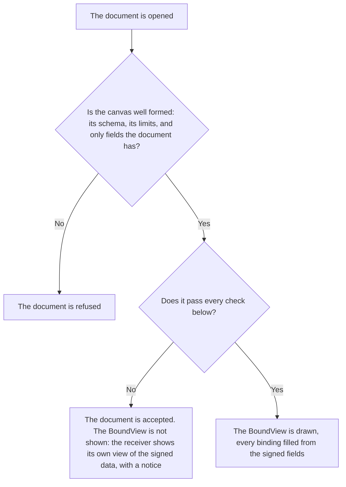

# Checks

:::info Reference for implementers
Part of the BoundView specification, for building your own builder or
renderer, or checking one. A platform that uses `@btps/boundview` does not need
it: the SDK runs these checks for you. See
[Using BoundView](./using.md#when-a-check-fails).
:::

A receiver checks a BoundView against the signed document **wherever the document
is opened**, before anything is shown: on the receiving server when it can
read the document, and on the receiver's device when only the device holds
the key. The SDK does both the same way (`checkBoundView`). A sender's SDK runs
the same checks before it signs, so an honest sender finds a problem before
sending.

| Where | When |
| --- | --- |
| The sender's SDK | Before it signs |
| The receiving server | When it can read the document |
| The receiver's device | When only the device holds the key |

## Two outcomes

| What is wrong | Outcome |
| --- | --- |
| The canvas breaks its [schema](./canvas.md) or a limit, or binds a field the document does not have | The **document is refused**, as a document with any other malformed field is. |
| The canvas is well formed but fails a check below | The **document is accepted** and the **BoundView is not shown**. The receiver shows its own view of the signed data, with a notice saying why. |

:::note Never in part, never lost
A BoundView that fails a check is never shown in part, and the document behind it
is never lost.
:::

## The checks

| Check | In short |
| --- | --- |
| [Key facts](#key-facts) | Every key fact of the document is on the BoundView, bound |
| [Shown in full](#shown-in-full) | Every bound value fits its box, with glyphs for every character |
| [Not hidden](#not-hidden) | Nothing covers a fact, and every fact stands out from what is behind it |
| [Nothing to fetch, nothing to run](#nothing-to-fetch-nothing-to-run) | Every value is one the schema names |

### Key facts

The BoundView shows each of its document's key facts at least once, as a bound
`text` element. A key fact the document does not carry is not required.

| Document | Key facts |
| --- | --- |
| Invoice | `id`, `issuedAt`, `dueAt`, `totalAmount`, `subtotalAmount`, `taxAmount`, `discount`, `issuer.name`, `recipient.name`, `description`, and every line's description and line total |
| Receipt | As an invoice, without `dueAt`, with `payment.amount` and `payment.paidAt` |
| Payslip | `id`, `issuedAt`, `issuer.name`, `employee.name`, `payPeriod.start`, `payPeriod.end`, `payDate`, `gross`, `taxWithheld`, `net`, and every earning's, deduction's and contribution's amount |
| Letter | `issuedAt`, `issuer.name`, `recipient.name`, every word of `body.content`, and the `signatory` (its name, title and visual signature) |
| Agreement | As a letter, with `acceptance.by` |

A line's description and line total are its cells in the columns
`lineItems.roles` names `description` and `lineTotal`. When the document
names no roles, every cell of every line is a key fact.

Every other signed field is shown by the receiving app's **all details**
view, which every receiver offers whether a BoundView is shown or not.

### Shown in full

Each bound value, written in its format and drawn with its glyphs, fits its
element's `width`. A receiver may draw it smaller to fit, down to three
quarters of its `size` and never below 6 pixels; if it still does not fit,
the check fails. A value is never cut short, wrapped or hidden.

Each character of a bound value has a glyph in its font or a
[fallback](./fonts.md#fallbacks) the receiver holds.

### Not hidden

For each bound `text` element and each `signature`:

- its box lies wholly inside the page;
- no element drawn after it overlaps its box;
- no `image` lies under it;
- its colour has a contrast of at least 3:1 with what is directly beneath
  its box: the page's background, or the topmost earlier `rect` or `path`
  whose fill covers the box. Against a gradient, every stop counts. The
  contrast is WCAG 2's.

A label, a shape and an image may be drawn anywhere: they are the sender's
design.

### Nothing to fetch, nothing to run

Every value in the canvas is one its schema names: colours as `#rrggbb` or
`#rrggbbaa`, numbers within their limits, path commands from the fixed list,
font and image keys that exist. A receiver never passes a value from a canvas
to anything that reads markup.

## A sender's warnings

A sender's SDK also warns, without refusing, when a label's text looks like
an amount, a date, an account number or an address but is not bound: most
often an example left in a design by mistake. A receiver does not refuse a
label for what it says; it is the sender's words ([Security
model](./security.md)).
