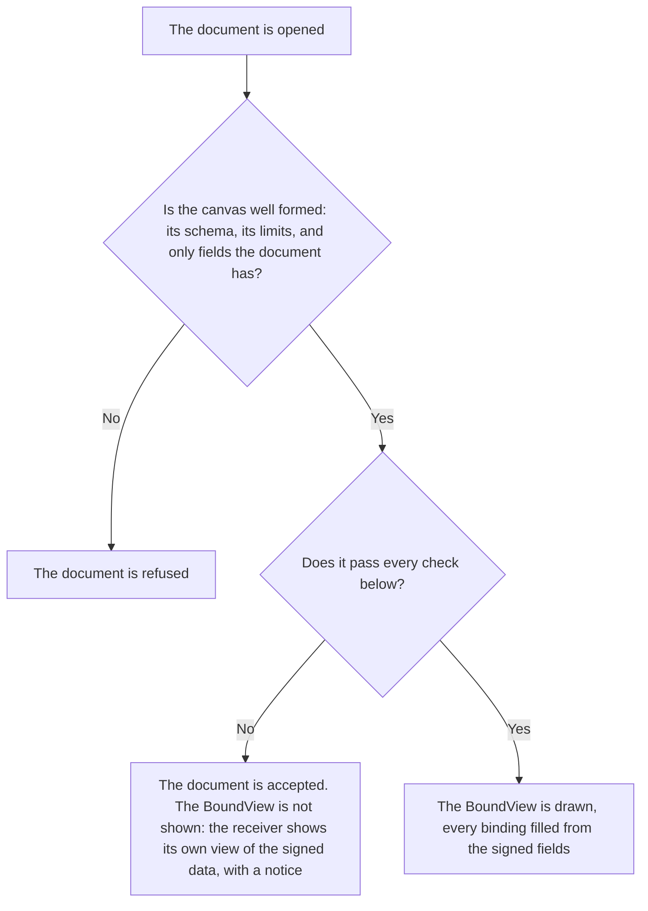

# Checks

:::info Reference for implementers
Part of the BoundView specification, for building your own builder or
renderer, or checking one. A platform that uses `@btps/boundview` does not need
it: the SDK runs these checks for you. See
[Using BoundView](./using.md#when-a-check-fails).
:::

A receiver checks a BoundView against the signed document **wherever the document
is opened**, before anything is shown: on the receiving server when it can
read the document, and on the receiver's device when only the device holds
the key. The SDK does both the same way (`checkBoundView`). A sender's SDK runs
the same checks before it signs, so an honest sender finds a problem before
sending.

| Where | When |
| --- | --- |
| The sender's SDK | Before it signs |
| The receiving server | When it can read the document |
| The receiver's device | When only the device holds the key |

## Two outcomes

| What is wrong | Outcome |
| --- | --- |
| The canvas breaks its [schema](./canvas.md) or a limit, or binds a field the document does not have, or a `text` element names a font that is only a `fallback` | The **document is refused**, as a document with any other malformed field is. |
| The canvas is well formed but fails a check below | The **document is accepted** and the **BoundView is not shown**. The receiver shows its own view of the signed data, with a notice saying why. |

:::note Never in part, never lost
A BoundView that fails a check is never shown in part, and the document behind it
is never lost.
:::

## The result

`checkBoundView(document, boundView)` gives `{ show: true }`, or
`{ show: false, problems }`, where each problem names the check that failed
and what it is about:

| Field | Type | Required | What it says |
| --- | --- | --- | --- |
| `check` | `wellFormed`, `keyFacts`, `shownInFull` or `notHidden` | Yes | The check that failed |
| `message` | string | Yes | Why, in words |
| `field` | string | No | The key fact it is about |
| `element` | number | No | The index in `elements` of the element it is about |

A document that is validated first never reaches the checks with a
malformed BoundView: it is refused. If a document reaches the check without
having been validated, and its BoundView turns out not to be well formed,
the BoundView is not shown, with a `wellFormed` problem.

## The checks

| Check | In short |
| --- | --- |
| [Key facts](#key-facts) | Every key fact of the document is on the BoundView, bound |
| [Shown in full](#shown-in-full) | Every bound value fits its box, with glyphs for every character |
| [Not hidden](#not-hidden) | Nothing covers a fact, and every fact stands out from what is behind it |
| [Nothing to fetch, nothing to run](#nothing-to-fetch-nothing-to-run) | Every value is one the schema names |

### Key facts

The BoundView shows each of its document's key facts at least once, as a bound
`text` element. A key fact the document does not carry is not required.

| Document | Key facts |
| --- | --- |
| Invoice | `id`, `issuedAt`, `dueAt`, `totalAmount`, `subtotalAmount`, `taxAmount`, `discount`, `issuer.name`, `recipient.name`, `description`, and every line's description and line total |
| Receipt | As an invoice, without `dueAt`, with `payment.amount` and `payment.paidAt` |
| Payslip | `id`, `issuedAt`, `issuer.name`, `employee.name`, `payPeriod.start`, `payPeriod.end`, `payDate`, `gross`, `taxWithheld`, `net`, and every earning's, deduction's and contribution's amount |
| Letter | `issuedAt`, `issuer.name`, `recipient.name`, every word of `body.content`, and the `signatory` (its name, title and visual signature) |
| Agreement | As a letter, with `acceptance.by` |

A line's description and line total are its cells in the columns
`lineItems.roles` names `description` and `lineTotal`. When the document
names no roles, every cell of every line is a key fact.

Every other signed field is shown by the receiving app's **all details**
view, which every receiver offers whether a BoundView is shown or not.

### Shown in full

Each bound value, written in its format and drawn with its glyphs, fits its
element's `width`. A receiver may draw it smaller to fit, down to three
quarters of its `size` and never below 6 pixels; if it still does not fit,
the check fails. A value is never cut short, wrapped or hidden.

Each character of a bound value has a glyph in that element's own font. A
character with no glyph there fails the check: a font's
[fallback](./fonts.md#fallbacks) is never used for a bound value, so every
receiver measures it with the same glyphs and reaches the same result.

### Not hidden

For each bound `text` element and each `signature`:

- its box lies wholly inside the page;
- no element drawn after it overlaps its box;
- no `image` lies under it;
- its colour has a WCAG 2 contrast of at least 3:1 with the colour beneath
  it at **every** sample point of its box ([Contrast](#contrast)).

A label, a shape and an image may be drawn anywhere: they are the sender's
design.

#### Contrast

The contrast test is exact: every receiver samples the same points and
computes the same colours, so two implementations always agree.

**The box.** For a bound `text` element: from `x` to `x + width`, and from
its baseline minus its font's `ascent` to its baseline plus its `descent`,
as [Elements](./elements.md#text) says, in pixels at the element's declared
`size`, never the smaller size a value may be drawn at to fit. The box at
the declared size contains the drawn one, so this is the stricter of the
two, and the same on every receiver.
For a `signature`: its box, `x` to `x + width` and `y` to `y + height`.

**Sample points.** A grid inside the box, every 1 pixel in `x` and `y`, at
pixel centres. For a box from `x0` to `x1` and from `y0` to `y1`, the points
in `x` are `x0 + 0.5 + k`, for `k` = 0, 1, 2, … for as long as the point
is at most `x1`, and the same in `y` from `y0` to `y1`: every pair of them.
If a side gets no point, because the box is under half a pixel that way,
its one point is the middle of that side.

**The colour beneath a point.**

1. Start from the page's `background`, white when absent. A `background`
   with alpha is first blended over white.
2. For each earlier `rect` and `path` that has a `fill`, in the order of
   `elements`, whose fill covers the point: blend its fill colour at that
   point over the colour so far, source-over:
   `out = src × a + below × (1 − a)`, where `a` is the fill's alpha times
   the element's `opacity`.
3. A gradient's colour at the point is interpolated as
   [Rendering](./rendering.md#shapes) says.
4. Blending is in sRGB, each channel a real number from 0 to 255, never
   rounded along the way. WCAG 2 relative luminance is computed from these
   unrounded values.
5. Strokes and `line` elements are ignored. An `image` beneath the fact is
   already refused, above.

**Covers.**

- A `rect` covers a point inside its box, with its rounded corners tested
  exactly.
- A `path` covers a point by its `fillRule`, `nonzero` or `evenodd`. Its
  curves are first flattened into straight segments, each `Q` and `C`
  subdivided into 16 equal parameter steps.
- A point exactly on an edge counts as covered.

**The test.** The fact's `colour` has a WCAG 2 contrast of at least 3:1 with
the colour beneath it at every sample point. One point below 3:1 fails the
check.

:::note Why it is exact
It checks what the reader actually sees behind the fact, point by point. An
honest design, such as white text on a dark band, passes; a hidden fact, in
a colour close to what lies behind it anywhere in its box, never does.
:::

**The work budget.** The contrast check makes at most 20,000,000 tests on
one BoundView. Count, for every sample row of every fact, each edge of each
`path` beneath it, plus each sample point times each fill beneath it. A
BoundView that needs more fails "Not hidden", so a receiver is never made to
work without end.

### Nothing to fetch, nothing to run

Every value in the canvas is one its schema names: colours as `#rrggbb` or
`#rrggbbaa`, numbers within their limits, path commands from the fixed list,
font and image keys that exist. A receiver never passes a value from a canvas
to anything that reads markup.

## A sender's warnings

A sender's SDK also warns, without refusing, when a label's text looks like
an amount, a date, an account number or an address but is not bound: most
often an example left in a design by mistake. A receiver does not refuse a
label for what it says; it is the sender's words ([Security
model](./security.md)).
