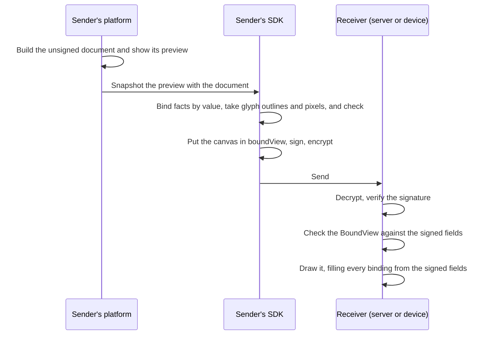

# BoundView

> **Since 1.2.** A BoundView travels in `1.2.0` artifacts only.

## What is BoundView

BoundView is BTPS's format for sending a document with its own look, so the
receiver sees exactly the page the sender previewed. Every fact on it is
bound to the document's signed data and drawn from that data, never carried
as text. It is signed with the document and checked wherever the document is
opened, and it is drawn by one engine in a closed WebAssembly box. **What you
see is what was signed.** A platform builds nothing: `@btps/boundview`
captures it from the HTML preview the platform already shows, and draws it
on the receiving side.

A document carries its BoundView in its `boundView` field: a signed
**canvas**, a page of shapes, text and images at fixed positions. It is made
by taking a snapshot of the sender's preview when the document is sent, and
drawn on the receiving side by one renderer.

## Why it was created

BTPS already proved who sent a document and that its data arrived
unaltered, but not that the page a person reads matches that data. A
receiver either drew its own generic view of the data, or showed the
sender's HTML or PDF, which nothing tied to the data. BoundView was created
to keep the sender's design and guarantee that the page shows what was
signed. The full story, and how email, signed PDFs, e-invoicing networks
and portals compare, is on [Why BoundView was created](./why.md).

## Where to start

| You are | Read |
| --- | --- |
| **Asking why BoundView was created**, and how it differs from email, PDFs and e-invoicing | [Why BoundView was created](./why.md) |
| **A platform** sending or showing documents | [Using BoundView](./using.md): the few lines of code, what your app shows around a BoundView, and what happens when a check fails. It is all you need. |
| **An implementer** building your own builder or renderer, or checking one | The [specification](#the-specification): the exact format, checks and drawing rules. |
| **Reviewing what BTPS guarantees** | [What BTPS promises](#what-btps-promises), below, then the [security model](./security.md). |

## You do not build any of this

BTPS ships the builder and the renderer in the `@btps/boundview` package. A
platform designs its preview in HTML, as it already does, and the rest
happens for it:

- **Sending.** Hand the preview's HTML element and the document to
  `snapshotBoundView`, in the browser where the preview is shown. It captures
  the canvas, binds every fact to its field, takes glyph outlines and pixels,
  and checks the result. Put what it returns in `boundView` and send as
  usual.
- **Receiving.** The SDK checks the BoundView whenever the document is
  opened, on the server or on the device, with nothing to call.
  `renderBoundView` draws a BoundView that passed into a finished picture,
  and the app only displays it.

```ts
import { snapshotBoundView, renderBoundView } from '@btps/boundview';

// Sending: the preview you already show, and the document it shows
const boundView = await snapshotBoundView(previewElement, document);
await agent.command('artifact.send', to, { ...document, boundView });

// Receiving: a PNG to display, or null when the view failed a check
const png = await renderBoundView(openedDocument);
```

:::tip There is no format to learn
There is no template to write either. The [specification](#the-specification)
pages are for anyone building their own builder or renderer, or checking that
one is right. A platform that uses `@btps/boundview` never needs them: start
with [Using BoundView](./using.md).
:::

## What BTPS promises

| BTPS guarantees | How |
| --- | --- |
| **No tampering.** What was signed is what arrives, the BoundView included. | The BoundView is inside the document, so the artifact's signature covers it. |
| **No spoofing.** The document comes from its sender. | The signature and the trust record. The receiving app shows the verified sender [outside the BoundView](./using.md#what-the-receiving-app-shows-around-a-boundview), never inside it. |
| **No active content, no tracking.** Nothing runs, and nothing is fetched when a document is viewed. | A BoundView holds only data: shapes, glyph outlines and pixels. It names no address, font file or image file. |
| **The page shows what the document says.** | Every fact on a BoundView is a [binding](./bindings.md) to a signed field and is drawn from that field. It must show the document's [key facts](./checks.md#key-facts), each in full. |
| **The same look on every receiver**, apart from a screen's own colour and edge rendering. | [Fonts as glyph outlines](./fonts.md), [images as pixels](./images.md) and one [rendering contract](./rendering.md), drawn by one engine in a [closed WebAssembly box](./rendering.md#the-engine-a-closed-box) that gives back only a picture. |

:::warning What BTPS does not promise
BTPS does **not** claim that a document's content is true or correct. A
wrong amount the sender typed is the sender's, and so are the sender's own
words on a BoundView (its [labels](./elements.md#label)). The receiver
decides whom to trust, and can reject, block or stop trusting a sender.
:::

## How it works



1. The sender's platform builds the document and shows its own preview,
   however it designs it.
2. On sending, the preview is captured as a canvas: text that shows a
   signed value is recorded as a binding to that field, fonts as the
   outlines of the characters used, and images as their pixels. No
   instructions are needed from the platform. The snapshot is part of the
   `@btps/boundview` package.
3. The canvas is checked against the document, put in `boundView`, and the
   document is signed and, when it is for an encrypted receiver, encrypted,
   as any document is.
4. Wherever the document is opened, the receiver's SDK checks the BoundView
   against the signed fields before anything is shown. A BoundView that
   fails is not shown: the receiver shows its own view of the signed data
   instead, with a notice. The document itself is never lost.
5. The BoundView is drawn with every binding filled from the signed fields,
   in the format the canvas records.

Some of a document is never part of its BoundView: the verified sender, the
title, attachments, references, the payment link and every signed field.
The receiving app shows those around it, as
[Using BoundView](./using.md#what-the-receiving-app-shows-around-a-boundview)
describes.

## Versions

A document with a BoundView is a `1.2.0` artifact: `boundView` travels in
`1.2.0` artifacts only. `template` keeps its 1.1 form, a name and free data,
in any version, and is read as 1.1 reads it. A receiver draws nothing from
it.

A provider that does not draw BoundViews still accepts and checks documents
that carry one, and shows its own view of the signed data.

## The specification

For building a builder or renderer of your own, or checking one.
`@btps/boundview` already follows every rule here.

| Page | What it covers |
| --- | --- |
| [Canvas](./canvas.md) | The `boundView` object: page, fonts, images, elements, coordinates and colours |
| [Elements](./elements.md) | Every element type and its fields |
| [Bindings and formats](./bindings.md) | Which fields can be bound, and how a value is formatted |
| [Fonts and glyphs](./fonts.md) | Text as glyph outlines, kerning, fallbacks |
| [Images](./images.md) | Images as lossless pixels |
| [Checks](./checks.md) | What a receiver checks, and what happens when a check fails |
| [Rendering](./rendering.md) | How a canvas is drawn, so every receiver draws it the same way |
| [Security model](./security.md) | Threats, guarantees and what a receiver must do |
| [Examples](./examples.md) | A complete invoice and a letter with its signatory |

Every limit is also collected on [Limits](../limits.md#boundview). The
[golden vectors](../golden-vectors.md) include BoundViews to test a checker
and a renderer against.
