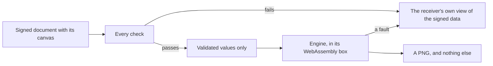

# Rendering

:::info Reference for implementers
Part of the BoundView specification, for building your own builder or
renderer, or checking one. A platform that uses `@btps/boundview` does not need
it: `renderBoundView` draws by these rules. See
[Using BoundView](./using.md#show-a-received-boundview).
:::

How a canvas is drawn, so every receiver draws it the same way. The
`@btps/boundview` package's `renderBoundView` draws by these rules with one engine,
compiled to WebAssembly, and gives a finished picture; a receiver's app only
displays it. A receiver that draws a canvas some other way must draw it as
these rules say.

## Order and the page

1. The page is filled with white, then `page.background`, when present, is
   drawn over it: a background with alpha is blended over white, as
   [Checks](./checks.md#contrast) says.
2. Each element is drawn in the order of `elements`, over those before it.
3. Nothing outside the page is drawn.

## Shapes

- A `rect` is drawn as its box, with its corners rounded by `radius`
  (clamped to half the shorter side), filled, then stroked centred on its
  edge.
- A `line` is stroked from `from` to `to` with butt ends.
- A `path` is filled by its `fillRule`, then stroked.
- `opacity` multiplies the element's paint's own alpha.
- A gradient interpolates between its stops in sRGB; outside the first and
  last stop it keeps their colours.

## Images

An `image` element draws its image scaled to its box, with bilinear
filtering. The image's pixels are drawn as stored: no colour profile is
applied.

## Text

A `text` element's string is its bound value written in its
[format](./bindings.md#formats), or the part `range` names. A `label`'s
string is its `text`. Then:

1. `transform`, when present, makes the string upper or lower case, character
   by character, as Unicode's simple case mapping does with no locale.
2. Each character is drawn with its font's glyph. A `label`'s character
   that has no glyph is drawn with the font's
   [fallback](./fonts.md#fallbacks). A bound value never uses a fallback:
   every character of it has a glyph ([Shown in full](./checks.md#shown-in-full)).
3. Characters are placed along the baseline at `y`. After each character the
   pen moves by its `advance`, plus the kerning for it and the next
   character, scaled by `size / unitsPerEm`, plus `letterSpacing` (after
   the last character too, as browsers do).
4. The string's width is where the pen ends. `align` places it in the box:
   `start` at `x`, `end` so it ends at `x + width`, `centre` midway.
5. If it is wider than `width`, `size` is reduced until it fits, no lower than
   [the check allows](./checks.md#shown-in-full).
6. Glyphs are filled with `colour`, by the non-zero rule.

## Signatures

- **Drawn.** The strokes, on their 1,000 by 300 canvas, are scaled to fit
  the `signature` element's box, keeping their proportions, and centred.
  They are stroked in `colour` with a width of 8 units of that canvas,
  scaled with it, with round ends and joins.
- **Typed.** The text is set in Caveat, bundled with the renderer, at the
  size where it fills the box's width or its height (the font's ascent plus
  descent), whichever is smaller, and centred both ways.

## What may differ

A receiver's screen shows the finished picture with its own colour and
edge rendering, as it shows any image. Positions, shapes, letters and pixels
are the canvas's.

## The engine: a closed box

`renderBoundView` draws with resvg and its rasterizer, tiny-skia, written in
Rust and compiled to WebAssembly.

:::danger Not optional
The engine is part of `@btps/boundview`, not an option: every receiver that draws
a BoundView draws it with the same code, in a browser, on a server and in an app.
:::

A WebAssembly module runs in a closed box. It has its own block of memory and
cannot read or write anything outside it, and it can reach only the functions
its host hands it. `renderBoundView` hands it none that reach the outside world:

| The engine has | The engine has no |
| --- | --- |
| The drawing, as shapes, glyph paths and pixels | Network: it cannot fetch an address, so a BoundView cannot report that it was opened |
| Its own memory, sized to the canvas's limits | Files: it cannot read the device's fonts, images or anything else |
| | Page or DOM: it is not HTML, so there is no script, style or link to run or follow |
| | System fonts: none are given it, and it needs none, because text arrives as paths |

What goes into the box and what comes out:

1. **In.** `renderBoundView` first runs every [check](./checks.md) and refuses a
   BoundView that fails one. It then builds the drawing from validated values
   only: numbers, colours as `#rrggbb` or `#rrggbbaa`, path commands from the closed list, glyph
   outlines (bound values are drawn with them, from the signed fields), and
   each image's pixels after they are inflated and their length is checked.
   The sender's bytes are never passed to the engine as they arrived: no font
   file and no image file ever reaches it. An image's pixels are encoded
   again by `renderBoundView` itself before the engine decodes them.
2. **Inside.** The engine draws the page by the rules above. The canvas's
   [limits](./canvas.md#limits) bound how much it can be asked to draw, so a
   crafted canvas cannot make it run without end or exhaust memory.
3. **Out.** A PNG, and nothing else: pixels the app displays as an image. No
   text, markup or link comes back out, so nothing in a BoundView can become
   something the app runs.

### What the engine reads

`renderBoundView` builds the drawing the engine reads itself, from validated
values only:

- rectangles, paths and images, with numeric attributes and colours;
- every glyph already turned into a path;
- each image, re-encoded by `renderBoundView`.

The drawing never holds text, a font, a style, a script, a link or a
reference to anything outside it. No value from a canvas is ever copied into
it as markup: only numbers and colours that passed the schema.

A fault in the engine stays inside the box. The worst a crafted canvas can do
there is fail to draw, and then the receiver shows its own view of the
signed data, as it does for a BoundView that fails a check.

## The same picture everywhere

WebAssembly runs the same instructions the same way on every device, so the
same canvas is meant to give the same picture, byte for byte. The SDK's
[golden vectors](../golden-vectors.md) include canvases with the SHA-256 of
the picture each must give, so a receiver can confirm its engine draws as
every other one does.
