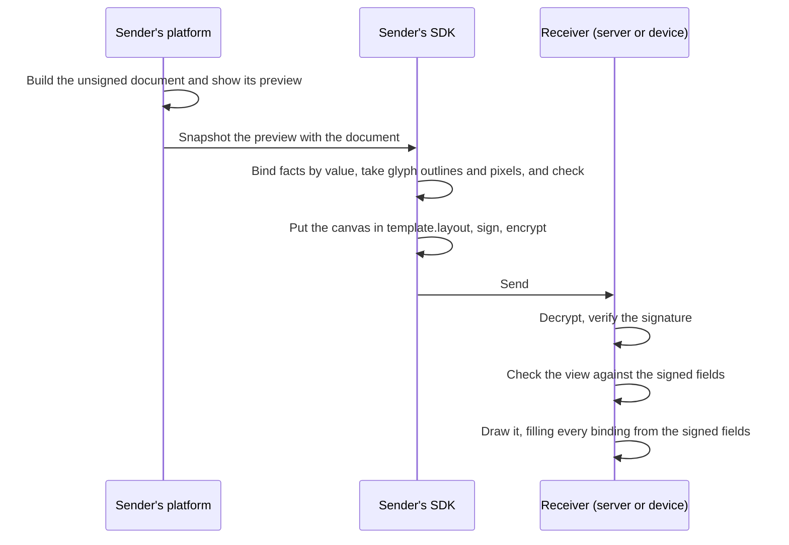

# Document view

Since 1.2. A sender can send a document with its **view**: how it looked in
the sender's own preview when it was sent. A receiver on any provider shows
it the same way. The view travels inside the signed document, every fact on
it is drawn from the document's own signed fields, and it is checked when it
arrives.

The view is the document's `template.layout`: a **canvas**, a page of shapes,
text and images at fixed positions. It is made by taking a snapshot of the
sender's preview when the document is sent, and drawn on the receiving side
by one renderer.

## You do not build any of this

BTPS ships the builder and the renderer in the `@btps/view` package. A
platform designs its preview in HTML, as it already does, and the rest
happens for it:

- **Sending.** Hand the preview's HTML element and the document to
  `snapshotLayout`, in the browser where the preview is shown. It captures
  the canvas, binds every fact to its field, takes glyph outlines and pixels,
  and checks the result. Put what it returns in `template.layout` and send as
  usual.
- **Receiving.** The SDK checks the view whenever the document is opened, on
  the server or on the device, with nothing to call. `renderLayout` draws a
  view that passed into a finished picture, and the app only displays it.

```ts
import { snapshotLayout, renderLayout } from '@btps/view';

// Sending: the preview you already show, and the document it shows
const layout = await snapshotLayout(previewElement, document);
await agent.command('artifact.send', to, { ...document, template: { layout } });

// Receiving: a PNG to display, or null when the view failed a check
const png = await renderLayout(openedDocument);
```

There is no format to learn and no template to write. **The pages below are
the specification**: the exact format, checks and drawing rules, for anyone
building their own builder or renderer, or checking that one is right. A
platform that uses `@btps/view` never needs them.

## What BTPS promises

| BTPS guarantees | How |
| --- | --- |
| **No tampering.** What was signed is what arrives, the view included. | The view is inside the document, so the artifact's signature covers it. |
| **No spoofing.** The document comes from its sender. | The signature and the trust record. The receiving app shows the verified sender outside the view, never inside it. |
| **No active content, no tracking.** Nothing runs, and nothing is fetched when a document is viewed. | A view holds only data: shapes, glyph outlines and pixels. It names no address, font file or image file. |
| **The view shows what the document says.** | Every fact on the view is a [binding](./bindings.md) to a signed field and is drawn from that field. The view must show the document's [key facts](./checks.md#key-facts), each in full. |
| **The same look on every receiver**, apart from a screen's own colour and edge rendering. | [Fonts as glyph outlines](./fonts.md), [images as pixels](./images.md) and one [rendering contract](./rendering.md), drawn by one engine in a [closed WebAssembly box](./rendering.md#the-engine-a-closed-box) that gives back only a picture. |

BTPS does **not** claim that a document's content is true or correct. A
wrong amount the sender typed is the sender's, and so are the sender's own
words on the view (its [labels](./elements.md#label)). The receiver decides
whom to trust, and can reject, block or stop trusting a sender.

## How it works



1. The sender's platform builds the document and shows its own preview,
   however it designs it.
2. On sending, the preview is captured as a canvas: text that shows a
   signed value is recorded as a binding to that field, fonts as the
   outlines of the characters used, and images as their pixels. No
   instructions are needed from the platform. The snapshot is part of the
   `@btps/view` package.
3. The canvas is checked against the document, put in `template.layout`,
   and the document is signed and, when it is for an encrypted receiver,
   encrypted, as any document is.
4. Wherever the document is opened, the receiver's SDK checks the view
   against the signed fields before anything is shown. A view that fails
   is not shown: the receiver shows its own view of the signed data
   instead, with a notice. The document itself is never lost.
5. The view is drawn with every binding filled from the signed fields, in
   the format the canvas records.

## What the receiving app shows around the view

Some of a document is shown by the receiving app itself, around the view,
never by the view:

- **Who sent it**: the verified sender, with its trust status.
- **Its title.**
- **Its attachments**, as files the receiver can open or save.
- **Its references** to other documents, and its **payment link**, each
  with the address it goes to.
- **All its details**: a way to see every signed field, including any the
  view does not draw.

So a view cannot pose as the sender, hide an attachment, or disguise where
a link goes.

## Versions

A document with a view is a `1.2.0` artifact. In a `1.1.0` artifact,
`template` keeps its 1.1 form, a name and free data, and a 1.2 receiver
accepts it and draws nothing from it.

A provider that does not draw views still accepts and checks documents that
carry one, and shows its own view of the signed data.

## The specification

For building a builder or renderer of your own. `@btps/view` already follows
every rule here.

| Page | What it covers |
| --- | --- |
| [Canvas](./canvas.md) | The layout object: page, fonts, images, elements, coordinates and colours |
| [Elements](./elements.md) | Every element type and its fields |
| [Bindings and formats](./bindings.md) | Which fields can be bound, and how a value is formatted |
| [Fonts and glyphs](./fonts.md) | Text as glyph outlines, kerning, fallbacks |
| [Images](./images.md) | Images as lossless pixels |
| [Checks](./checks.md) | What a receiver checks, and what happens when a check fails |
| [Rendering](./rendering.md) | How a canvas is drawn, so every receiver draws it the same way |
| [Security model](./security.md) | Threats, guarantees and what a receiver must do |
| [Examples](./examples.md) | A complete invoice and a letter with its signatory |
