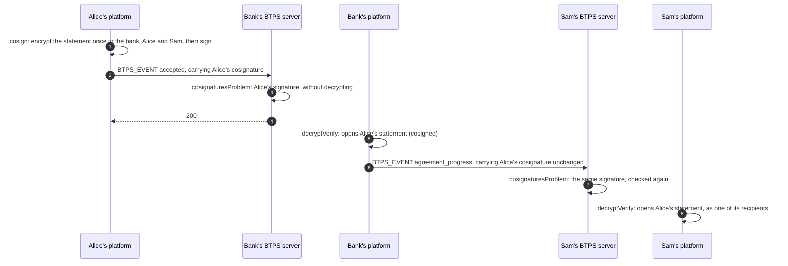

# Transporter Artifact Specification

Transporter artifacts are the primary mechanism for server-to-server communication in the BTPS protocol. They enable secure document delivery between trusted organizations and support various document types including trust requests, trust responses, and business documents like invoices.

## Overview

Transporter artifacts (`BTPTransporterArtifact`) are designed for automated server-to-server communication where organizations exchange sensitive business documents. They require established trust relationships and support end-to-end encryption for secure document transmission.

## Artifact Structure

An invoice sent from Alice's phone, through her provider, under a trust with permissions:

```json btps=transporter
{
  "version": "1.2.0",
  "id": "6f0d8e2a-7b1c-4e3d-9a5f-1c2b3d4e5f60",
  "issuedAt": "2026-11-08T01:00:00.000Z",
  "type": "BTPS_DOC",
  "from": "alice$saas.example",
  "to": "pay$client.example",
  "selector": "btps1",
  "documentType": "invoice",
  "document": "BASE64-OF-THE-ENCRYPTED-DOCUMENT",
  "signature": {
    "algorithmHash": "sha256",
    "value": "BASE64-SIGNATURE",
    "fingerprint": "BASE64-FINGERPRINT"
  },
  "encryption": {
    "algorithm": "aes-256-gcm",
    "encryptedKey": "BASE64-KEY",
    "iv": "BASE64-IV",
    "type": "standardEncrypt",
    "authTag": "BASE64-TAG"
  },
  "delegation": {
    "agentId": "btps_ag_3f2e1d0c-9b8a-4776-8554-433221100fed",
    "agentPubKey": "-----BEGIN PUBLIC KEY-----\nMIIBIjANBg…\n-----END PUBLIC KEY-----",
    "signedBy": "alice$saas.example",
    "issuedAt": "2026-11-08T01:00:00.000Z",
    "signature": {
      "algorithmHash": "sha256",
      "value": "BASE64-SIGNATURE",
      "fingerprint": "BASE64-FINGERPRINT"
    },
    "selector": "btps1",
    "attestation": {
      "issuedAt": "2026-11-08T01:00:00.000Z",
      "signedBy": "admin$saas.example",
      "signature": {
        "algorithmHash": "sha256",
        "value": "BASE64-SIGNATURE",
        "fingerprint": "BASE64-FINGERPRINT"
      },
      "selector": "btps1"
    }
  }
}
```

**Required Fields:**

- **version**: `1.1.0` or `1.2.0`: the lowest version that can say what the artifact carries (see [Protocol versions](../../features/versions.md)). A 1.2 server takes any `1.1.x` or `1.2.x`
- **id**: Unique message identifier (UUID v4 recommended). A receiving platform treats `(from, id)` as unique and ignores a second copy, which can arrive within the time window (see [Server Requirements](./overview.md#server-requirements))
- **issuedAt**: ISO 8601 timestamp of message creation. The receiving server refuses the artifact when this is outside its time window, 5 minutes either way by default, so an artifact is sent soon after it is signed
- **type**: Artifact type (TRUST_REQ, TRUST_RES, BTPS_DOC, BTPS_EVENT; since 1.2, DETAILS_CHANGED, DETAILS_REQ, DETAILS_RES)
- **from**: Sender's BTPS identity address
- **to**: Recipient's BTPS identity address
- **document**: The actual document content
- **signature**: Cryptographic signature for authenticity
- **selector**: DNS selector for key management

**Optional Fields:**

- **encryption**: Encryption details (null for unencrypted messages)
- **delegation**: Delegation information for agent-based operations
- **relatesTo**: Required on a `BTPS_EVENT` and refused on every other type: the `id` of the `BTPS_DOC` artifact that delivered the invoice the event is about (see Lifecycle Event). Since 1.2, also required on a `DETAILS_RES` and allowed on a `DETAILS_REQ` (see [Details refresh](#details-refresh))
- **details**: Since 1.2, on the three details refresh types only (see [Details refresh](#details-refresh))
- **syncOf**: Since 1.2, on a sync only: the send it copies (see [Sync](#sync))
- **permissions**, **entityType**, **given**, **change**, **granted**, **documentType**: Since 1.2, trust permissions (see [Trust permissions](#trust-permissions))
- **cosignatures**: Since 1.2 (rc.4), on a `BTPS_EVENT` in a `1.2.0` artifact only: an agreement's signed statements, outside the encrypted document, which every server checks on receipt (see [Cosignatures](#cosignatures))

## Trust permissions

Since 1.2. A trust says what may travel on it: which document types may be sent, and which details each side gives the other. Every permission **name** travels on the envelope, signed and readable, so the receiving BTPS server checks it on arrival without decrypting anything. Only the **values** (a date of birth, an address) are in the document, encrypted. Every field here is `1.2.0` only, and stamps the artifact `1.2.0`; a trust request, answer or send without them goes as `1.1.0`, exactly as in 1.1.

### The names

A name is one of the protocol's own, and nothing else. There are no provider-defined names, so every provider understands every permission. `DOCUMENT_TYPES`, `SEND_PERMISSIONS` and `DETAIL_PERMISSIONS` in `@btps/sdk/trust` list them.

- **Sending:** `send:invoice`, `send:receipt`, `send:payslip`, `send:letter`, `send:agreement`. `send:letter` does not cover an agreement: a person can take a bank's notices without taking its contracts for acceptance, or allow both.
- **Details:** `detail:legalName`, `detail:profile`, `detail:email`, `detail:phone`, `detail:address`, `detail:taxNo`, `detail:dob` (a person's date of birth), `detail:registrationNumber` (an organisation's).

### On the envelope

| Field          | On                                 | What it says                                                                                                                                             |
| -------------- | ---------------------------------- | -------------------------------------------------------------------------------------------------------------------------------------------------------- |
| `permissions`  | `TRUST_REQ`                        | `[{ name, required }]`: what the sender asks for, one flat list in which the prefix says each name's kind. Each name once, and at least one `send:` name |
| `entityType`   | `TRUST_REQ`, accepted `TRUST_RES`  | `person` or `organisation`: what owns the sender's address. Required with `permissions` and with `granted`                                               |
| `given`        | `TRUST_REQ`                        | The `detail:` names the sender gives about itself, as permissions                                                                                        |
| `change`       | `TRUST_REQ`                        | `true`: a change to an active trust, asking for the whole set of permissions now wanted                                                                  |
| `granted`      | accepted `TRUST_RES`               | The names given. A rejected answer carries none, and may leave out `entityType`                                                                          |
| `documentType` | `BTPS_DOC` under a trust with them | The type of the document it carries: `invoice`, `receipt`, `payslip`, `letter` or `agreement`                                                            |

The envelope's permission fields, the rest of the artifact left out:

```json sketch
{
  "type": "TRUST_REQ",
  "from": "billing$vendor.example",
  "to": "pay$client.example",
  "permissions": [
    { "name": "send:invoice", "required": true },
    { "name": "detail:legalName", "required": true },
    { "name": "detail:address", "required": false }
  ],
  "entityType": "organisation",
  "given": ["detail:legalName", "detail:email", "detail:address"]
}
```

### What a server refuses on arrival

From the envelope alone:

- a field on another artifact type, or in a `1.1.0` artifact;
- a name that is not the protocol's, or a name twice in one list, required or not;
- a `1.2.0` `TRUST_REQ` without `permissions`: a request for everything is a `1.1.0` one;
- `permissions` without a `send:` name;
- `permissions` or `granted` without `entityType`;
- **a request that does not give what it asks for:** every detail asked for is in `given`. `detail:dob` and `detail:registrationNumber` swap between kinds: a person gives its date of birth and an organisation its registration number, never the other, so asking for either is met by giving your own. The sender's `entityType` decides which. An organisation's request is always held to it. A person's is held to it unless the receiver is an organisation: a person asking a business gives nothing in return. The receiver's kind is known only to its own server, from its platform (`entityTypeOf`); without that, the receiver is held to be a person;
- a person giving or granting `detail:registrationNumber`, or an organisation giving or granting `detail:dob`.

And where the document is readable (not encrypted):

- a request carrying its own values (`own`), or an answer carrying the granted values (`details`, keyed by name, so `detail:profile` sits inside it as `{ displayName, logo?, website? }`): those are always encrypted;
- an answer that is not `accepted` but carries `granted`.

An address's kind is published nowhere but the envelope, and a receiving platform's own knowledge of its addresses.

Every one of these refusals reaches the sender as itself, `BTP_ERROR_VALIDATION` with the broken rule; so do a grant's (`BTP_ERROR_PERMISSION_REQUIRED`, `BTP_ERROR_PERMISSION`), a send whose type is not granted (`BTP_ERROR_PERMISSION`) or is not its document's (`BTP_ERROR_DOCUMENT_TYPE_MISMATCH`) and a detail not held (`BTP_ERROR_DETAILS_NOT_HELD`). Only a trust's state stays hidden: those all read `BTP_ERROR_TRUST_NOT_ALLOWED`.

**Sending one.** A device sets these with `BtpsAgent`'s `trust.request` options `permissions`, `entityType`, `given` and `change`, and `trust.respond` options `granted` and `entityType`; the agent checks the artifact as its provider will before it goes. A platform sending server to server puts the same fields on the payload it gives `signEncrypt`, which signs them with the envelope, and stamps the artifact with `artifactVersion`.

**To a receiver whose server speaks 1.1.** A 1.1 server knows no permissions, so the SDK composes the request for the receiver's version, automatically and never silently:

- Before it signs a trust request **with permissions**, the agent or `signEncrypt` asks the receiver's server its version, with one `PING` on a connection of its own. A request without permissions is never asked about, so it costs no round trip.
- To a 1.1 server, it goes as 1.1 allows: without `permissions`, `given`, `entityType` and `change` on the envelope, and without `own` and `verification` in the document, stamped `1.1.0`. 1.1's own fields (`name`, `email`, `phone`, …) stay. The result says so in `shaped`, `{ sentAs: "1.1.0", leftOut: [...] }`, so the platform knows the trust will carry no permissions.
- With `versionFallback: false`, it is refused instead (`BTP_ERROR_VERSION_UNSUPPORTED`), with the receiver's version in the error's `meta.receiverVersion`.
- When the receiver's server cannot be asked, that error is returned and nothing is sent: a version is never guessed.

`shapeTrustRequestFor11` in `@btps/sdk/trust` does the shaping alone, for a platform that builds artifacts another way. A 1.1 provider asking a 1.2 one sends a 1.1 request, which the 1.2 receiver takes as it always has. A trust made under 1.1 keeps working, and either side may later send a `change` to add permissions once both run 1.2.

### The values, checked when opened

The values are in the document, encrypted, so they are checked when it is opened: `decryptVerify` refuses a trust request or answer whose values do not match its names, with `BTP_ERROR_VALIDATION`. `trustRequestProblem` and `trustResponseProblem` in `@btps/sdk/trust` run the same check on an opened artifact, for a platform that opens documents another way.

**A request** gives each name in `given` a value:

- where 1.1's trust request already has a field, the value is there and nowhere else: `detail:legalName` is `name`, `detail:email` is `email`, `detail:phone` is `phone`, `detail:address` is `address`, and `detail:profile` is `displayName`, with `logoUrl` and `websiteUrl`;
- every other name's value is in `own`, keyed by name;
- `own` holds nothing else: no name that is not given, and no value 1.1 has a field for.

```json btps=document:TRUST_REQ
{
  "id": "4c1b2a40-1d7e-4f38-9a3a-5b6f2c7d8e90",
  "name": "Acme Pty Ltd",
  "email": "billing@acme.example",
  "phone": "+61 400 000 000",
  "reason": "To send you invoices",
  "own": { "detail:registrationNumber": { "number": "51824753556", "country": "AU" } }
}
```

**An answer** holds the value of every granted `detail:` name in `details`, keyed by name, and nothing else:

```json btps=document:TRUST_RES
{
  "id": "8a2e5f10-3b4c-4d6e-8f90-a1b2c3d4e5f6",
  "decision": "accepted",
  "decidedAt": "2026-11-08T00:05:00.000Z",
  "decidedBy": "pay$client.example",
  "details": {
    "detail:legalName": "Robert Smith",
    "detail:profile": { "displayName": "Bob", "website": "https://client.example" }
  }
}
```

**Each value's shape:**

| Name                                        | Value                                                                                  |
| ------------------------------------------- | -------------------------------------------------------------------------------------- |
| `detail:legalName`, `phone`, `address`      | text                                                                                   |
| `detail:email`                              | an email address                                                                       |
| `detail:profile`                            | `{ displayName, logo?: { sha256, source }, website? }`, with https addresses           |
| `detail:taxNo`, `detail:registrationNumber` | `{ number, country }`, `country` an ISO 3166-1 alpha-2 code in upper case, e.g. `"AU"` |
| `detail:dob`                                | a real date, `YYYY-MM-DD`                                                              |

Each value's length limit is on [Limits](./limits.md#trust-detail-values).

### Verification

**BTPS verifies no one and decides nothing about who is verified.** It gives a standard place for a signed statement, the checks only cryptography can do, and the facts a provider needs to decide for itself. A provider that has checked a sender (by documents, by staff, or automatically) signs a statement of what it checked, and the sender's request carries it in its document as `verification`:

```json sketch
{
  "verifiedBy": "admin$saas.example",
  "claims": {
    "entityType": "organisation",
    "detail:legalName": "Acme Pty Ltd",
    "detail:registrationNumber": { "number": "51824753556", "country": "AU" }
  },
  "verifiedAt": "2026-11-01T00:00:00.000Z",
  "expiresAt": "2027-11-01T00:00:00.000Z",
  "selector": "btps1",
  "signature": {
    "algorithmHash": "sha256",
    "value": "BASE64-SIGNATURE",
    "fingerprint": "BASE64-FINGERPRINT"
  }
}
```

A whole request carrying one is on [Verification](../../features/verification.md#the-statement).

- **The claims** say exactly what was checked, by the protocol's names only: `entityType`, and `detail:` names with their values in their shapes (above). Any other key is refused.
- **The signature** is `verifiedBy`'s, at its `selector`, over the RFC 8785 form of `{ subject, claims, verifiedAt, expiresAt, verifiedBy, selector }`, where `subject` is the request's `from`, so a statement cannot be copied into anyone else's request. `signVerification` in `@btps/sdk/trust` makes one.
- **It is values**, so a request carrying one is encrypted, as one carrying `own` is.
- **Its verifier runs a BTPS server.** `verifiedBy` must be the operator (`op`) named in `_btps.host` of its own domain. A customer address on a SaaS (`jane$saas.example`, where `op` is `admin$saas.example`) may not verify; another operator, such as an identity-check service running its own server, or a self-hoster who is its own `op`, may. When the request is opened (`decryptVerify`), a verification from anyone else refuses it (`BTP_ERROR_VALIDATION`, "the verifier does not run a BTPS server: … is not the operator of …"). A lookup that fails, rather than finding no record, judges no one: the request is refused to be tried again (`BTP_ERROR_RESOLVE_DNS`, "could not look up …'s BTPS host record; try again"). This rule only makes a verifier an operator. Each provider still chooses whose verifications it trusts, and may keep its own list even among operators.

`verificationFacts(request)` reports, for the opened request, and refuses nothing:

| Fact                   | Means                                                                                                         |
| ---------------------- | ------------------------------------------------------------------------------------------------------------- |
| `signatureValid`       | the signature is `verifiedBy`'s, over this sender's address and these claims                                  |
| `expired`              | `expiresAt` has passed                                                                                        |
| `verifierServesSender` | `verifiedBy` is on the domain of the operator (`op`) named in the sender's `_btps.host`, not the sender's own |
| `verifierIsOperator`   | `verifiedBy` is that operator: the serving provider's own signing identity                                    |

`verifierServesSender` is what shows a custom-domain or BYOK user signing for themselves: they control their own DNS or key, but cannot publish keys under their provider's domain. **What each provider decides:** each provider keeps its own list of verifiers it accepts (for example its own operator, and others it chooses to vouch for, such as an identity-check service or another provider), uses the facts to check that a statement is genuine and current, and decides what its app shows. It always names the verifier ("Verified by …"), never a bare "Verified". Someone who runs their own BTPS server is their own provider and can sign for themselves; the protocol cannot tell a real provider from a home server, which is why the decision is each provider's. A request without a verification works as before.

### A send's document type

Under a trust with permissions, a `BTPS_DOC` names its `documentType` on the envelope, and the receiving server checks it against its trust record on arrival, without decrypting:

- a send without `documentType` is refused (`BTP_ERROR_PERMISSION`);
- `send:<documentType>` must be in the record's `permissions.granted`, or the send is refused (`BTP_ERROR_PERMISSION`);
- a readable (unencrypted) document whose `type` is not its `documentType` is refused (`BTP_ERROR_DOCUMENT_TYPE_MISMATCH`).

`decryptVerify` refuses an opened document that is not its `documentType` (`BTP_ERROR_DOCUMENT_TYPE_MISMATCH`), and `signEncrypt` refuses to sign one before it encrypts it. `documentTypeProblem` in `@btps/sdk/trust` runs the arrival check on its own.

The sender's own server checks it first: a device's `artifact.send` is checked by its provider, against the user's own record of the trust with the receiver, before it goes, with the same rules and errors. Only that trust's own direction is read, from the sender to the receiver, as on arrival: a document travels only that way, unlike a details refresh, which works over a trust in either direction.

Only a send under a trust with permissions carries `documentType`: it stamps the artifact `1.2.0`. A trust without permissions (a 1.1 trust) takes any document type, as in 1.1, and every other send goes as `1.1.0`. Events need none: `relatesTo` ties each to the document it is about. A device sets it with `BtpsAgent`'s `artifact.send` option `documentType`.

## Details refresh

Since 1.2. Each side of an active trust with permissions can be told when the other side's details change, and can fetch them again, but only the details it already holds by that trust: the requester holds the responder's granted details, and the responder holds the requester's given ones (the record's `detailsHeld`; what a side gave is its `detailsShared`). It works over the trust in either direction.

Every step is its own artifact, delivered like any other, so a platform may queue it; nothing is answered at once.

| Type              | Envelope (signed, readable)                                                          | Document                                                |
| ----------------- | ------------------------------------------------------------------------------------ | ------------------------------------------------------- |
| `DETAILS_CHANGED` | `details`: the names that changed                                                    | no values; an optional `message` note                   |
| `DETAILS_REQ`     | `details`: the names wanted; `relatesTo`, optional: the `DETAILS_CHANGED` it follows | no values; an optional `message` note                   |
| `DETAILS_RES`     | `details`: the names it answers; `relatesTo`, required: the `DETAILS_REQ` it answers | the value of each name, keyed by name, always encrypted |

`details` holds `detail:` names only, each once, at least one. All three types are `1.2.0` only. A response may answer part of a request: it names only what it carries. A 1.1 server does not know these types: it refuses one as an artifact it cannot read (`BTP_ERROR_VALIDATION`), before it reads the version, so the sender is not told the receiver speaks 1.1. A trust with a 1.1 provider holds no details by name in any case.

**On arrival**, from the envelope and the receiver's own record of the trust, without decrypting:

- a notice or a response names only details the receiver holds of the sender, and a request only details the answerer shares (`BTP_ERROR_DETAILS_NOT_HELD`); a trust without permissions holds none;
- a response answers a request the receiver knows (`isKnownArtifact` on its `relatesTo`, `BTP_ERROR_PERMISSION`).

**The platform's own checks.** Two more checks read records only the platform keeps, so they are the platform's, off until it adds them as middleware from `@btps/sdk/server/core`. Each runs after the server's trust check and refuses in flight, from the envelope, encrypted or not:

- `detailsResponseCheck({ getArtifact })`: a response answers a `DETAILS_REQ` its receiver sent to its sender, and names only what that request asked for (`detailsRequestRefusal`; `BTP_ERROR_PERMISSION`, the reason in its message). For a response arriving and for one this provider's own device sends.
- `detailsRequestLimit(allow)`: a request is within the provider's own limit, if it sets one. Over it, the request is refused with `BTP_ERROR_DETAILS_RATE_LIMITED`, whose `status.retryAfter` says how many seconds to wait before asking again. The protocol sets no limit. Add it after every other check, so the provider counts only requests that are taken.

```js
import { detailsRequestLimit, detailsResponseCheck } from '@btps/sdk/server/core';

export default function createMiddleware() {
  return [
    detailsResponseCheck({
      // The envelope of the artifact `artifactId` the platform recorded from `from` to `to`.
      getArtifact: ({ artifactId, from, to }) => artifacts.envelope({ artifactId, from, to }),
    }),
    // Last: the provider's own count, e.g. ten requests per trust per month.
    detailsRequestLimit(async ({ from, to }) =>
      (await counts.thisMonth(from, to)) < 10
        ? true
        : { retryAfter: await counts.secondsToNextMonth() },
    ),
  ];
}
```

A request that passes every check, the platform's middleware included, is told to the server's `detailsRequested` listeners: `{ from, to, names, at }`.

**When sent**, a device sends each one with its own agent action (`details.changed`, `details.request`, `details.respond`; see [Agent Artifact](./agent-artifact.md)), and its provider makes the same checks first, from the user's own record of the trust, `detailsResponseCheck` included when added. A response that passes every check is told to the provider's `detailsShared` listeners, so a platform can show who fetched what, and when.

**When opened**, `decryptVerify` refuses a response whose values do not match its names: a value for every name, valid for it, and no others.

## Sync

Since 1.2. A user's devices keep the same sent items through a **sync**: after a device sends, it sends the user's own copy of that send to the user's own address, so the provider files it among the user's sent items and every other device of the user can fetch it. A sync is an ordinary `artifact.send` whose transporter artifact is from and to the same address, with its document encrypted to the user's own key, and which names the send it copies on its envelope:

```json sketch
{
  "from": "alice$saas.example",
  "to": "alice$saas.example",
  "syncOf": {
    "id": "6f1d2c3b-4a59-4e8f-9b7a-1c2d3e4f5a6b",
    "sha256": "lowercase-hex-sha256-of-the-sent-artifact"
  }
}
```

A whole sync, with the send it names, is on [Devices](../../features/devices.md#sync).

- `id` is the sent artifact's id. `sha256` is the lowercase hex SHA-256 of the sent artifact's RFC 8785 canonical form, signature included (`syncOfArtifact` in `@btps/sdk/crypto` computes both).
- Like the rest of the envelope it is signed and stays readable, so the provider files the sync without opening it, and never delivers it anywhere.
- `syncOf` is only on an artifact whose `from` and `to` are the same address (compared without case), and only in a `1.2.0` artifact; it stamps the artifact `1.2.0`.
- **Only the user's own device sends one.** A provider takes a sync only inside an `artifact.send` from a live device of that address. A transporter artifact with `syncOf` sent to a server directly, by any server, is refused before its signature is checked (`BTP_ERROR_SYNC_NOT_ALLOWED`).

How a send went is the provider's own record, read from the user's sent items: see `delivery` under [Responses](./responses.md).

## Supported Document Types

Each document type's field limits are on [Limits](./limits.md#document-fields).

### 1. Trust Request Document (`TRUST_REQ`)

Used to establish trust relationships between organizations.

```json btps=document:TRUST_REQ
{
  "id": "0d4f6a2e-8b1c-4e7a-9f3d-2c5b7a9e1f04",
  "name": "Acme Corporation",
  "email": "billing@acme.com",
  "reason": "To send monthly service invoices",
  "phone": "+1-555-0123",
  "address": "123 Business St, City, State 12345",
  "logoUrl": "https://acme.com/logo.png",
  "displayName": "Acme Corp",
  "websiteUrl": "https://acme.com",
  "message": "We would like to establish a trusted relationship for billing purposes.",
  "expiresAt": "2025-12-31T23:59:59Z",
  "privacyType": "encrypted"
}
```

**Required Fields:**

- **id**: Unique uuid for future reference and data management
- **name**: Legal business name
- **email**: Contact email address
- **reason**: Purpose of trust request
- **phone**: Contact phone number

**Optional Fields:**

- **address**: Business address
- **logoUrl**: Company logo URL
- **displayName**: Display name for UI
- **websiteUrl**: Company website
- **message**: Custom message to recipient: a note, with a format since 1.2 (see Notes)
- **expiresAt**: Trust expiration date (ISO format)
- **privacyType**: Privacy level (unencrypted, encrypted, mixed)

### 2. Trust Response Document (`TRUST_RES`)

Used to accept, reject, or block trust requests.

```json btps=document:TRUST_RES
{
  "id": "0d4f6a2e-8b1c-4e7a-9f3d-2c5b7a9e1f04",
  "decision": "accepted",
  "decidedAt": "2025-01-15T10:30:00Z",
  "decidedBy": "John Smith",
  "expiresAt": "2025-12-31T23:59:59Z",
  "retryAfterDate": "2025-02-15T10:30:00Z",
  "message": "Trust relationship established successfully.",
  "privacyType": "encrypted"
}
```

**Required Fields:**

- **id**: Unique uuid for the trust request being responded to
- **decision**: Trust decision (accepted, rejected, revoked, blocked)
- **decidedAt**: ISO timestamp of decision
- **decidedBy**: Name or identifier of the person making the decision

**Optional Fields:**

- **expiresAt**: Trust expiration date (ISO format)
- **retryAfterDate**: Date after which retry is allowed (ISO format)
- **message**: Custom message to sender: a note, with a format since 1.2 (see Notes)
- **privacyType**: Agreed privacy level (unencrypted, encrypted, mixed). The receiver enforces it on every artifact sent over the trust: `encrypted` refuses one sent in the clear, `unencrypted` refuses an encrypted one, and `mixed` allows either. A refused artifact is answered `BTP_ERROR_PRIVACY_TYPE` (400).

### 3. BTPS Document (`BTPS_DOC`)

A document's `type` says which kind it is:

- **`invoice`**: asks for payment. The receiver may show it as a bill.
- **`receipt`**: proves a payment was made (see [Receipt](#receipt)).
- **`payslip`**: an employee's pay for a period (see [Payslip](#payslip)).
- **`letter`**: anything else, from a notice to a statement (see [Letter](#letter)).
- **`agreement`**: since 1.2, a letter that asks its signers to accept it (see [Agreement](#agreement)).

The invoice is described first; the others share its money, attachments and references.

```json btps=document:BTPS_DOC
{
  "type": "invoice",
  "title": "Invoice #INV-2025-001",
  "id": "INV-2025-001",
  "issuedAt": "2025-01-15T10:30:00Z",
  "dueAt": "2025-02-15T10:30:00Z",
  "recipient": { "name": "Client Inc." },
  "subtotalAmount": { "amount": 150000, "currency": "USD" },
  "taxAmount": { "amount": 0, "currency": "USD" },
  "totalAmount": {
    "amount": 150000,
    "currency": "USD"
  },
  "lineItems": {
    "columns": ["Description", "Quantity", "Unit Price", "Amount"],
    "roles": {
      "Description": "description",
      "Quantity": "quantity",
      "Unit Price": "unitPrice",
      "Amount": "lineTotal"
    },
    "rows": [
      {
        "Description": "Web Development Services",
        "Quantity": "1",
        "Unit Price": 150000,
        "Amount": 150000
      }
    ]
  },
  "issuer": {
    "name": "Acme Corporation",
    "email": "billing@acme.com",
    "phone": "+1-555-0123",
    "address": "1 Main Street, Springfield",
    "identifiers": { "us:ein": "12-3456789" }
  },
  "paymentLink": {
    "linkText": "Pay Invoice",
    "url": "https://pay.acme.com/inv/INV-2025-001"
  },
  "description": {
    "format": "markdown",
    "content": "Web development for **January 2025**. Thank you for your business."
  },
  "attachments": [
    {
      "content": "JVBERi0xLjcgSW52b2ljZSBJTlYtMjAyNS0wMDE=",
      "type": "application/pdf",
      "filename": "invoice-INV-2025-001.pdf",
      "size": 29,
      "sha256": "fc71100ddc0880be653f8110d8b4344d98bf45b2c45a3a5dd811d8dfebd8bddc"
    }
  ],
  "metadata": { "acme:orderId": "PO-7731" }
}
```

This example carries what 1.2 adds (`recipient`, the totals, line roles, a note with a format), so it travels in a `1.2.0` artifact. A `1.1.0` invoice has none of these, and may carry 1.1's `template` instead, which a `1.2.0` one never does. The attachment's `size` and `sha256` are its decoded content's.

**Required Fields:**

- **type**: `invoice`
- **title**: Document title
- **id**: The invoice number, unique per sender
- **issuedAt**: ISO timestamp of document creation
- **totalAmount**: Total amount in minor units, with its currency (see Money Amounts)
- **lineItems**: Document line items with columns and rows

**Optional Fields:**

- **dueAt**: Payment due date (ISO format)
- **issuer**: Document issuer information, with an optional `address` and `identifiers` (company and tax ids by namespaced key, e.g. `au:abn`)
- **paymentLink**: Payment link information
- **description**: A note for the other party (see Notes)
- **discount** (1.2, invoice and receipt): A discount on the whole document, applied before tax (see Discounts)
- **subtotalAmount**, **taxAmount** (1.2, invoice and receipt): The total before tax and the tax, as the sender worked them out (see Totals, line roles and the recipient)
- **recipient** (1.2): Who the document is for, `{ "name": "Northwind Studio" }` (see Totals, line roles and the recipient)
- **attachments**: Files carried with the document (see Attachments)
- **references**: Links to other signed documents (see References)
- **template** (`1.1.0` only): The 1.1 form, `{ "name": "…", "data": { … } }`, read as 1.1 reads it; a receiver draws nothing from it. Refused in a `1.2.0` artifact, where a document's look is its `boundView` (see BoundView)
- **boundView** (1.2): The document's BoundView, a signed canvas (see BoundView); on every document type
- **metadata**: The sending platform's own data; carried and signed, never read by the protocol

**Notes (since 1.2):**

A person's note says how it is written: `{ "format": "text" | "markdown", "content": "…" }`, as a letter's body does (CommonMark, raw HTML off). This is an invoice's and a receipt's `description`, an event's `message`, and a trust request's or response's `message`. A plain string, as in 1.1, is still taken and read as `text`. In a `1.2.0` artifact a note's content is at most 5,000 characters; in a `1.1.0` artifact a note is a string and reads exactly as in 1.1.

**Discounts (since 1.2):**

- On the whole invoice or receipt: `discount` is `{ "amount": 500 }`, a positive whole number in the minor units of the document's currency, or `{ "percent": 1000 }`, whole basis points from 1 to 10,000 (1,000 is 10%). Never both. It is applied before tax.
- On a line: a `discount` column, whose cell is an amount in minor units of at least 0. 1.1 already carries such a column, so it is taken under `1.1.0` as 1.1 had it.
- Rounding is each platform's own; the protocol fixes only how money is written.

**Totals, line roles and the recipient (since 1.2):**

- `subtotalAmount` and `taxAmount` are the total before tax and the tax, as the sender worked them out, in the currency of `totalAmount`. The protocol carries them and never adds them up.
- `lineItems.roles` names what a column holds, so a receiver knows it whatever the sender calls it: `{ "Amount (incl. tax)": "lineTotal" }`. A role is `description`, `quantity`, `unitPrice`, `discount`, `tax` or `lineTotal`; each names one of `columns`, and each appears at most once.
- `recipient` is who the document is for: `{ "name": "Northwind Studio" }`, the name as the sender writes it. It is on an invoice, a receipt, a letter and an agreement; a payslip's is its `employee`.

Each travels in a `1.2.0` artifact.

**BoundView (since 1.2):**

What you see is what was signed. In a `1.2.0` artifact, a document may carry `boundView`: its BoundView, a signed canvas captured from the sender's own preview, whose facts are bound to the document's signed fields. A receiver checks it wherever the document is opened and draws it, or shows its own view of the data when a check fails. The canvas, its bindings, its checks and how it is drawn are on [BoundView](./boundview/overview.md). `boundView` is optional: a platform that does not want its design to travel sends none, and the receiver shows its own view of the data.

`template` is `1.1.0` only. In a `1.1.0` invoice or receipt it is read exactly as 1.1 reads it: `{ "name": "…", "data": { … } }` with free `data`, and a receiver draws nothing from it. In a `1.2.0` artifact it is refused with `template is 1.1.0 only; in 1.2.0 a document's look is its boundView`. A letter or a payslip has no `template` in any version. A platform moving to 1.2 drops `template` from a document as soon as it adds anything 1.2 to it, and sends a BoundView to keep the document's look ([Migrating from 1.1 to 1.2](../../whats-new/version-1-2-migration.md#dropping-template)).

A document carries no status: whether an invoice is paid, partly paid, disputed or refunded comes from the lifecycle events exchanged about it. The schema is strict, so a field it does not name (such as 1.0's `status`) is refused.

**Money Amounts:**

Every amount is a whole number in the **minor units** of its currency, as defined by ISO 4217, never a decimal. The currency fixes how many decimal places the number has:

| Currency      | Minor unit digits | `amount: 4997` means |
| ------------- | ----------------- | -------------------- |
| USD, AUD, EUR | 2                 | 49.97                |
| JPY           | 0                 | 4,997                |
| KWD, BHD      | 3                 | 4.997                |

So `{ "amount": 4997, "currency": "AUD" }` can only mean AUD 49.97. Whole numbers are used because decimal numbers are stored inexactly by computers (`0.1 + 0.2` is `0.30000000000000004`), which makes totals drift by a cent and lets two implementations disagree about an amount they both signed. This is how banks and payment systems carry money.

- **totalAmount** is minor units.
- **lineItems** cells are text or whole numbers. A money cell (unit price, tax, line total) is minor units in the invoice's currency. A value that needs more decimals than the currency has, such as a quantity or a unit rate of `0.2843`, is written as text.
- **BTPS never converts amounts.** It carries the whole number and the currency code. Showing `4997` as `49.97` is the platform's job, using ISO 4217's minor unit digits for the currency. `Intl.NumberFormat`'s display digits are not ISO 4217's and differ for some currencies (for example IDR and HUF), so they must not be used to convert.

**Attachments:**

Each attachment carries the file itself, plus two facts the sender states about it:

```json sketch
{
  "content": "base64-encoded-file",
  "type": "application/pdf",
  "filename": "invoice-INV-2025-001.pdf",
  "size": 48213,
  "sha256": "lowercase-hex-sha256-of-the-file"
}
```

The invoice above carries a real one.

- **content**: The file, base64 encoded
- **type**: `application/pdf`, `image/jpeg` or `image/png`
- **filename**: Optional file name
- **size**: Size of the file in bytes (of the decoded `content`)
- **sha256**: SHA-256 hash of the file (of the decoded `content`), written as 64 lowercase hex characters

The sender computes `size` and `sha256` from the file's bytes:

```js
import { createHash } from 'crypto';

const bytes = Buffer.from(attachment.content, 'base64');
attachment.size = bytes.length;
attachment.sha256 = createHash('sha256').update(bytes).digest('hex');
```

`size` and `sha256` let a receiving platform that stores the file apart from the document (for example in object storage) confirm later that it is still exactly the file that arrived, recognise the same file sent twice, and show the file's size before it is downloaded. They are not what protects the file in transit: the artifact's signature already covers the whole document, attachments included. The protocol does not check them; a platform may.

**Size:**

Each receiving server sets the largest artifact it can accept: 5 MB unless it chooses otherwise (see [Server Requirements](./overview.md#server-requirements)). Attachments travel inside the artifact as base64, which is a third larger than the file itself, so a 5 MB artifact carries about 3.7 MB of files. When the files do not fit, send them in further documents that reference the first one (`follows`, see References) rather than in one large artifact.

**References:**

A document can point to other signed documents, for example a corrected invoice to the invoice it replaces:

```json sketch
"references": [
  {
    "type": "correction_of",
    "from": "billing$acme.com",
    "id": "INV-2025-001",
    "sha256": "lowercase-hex-sha256"
  }
]
```

- **type**: What the link means: `correction_of` (a corrected invoice names the one it corrects), `credits` (a credit note names the invoice it credits), `instalment_of` (one payment of several names its invoice), `follows` (the next document in a series), `receipt_for` (a receipt names the invoice it pays), or a platform's own code under a prefix, such as `acme:supersedes`
- **from**: The identity that sent the referenced document
- **id**: The referenced document's `id`
- **sha256**: SHA-256 of the referenced document's signed transporter artifact in its RFC 8785 canonical form, written as 64 lowercase hex characters, so the link names one exact version of that document

Whether the referenced document exists is for the receiving platform to check; the protocol carries the link.

#### Receipt

Proof that a payment was made. It is the invoice without what asks for payment (`dueAt` and `paymentLink`), with a required `payment`, and its `lineItems` are optional.

```json btps=document:BTPS_DOC
{
  "type": "receipt",
  "title": "Receipt #REC-2025-001",
  "id": "REC-2025-001",
  "issuedAt": "2025-02-01T09:00:00Z",
  "totalAmount": { "amount": 150000, "currency": "USD" },
  "payment": {
    "amount": { "amount": 50000, "currency": "USD" },
    "paidAt": "2025-02-01T08:55:00Z",
    "method": "bank_transfer",
    "reference": "TXN-88213"
  },
  "references": [
    {
      "type": "receipt_for",
      "from": "billing$acme.com",
      "id": "INV-2025-001",
      "sha256": "5b1e0c9d7a4f3e2b8c6d1a0f9e8d7c6b5a4f3e2d1c0b9a8f7e6d5c4b3a2f1e0d"
    }
  ]
}
```

- **payment.amount**: What was paid, more than zero. Less than `totalAmount` makes it a receipt for a part payment.
- **payment.paidAt**: When it was paid.
- **payment.method**: Optional: `card`, `bank_transfer`, `cash`, or a platform's own code under a prefix.
- **payment.reference**: Optional: the payment's own reference, such as a bank transaction id.
- **references**: `receipt_for` names the invoice it pays. A receipt for a sale with no invoice, such as a shop purchase, has none.

A receiver never shows a receipt as something to pay. An invoice's status still comes from lifecycle events; a receipt is the issuer's formal proof, which it may send after accepting a `paid` or `partially_paid` event, or on its own.

#### Payslip

An employee's pay for a period. Earnings, deductions, contributions and leave are each named by an open code, a bare or prefixed code like `ordinary`, `au:penalty` or `acme:wellbeing_day`, so a new allowance or a new country needs no protocol change. `description` is the name the employer prints, and is what a receiver shows.

```json btps=document:BTPS_DOC
{
  "type": "payslip",
  "title": "Payslip, 1–14 October 2025",
  "id": "PAY-2025-041",
  "issuedAt": "2025-10-15T00:00:00Z",
  "issuer": { "name": "Acme Pty Ltd", "identifiers": { "au:abn": "51824753556" } },
  "employee": { "name": "Sam Lee", "employeeId": "E-1042", "payBasis": "hourly" },
  "jurisdiction": "AU",
  "payPeriod": { "start": "2025-10-01T00:00:00Z", "end": "2025-10-14T23:59:59Z" },
  "payDate": "2025-10-15T00:00:00Z",
  "earnings": [
    {
      "category": "ordinary",
      "description": "Ordinary hours",
      "rate": "48.75",
      "rateUnit": "hour",
      "quantity": "76",
      "amount": { "amount": 370500, "currency": "AUD" }
    }
  ],
  "deductions": [
    {
      "category": "salary_sacrifice",
      "amount": { "amount": 20000, "currency": "AUD" },
      "payee": { "name": "Acme Super Fund", "accountRef": "SF-221" }
    }
  ],
  "contributions": [
    {
      "category": "au:super_guarantee",
      "amount": { "amount": 44460, "currency": "AUD" },
      "fund": { "name": "Acme Super Fund", "memberNumber": "M-90011" }
    }
  ],
  "leave": [
    {
      "category": "annual",
      "description": "Annual Leave",
      "unit": "hours",
      "balance": "76.5",
      "accrued": "5.85",
      "taken": "0"
    },
    {
      "category": "sick",
      "description": "Personal/Carer's Leave",
      "unit": "hours",
      "balance": "40"
    }
  ],
  "taxWithheld": { "amount": 81500, "currency": "AUD" },
  "gross": { "amount": 370500, "currency": "AUD" },
  "net": { "amount": 269000, "currency": "AUD" },
  "yearToDate": { "gross": { "amount": 2593500, "currency": "AUD" } }
}
```

**Required:** `type`, `title`, `id`, `issuedAt`, `employee` (with `name`), `earnings`, `deductions`, `contributions` (each may be empty), `gross`, `net`.

**Optional:** `issuer` (the employer), `jurisdiction` (ISO 3166-1 alpha-2, e.g. `AU`), `payPeriod`, `payDate`, `payRate` (`amount`, `unit` such as `annual`, `asAt`), `leave`, `taxWithheld`, `yearToDate`, `attachments`, `references`, `metadata`; since 1.2, `boundView` (its [BoundView](./boundview/overview.md)).

- **Decimals are text.** `rate`, `quantity` and a leave `balance`, `accrued` or `taken` are decimals written as text (`"48.75"`), never as numbers. Every amount of money is minor units.
- **Leave** lists each kind the employer tracks, in its `unit` (`hours`, `days`, `weeks`). A balance may be negative where an employer allows it. Leave taken and paid in the period also appears as an earnings line, as payslips print it.
- **The protocol carries the numbers and never adds them up.** Whether `gross` and `net` match the lines is for the platforms to check, as with an invoice's total.

#### Letter

Anything else: a notice, a statement, a plan change. It has a title and one body, and no money. A letter that asks for acceptance is an [agreement](#agreement), its own type.

```json btps=document:BTPS_DOC
{
  "type": "letter",
  "title": "Your new plan",
  "id": "LET-2025-007",
  "issuedAt": "2025-10-20T00:00:00Z",
  "body": {
    "format": "markdown",
    "content": "# Welcome\n\nYour plan changes on **1 November**. The terms are attached."
  },
  "issuer": { "name": "Acme Telco" },
  "recipient": { "name": "Alice Ng" },
  "signatory": {
    "name": "Jo Bloggs",
    "title": "Director",
    "visualSignature": { "type": "typed", "text": "Jo Bloggs" }
  },
  "attachments": []
}
```

- **body.format** is `text` or `markdown`, one per letter, never mixed.
- **`text`** is shown exactly as written.
- **`markdown`** is CommonMark with raw HTML off. A receiver renders it without inline images and follows only `https` links. There is no HTML body: an HTML body would need sanitising by every receiver, and a mistake in that is a vulnerability.
- **Optional:** `issuer`, `attachments` (up to 10), `references` (up to 20), `metadata`; since 1.2, `recipient`, `signatory` and `boundView` (its [BoundView](./boundview/overview.md)).
- **signatory** (since 1.2, a letter and an agreement): the sender's sign-off, `{ "name": "Jo Bloggs", "title": "Director", "visualSignature": { "type": "drawn", "strokes": [[40, 200, 180, 90]] } }`. `name` is required, `title` and `visualSignature` optional; the name and title are plain text of at most 100 characters, and `visualSignature` is typed or drawn exactly as an agreement signer's is. It is the sender's own, signed with the letter.
- A letter never carries `acceptance`.

#### Agreement

Since 1.2, in a `1.2.0` artifact only: a letter that asks its signers to accept it, such as a loan contract, a tenancy or a phone plan. It has every field a letter has, and may carry a BoundView and a signatory as a letter does. It also carries `acceptance` and, since rc.4, `salt`, both required, and `originatorSignature`. A 1.1 receiver refuses it by version.

This one is from the golden vectors (`agreements.vectors.json`), with its originator's real signature:

```json btps=document:BTPS_DOC
{
  "type": "agreement",
  "title": "Home loan agreement",
  "id": "AGR-1",
  "salt": "MDEyMzQ1Njc4OWFiY2RlZjAxMjM0NTY3ODlhYmNkZWY=",
  "issuedAt": "2026-10-19T00:00:00.000Z",
  "body": {
    "format": "markdown",
    "content": "# Home loan\n\nThe terms are attached. Each of you accepts them in turn."
  },
  "attachments": [
    {
      "content": "JVBERi0xLjcgSG9tZSBsb2FuIHRlcm1zOiA2LjElIHAuYS4gb3ZlciAzMCB5ZWFycw==",
      "type": "application/pdf",
      "filename": "terms.pdf",
      "size": 49,
      "sha256": "879045b6f068c6187f025ba1ef44bfa5976c9826e68e6fe6f1956c8ea2044b01"
    }
  ],
  "acceptance": {
    "by": "2026-11-30T00:00:00.000Z",
    "terms": ["879045b6f068c6187f025ba1ef44bfa5976c9826e68e6fe6f1956c8ea2044b01"],
    "signers": [
      { "address": "alice$client.example" },
      { "address": "sam$guarantor.example" },
      { "address": "loans$bank.example" }
    ],
    "signingOrder": "sequential"
  },
  "originatorSignature": {
    "selector": "btps1",
    "signature": {
      "algorithmHash": "sha256",
      "value": "cz889mCrNDhiOutUfkf/fzwlTqrWl5KekO3DcGHH+itwH6aJBcjxFtjH6F9L/8olXpNRbUI4P2FKYEBQHiKyH1tazcNxyM474OM+DYDcZTlBDMooG5PAN1LuIE6hzbreNcCpCj5ZHbK43fAoxkfJzRC1TK4CkFDPCo18K3vTiQl4njMA9zFGMOM02gT/1eVhtp/0eM6RRmfjo7hZ7VMUEoT5GVe+mIS0dhlP7a0B9h1Kd/X9zbGIU4uAb4tJ2ihT1FtKWEppW8dW1XLEZwcVPeQ7prTMdBZ1LOzC06p8bHrQuWaQ0lOnkSiTkO9cOnDEM1vBLLR7sd++gXOyBndnTA==",
      "fingerprint": "P3jb2C0c6XutGbtPyrDjDfY+M8IICzA5Ym8YkTZerAs="
    }
  }
}
```

Its `contentSha256`, as `agreementContentSha256` gives it, is `85aa77265b21d30739eb1aa19e17db6fc832f674319c763ed7ce8de5fc2d53bf`, and its one term is its attachment's `sha256`.

- **`acceptance.signers`**: who accepts it, 1 to 20 BTPS addresses, each once, letters compared without case. The originator may be one of them, for example a bank that countersigns. It is signed content, so the list cannot change after sending.
- **`acceptance.signingOrder`**: `sequential`, where the signers answer in list order, or `any`.
- **`acceptance.terms`**: the SHA-256 of each attachment that is a term of the agreement, each once, and each the `sha256` of one of its attachments. It may be empty: an acceptance always covers the whole signed content, and `terms` only names which attached documents are the contract.
- **`acceptance.by`** (optional): the deadline. A signer's answer is signed no later than it.
- **`salt`** (since 1.2 (rc.4), required): 32 random bytes, base64: it must decode to exactly 32 bytes. It is part of the content, so of `contentSha256`, which every [cosignature](#cosignatures) carries readable on its envelope. Without it, anyone who holds a standard agreement's text could hash it and confirm a guess at what was signed. Like the rest of the content, it travels encrypted.
- **One source of truth:** an agreement always carries `acceptance`, and a letter never does, so the type and the block can never disagree. There is no `kind` field.
- **Its content and its originator's signature.** An agreement is identified by its originator's address, its `id`, and its `contentSha256`: the SHA-256, in lowercase hex, of its RFC 8785 form without `originatorSignature`. `originatorSignature` is the originator's signature, at `selector`, over the RFC 8785 form of `{ originator, id, contentSha256 }`. Every signer gets its own copy, encrypted to it only; the copies have the same content, so any copy can be checked offline, whatever its encryption.
- **Its permission:** under a trust with permissions, an agreement travels with `documentType: "agreement"`, and the receiver must have granted `send:agreement` (see [A send's document type](#a-sends-document-type)).

**A signer's answer is a statement**, which travels encrypted, and signed, in its [cosignature](#cosignatures):

```json btps=statement
{
  "agreement": {
    "originator": "loans$bank.example",
    "id": "AGR-1",
    "contentSha256": "85aa77265b21d30739eb1aa19e17db6fc832f674319c763ed7ce8de5fc2d53bf"
  },
  "terms": ["879045b6f068c6187f025ba1ef44bfa5976c9826e68e6fe6f1956c8ea2044b01"],
  "signer": "sam$guarantor.example",
  "artifactId": "719a6118-3d0b-4e4c-8843-9dd66c79c98f",
  "decision": "accepted",
  "signedAt": "2026-11-03T00:00:00Z",
  "previous": "d9c52d5bebc9aed476c08353f22dff5ce033514f43f84447541b8af7f5f512b4",
  "visualSignature": { "type": "typed", "text": "Sam Lee" },
  "consent": {
    "electronic": true,
    "disclosureSha256": "9cf72b4504a4459f146c90afd9ba6b84146bd182f49551d051c2a4af26662175",
    "at": "2026-11-02T23:58:21Z"
  },
  "viewedAt": "2026-11-02T23:51:07Z",
  "viewedFrom": { "ip": "203.0.113.24", "device": { "os": "macOS", "browser": "Google Chrome" } },
  "signedFrom": { "ip": "203.0.113.24", "device": { "os": "macOS", "browser": "Google Chrome" } }
}
```

This is Sam's answer to the agreement above, after Alice's: its `agreement` is that agreement's, and `previous` is the `cosignatureSha256` of Alice's cosignature, shown in [Cosignatures](#cosignatures). Each field after `previous` is optional. A `declined` statement may carry `viewedAt`, `viewedFrom` and `signedFrom`, never `visualSignature` or `consent`.

- **`signer`** is the signer's address, compared without case, as every address is.
- **`artifactId`** (since 1.2 (rc.4), required): the `id` of the artifact that first delivers the statement, the signer's answer. For a statement signed on a device, it is the id of the device's delegated artifact. Its cosignature names the same id, so the statement cannot be moved into another artifact.
- **`terms`** repeats the agreement's `acceptance.terms` exactly, in the same order. **`decision`** is `accepted` or `declined`. **`signedAt`** is the signer's own signed time, which the deadline is checked against.
- **`previous`**, in a `sequential` agreement only, on every statement after the first: since rc.4, the SHA-256 of the cosignature before it (`cosignatureSha256`, see [The chain](#the-chain)).
- **`visualSignature`**, optional, on an `accepted` statement only: the signer's own signature as data, `{ "type": "typed", "text": "Alice Ng" }` or `{ "type": "drawn", "strokes": [[x, y, x, y, …]] }`, with a letter's limits (plain text of at most 100 characters; integer strokes on a 1000 by 300 canvas, at most 32 strokes and 2048 points). It is inside the statement, so the signer's signature covers it, and it travels into the evidence bundle with it. Signing with the key is what accepts; the visual signature is what a reader is shown. Whether one is required is the platform's choice.
- **`consent`**, optional, on an `accepted` statement only: the signer's consent to sign electronically, `{ "electronic": true, "disclosureSha256": "…", "at": "2026-11-03T00:00:00Z" }`. `electronic` is always `true`. `disclosureSha256` is the SHA-256, in lowercase hex, of the disclosure the signer's platform showed it, in that platform's own words: BTPS carries the fact, and each platform writes and versions its own wording. `at` is when the signer agreed, an RFC 3339 time no later than `signedAt`. A `declined` statement with a `consent` is refused.
- **`viewedAt`**, optional, on an `accepted` or a `declined` statement: when the signer first viewed the agreement, an RFC 3339 time no later than `signedAt`.
- **`consent` and `viewedAt`** are there because laws on electronic signatures (such as Australia's Electronic Transactions Act 1999, ESIGN and UETA in the US, and eIDAS in the EU) and some courts expect evidence that the signer agreed to sign electronically and of when it viewed the document. Both are inside the statement, so the signer's signature covers them: changing or removing either makes it no longer check. They travel into the evidence bundle with it, so any platform's evidence can show them, not only the originator's own records. A statement without them stays valid. Whether either is required is the platform's choice.
- **`viewedFrom`**, optional, only with a `viewedAt`: where the signer viewed the agreement from. A statement with a `viewedFrom` and no `viewedAt` is refused.
- **`signedFrom`**, optional, on an `accepted` or a `declined` statement: where the signer answered from.
- **A signing context**, the value of each, is an object with `ip`, `userAgent` and `device`, each optional, at least one of the three. **`ip`** is the IP address the request came from, IPv4 or IPv6. **`userAgent`** is the user agent the browser or app sent, printable ASCII text of at most 256 characters. **`device`** is an object with `os`, `osVersion`, `model`, `browser`, `browserVersion`, `app`, `appVersion` and `id`, each optional, at least one, each printable ASCII text of at most 100 characters (`id`, at most 128). `id` is the platform's own identifier for a device it registered, such as an app installation, not a fingerprint. For example:

  ```json
  {
    "ip": "203.0.113.7",
    "userAgent": "ExampleApp/4.2 (iOS 18.1)",
    "device": {
      "os": "iOS",
      "osVersion": "18.1",
      "model": "iPhone16,2",
      "app": "ExampleApp",
      "appVersion": "4.2",
      "id": "inst-7f3a9c"
    }
  }
  ```

- **A context is the signer's platform's observation**, not cryptographic proof of location or device: the platform saw the request, and a browser reports what it reports. How much is known, and how accurately, is the platform's responsibility: a web browser may give only a user agent (some browsers expose the OS and model through User-Agent Client Hints), and a native app can give its OS, version, model and its registered device id. BTPS only carries the fields. Both contexts are inside the statement, so the signer's signature covers them and they cannot be changed afterwards. They travel into the evidence bundle and to every party the statement is forwarded to. A statement without them stays valid.
- **Privacy.** An IP address and device details are personal information in many jurisdictions. A platform that records them should tell the signer before it signs, for example in the disclosure `consent.disclosureSha256` names, that they are recorded and shared with the agreement's parties. Every field is optional, so a platform may leave them out.
- **How it is signed and carried** (since rc.4): the statement is never sent on its own. Its [cosignature](#cosignatures) encrypts it once to the originator and every signer, and the signer signs the cosignature over that ciphertext and the statement's SHA-256, by its identity key or on a device. Every BTPS server on the way checks that signature on receipt, without decrypting.
- **An answer is final.** A statement is never withdrawn; a change is a new agreement.

Each document type's limits are on [Limits](./limits.md#document-fields).

### 4. Lifecycle Event (`BTPS_EVENT`)

Lifecycle events record what happens to an invoice after it is sent: paid, partly paid, disputed, refunded. An invoice carries no status of its own; each side works out its status from the events both parties have **accepted**.

The receiver of the invoice (the payer) proposes and the sender (the biller) answers. "Accepted" and "rejected" are always about payment: a received invoice is never deleted or changed by an event.

| Proposed by         | Event                                                | Answer                                                                       | Status once accepted                                                  |
| ------------------- | ---------------------------------------------------- | ---------------------------------------------------------------------------- | --------------------------------------------------------------------- |
| Payer               | `paid`                                               | Biller `response`: accepted or rejected                                      | Paid                                                                  |
| Payer               | `partially_paid`, with `amount`                      | Biller `response`: accepted (optionally with `remainingDueDate`) or rejected | Partly paid: the rest due by `remainingDueDate`                       |
| Payer               | `disputed`, with `reason`                            | Biller `response`: accepted or rejected                                      | Disputed. The biller then sends a corrected invoice (`correction_of`) |
| Biller              | `paid` (recorded by the biller, e.g. a cash payment) | None: final                                                                  | Paid                                                                  |
| Payer, after paying | `refund_requested`                                   | Biller `refund` with the amount, or a rejecting `response`                   | —                                                                     |
| Biller              | `refund`, with `amount`                              | Payer `response`: accepted or rejected                                       | Refunded (in full or in part)                                         |
| Proposer (1.2)      | `withdrawn`, with `inReplyTo`                        | None: final                                                                  | As the accepted events say without the withdrawn proposal             |

Several partial payments are allowed; the remaining amount keeps going down. The money itself moves outside BTPS.

**Withdrawing a proposal (since 1.2).** The payer who sent a proposal that has not been answered can take it back with `withdrawn`, naming the proposal in `inReplyTo`, about the same invoice. The proposal is then closed on both sides: the other party no longer answers it. Only the payer who sent the proposal may withdraw it, never the invoice's issuer, whose own recorded `paid` is final, and only while it is open; an answered proposal stays as answered, and a withdrawal is final, with no answer. A withdrawn proposal may be proposed again later, as a new proposal with a new `id` that names the `withdrawn` it follows in `follows`, so the chain stays traceable (`disputed` → `withdrawn` → `disputed`). A `withdrawn`, or a proposal with `follows`, travels in a `1.2.0` artifact: a 1.1 receiver takes neither.

```json btps=document:BTPS_EVENT
{
  "type": "lifecycle_event",
  "id": "0b6f4b5e-5d0a-4c4e-8f43-2a7d3a1f9e01",
  "occurredAt": "2025-02-03T08:15:00Z",
  "document": {
    "from": "billing$acme.com",
    "id": "INV-2025-001",
    "sha256": "5b1e0c9d7a4f3e2b8c6d1a0f9e8d7c6b5a4f3e2d1c0b9a8f7e6d5c4b3a2f1e0d"
  },
  "eventType": "partially_paid",
  "amount": {
    "amount": 50000,
    "currency": "USD"
  },
  "message": "First instalment, paid by bank transfer"
}
```

**Required Fields:**

- **type**: `lifecycle_event`
- **id**: A random UUID. It is also the `id` of the `BTPS_EVENT` artifact that carries the event, so one id identifies it end to end
- **occurredAt**: When it happened, as the sender states it (ISO format)
- **document**: The invoice the event is about, `{ from, id, sha256 }`, as for a reference (see References). It must be an invoice between the same two parties: `document.from` is the artifact's `from` or `to`
- **eventType**: `paid`, `partially_paid`, `disputed`, `refund_requested`, `refund`, `response` or (since 1.2) `withdrawn`

**Fields by Event Type:**

| Event type         | Also required           | Optional                      |
| ------------------ | ----------------------- | ----------------------------- |
| `paid`             | —                       | `message`, `follows` (1.2)    |
| `partially_paid`   | `amount`                | `message`, `follows` (1.2)    |
| `disputed`         | `reason`                | `message`, `follows` (1.2)    |
| `refund_requested` | —                       | `message`, `follows` (1.2)    |
| `refund`           | `amount`, `inReplyTo`   | `message`                     |
| `response`         | `decision`, `inReplyTo` | `remainingDueDate`, `message` |
| `withdrawn` (1.2)  | `inReplyTo`             | `message`                     |

- **amount**: Money in minor units, with its currency (see Money Amounts), more than zero
- **reason**: Why the payer disputes the invoice: `rejected`, `amount_wrong` or `not_as_agreed`, or a platform's own code under a prefix (such as `acme:late_delivery`)
- **decision**: `accepted` or `rejected`
- **inReplyTo**: The `id` of the event this one answers, or on a `withdrawn` the proposal it takes back
- **follows** (1.2): On a proposal sent again after a withdrawal, the `id` of that `withdrawn`
- **remainingDueDate**: Only on an accepted `response` to a `partially_paid`: the agreed date for the rest (ISO format)
- **message**: Free text for the other party: a note, with a format since 1.2 (see Notes)

**Replies and Tracing:**

Every reply carries `inReplyTo`, and only a reply or a `withdrawn` may: the proposals (`paid`, `partially_paid`, `disputed`, `refund_requested`) start a chain, and each schema refuses `inReplyTo` on them. A proposal sent again after a withdrawal names the `withdrawn` it follows in `follows`, and only a proposal may. Every event names its invoice (`document`) and every reply names what it answers, so either party can rebuild the whole exchange from the two identities and the ids.

A receiver refuses, with `BTP_ERROR_EVENT_CHAIN` (400), a `withdrawn` or a proposal with `follows` sent by the invoice's issuer (the event's `from` is its `document.from`): only the payer withdraws or proposes again. It also refuses a `withdrawn` whose `inReplyTo` names no event between the same two parties, an event that is not a proposal, the other party's proposal, a proposal about another invoice, or a proposal already answered or withdrawn; and a proposal whose `follows` names anything but a `withdrawn` about the same invoice between the same two parties. The first rule needs nothing but the event, so it holds for an encrypted event once opened too. The error concerns the sender's own events, so the sender is told which rule it broke.

The chain is the receiving platform's to check, from the events it holds, never the server's. The SDK ships the check as middleware, `eventChainCheck` from `@btps/sdk/server/core`, off until a platform adds it. It runs after the server's trust check and refuses an unencrypted event in flight. With `getEvent`, the platform's own lookup of an earlier event, it checks every rule; without it, only that the payer sent it:

```js
import { eventChainCheck } from '@btps/sdk/server/core';

export default function createMiddleware() {
  return [
    eventChainCheck({
      // What the platform holds of event `id` between `from` and `to`, either way:
      // { eventType, from, state: 'open' | 'answered' | 'withdrawn', document: { from, id } },
      // or undefined when it holds none.
      getEvent: ({ id, from, to }) => events.facts({ id, from, to }),
    }),
  ];
}
```

An encrypted event's chain is inside it, so the platform checks it once opened, with the same rule, `lifecycleEventChainProblem` from `@btps/sdk/server`, and answers the sender with a BTPS event.

Whether an `inReplyTo` on a reply names an event the two parties actually exchanged, and whether a change of status is allowed (for example a refund before the invoice is paid), are for the receiving platform to check against the events it holds.

**Trust:**

When the biller asked to send to the payer and the payer accepted, the payer may answer about what the biller sends. So a `BTPS_EVENT` is accepted over a trust in either direction between the two parties: the sender's own trust to the receiver, or the receiver's accepted trust to the sender. This applies to events only. To send an invoice, the payer still needs its own trust to the biller, and a party with no trust either way can send neither.

**Signing and Encryption:**

An event is signed like every artifact. It is encrypted when the trust's `privacyType` says so, like a `BTPS_DOC`, because it carries amounts, reasons and messages that are as private as the invoice. Only the artifact envelope (`from`, `to`, `type`, `id`, `issuedAt`) stays readable for routing and the trust check.

The server checks an unencrypted event on arrival. An encrypted one it cannot read, so the receiver's `decryptVerify` checks it on decryption, with the same rules (see [Decryption](../security/decryption.md)).

**The Invoice It Relates To:**

An event must be about an invoice its two parties actually exchanged. A stolen signing key should not be enough to send a stream of events about invoices that never existed. The server checks this without decrypting anything, so the check holds even when only the receiver holds its key.

So every `BTPS_EVENT` carries `relatesTo` in its envelope, outside the encrypted document: the `id` of the `BTPS_DOC` artifact that delivered the invoice. Like the rest of the envelope it is signed and stays readable. The receiving server asks its trust store whether an artifact with that id passed between `from` and `to`, in either direction, and refuses the event when the store does not know it. The sender sees the same refusal as for a missing trust (`BTP_ERROR_TRUST_NOT_ALLOWED`); the receiving server's own context keeps the precise reason, `BTP_ERROR_EVENT_UNRELATED`.

```json btps=transporter
{
  "version": "1.1.0",
  "id": "0b6f4b5e-5d0a-4c4e-8f43-2a7d3a1f9e01",
  "issuedAt": "2025-02-03T08:15:00Z",
  "type": "BTPS_EVENT",
  "from": "pay$client.com",
  "to": "billing$acme.com",
  "relatesTo": "3f2a1c9e-7b4d-4e8a-9c61-5d0f2b8a7e14",
  "document": "BASE64-OF-THE-ENCRYPTED-LIFECYCLE-EVENT",
  "encryption": {
    "algorithm": "aes-256-gcm",
    "encryptedKey": "BASE64-KEY",
    "iv": "BASE64-IV",
    "type": "standardEncrypt",
    "authTag": "BASE64-TAG"
  },
  "signature": {
    "algorithmHash": "sha256",
    "value": "BASE64-SIGNATURE",
    "fingerprint": "BASE64-FINGERPRINT"
  },
  "selector": "btps1"
}
```

Answering that question is required of every trust store (`isKnownArtifact`, see [AbstractTrustStore](../../sdk/classApiReference.md#abstracttruststore)), because only the platform knows which artifacts it delivered. A server whose store answers `false` accepts no events.

#### Agreement events

Since 1.2, in a `1.2.0` artifact only, a `BTPS_EVENT` may carry an agreement's answer instead of an invoice's lifecycle event: `type` is `agreement_event`, and every one names its agreement, `{ originator, id, contentSha256 }`.

The event names what happened. Since rc.4, the signed statements are not in it: they travel on the artifact's envelope, as its `cosignatures` (see [Cosignatures](#cosignatures)).

| `eventType`          | From                        | The event carries                   | The artifact's `cosignatures` carry                                  |
| -------------------- | --------------------------- | ----------------------------------- | -------------------------------------------------------------------- |
| `accepted`           | a signer, to the originator | the agreement it answers            | exactly the signer's own, whose statement's `decision` is `accepted` |
| `declined`           | a signer, to the originator | the agreement, and an optional note | exactly the signer's own, whose statement's `decision` is `declined` |
| `agreement_progress` | the originator, to a signer | the agreement                       | the cosignatures so far, in order, before a sequential signer's turn |
| `agreement_complete` | the originator, to a signer | the agreement                       | every cosignature, in order, once all have answered                  |

Alice's answer to the agreement above, the first in its order, opened. It is the golden vectors' `accepted` event:

```json btps=document:BTPS_EVENT
{
  "type": "agreement_event",
  "id": "b38feac1-e0f1-4afb-85d2-4fbd1965357c",
  "occurredAt": "2026-11-02T00:00:00.000Z",
  "eventType": "accepted",
  "agreement": {
    "originator": "loans$bank.example",
    "id": "AGR-1",
    "contentSha256": "85aa77265b21d30739eb1aa19e17db6fc832f674319c763ed7ce8de5fc2d53bf"
  }
}
```

Its statement is in the cosignature its artifact carries, shown whole in [Cosignatures](#cosignatures). An event that carries `statement` or `statements` is refused (`BTP_ERROR_VALIDATION`).

- **Forwarding carries cosignatures only**, at most one for each of at most 20 signers, in order and unchanged, never the agreement again: each signer already has its own copy. The originator may forward its own cosignature with the others, when it is a signer too. Whether and when to send `agreement_progress` and `agreement_complete` is the originator's choice; from the cosignatures, the signer's platform assembles the evidence bundle.
- **`relatesTo`** names the signer's own copy of the agreement, as an invoice's event names its invoice, and the event travels over the trust between the two, as any event does.
- **The event is consistent with itself, which the server checks:** its `id` is the artifact's `id`, and its agreement's `originator` is the artifact's `from` or `to`. These read only the artifact, so they are structure: a readable event is refused on arrival, and an encrypted one by `decryptVerify` once opened. `decryptVerify` also refuses an event whose cosignatures name another agreement than the event does (`BTP_ERROR_SIG_VERIFICATION`).
- **An answer is final.** A `withdrawn` names a proposal only, so it can never name an `accepted` or `declined`. A change is a new agreement.
- **What the envelope shows** (since rc.4). An answer's envelope carries its cosignature, so every server on the way can read which agreement it answers (`ref`: the originator, the id and `contentSha256`), who signed it, in what order (`previous`), and to whom the statement is encrypted. What each signer said, its decision included, stays encrypted, and the statement is padded so its length does not tell an acceptance from a decline. The agreement's text is not on the envelope, and its `salt` keeps `contentSha256` from confirming a guess at it.

**The order is the originator's platform's, never the server's.** The order of the answers is data the originator chose, as an invoice's amounts are, so the server never checks it: it checks structure, signatures, the trust and its permissions, and passes the answer on. The platform records the answers it takes, and checks each one in two parts.

- **Its turn, in flight, from the envelope.** Whose turn it is needs only who sent the answer (`from`) and which copy it answers (`relatesTo`), so it is checked before the answer is opened, encrypted or not: a listed signer who has not answered; in a `sequential` agreement, the next signer, and nothing after a `declined` (`agreementTurnProblem`). The SDK ships this as middleware, `agreementOrderCheck` from `@btps/sdk/server/core`, off until a platform adds it with its own lookup. It runs after the server's trust check and refuses an answer out of turn while it is in flight, with `BTP_ERROR_AGREEMENT_ORDER` (400) and the broken rule in its message, so the sender knows at once:

  ```js
  import { agreementOrderCheck } from '@btps/sdk/server/core';

  export default function createMiddleware() {
    return [
      agreementOrderCheck({
        // The platform's own record of the agreement whose copy `relatesTo` names, sent by
        // `originator` to `signer`: its signers, signingOrder, and the answers taken so far,
        // or undefined when it is no agreement copy.
        answers: ({ relatesTo, signer, originator }) =>
          agreements.answersByCopy({ copyId: relatesTo, signer, originator }),
      }),
    ];
  }
  ```

- **The statement, once opened.** `decryptVerify` opens the answer's cosignature and gives its statement in `cosigned` (see [What the receiver checks](#what-the-receiver-checks)). What needs the opened statement the platform checks with `agreementStatementProblem` from `@btps/sdk/trust`, given the event, its cosignature and that statement, and the cosignatures already taken with their statements: its `decision` is the event's `eventType`, it names this agreement (its originator, id and `contentSha256` as its copy has them) and its terms exactly, it is its sender's own, it was signed no later than `acceptance.by`, and `previous` is the `cosignatureSha256` of the last answer taken, or none for the first, in a `sequential` agreement, and absent in an `any` one (`agreementOrderProblem`). A platform holding the originator's key (a managed key) can open the answer in its own middleware and refuse it in flight too. When the user holds the key, the platform checks it once the user's device has opened it, and answers the sender afterwards with a BTPS event. Signatures are not part of this check: the server checked each cosignature's on receipt. The rules of the statement's own fields (`visualSignature` and `consent` on an acceptance only, `viewedFrom` only with `viewedAt`, `consent.at` and `viewedAt` no later than `signedAt`, each signing context's limits) are structure, not part of this check either: `decryptVerify` refuses a statement that breaks them when it opens it, with `BTP_ERROR_SIG_VERIFICATION` ("its statement is not in its one form"). No server can read a statement, so none refuses it on arrival.

#### Cosignatures

Since 1.2 (rc.4), in a `1.2.0` artifact only. BTPS signs everything the same way: it encrypts the document, signs the artifact over the ciphertext, and every receiving server checks the signature before anything is decrypted (`signEncrypt`, `decryptVerify`). Until rc.4, an agreement's statements were the exception: each signer signed its statement in plain text, and the signed statement then travelled encrypted inside the event's document, so no BTPS server could check it. A **cosignature** brings the statement into line. It is the signer's statement, encrypted once to every party, and signed over that ciphertext. It travels on the event's envelope, so every BTPS server on the way checks its signature on receipt, without decrypting. Who signed, and in what order, is readable. What each signer said is encrypted.



**Where they travel.** `cosignatures` is a list on a `BTPS_EVENT`'s envelope, at least one and at most 20.

- An agreement's answer (`accepted`, `declined`) carries exactly its own signer's cosignature.
- The originator's forwards (`agreement_progress`, `agreement_complete`) carry the cosignatures they forward, in order and unchanged. The originator may carry its own too, when it is also a signer.
- Anywhere else, `cosignatures` is refused (`BTP_ERROR_VALIDATION`): on another artifact type, in a `1.1.0` artifact, or as an empty list.

Alice's cosignature on her answer, as it travels. It is the golden vectors' `cosignatureSha256` case, the same one their `cosignatures` case `answer-carrying-its-own` carries:

```json btps=cosignature
{
  "ref": {
    "originator": "loans$bank.example",
    "id": "AGR-1",
    "contentSha256": "85aa77265b21d30739eb1aa19e17db6fc832f674319c763ed7ce8de5fc2d53bf"
  },
  "signer": "alice$client.example",
  "selector": "btps1",
  "artifactId": "b38feac1-e0f1-4afb-85d2-4fbd1965357c",
  "statementSha256": "a2a8b77987c9f5871e41fbd0bfb6c3bc7577b9c73bdf76d110ab66c16ac1d4c1",
  "recipients": [
    {
      "identity": "alice$client.example",
      "fingerprint": "AweN/CtrGovnDg5O66wnltYg3fdHMFBpAWtvKSsfUtA=",
      "wrappedKey": "MWsDSeIel8S1pKgMen65Aw+lI/4hJpKVXgMCgpj/DwSlSgT3eTGmGC5oFOKr8lc5p8DsOmZaOCw6KvTkMyFVr0LcXbmSGxiRUUxlP7dqg57dW1hmhLfGvdL/SscJJRRYXcwY4nO5Rrt71C0CNcGtn7EyIj9Gzpwk1bre+L5Zz8SzEhf7/qkDT0Ga+kebEf880lfOIdjLVYqyW3HNW+BbD4fqDKa6LfGw7i0MAneF8gryXrEMFEqE7z6BCsk50S3OEHrLMrHI7cidksDCKv1kRcPQzl/IySVR+O+u+4QoF09o/bExNUfHLpT9fWN0IYGnyq1rUCu5cfGoAKCM1QrJmg=="
    },
    {
      "identity": "loans$bank.example",
      "fingerprint": "P3jb2C0c6XutGbtPyrDjDfY+M8IICzA5Ym8YkTZerAs=",
      "wrappedKey": "EKQiRh+1EAQ8R/HaDrYtP+tDW6zeG+2Sk+aenSGD+7nRz+8k6esLdLm8TgMtjTy3kfnFpIbOiJG2l6Pgx0QUYsPTAcmMfz2Brr5Q95Vygq1B4xGAPKVREylCMyjL3zP+yo5/QEZj5fqD2avWHOIkHkYTrH2Rtt2k8rxUj4VZByylENNA3jlJWFUv6K8nlBWgqvnjB06hpGLLwUi58Bdt8W5tD7X+kKURRIH/xPon6KAaSx768eFGLWCYZezBHUH37vtVI1RnTWb1GsdJL+JFmPFOCNMCPrhl2iD2RG8y99ORRoEX0WE48nJjrNc0bvQr8XndHqYcuIHHCHLxahD2bQ=="
    },
    {
      "identity": "sam$guarantor.example",
      "fingerprint": "yXINCn4QQ2vnYtWxIicUhcrQNvdDHBt6aS/O4z8PCp0=",
      "wrappedKey": "HJvrZkrPmXty4GA3LKnbSkGRA8y+ndZfLaqrryN51lLfbWPjuE+qE9oJah+legsSPgvem/7iJMi+Pvolb+UkNlMGIXK9WH31rKF6JykR1otWH+hErQSZsLTHBktnmoJTiYe6XAJXO9luxFPgxlDUc7/9fPMBx0aobYW8fNygX0sczNkcPhBO/T9fERoPKS5TsMRC8bbDJ83Ra5xVl7PryK5MP3SuoZDd0wmbnFQsmN+fzJ9qsx9byuFcaeJgFIGzsbhlOyMmh/K8vU+AtmLfYFGFVgIwKa9SYIkuNBQBGTwJJuaJ2L/6QhWy27HGQVN4pS5023a7F933eM+ZBdgsSg=="
    }
  ],
  "encryption": {
    "algorithm": "aes-256-gcm",
    "iv": "nLgq/nSffQA7jt/y",
    "authTag": "3KBD2p0EJv5ObscDXx2JYw=="
  },
  "ciphertext": "MmnT2choW5jdHPpg94GkCzLggj/OTzpokvr8zY5Jnit5ipi2al7UAKQoJ4+REJP7VFwhvxmBZ8fNfZGMq4rvkPJ4Ny4DKpE9OPDN+O9juUOlck7Eru3ZuK2ytM5LdZ8PA5t14GQejpllUJsLo90RJRyKkPmOC3iuZHn52YCAZnoXnxGAnYVn+tud0EUbCPgNPjZkGcvDIwSsFPTYOoZP2GdkpMjGLAFEJhMAAFK/9NKy6Cu8hrFTRb2+33lfZrFCSuyOK1Oqja5/InVLry7EDW/yVg25zP4oV7mL63Kal/eFMO9z2Dmfgg6qu12CSt1VGUZ7FCtcWyqyY7kDaUGw0sEptqY2NNzfsrO7nLV0GsSQsyuHTXUk2/RUdQhjImXivOtrxQTYxhywfZziKOo45j1VKoj3U6r7KDC7Kuqesg5PatWqw6RgEMREBNq4HZtYOEN9h2bgQr4BudQ/Wq18PPzRlt2aM21tTlFrIgZjMpX3BgJGWqTgSzeqsWf8fC0MhdT2LOVrK0XT5ebNNUW+hZP6xABOw7Mhvx3hUg/5x/QW8uiiG306mYgmaJP/Ymv5VqS2+aEOcvaeB5/hG/LRbAuk6UjCKN8Wl9a1/8eFOldVBlGNXgNpnWLYx2M0KBYahxcY0vYltYHRCAtJk1efvi0ih+4XvP1HZAu4Q90jiVQ8k/5X8mHMwbkYc7cxSnT0czrf16eGhpQ1AnVik/hEO8kHVeQ6gk0sUC7PX1GYVt69/yJzAb+LIakceeMHrXYRskc12IKBSVb3b0OfiYSiE3VICE4isjrrXra+Lkkm/V5SYDv1+Y8FxEW2sQU13x6qdNpI+peyhNONsDuhS0f8goO2Ktbo2LdeQVKGpzZDtvCcGeWAQrd37Fck9tH18xUmTMNe7Zoy4Zeaa+TFNoST4TZDtZPtpaUZu07k8X7cKj232M7WWlR/dTMWbW7Okm5yPfMN3hjh8z7UUtzFHcEwViQBYyFmP2YnXei6mZj1vYmKIkf8alD5SAl9HEF6jGxqchmERxokqOT5o4Vy4JkZ+H/SnS1bhU8pIP6dCq0+LSSjoM3uatpU2EVj+d2gmNJAc1ZPqUcPFLuosRf0kuBN9oO+W0+kcNuPXvNTq+/njckBgCKIKlDsu0P8GuTU+f94zt8FrQ2yJNyDskZ2MIEh+REgPq7hhSV7JVt7CAkfNr+PHPwZqddR5ihhg+wjNuh1z2Jtorg0n8kxas9rPsJN/VuR5Xv1YsvACZM/E+bokVRX2BiZW0ZfjpPZO59rIKpvA5fDiN3252clCPEbaC4z0HnqtVYPhVSxcNxszN7LlA/zimCXMRtacRQ/qWsBYaXcHqHlLGacLPxRrifE4TZY/q2lgCT/cEcN9/qpoTtOhwtMcWEw+yfHXTrcuIEOc9jZUiGJzU1YW2lNtCmjjYQOKPrtihUV4Upv6P82IWig2uDNu3ueWBg2pA5jmqKP6qYtIXGCXHedPmqQDTQL3qwv6Whcb5LUiUbzI+M6+1I0t60NZQVHtOkyIT5XWA2tskp1LflPKgA9bMQIeLWnbROAtQ6/LatYS0yMvp7w4GSYr6CqxLHvyMe9H11y6c88vRvgYYlkgekCc0KG/SH9vUzC4tB+LYw12Jn/aLexIUQV8oRku3m5DMNtgsUEE/otaFXKGoFd4Xqg8inqrB81IJuM6njNfLYxXFKv67HO7Pyz+YwFn6+dI/HibcCq31C/SsVJrhFO7iq2xqZkajk4xmTpDn/c/G1LHreo2us5r9GSrHgkYTX5GZS/iRNSd5doILlIdNbqBBYUTmWrTOZimlZZL2yOWyNi98wHUUaimnnY2RFK2DBg8iWVPMSDz9i6Ro/pfDojh/XEygu87mF3gqJfgJVybaYpvDREfscubfrvNSfG5+e2k+n0nM1hSFlJkC2k6Ac3r3sQcGk/CfGQGBQL3maMIR5DNW64I3eGzj1Hc+BoNWxCzOcSWW6y407iw1arlT4bA0XO71hK0CRnweQKuZHn8e2Ci3jdW9udp9IjKQ/DjxwqGm74IjqoNGYSRCZ3ymdpD1SHwAelW1rU4/7rKd1qxTEcU0ZGk//myhaEI0VMptM56X7l7ihdv3Vtu1wgiOhh091eSpmUyiUjD0SPK7lWu8LXj3RxFxtzM91xTHD2AGx2ksZabYoS/Fjdso+DcbDmUYE5Gv+cb9d20f+F1MipyebjfA7owDUu3Ra0v5XJlPTvuHgtNGv0Yq4c9GeAI2RzU9JAFfqgrhVca7uiXyJkaIza1Tu6Z5D+tdPS2FCa0qPSNlnCEP9iiGrQ5q7WTp4fm78YEAVs3CpaQkaHONAWbS+EhR5H757LJ/BmEWAkFs/AqzLES9Fq3gcUPMTW6/yR1zMBqJ0O4rH2CJQAKOTcHirTBJdC2DqmIap0/1/y1SlmTWvwfcvzFpCwCESEliQg+ZX3/U8Pp8Q8M9Q9HxUc2dRxS6K+9jFqjUp39n3NB45KJuBDrdZIz/46thL7wC17LJ7GXGdsL2MC2wgzW/+vwruqu+aUbNeYQY+PGY4J5qmeAadANRQoq5pUsEoMiI6XziqOXb6JcQ+ovrIms9SrGGyN1trDgSvonwYrB2vSkGIjV3Rn2aAyHyh2M6ZWJfUHpRrevf47ZK5JRuk46SYmO+ffz0tb3bwpv0Esg7szd6TtLlIdGJ+UTRGmSMZLOr+cM3zmfB/j2M+t+nY2UcBi9CZ3J1fAarapCCUaEvXPZuzPWMRJAlzFA6GmO22xzFqrVpccUOPiERmkUvMRMwoDlsRzAuySZirHRXnNyYOFpdDrWAj6hIn31lmSt/Wv8CohsmsyM0kJFsNwzGl2qqkvXC2ItFqxYMxxCEDAtFmsqIw8SKSTFfs4ZxLlwYWy9m18p40/GiiAH4IhtIQT7bO3ak7bMb129C+BPVJKVRcrHJxeKGbabKBCi4B24VqTqXEdM/cETebsylR8FWks4BuHtlTCTOX/rnPMrZkPTyWe5CQjdnoxEw9O/KyDrnr9ASt8q5l87NhJeAlT4lPc2GcB3JoXtUuMoQkB4bBZ/k7R+PO2q8+A7hcKkv5wKgt0tkO+b/z+ZHCEv4QrJj793QLu/1Kp0E5Nrttlh0aT8xqoNJ6YnARm5gt/ImC6LaI+e2evhZavTpoz4njuS4eBk8JhRwtr+jmE6rk8sCEgR5Syf67fQBdAbvgJntX3/Rjq1pq5rTcjhR8YLaOH6dpduN7nDL11PpCQ9xtY4tDwf+Mc96gB2sH6kZ+9kRcysqQ/XfJdJr72D6nY2ludc+Yx9kBzG+n/zJQ6CRlPZ38YYia/HTsoTY7DledhYqT40XT7dooQ0aKtq7CYbq4waVDDOtZewL/x/oHVwfIF8PLjPv18XEyp5H03JhcVBiEhCvXFsRzOAHutWm8R1WHSTQA5ZT90gPaCZhUHImUgYgQZDUD7wohqLmuQSiYiNwkN28J9Dt8UgvKOXkiK6O06Jy+tr0Y6Me20cokKQWSLuEMXj7CksF10JIpzAvSYBCzeskuI4VmR1PA+KKgN1ErLxaubKG9WheO2dWw6KC4vIgY0TW2ndlAfrRxaYSgjCAScZ61QNY6AeWcqIizpF8W/vafiEGjNifhPmHrqthY3GBOlSABbFXC3y3Ea3lUEZ0S4P1Ufn/l0bafkYLEW9DLJYgdgQt5J/atS7eyRr4lTDMgfSEAjNOGMfZU8UQ+d9JK2yLixkA/QjYgpLn74y3oyDUDKmQagY++pBDX6ylVViD6bmOaTOUW3rPTETF4MmH8Fo5ms6dR+JtKq+WCDYvgReaPvKUSZ8M4KqQ+IaVecneoPrZ0innVqx/ljfY980eZZszBD98xyPRrzfLCkDop+Yva7t5/VqUYITfr9z5SOyDMp4WJH2mFaxW7ZWJqyDxGzvEo2z+yDYTiLN9yUwTa94RfwZVT7dClmOnWFKlTBnOmQQUSLdIzQC9wGwP1vURrj6eqlA+ZU6iB+5YkKsPoWx4Rleb70WdBh+6z9tIsMun3QelZVZV0+2EBQfKVqxZ1OSFaMjJsrAPI0/rXKztsYR24jvLIIlUgc6RU6OspThorqAO+n5U0xPRGUj3QQbY5FLVJVcK1XlX4V0hlqUkU2zWikCxd2GWxoAXMmMjpa5bHYR1A8rRkTyBPcKChodzVYKECAG1gw5BI+LPkgFhfRc7QpIVBQbab2+D5QyHtSaat2tzUssneuLc5e4CkNMB4Touo8m8Yac+0z2Pf0xCZnu3Il2jQWmjUNvRObKs7DiRmG67vSS3d0ialwiYP7+gCKkxOydfWnXesWsY1G0dIgqcqbKqYF29qlbjFxcFCWVrmIN4bBZAC61Ka1sMalnWFumA+dSip1yXQhCTf5KJ/vIRWHgyZrR78zP05QEiscVg8MpzE5aTwXAjJ2J1PdSpkFx7lWW37aQCn77HA5dR9XmW6ZbAHQhTwrryqJ3TVShBinHymVUSmrvcq6UbJGGfHl1+3EA/xbfEO0EF5x+YzgaD9H1fa98K9K2yjvUh9MVV+BAmcUp/Is0WrwgXjKYcGVVfdurYfwh2ysVhoz8yru4nbKz3RmehqsnpzJAlh1BTw114Dx35PAmV1TGX9NvDd4yfe7aM02i3WTcA1mEEkv2klXdKuOgt225HsVTJDQhXDgVFqZH9NxMoItE+ctkqsZ+QbQr5fnP/TCBFftXDXRO9buUvbhBRPnf/jx0gS9T01Mc2ejWg/l8S0TO2IYbnaWy+I72xxd6HCEYc/aArWXXT8FHiLcmiYpM1xMh/hm946OQyPW0EC/ga6yRwl9FLbcTfzz9PnMuAVtJmAXnAXTqWmN+OL/mm01Jf6FIaYy4vY4QSbQxefc4t9OpOgfSK9UB28Ds2kAWNxc6W64pXak3moZ0905MA4qCM/D6Q6fBeGGG7TkBdV8P56mBbIgdhHxMKjSz9DsdAVSSv+uyXF1B9Kk+Kn8IcU/+srDOsWjA4UiziDdltKrjRLtKuQEWBHLRr5zr2E4Y2WUcDwWcs1cR3nz4YjUaCT+ElhzI+dldUF7uH53YcO+m8A+I0bfIRTDlpSvtgZKO3UOaxblFYOsXVQOErcVRm1pr92QbyRaFfOarQh0MDiuOJb0Euf0cYlNk/RdwE/Flnms/lrk9NhQ017jMQ8G7nGl4/e4R5ejX5uOKoiKKv5EYNqdgejxRlTsQwvVSZzjnYdq/LRRUnLYCkCF3Q/tqOk69YLi6QwTar/691pyOG0GydnI2T3FQa2e0pPZ5Q5zU0kSHfnFTMrR0aW3a0w48Xmq5hc6A/cAfQNJXm0tS6RveFtZJeYSv/nNgrXgADZbQt/3fr05Z9wLjnd5BdG9X9bd1za8+IigVCka8PEoNch8DIITekxgLq6F8LfofqHF7FbgxHNKVDy5cEeJPO7P69AVHnAlVewb/AeUupdme/zpkm2gCrD5EPUoVOTc9jga5thwQKuJ0fOoK1Y8HA==",
  "signature": {
    "algorithmHash": "sha256",
    "value": "o3eD4TsbS7/m0OTgEXi7UYy1B+tHztAwg/1/S+ySI02u5mPzmgPkGzcs38YXigz9XfiVSPa4qVAXYuvsvUW422V9Htb2D2byHshsenYZG+JKp5SqQTGZbrPILe/Z0RuoC39hLloLoI7KsBtZGyL6zBA4WCdj/avkhsqMH3WNBYUU17oAYak8Xma7OCWylaUtDNNcnSqHdq6URs231k8cL5aWv7osgPD99V9EQtiZUbw4lEb6Vc1OKgeV+44lALVmxc7v1t/Z/+fdL6TzTGI5HM+XuTSGK+feJpDzBEsCvkWnYX8VNTG4valGAL+QDD39jwIIDkqQU+on45Ky0GLOsw==",
    "fingerprint": "AweN/CtrGovnDg5O66wnltYg3fdHMFBpAWtvKSsfUtA="
  }
}
```

| Field               | Type                                        | Required                  | What it says                                                                                                                                  |
| ------------------- | ------------------------------------------- | ------------------------- | --------------------------------------------------------------------------------------------------------------------------------------------- |
| `ref`               | `{ originator, id, contentSha256 }`         | yes                       | the agreement the statement answers                                                                                                           |
| `signer`            | identity                                    | yes                       | who signed the statement                                                                                                                      |
| `selector`          | string                                      | for an identity key       | the selector of the signer's identity key that signed it. Left out on a device                                                                |
| `delegatedArtifact` | the delegated artifact                      | on a forwarded device one | the device's delegated artifact that first delivered it, whole, as it arrived. The originator adds it when it forwards a device's cosignature |
| `artifactId`        | UUID                                        | yes                       | the `id` of the artifact that first delivers it: the signer's answer, or on a device its delegated artifact                                   |
| `previous`          | SHA-256, lowercase hex                      | no                        | the `cosignatureSha256` of the cosignature before it, in a sequential agreement                                                               |
| `statementSha256`   | SHA-256, lowercase hex                      | yes                       | the SHA-256 of the encrypted statement's exact text                                                                                           |
| `recipients`        | `[{ identity, fingerprint, wrappedKey }]`   | yes                       | each party the statement is encrypted to: its identity, the SHA-256 fingerprint of its key, and the content key wrapped to that key (base64)  |
| `encryption`        | `{ algorithm: "aes-256-gcm", iv, authTag }` | yes                       | how the statement is encrypted; `iv` and `authTag` are base64                                                                                 |
| `ciphertext`        | base64                                      | yes                       | the encrypted statement                                                                                                                       |
| `signature`         | signature                                   | yes                       | the signer's signature over the cosignature (below)                                                                                           |

A cosignature has no other field: an unknown one is refused. It has at most one of `selector` and `delegatedArtifact`. Its `recipients` name each identity once (compared without case), at most 21, and include its `signer` and its `ref.originator`.

##### The encrypted statement

- **What is encrypted** is the RFC 8785 form of `{ statement, padding }`. `padding` is a string of `0`s that brings the text's length up to a multiple of 4,096 characters (`BTPS_FIELD_LIMITS.agreement.statementPaddingBucket`). An acceptance may carry a visual signature and a consent, and a decline never does, so without padding the ciphertext's length would tell one from the other. `cosignedStatementText` writes this text, and the same statement always gives the same text.
- **`statementSha256`** is the SHA-256 of that exact text.
- **How.** The text is encrypted once with AES-256-GCM under a fresh content key. The content key is wrapped with RSA-OAEP (SHA-256) to every recipient: the originator and every signer.
- **A cosignature carries a statement, never a document.** Its `ciphertext` is at most 262,144 base64 characters (`BTPS_FIELD_LIMITS.agreement.cosignatureCiphertextChars`), room for a statement with a drawn signature, padded.

Alice's statement, opened, as the golden vectors' `cosigned` case `accepted` holds it. Its RFC 8785 form is exactly 4,096 characters, and its SHA-256 is the cosignature's `statementSha256` above:

```json btps=cosignedStatement
{
  "padding": "0000000000000000000000000000000000000000000000000000000000000000000000000000000000000000000000000000000000000000000000000000000000000000000000000000000000000000000000000000000000000000000000000000000000000000000000000000000000000000000000000000000000000000000000000000000000000000000000000000000000000000000000000000000000000000000000000000000000000000000000000000000000000000000000000000000000000000000000000000000000000000000000000000000000000000000000000000000000000000000000000000000000000000000000000000000000000000000000000000000000000000000000000000000000000000000000000000000000000000000000000000000000000000000000000000000000000000000000000000000000000000000000000000000000000000000000000000000000000000000000000000000000000000000000000000000000000000000000000000000000000000000000000000000000000000000000000000000000000000000000000000000000000000000000000000000000000000000000000000000000000000000000000000000000000000000000000000000000000000000000000000000000000000000000000000000000000000000000000000000000000000000000000000000000000000000000000000000000000000000000000000000000000000000000000000000000000000000000000000000000000000000000000000000000000000000000000000000000000000000000000000000000000000000000000000000000000000000000000000000000000000000000000000000000000000000000000000000000000000000000000000000000000000000000000000000000000000000000000000000000000000000000000000000000000000000000000000000000000000000000000000000000000000000000000000000000000000000000000000000000000000000000000000000000000000000000000000000000000000000000000000000000000000000000000000000000000000000000000000000000000000000000000000000000000000000000000000000000000000000000000000000000000000000000000000000000000000000000000000000000000000000000000000000000000000000000000000000000000000000000000000000000000000000000000000000000000000000000000000000000000000000000000000000000000000000000000000000000000000000000000000000000000000000000000000000000000000000000000000000000000000000000000000000000000000000000000000000000000000000000000000000000000000000000000000000000000000000000000000000000000000000000000000000000000000000000000000000000000000000000000000000000000000000000000000000000000000000000000000000000000000000000000000000000000000000000000000000000000000000000000000000000000000000000000000000000000000000000000000000000000000000000000000000000000000000000000000000000000000000000000000000000000000000000000000000000000000000000000000000000000000000000000000000000000000000000000000000000000000000000000000000000000000000000000000000000000000000000000000000000000000000000000000000000000000000000000000000000000000000000000000000000000000000000000000000000000000000000000000000000000000000000000000000000000000000000000000000000000000000000000000000000000000000000000000000000000000000000000000000000000000000000000000000000000000000000000000000000000000000000000000000000000000000000000000000000000000000000000000000000000000000000000000000000000000000000000000000000000000000000000000000000000000000000000000000000000000000000000000000000000000000000000000000000000000000000000000000000000000000000000000000000000000000000000000000000000000000000000000000000000000000000000000000000000000000000000000000000000000000000000000000000000000000000000000000000000000000000000000000000000000000000000000000000000000000000000000000000000000000000000000000000000000000000000000000000000000000000000000000000000000000000000000000000000000000000000000000000000000000000000000000000000000000000000000000000000000000000000000000000000000000000000000000000000000000000000000000000000000000000000000000000000000000000000000000000000000000000000000000000000000000000000000000000000000000000000000000",
  "statement": {
    "agreement": {
      "contentSha256": "85aa77265b21d30739eb1aa19e17db6fc832f674319c763ed7ce8de5fc2d53bf",
      "id": "AGR-1",
      "originator": "loans$bank.example"
    },
    "artifactId": "b38feac1-e0f1-4afb-85d2-4fbd1965357c",
    "decision": "accepted",
    "signedAt": "2026-11-02T00:00:00.000Z",
    "signer": "alice$client.example",
    "terms": ["879045b6f068c6187f025ba1ef44bfa5976c9826e68e6fe6f1956c8ea2044b01"]
  }
}
```

##### The cosignature's signature

- **What is signed:** the RFC 8785 form of the cosignature without `signature` and `delegatedArtifact` (`cosignatureSignedPart`), ciphertext included. The statement is encrypted first and then signed, as every BTPS artifact is. `statementSha256` is inside what is signed, so the signature binds the signer to every word of the statement. There is no second signature inside.
- **By its identity key:** `selector` names the signer's key that signed it, which may be a managed key its provider holds.
- **On a device:** the device's own key signs, and `selector` is left out. In the device's delegated artifact that first delivers it, the cosignature has neither `selector` nor `delegatedArtifact`: that artifact's delegation stands for it, and its `artifactId` is that artifact's `id`. When the originator forwards it, it adds `delegatedArtifact`: that delegated artifact, whole, as it arrived (envelope, ciphertext, the device's signature and its delegation). A BTPS delegation signs the artifact it travels with, so the cosignature keeps that artifact to stay checkable wherever it is forwarded, and offline. Its ciphertext only has to verify, never to open. `delegatedArtifact` is added after signing, so it is outside the signature and outside the chain hash.
- **The key kind is a fact, not a field:** a cosignature with a delegated artifact, or one in its device's own delegated artifact, was signed by a device. One with a `selector` was signed by the identity.

##### The chain

**`cosignatureSha256`** is the SHA-256, in lowercase hex, of a cosignature's RFC 8785 form, `signature` included, without `delegatedArtifact`. It names a cosignature: the next statement in a sequential agreement names it as `previous`, and so does that statement's cosignature, and trusted timestamps and signed arrivals are over it ([The evidence bundle](#the-evidence-bundle)). For Alice's cosignature above, it is `d9c52d5bebc9aed476c08353f22dff5ce033514f43f84447541b8af7f5f512b4`, which Sam's statement in [Agreement](#agreement) names.

##### What every server checks on receipt

Every BTPS server checks an arriving artifact's cosignatures in its signature step, right after the artifact's own signature, without decrypting anything (`cosignaturesProblem`). It is part of the protocol and cannot be turned off. An artifact that fails is refused with `BTP_ERROR_SIG_VERIFICATION` (401), the broken rule in its reason:

- **Each cosignature's signature:** by the signer's key at its `selector`, found through the server's key resolver and key chains, as the artifact's own signer's key is; or a device's, under the rules below.
- **One document, one each, in order:** all name one document; a signer cosigns once; and one that names `previous` follows the one before it in the list.
- **Who carries what:** an artifact from anyone but the document's originator carries only its own signer's cosignature, whose `artifactId` is that artifact's `id`. The originator may carry any, its own among them.
- **A device's:** its delegation is its delegator's, a self-delegation (signed by the signer itself) carries an attestation, any attestation is its attestor's, the delegated artifact came from the signer and is signed by the device, and so is the cosignature. The delegated artifact's `id` is the cosignature's `artifactId`: that stops a stolen device key from pairing a fresh statement with an older delegated artifact.

The server checks no order between answers: that is the originator's platform's, with `agreementOrderCheck` ([Agreement events](#agreement-events)).

##### What the receiver checks

`decryptVerify`, given the receiver's key and once it has decrypted the event, holds every cosignature to the document the opened event is about: each must name it. Then it opens each cosignature its receiver (the artifact's `to`) is a recipient of (`openCosignature`), and checks that:

- the content key opens with the receiver's key;
- the text's SHA-256 is the cosignature's `statementSha256`;
- the text is in its one RFC 8785 form, and is a statement and padding that keep the statement's own rules;
- its padding is exactly what `cosignedStatementText` writes: `0`s up to the next multiple of 4,096 characters;
- the statement's `agreement`, `signer`, `artifactId` and `previous` are the cosignature's `ref`, `signer`, `artifactId` and `previous`.

It returns the statements in `cosigned`, by position: the opened statement, or `null` where the receiver is not a recipient. A cosignature for the receiver that does not hold, or one that names another document, is refused with `BTP_ERROR_SIG_VERIFICATION` and no payload.

#### The evidence bundle

Since 1.2: a file a party to an agreement creates to show what was agreed, for example to a solicitor or a court. It holds everything needed to check the agreement offline, with no provider and no network, and no decryption key: the content is bound by its originator's signature, not by any copy's encryption.

The shape, shortened; a whole bundle is on [Evidence bundles](../../features/evidenceBundles.md#the-bundle):

```json sketch
{
  "format": "btps-evidence/1",
  "originator": "loans$bank.example",
  "agreement": { "type": "agreement", "…": "…", "originatorSignature": { "…": "…" } },
  "cosignatures": [{ "ref": { "…": "…" }, "signer": "alice$client.example", "…": "…" }],
  "statements": ["{\"padding\":\"000…\",\"statement\":{…}}"],
  "keys": [
    {
      "identity": "loans$bank.example",
      "selector": "btps1",
      "publicKey": "-----BEGIN PUBLIC KEY-----…",
      "fingerprint": "…"
    }
  ],
  "keyChains": [{ "identity": "loans$bank.example", "records": [{ "rotation": { "…": "…" } }] }],
  "arrivals": [{ "cosignatureSha256": "…", "arrivedAt": "…", "receivedBy": "…", "…": "…" }]
}
```

- **`agreement`** is the opened agreement, attachments included, with `originatorSignature`. **`cosignatures`** (since rc.4) are the signers' [cosignatures](#cosignatures), in the order they were taken, as they travelled: a device's with its `delegatedArtifact`. **`statements`** (since rc.4) holds each one's opened statement as the exact text it signed: `statements[i]` is the RFC 8785 form of `{ statement, padding }` whose SHA-256 is `cosignatures[i].statementSha256`. **`keys`** holds the public key behind each signature: the originator's, each identity-signed cosignature's, each device's delegator and attestor, each key chain's operator, and the arrivals' signer. A device's own key is its delegation's `agentPubKey`. Its JSON Schema is published at [`/schemas/btps-evidence.schema.json`](pathname:///schemas/btps-evidence.schema.json).
- **`keyChains`** (optional) holds a signing identity's [key chain](./key-rotation.md#in-an-evidence-bundle), with the operator's signed answer that served it, kept whole. A key whose DNS record is retired is in its identity's chain. **`arrivals`** (optional) holds, for a cosignature, when the bundle's builder received it, signed by the builder then: a time the signer could not set. Since rc.4 an arrival names its cosignature by `cosignatureSha256`.
- **`buildEvidenceBundle`** (`@btps/sdk/trust`) makes one from what the originator holds; a signer's platform makes one from its own copy, the cosignatures in `agreement_complete`, and the statements `decryptVerify` opened from them (`cosigned`).
- **`verifyEvidenceBundle`** checks it and reports facts, never a verdict: the content's SHA-256, whether the originator's signature is over it, whether each term is the SHA-256 of an attachment as attached, and, for each statement, whether its cosignature's signature holds and with which kind of key (and, for a device, who delegated and attested it), whether its text is exactly the one its cosignature signed (`statementMatches`, since rc.4), whether it names this agreement and its terms, whether it was signed by the deadline, and whether it follows the signers' order. When a statement's text is not the one signed, nothing in it is taken: its `decision` is left out, and its terms and deadline do not hold. What holds of it then (the document it names, its place in the order) is read from its signed cosignature. It names the key each signature was checked with, by identity, selector and fingerprint (`originatorKey`, and each statement's `key`, and for a device its `delegationKey`). `complete` says whether every one of those holds and every signer accepted, once. An answer out of order or late is reported as such, and nothing is refused for it. A key in `keys` counts only when its fingerprint is its own. With `keyChains`, each signing key is also reported against its identity's chain (`originatorKeyChain`, each statement's `keyChain`): whether it was in its window when it signed, and whether it was later rotated away or expired; and each statement's `arrival`. **Every key is the bundle's own unless checked online**: `complete` says the bundle is consistent with the keys it carries, not that each key was its identity's when it signed. Given `online`, `verifyEvidenceBundle` confirms each signing key now as its identity's, by its identity's chain anchored online, or by DNS when there is no chain; `keysConfirmedOnline` is true only when every one is. A key chain fact and an online check never change `complete`.
- **From the command line:** `npx -p @btps/sdk btps-verify-evidence bundle.json` prints the facts, each key's fingerprint, and whether the keys are confirmed online (`--json` for JSON; `--timestamp-root ca.pem`, repeatable, for the timestamp authorities the reader trusts; `--anchor <fingerprint>`, repeatable, for signing-key fingerprints the reader kept; `--operator <domain>=<fingerprint>`, repeatable, for a domain's operator's fingerprint the reader kept; `--online <identity>`, to check each key now, asking hosts as that identity). It exits `0` when the agreement is complete, `1` when it is not, and `2` when the file is not an evidence bundle.
- **Trusted timestamps (optional, recommended for agreements).** A provider may add an RFC 3161 timestamp token for a statement: `timestamps: [{ cosignatureSha256, token }]`, where `cosignatureSha256` is its cosignature's ([The chain](#the-chain)) and `token` is the DER TimeStampToken, base64. Since rc.4 a token is over the cosignature, which binds the statement. Only that hash is sent to the timestamp authority, never the content (`timestampRequest` builds the request; `timestampTokenOf` takes the token from the authority's reply). A token proves the statement existed by its time, so nobody can make one later and backdate it, and it keeps proving that the signature was made while its key was current after the key rotates; that matters most for a statement signed with a key the provider holds. `verifyEvidenceBundle` reports, for each statement with a token, whether the token's imprint is this statement, whether it is signed by the certificate it carries, its time and authority, whether that certificate is a timestamp authority's (its one extended key usage is `id-kp-timeStamping`, marked critical, as RFC 3161 §2.3 requires), and, given the roots the reader trusts, whether it is trusted: an authority's certificate that chains to one of them or is one of them. A certificate for anything else under a trusted root, such as a TLS server's, is never trusted to timestamp. A timestamp is reported and never changes `complete`. Which authorities to trust is each platform's, and each reader's, choice; getting a token is the platform's job. "Signed by the deadline" is judged by the statement's own `signedAt`, which is the signer's claim; a timestamp from an authority the reader trusts is what gives independent time, its `time` against `acceptance.by`. The reader compares them; it is a fact, and never changes `complete`.
- **What it cannot know offline:** whether each key really was its identity's when it signed, unless the reader kept a fingerprint of one of its identity's keys (an anchor), and whether a device's delegator or attestor is its domain's operator. Both are facts a reader may confirm online, through the identity's key chain and DNS. The bundle embeds the keys, and their chains, so that it checks without.
- **Privacy, by design.** An agreement only ever travels encrypted to its own signers. A bundle is a file a party chooses to create and disclose; whoever receives it sees everything in it, because a dispute is about exactly that. BTPS never publishes a bundle.

**Proof that lasts.** A bundle embeds its keys and their chains, so it still checks if a provider is gone. For it to be confirmed online years later, after keys have rotated, these rules hold for every provider:

- A provider MUST never reuse a selector for a different key of the same identity.
- A provider MUST publish a [key rotation record](./key-rotation.md) for every new key of an identity, and keep the identity's chain at its host for at least as long as it keeps documents signed with its keys.
- A provider MAY retire an old key's DNS record after a planned rotation's grace (`retiredKeyGraceSeconds`), and MUST remove an expired key's record at once.

The SDK checks a chain wherever it meets one, but cannot see that a provider published one for every new key: that rule is the provider's (see [Key Rotation](./key-rotation.md)).

## Security Features

### Digital Signatures

All transporter artifacts must be digitally signed using SHA-256 with RSA, The signature covers the entire message envelope excluding the signature field itself.

### Encryption

Transporter artifacts support optional encryption using AES-256-GCM:

- **Algorithm**: AES-256-GCM
- **Encryption Types**: `none`, `standardEncrypt`, `2faEncrypt`
- **Key Exchange**: RSA-OAEP with SHA-256
- **IV**: Random initialization vector
- **Auth Tag**: GCM authentication tag for integrity
- **Content**: Base64 encoded encrypted payload

### Trust Verification

Before processing any transporter artifact, the receiving server must:

1. Verify the sender's digital signature
2. Check if a trust relationship exists
3. Validate the trust relationship status
4. Verify the sender's public key matches the trust record

## Delegation Support

Transporter artifacts can include delegation information for agent-based operations:

- **agentId**: Unique identifier for the agent
- **agentPubKey**: Agent's public key
- **signedBy**: Main identity that signed the delegation
- **signature**: Digital signature of the delegation
- **attestation**: Optional attestation from a higher authority

## Error Handling

### Common Error Scenarios

- **401 Unauthorized**: Invalid signature or untrusted sender
- **403 Forbidden**: Trust relationship not established or blocked
- **400 Bad Request**: Invalid message format or missing required fields
- **500 Internal Server Error**: Server processing error
- **429 Too Many Requests**: Rate limiting exceeded

### Retry Logic

Failed deliveries should implement exponential backoff retry logic:

1. Initial retry after 1 minute
2. Subsequent retries with exponential backoff (2, 4, 8, 16 minutes)
3. Maximum retry attempts: 5
4. Final failure notification after all retries exhausted

## Implementation Guidelines

### Server Requirements

- Must validate all incoming transporter artifacts
- Must verify sender trust before processing
- Must implement proper error handling and logging
- Must support retry mechanisms for failed deliveries
- Must maintain audit trails for all transactions

### Client Requirements

- Must generate unique artifact IDs
- Must sign all outgoing artifacts
- Must handle trust establishment before sending documents
- Must implement proper retry logic for failed deliveries
- Must validate server responses and handle errors appropriately
