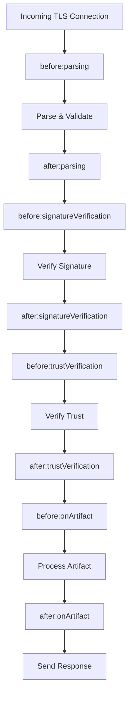

# Middleware System in BTPS Server

The BTPS Server SDK features a powerful, phase-based middleware system that lets you intercept, validate, transform, and control every step of the request lifecycle. Middleware is the primary way to add custom business logic, security, logging, and multi-tenant routing.

## Default Middleware and Rate Limiting

Every `BtpsServer` runs a **default middleware set**, before your middleware
file's, whether or not you give a file (BTPS 1.1):

| Phase / step | Default | Keyed by |
| --- | --- | --- |
| before `parsing` | Rate limit by network address: 50 a second | `req.remoteAddress` |
| after `parsing` | Parse metrics only: nothing is limited here | — |
| after `signatureVerification` | Signature metrics, then rate limit by identity: 30 a second | the **verified** sender: `from`, or an agent artifact's `agentId` |
| after `trustVerification` | Trust metrics | — |
| after `onArtifact` | Received-artifact metrics | — |
| before `onError` | Error logging | — |

Over a limit, the server answers `BTP_ERROR_RATE_LIMITER` (429, retryable).
It is defined in [`defaultMiddleware.ts`](https://github.com/openbtps/btps-node/blob/master/src/server/libs/defaultMiddleware.ts)
and exported from `@btps/sdk/server/core` as `createDefaultMiddleware`.

### Why identity is limited after signature verification

At `after parsing`, `from` is only a claim: anyone can write any address in
it. A limit keyed there let an attacker spend a victim's allowance by forging
`from: victim`, and the victim's real artifacts were then refused. The
identity limit runs only once the signature has verified, keyed by the
sender the signature proved. An artifact that fails verification is never
counted against the identity it names; it was already counted against its
network address before parsing.

An `auth.request` (device registration) is not counted by identity: its key
comes from its own document, so its signature proves nothing about its
`agentId`. It is limited by address, and by the registration token the
server requires.

### Bounded tables

The default limiter, `BtpsSimpleRateLimiter`, keeps one table of keys for
addresses and one for identities, each holding at most
`BTP_RATE_LIMIT_MAX_KEYS` (100,000) keys, about 10 MB when full. When a table
is full, keys that have aged out of the one-second window are swept (at most
once a second); if it is still full, a key it does not hold is refused with
429 rather than the table growing. Keys it already holds are served as
usual. Set another bound with `maxKeys`.

### Changing or turning off the defaults

The defaults change only through the server's `defaultMiddleware` option,
never by accident:

```js
import { BtpsServer } from '@btps/sdk/server';
import { createDefaultMiddleware, BtpsSimpleRateLimiter } from '@btps/sdk/server/core';

// Other limits:
new BtpsServer({
  ...options,
  defaultMiddleware: createDefaultMiddleware({
    rateLimiter: new BtpsSimpleRateLimiter({ ipAddress: 200, fromIdentity: 60, maxKeys: 500_000 }),
  }),
});

// Counters in a shared store, for several server instances: any RateLimiter.
new BtpsServer({ ...options, defaultMiddleware: createDefaultMiddleware({ rateLimiter: myRedisLimiter }) });

// Your own set instead of the defaults:
new BtpsServer({ ...options, defaultMiddleware: [/* middleware definitions */] });

// None. The server then limits nothing unless your own middleware does.
new BtpsServer({ ...options, defaultMiddleware: false });
```

A `RateLimiter` implements `isAllowed(key, 'ipAddress' | 'fromIdentity')`.
If you write your own identity limit, run it at `after signatureVerification`
and key it with `verifiedSender(req)` from `@btps/sdk/server/core`, which is
`undefined` when the signature proved no sender.

A middleware file written before 1.1 that still includes
`...createDefaultMiddleware()` keeps working: an entry named as a default
that already runs (`default-ip-rate-limiter`, `default-identity-rate-limiter`
and the rest) is skipped with a warning, so the defaults run once.

See [`example.btps.middleware.mjs`](https://github.com/openbtps/btps-node/blob/master/example.btps.middleware.mjs) for a middleware file that adds to the defaults.

> **Note:** The default limiter keeps its counters in memory, per server process. For several instances behind one address, pass a `RateLimiter` backed by a shared store (e.g. Redis), as above.

## Middleware Phases & Steps

Middleware can be registered for specific **phases** and **steps** in the request lifecycle:

| Phase   | Step                  | Description                        |
| ------- | --------------------- | ---------------------------------- |
| before  | parsing               | Before request is parsed/validated |
| after   | parsing               | After request is parsed/validated  |
| before  | signatureVerification | Before signature is verified       |
| after   | signatureVerification | After signature is verified        |
| before  | trustVerification     | Before trust is checked            |
| after   | trustVerification     | After trust is checked             |
| before  | onArtifact            | Before the artifact is processed   |
| after   | onArtifact            | After the artifact is processed    |
| before  | onError               | Before error is handled            |
| after   | onError               | After error is handled             |

Server lifecycle hooks are not middleware steps: a middleware module may export
`onServerStart`, `onServerStop` and `onResponseSent` beside its array.

## Middleware Execution Flow



## Middleware Types & Structure

A middleware definition is an object with the following structure:

```js
{
  phase: 'before' | 'after', // When, relative to the step
  step: 'parsing' | 'signatureVerification' | 'trustVerification' | 'onArtifact' | 'onError',
  priority?: number, // (Optional) Lower numbers run first
  config?: { ... }, // (Optional) Custom config for this middleware
  handler: async (req, res, next, context) => { ... }, // Middleware function
}
```

- **phase**: Whether the middleware runs before or after the step
- **step**: The specific step
- A definition that does not validate (an unknown phase or step, a missing handler, a handler with fewer than 3 parameters) fails the server's start with `BTP_ERROR_MIDDLEWARE` (BTPS 1.1); it is no longer skipped with a warning
- **priority**: (Optional) Controls execution order within the phase/step
- **config**: (Optional) Custom configuration for the middleware
- **handler**: The async function that implements your logic

## Writing Custom Middleware

Middleware is defined as an array of objects in a `.mjs` file (default: `btps.middleware.mjs`). Each object specifies the phase, step, and handler function.

**Answering with an error (BTPS 1.1).** Pass a constant from `@btps/sdk/error`, e.g. `res.sendError(BTP_ERROR_RATE_LIMITER)`: it goes out with its stable `code`, status and fixed message ([Wire Errors](../protocol/specifications/wire-errors.md)). A bare status such as `{ code: 403, message }` is sent as that class's constant (400, 401, 403 or 429); its own message is not sent, and any other code goes out as `BTP_ERROR_UNKNOWN` (500).

**Example:**

```js
import { BTP_ERROR_TRUST_NOT_ALLOWED, BTP_ERROR_VALIDATION } from '@btps/sdk/error';

export default [
  // Block specific IPs
  {
    phase: 'before',
    step: 'parsing',
    handler: async (req, res, next) => {
      if (req.remoteAddress === '1.2.3.4') {
        res.sendError(BTP_ERROR_TRUST_NOT_ALLOWED);
        return;
      }
      await next();
    },
  },
  // Log parsed artifacts
  {
    phase: 'after',
    step: 'parsing',
    handler: async (req, res, next) => {
      console.log('Parsed artifact:', req.data?.artifact);
      await next();
    },
  },
  // Require signature
  {
    phase: 'before',
    step: 'signatureVerification',
    handler: async (req, res, next) => {
      if (!req.data?.artifact?.signature) {
        res.sendError(BTP_ERROR_VALIDATION);
        return;
      }
      await next();
    },
  },
];
```

## Queuing in Middleware

Middleware can be used to implement queuing for async processing, rate limiting, or deferred actions. For example, you can enqueue requests for later processing, or use a queue to smooth out bursts of traffic:

```js
import { enqueueArtifact } from './queue';

export default [
  {
    phase: 'before',
    step: 'onArtifact',
    handler: async (req, res, next, context) => {
      await enqueueArtifact(req.data.artifact);
      res.sendRes({
        ...context.serverInstance.prepareBtpsResponse(
          { ok: true, message: 'Queued for processing', code: 202 },
          res.reqId,
        ),
        type: 'btps_response',
      });
      // Answering ends the request: the core does not process it again
    },
  },
];
```

## Middleware Context & API

Each handler receives:
- `req`: Request context (`req.data.artifact` once parsed, `req.remoteAddress`, `req.getIdentity()`, etc.)
- `res`: Response context (`sendError`, `sendRes`, `reqId`)
- `next`: Call to continue to the next middleware
- `context`: (Optional) Additional context (dependencies, config, server instance)

**Short-circuit:** Call `res.sendError()` or `res.sendRes()` to stop processing and return a result.

### `next()` and stopping (BTPS 1.1)

When a handler's promise settles, the server looks at what it did:

| The handler | What happens next |
| --- | --- |
| answered (`res.sendRes` or `res.sendError`) | The request is done. No later middleware and no core step runs. |
| called `next()`, at any point, and did not answer | The next handler of the same phase and step runs. |
| neither | It **stopped the chain**: no later handler of the same phase and step runs. The server then carries on as it would after the last handler: its own checks (signature, trust, replay) still decide, and still answer any refusal. |

So returning without `next()` is never a refusal. A middleware that refuses
a request answers it with `res.sendError(...)`; one that only records
something (as the default metrics handlers do on an error) may return
without `next()` and leave the answer to the server.

## Loading & Ordering Middleware

- The default middleware is loaded first (see above), then the file specified by `middlewarePath` (default: `btps.middleware.mjs` in the working directory). With no `middlewarePath`, a missing default file is not an error. A `middlewarePath` given explicitly must exist: if it does not, the server fails to start with `BTP_ERROR_MIDDLEWARE`.
- Every definition is checked when it is loaded: a valid `phase` and `step`, a `handler` function declared with at least three parameters (`req, res, next`), and a non-negative whole `priority`. One that fails stops the server from starting with `BTP_ERROR_MIDDLEWARE`; it is never skipped with only a warning.
- Within a phase/step, the defaults run before the file's middleware.
- Middleware is executed in the order listed for each phase/step.
- Use the `priority` field to control execution order (lower numbers run first).

## Server Lifecycle Middleware

You can register hooks for server start/stop:

```js
export default [
  // ...other middleware
];

export async function onServerStart() {
  // Initialize resources, connect to DB, etc.
}

export async function onServerStop() {
  // Cleanup resources, flush logs, etc.
}
```

## Best Practices

- **Keep middleware focused:** Each handler should do one thing (e.g., rate limit, log, validate).
- **Short-circuit on error:** Use `res.sendError()` to stop processing and return an error.
- **Order matters:** Middleware is executed in the order listed for each phase/step.
- **Test in isolation:** Write unit tests for complex handlers.
- **Use server-level hooks:** For metrics, health checks, or resource cleanup.

## Debugging Middleware

- Add logging to each handler to trace execution.
- Use the `onError` phase to catch and log errors.
- Test middleware with known-good and known-bad artifacts.
- Use health checks and metrics to monitor server readiness and performance.

---

Next: [Advanced Usage](/docs/server/advanced-usages) | [Debugging](/docs/server/debugging)
