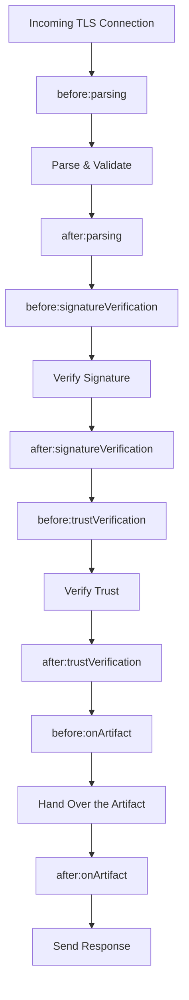

# Middleware System in BTPS Server

The BTPS Server SDK features a powerful, phase-based middleware system that lets you intercept, validate, transform, and control every step of the request lifecycle. Middleware is the primary way to add custom business logic, security, logging, and multi-tenant routing.

## Default Middleware: Quick Start

For development and tests, the SDK provides a **default middleware set**. A BTPS server never loads it by itself; you include it from your middleware file:

- **IP-based rate limiting** (before parsing)
- **Identity-based rate limiting** (after signature verification, so only a proven sender is counted)
- **Signature and trust verification metrics**
- **Message processing metrics**
- **Error logging**

This default middleware is defined in [`defaultMiddleware.ts`](https://github.com/openbtps/btps-node/blob/master/src/server/libs/defaultMiddleware.ts) and can be used as-is or as a starting point for your own configuration.

**How to use:**

- If you do not specify a custom middleware file, the server will not use this default middleware as its purely for inspection and implementation guide. However one can include this default middleware into the btps.middleware.mjs of the running server root folder
- To customize, you can import and extend it in your own middleware file:

```js
import { createDefaultMiddleware } from '@btps/sdk/server/core';

export default function createMiddleware() {
  return [
    ...createDefaultMiddleware(),
    // Add your custom middleware here
  ];
}
```

See [`example.btps.middleware.mjs`](https://github.com/openbtps/btps-node/blob/master/example.btps.middleware.mjs) for a real-world example of extending and customizing the default middleware.

> **Note:** The default middleware keeps its counters in the server's own memory, so it is for development and tests only. In production, use middleware backed by shared services, such as Redis for rate limiting behind the `RateLimiter` contract and Prometheus for metrics.

## Middleware Phases & Steps

Middleware can be registered for specific **phases** and **steps** in the request lifecycle:

| Phase  | Step                  | Description                                             |
| ------ | --------------------- | ------------------------------------------------------- |
| before | parsing               | Before request is parsed/validated                      |
| after  | parsing               | After request is parsed/validated                       |
| before | signatureVerification | Before signature is verified                            |
| after  | signatureVerification | After signature is verified                             |
| before | trustVerification     | Before trust is checked                                 |
| after  | trustVerification     | After trust is checked                                  |
| before | onArtifact            | Before the artifact is handed over (takes the artifact) |
| after  | onArtifact            | After the artifact is handed over                       |
| before | onError               | Before error is handled                                 |
| after  | onError               | After error is handled                                  |

## Middleware Execution Flow



## Middleware Types & Structure

A middleware definition is an object with the following structure:

```js
{
  phase: 'before' | 'after', // Before or after the step
  step: 'parsing' | 'signatureVerification' | 'trustVerification' | 'onArtifact' | 'onError', // The step
  priority?: number, // (Optional) Lower numbers run first
  config?: { name?: string, enabled?: boolean, options?: { ... } }, // (Optional) options reach the handler as context.config
  handler: async (req, res, next, context) => { ... }, // Middleware function
}
```

- **phase**: Whether the middleware runs before or after the step
- **step**: The step it runs around
- **priority**: (Optional) Controls execution order within the phase/step
- **config**: (Optional) Custom configuration for the middleware; `enabled: false` turns it off
- **handler**: The async function that implements your logic. It is awaited, so it does not have to call `next`

Server start and stop hooks are not middleware definitions: export them alongside the middleware (`onServerStart`, `onServerStop`, `onResponseSent`).

## Writing Custom Middleware

Middleware is defined as an array of objects in a `.mjs` file (default: `btps.middleware.mjs`). Each object specifies the phase, step, and handler function. A handler stops the request by answering it with `res.sendError()` or `res.sendRes()`; otherwise the server carries on to the next middleware and step.

**Example:**

```js
export default function createMiddleware() {
  return [
    // Block specific IPs
    {
      phase: 'before',
      step: 'parsing',
      handler: async (req, res) => {
        if (req.remoteAddress === '1.2.3.4') {
          return res.sendError({ code: 403, message: 'Blocked IP' });
        }
      },
    },
    // Log parsed artifacts
    {
      phase: 'after',
      step: 'parsing',
      handler: async (req) => {
        console.log('Parsed artifact:', req.data?.artifact);
      },
    },
    // Require signature
    {
      phase: 'before',
      step: 'signatureVerification',
      handler: async (req, res) => {
        if (!req.data?.artifact?.signature) {
          return res.sendError({ code: 400, message: 'Missing signature' });
        }
      },
    },
  ];
}
```

## Queuing in Middleware

Middleware can hand an artifact to your own queue for async processing. A `before onArtifact` middleware counts as taking the artifact, so the server answers success once it returns:

```js
import { enqueueArtifact } from './queue';

export default function createMiddleware() {
  return [
    {
      phase: 'before',
      step: 'onArtifact',
      handler: async (req) => {
        // Throw if the queue is unavailable: the sender is told to send again
        await enqueueArtifact(req.data.artifact);
      },
    },
  ];
}
```

## Middleware Context & API

Each handler receives:

- `req`: Request context (`data.artifact`, `remoteAddress`, `getIdentity()`, `isValid`, `isTrusted`, `error`)
- `res`: Response context (`sendError`, `sendRes`)
- `next`: Optional to call: the server continues once the handler returns, unless it answered
- `context`: (Optional) Additional context (dependencies, config, server instance)

**Short-circuit:** Call `res.sendError()` or `res.sendRes()` to stop processing and return a result.

## Loading & Ordering Middleware

- Middleware is loaded from the file specified by `middlewarePath` (default: `btps.middleware.mjs` in the root).
- Middleware is optional, so a missing file never stops the server. If you set `middlewarePath` and the file is not there, the server logs a warning and runs without middleware.
- A definition with an invalid `phase`, `step`, `handler` or `priority` is skipped with a warning. A handler is awaited, so it does not have to take `next`.
- Middleware is executed in the order listed for each phase/step.
- Use the `priority` field to control execution order (lower numbers run first).

## Server Lifecycle Middleware

You can register hooks for server start/stop:

```js
export default function createMiddleware(dependencies) {
  return {
    middleware: [
      // ...your middleware
    ],
    onServerStart: async () => {
      // Initialize resources, connect to DB, etc.
    },
    onServerStop: async () => {
      // Cleanup resources, flush logs, etc.
    },
  };
}
```

## Best Practices

- **Keep middleware focused:** Each handler should do one thing (e.g., rate limit, log, validate).
- **Short-circuit on error:** Use `res.sendError()` to stop processing and return an error.
- **Order matters:** Middleware is executed in the order listed for each phase/step.
- **Test in isolation:** Write unit tests for complex handlers.
- **Use server-level hooks:** For metrics, health checks, or resource cleanup.

## Debugging Middleware

- Add logging to each handler to trace execution.
- Use the `onError` phase to catch and log errors.
- Test middleware with known-good and known-bad artifacts.
- Use health checks and metrics to monitor server readiness and performance.

---

Next: [Advanced Usage](/docs/server/advanced-usages) | [Debugging](/docs/server/debugging)
