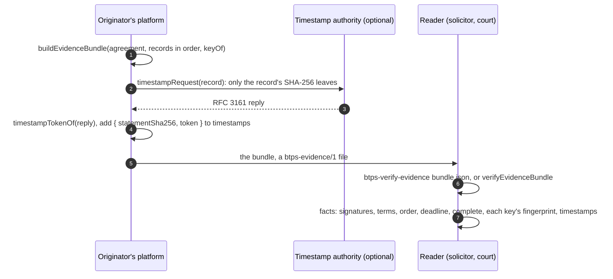

# Evidence bundles and trusted timestamps

**What it is.** An evidence bundle is one file a party to an [agreement](./agreements.md) makes to show what was agreed: the signed agreement, every signer's statement record in order, and the public key behind each signature. Anyone can check it offline, with no provider, no network and no decryption key, in code or from the command line. A bundle may also carry an RFC 3161 **trusted timestamp** for each statement, from a timestamp authority, so it still proves when a statement was signed after keys have rotated.

**Why.** A dispute goes to a solicitor or a court, who has neither the parties' providers nor their keys. The bundle carries everything needed, and reports facts, never a verdict.

Whoever receives a bundle sees everything in it, by design. BTPS never publishes one; a party chooses to make and disclose it.

## The flow



## The bundle

A shortened bundle, one signer and one key shown:

```json btps=bundle
{
  "format": "btps-evidence/1",
  "originator": "loans$bank.example",
  "agreement": {
    "type": "agreement",
    "title": "Home loan agreement",
    "id": "AGR-1",
    "issuedAt": "2026-10-19T00:00:00.000Z",
    "body": { "format": "markdown", "content": "# Home loan\n\nThe terms are attached." },
    "acceptance": {
      "by": "2026-11-30T00:00:00.000Z",
      "terms": [],
      "signers": [{ "address": "alice$client.example" }],
      "signingOrder": "any"
    },
    "originatorSignature": {
      "selector": "btps1",
      "signature": {
        "algorithmHash": "sha256",
        "value": "BASE64-SIGNATURE",
        "fingerprint": "BASE64-FINGERPRINT"
      }
    }
  },
  "statements": [
    {
      "statement": {
        "agreement": {
          "originator": "loans$bank.example",
          "id": "AGR-1",
          "contentSha256": "fabe09ee458f0f7b3091ff62d7927edee1a7e6b4a74695c6ffa0c928ad861ebc"
        },
        "terms": [],
        "signer": "alice$client.example",
        "decision": "accepted",
        "signedAt": "2026-11-02T00:00:00.000Z"
      },
      "selector": "btps1",
      "signature": {
        "algorithmHash": "sha256",
        "value": "BASE64-SIGNATURE",
        "fingerprint": "BASE64-FINGERPRINT"
      }
    }
  ],
  "keys": [
    {
      "identity": "loans$bank.example",
      "selector": "btps1",
      "publicKey": "-----BEGIN PUBLIC KEY-----\nMIIBIjANBg…\n-----END PUBLIC KEY-----",
      "fingerprint": "P3jb2C0c6XutGbtPyrDjDfY+M8IICzA5Ym8YkTZerAs="
    }
  ],
  "timestamps": [
    {
      "statementSha256": "4c1d2e3f405162738495a6b7c8d9e0f1a2b3c4d5e6f708192a3b4c5d6e7f8091",
      "token": "BASE64-OF-THE-RFC-3161-TOKEN"
    }
  ]
}
```

A key counts only when its fingerprint is its own: a bundle cannot pair one key with another's fingerprint.

## What a reader learns

`verifyEvidenceBundle` reports `BTPEvidenceFacts`:

| Fact                       | Means                                                                                                                                                                                                                                                  |
| -------------------------- | ------------------------------------------------------------------------------------------------------------------------------------------------------------------------------------------------------------------------------------------------------ |
| `contentSha256`            | the agreement's content hash, as the bundle holds it                                                                                                                                                                                                   |
| `originatorSignatureValid` | the originator's signature is over this content                                                                                                                                                                                                        |
| `originatorKey`            | the key it was checked with: `{ identity, selector, fingerprint }`                                                                                                                                                                                     |
| `termsAttached`            | each term is the SHA-256 of one of its attachments, as attached                                                                                                                                                                                        |
| `statements[]`             | each statement: `signatureValid`, `keyKind` (`identity` or `device`, with `delegatedBy` and `attestedBy`), `key` (and a device's `delegationKey`), `agreementMatches`, `termsMatch`, `withinDeadline`, `inOrder`, and its `timestamp`, when it has one |
| `keysConfirmedOnline`      | always `false`: every key is the bundle's own                                                                                                                                                                                                          |
| `complete`                 | every fact above holds, and every signer accepted, once                                                                                                                                                                                                |

**What `complete` means, plainly.** The bundle is consistent with the keys it carries. It does **not** say each key was its identity's when it signed: a bundle forged with fresh keys labelled as the parties is consistent too. That is why every fingerprint is printed: a reader who needs more checks them against the identities' published keys, or their history, itself. Providers make that possible: they never reuse a selector for a different key, and keep old public keys answerable as long as documents signed with them are kept ([Key Rotation](../protocol/keyRotation.md)).

**A timestamp** reports `imprintMatches` (over this statement), `signatureValid`, `time`, `authority`, `timestampingKeyUsage` (the signer's certificate is a timestamp authority's: its one extended key usage is timeStamping, critical, as RFC 3161 requires, so a TLS server's certificate under a trusted root is not) and `trusted`, given the roots the reader trusts. A timestamp never changes `complete`.

## The code

### Build it

From the agreement journey (`tests/e2e/agreements.e2e.test.ts`):

```ts
import { buildEvidenceBundle } from '@btps/sdk/trust';

const bundle = buildEvidenceBundle(
  { originator: 'loans$bank.example', agreement, statements: records },
  // The public key behind each signature: the originator's, each identity's, a device's delegator's and attestor's.
  (identity, selector) => keys.lookup(identity, selector),
);
```

It refuses to build without every key it needs (`BTP_ERROR_RESOLVE_PUBKEY`).

### Add a trusted timestamp

```ts
import { timestampRequest, timestampTokenOf, statementRecordSha256 } from '@btps/sdk/trust';

const query = await timestampRequest(record); // only the record's SHA-256 leaves the provider
const reply = await fetch('https://tsa.example/rfc3161', {
  method: 'POST',
  headers: { 'content-type': 'application/timestamp-query' },
  body: query,
});
const token = await timestampTokenOf(new Uint8Array(await reply.arrayBuffer()));
bundle.timestamps = [
  ...(bundle.timestamps ?? []),
  { statementSha256: statementRecordSha256(record), token },
];
```

`timestampTokenOf` refuses a reply that granted no token (`BTP_ERROR_VALIDATION`).

### Check it

```ts
import { verifyEvidenceBundle, describeEvidenceFacts } from '@btps/sdk/trust';

const facts = await verifyEvidenceBundle(bundle, { trustedTimestampRoots: [tsaRootPem] });
console.log(describeEvidenceFacts(facts));
```

From the command line:

```sh
npx -p @btps/sdk btps-verify-evidence bundle.json
npx -p @btps/sdk btps-verify-evidence bundle.json --json
npx -p @btps/sdk btps-verify-evidence bundle.json --timestamp-root tsa-root.pem
```

| Exit code | Means                                                    |
| --------- | -------------------------------------------------------- |
| `0`       | the agreement is complete                                |
| `1`       | it is not; the facts say why                             |
| `2`       | the file could not be read, or is not an evidence bundle |

The printed facts end with each key's fingerprint and "keys from the bundle, not confirmed online". The security suite reads a bundle forged with fresh keys this way, and checks that both are shown (`tests/security/reviewFixes.security.test.ts`).

## Errors

| Code                       | Status | Who refuses            | When                                                                                     |
| -------------------------- | ------ | ---------------------- | ---------------------------------------------------------------------------------------- |
| `BTP_ERROR_VALIDATION`     | 400    | `verifyEvidenceBundle` | not an evidence bundle (another format, a missing originator, a record signed both ways) |
| `BTP_ERROR_RESOLVE_PUBKEY` | 401    | `buildEvidenceBundle`  | a key it needs cannot be found                                                           |
| `BTP_ERROR_VALIDATION`     | 400    | `timestampTokenOf`     | the authority granted no token                                                           |

Anything else is a fact, not an error: a signature that does not hold, a term not attached, an answer late or out of order.

## Protocol and platform

The protocol defines the file, the signatures and what each fact means. Building a bundle, getting timestamps, and deciding when a party may have one are the platform's. Choosing which timestamp authorities to trust is the reader's. The rules in full: [The evidence bundle](../protocol/specifications/transporter-artifact.md#the-evidence-bundle).
