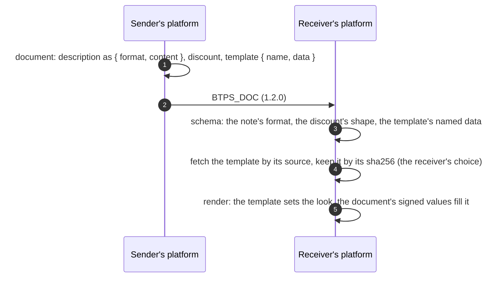

# Notes, discounts and templates

Three additions to documents, each `1.2.0` only. A document valid in 1.1 reads exactly as before in a `1.1.0` artifact.

| What                                     | Why                                                                                                            |
| ---------------------------------------- | -------------------------------------------------------------------------------------------------------------- |
| **Notes say how they are written**       | a note in markdown renders as markdown, not as asterisks                                                       |
| **Discounts**                            | an invoice or receipt says what was taken off, before tax, instead of hiding it in a line                      |
| **Templates by reference, and format 2** | a document names how it should look, payslips and letters included, and a letter can carry a signature to show |

## The flow



## Notes

An invoice's and a receipt's `description`, an event's `message`, and a trust request's or answer's `message` may be `{ format: "text" | "markdown", content }`. A plain string is still taken, read as `text`. Under `1.2.0`, a note's content is at most 5,000 characters.

## Discounts

An invoice or receipt may carry `discount`: `{ amount }` in minor units, or `{ percent }` in whole basis points (1 to 10,000, so `1000` is 10%), applied before tax. Under `1.2.0`, a line's own `discount` cell is an amount of at least 0.

## Templates by reference

A document names its template, `template: { name, data }`. Under `1.2.0` the named `data` fields are checked when present: `version` (semantic), `sha256` (the template file's fingerprint: the SHA-256 of its RFC 8785 form), `source` (an https address, always with its `sha256`), and `logo` (`{ sha256, source }`). Other keys stay the provider's.

An invoice with all three:

```json btps=document:BTPS_DOC
{
  "type": "invoice",
  "title": "November",
  "id": "INV-1002",
  "issuedAt": "2026-11-08T06:00:00.000Z",
  "totalAmount": { "amount": 135000, "currency": "AUD" },
  "lineItems": {
    "columns": ["Item", "Amount"],
    "rows": [{ "Item": "Website build", "Amount": 150000 }]
  },
  "description": { "format": "markdown", "content": "**Thank you** for your business." },
  "discount": { "percent": 1000 },
  "template": {
    "name": "acme/classic",
    "data": {
      "version": "2.1.0",
      "sha256": "cccccccccccccccccccccccccccccccccccccccccccccccccccccccccccccccc",
      "source": "https://templates.acme.example/classic-2.1.0.json"
    }
  }
}
```

**The template file** says how a document looks, never what it says. Format 1 is for invoices and receipts. **Format 2** is format 1 for them, plus:

- a **payslip** template: the payslip's own sections and labels, every one with signed fields shown;
- a **letter** template, which draws agreements too: the page, a letterhead placing the sender's own fields, and a footer with a sign-off and signature slots. Never the body.

A template never carries or changes a value of the document, hides no section with signed fields, fetches nothing and runs nothing; its own words are plain text. The format, its JSON Schema (`schemas/btps-template.schema.json`) and its golden vectors are on the [Templates](../protocol/specifications/templates.md) page. **The SDK renders nothing:** rendering is the platform's.

## A letter's signature

A letter's template carries the values its signature slots show, in `template.data.values`, signed with the letter: a typed signature (drawn in the open-licence script font Caveat), a name, a title, and a drawn signature as integer strokes on a 1,000 by 300 canvas, never markup.

```json btps=document:BTPS_DOC
{
  "type": "letter",
  "title": "Your new plan",
  "id": "LET-7",
  "issuedAt": "2026-11-08T06:00:00.000Z",
  "body": { "format": "markdown", "content": "Dear Alice,\n\nYour new plan starts on 1 December." },
  "template": {
    "name": "acme/letter",
    "data": {
      "values": {
        "signature.typed": "Jo Bloggs",
        "signature.name": "Jo Bloggs",
        "signature.title": "Customer care",
        "signature.drawn": { "strokes": [[10, 200, 120, 80, 240, 210, 380, 90]] }
      }
    }
  }
}
```

**Such a signature is decoration and proves no agreement.** To be bound by a document, send an [agreement](./agreements.md).

## The code

Nothing new to call: these are fields of the document a platform already sends. From a device, the `artifact.send` checks them under the version the agent will stamp; from a server, `signEncrypt` does. The feature journey (`tests/e2e/features.e2e.test.ts`) sends an invoice with a markdown note and a discount, and a letter with a template, and each arrives intact.

## Errors

| Code                   | Status | Who refuses                                                                     | When                                                                                                                                                                                                                                                                              |
| ---------------------- | ------ | ------------------------------------------------------------------------------- | --------------------------------------------------------------------------------------------------------------------------------------------------------------------------------------------------------------------------------------------------------------------------------- |
| `BTP_ERROR_VALIDATION` | 400    | the receiving server (readable), `decryptVerify` (opened), the sender's own SDK | a note over 5,000 characters or of another format, a discount with both or neither field or out of range, a template's `source` without its `sha256`, `values` on anything but a letter's or agreement's template, a stroke off the canvas, or any of these in a `1.1.0` artifact |

## Protocol and platform

The protocol checks the shapes. What a template's words may say (for example, refusing digit runs and web, email and BTPS addresses, where a fake payment detail would hide), when to fetch it, and how to render it are the platform's; the Templates page recommends what to refuse.
