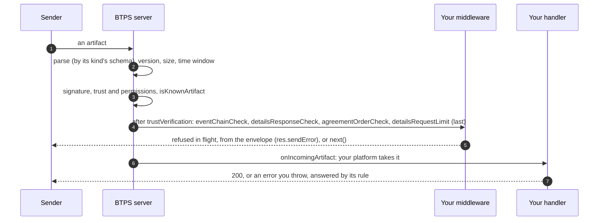

# Your platform's checks

**What it is.** A 1.2 server checks an artifact's structure, its signatures, the trust and its permissions, and `isKnownArtifact`, and reads no other record of the platform's. Everything that needs a record only the platform keeps (an invoice's events, the requests it sent, an agreement's answers, its own limits) is the platform's to check. The SDK ships those checks two ways: as **middleware**, which refuses in flight, and as **plain functions**, for a platform that checks another way.

**Why.** The server stays the same for every platform; what a platform keeps, and how, stays its own. Each check is off until the platform adds it, with its own lookup.

## The flow



## The four middleware

All from `@btps/sdk/server/core`. Each runs after the server's trust check, and refuses from the envelope, encrypted or not, without opening anything.

| Middleware                              | Refuses                                                                                      | With your lookup                           | Plain function                                  |
| --------------------------------------- | -------------------------------------------------------------------------------------------- | ------------------------------------------ | ----------------------------------------------- |
| `eventChainCheck({ getEvent })`         | a `withdrawn` or `follows` that breaks the chain ([Withdrawing](./withdrawingProposals.md))  | an earlier event's facts                   | `lifecycleEventChainProblem`                    |
| `detailsResponseCheck({ getArtifact })` | a `DETAILS_RES` naming what its request did not ask ([Details refresh](./detailsRefresh.md)) | the request's envelope                     | `detailsProblem`, `detailsRequestRefusal`       |
| `agreementOrderCheck({ answers })`      | an agreement's answer out of turn ([Agreements](./agreements.md))                            | the agreement's signers, order and answers | `agreementTurnProblem`, `agreementOrderProblem` |
| `detailsRequestLimit(allow)`            | a `DETAILS_REQ` over your own limit, with `retryAfter`                                       | your count                                 | none: the limit is yours                        |

```js
import {
  agreementOrderCheck,
  detailsRequestLimit,
  detailsResponseCheck,
  eventChainCheck,
} from '@btps/sdk/server/core';

export default function createMiddleware() {
  return [
    eventChainCheck({ getEvent: ({ id, from, to }) => events.facts({ id, from, to }) }),
    detailsResponseCheck({ getArtifact: (query) => artifacts.envelope(query) }),
    agreementOrderCheck({ answers: (query) => agreements.answersByCopy(query) }),
    // Last, so it counts only what every other check took.
    detailsRequestLimit(async ({ from, to }) =>
      (await counts.thisMonth(from, to)) < 10
        ? true
        : { retryAfter: await counts.secondsToNextMonth() },
    ),
  ];
}
```

## What a sender is told of an error

Where an error comes from decides what the sender sees, not how it looks:

- **Your own answers go as plain objects through `res.sendError`**, and are sent as you wrote them: a `{ code, message, status }` of your own (for example `PROVIDER_ALREADY_RECEIVED`, 409), or a BTPS constant with something added to its message (a support reference).
- **Anything thrown, or an error you caught and pass on,** is told only as a BTPS constant: its status, and its message, or that message followed by `: ` and a detail. Any other (a database's duplicate-key error, an SDK's `{ status: 403, code: 'AccessDenied' }`) goes out as the generic `500`, and its detail stays with your server. So never pass a caught error to `res.sendError` to explain a refusal: send your own answer.
- **`retryAfter`:** a 429 sent as a `BTPErrorException` from a BTPS constant, whose `meta.retryAfter` is whole seconds, goes out with `status.retryAfter`, in a `1.2.0` answer. Nothing else from `meta` reaches the wire, and `cause` never does.

```json btps=response
{
  "version": "1.2.0",
  "id": "293a4b5c-6d7e-48f9-a0b1-c2d3e4f50617",
  "issuedAt": "2026-11-08T08:00:00.000Z",
  "type": "btps_error",
  "reqId": "3a4b5c6d-7e8f-49a0-b1c2-d3e4f5061728",
  "status": {
    "ok": false,
    "code": 429,
    "error": "BTP_ERROR_DETAILS_RATE_LIMITED",
    "message": "Too many details requests on this trust. Ask again later",
    "retryAfter": 60
  }
}
```

```js
// A refusal of your own, in middleware: as given.
return res.sendError({
  code: 'PROVIDER_ALREADY_RECEIVED',
  message: 'This artifact was already received',
  status: 409,
});
// A BTPS refusal with a wait: from its constant.
return res.sendError(new BTPErrorException(BTP_ERROR_RATE_LIMITER, { meta: { retryAfter: 30 } }));
```

## The server's own limits

| Option                       | Default        | What it bounds                                                                                                      |
| ---------------------------- | -------------- | ------------------------------------------------------------------------------------------------------------------- |
| `maxArtifactSizeKb`          | 5,120 (5 MB)   | one artifact's size, before it is read in full                                                                      |
| `maxArtifactAgeSeconds`      | 300            | how far `issuedAt` may be from the server's clock                                                                   |
| `maxInFlightPerConnection`   | 32             | requests one connection may have handled at once; a request is in flight until its answer is written, signed or not |
| `maxConsecutiveInvalidLines` | 10 (since 1.2) | unreadable lines in a row on one connection: the last is answered, with `status.closing`, and the connection ends   |
| `connectionTimeoutMs`        | 30,000         | how long a connection with nothing in flight stays open                                                             |

A line is checked against the schema of the kind of artifact it is taken for, and nothing else, and every list is refused cheaply when it is too long, before its signature is checked. See [Limits](../protocol/specifications/limits.md).

## Errors you hear about

```ts
const server = new BtpsServer({
  // ...
  onError: (error) => log.error(error.toJSON()), // every failed artifact; no token or code is ever in an error
});
```

With `onError` (or `onError` middleware), the server no longer also writes each failed artifact to `console.error`.

## Caching key lookups

Every key lookup, the server's and the client's, goes through one option, `keyResolver`, so a provider can cache keys; BTPS itself caches nothing. `createDefaultKeyResolver` is the lookup to wrap. See [Caching Key Lookups](../server/advancedUsages.md#caching-key-lookups).

```ts
import { createDefaultKeyResolver } from '@btps/sdk/crypto';

const lookup = createDefaultKeyResolver();
const cache = new Map();
const keyResolver = {
  async resolvePublicKey(identity, selector, use) {
    const key = `${identity} ${selector} ${use}`;
    if (!cache.has(key)) cache.set(key, await lookup.resolvePublicKey(identity, selector, use));
    return cache.get(key);
  },
};
const server = new BtpsServer({ /* ... */ keyResolver });
```

The feature journey (`tests/e2e/features.e2e.test.ts`) checks that a caching resolver looks a sender's key up once over three events.

## Protocol and platform

| The server checks                                     | Your platform checks                                                                      |
| ----------------------------------------------------- | ----------------------------------------------------------------------------------------- |
| structure, by the artifact's kind; size, age, version | an invoice's events: `eventChainCheck`                                                    |
| signatures, delegations and attestations              | details responses against the requests you sent: `detailsResponseCheck`                   |
| the trust and its permissions; `isKnownArtifact`      | an agreement's order: `agreementOrderCheck`, then `agreementStatementProblem` once opened |
| in-flight, invalid-line and size limits               | your own limits: `detailsRequestLimit`                                                    |

What a 1.1 provider registers to keep each refusal when it upgrades is in the changelog's [Upgrading from 1.1](https://github.com/openbtps/btps-node/blob/release/1.2/CHANGELOG.md#upgrading-from-11).
