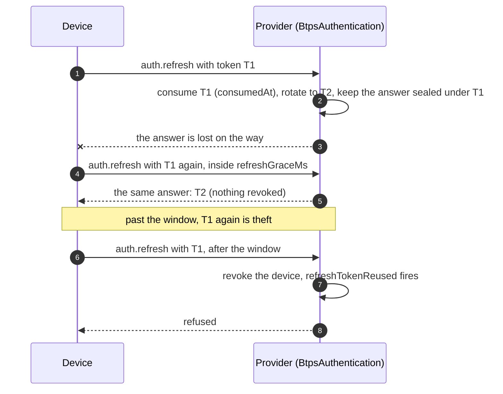

# Refresh tokens

A device signs in once, with a one-time code, and then keeps its session with a **refresh token**, rotated on every refresh. 1.2 makes refresh safer against a stolen device key and kinder to a device on a bad connection:

| What                                            | Why                                                                                    |
| ----------------------------------------------- | -------------------------------------------------------------------------------------- |
| **A token used twice revokes the device**       | only a copy of a token can use it a second time, so a second use is theft              |
| **A grace window for a retried refresh**        | a device that refreshed but lost the answer asks again without being taken for a thief |
| **"Busy, try again" for two refreshes at once** | a device retrying while its first refresh is still being made is not revoked           |
| **A maximum key age** (optional)                | a provider can make devices move to a new key on a schedule                            |
| **Key rotation with a proof**                   | a device moves to a new key, proving it holds it, and the provider is told             |

## The flow



## The refresh

A refresh is an agent artifact the device signs with its current key:

```json btps=agent
{
  "id": "c3d4e5f6-0718-4293-8a4b-5c6d7e8f9a0b",
  "issuedAt": "2026-11-08T05:00:00.000Z",
  "action": "auth.refresh",
  "agentId": "btps_ag_3f2e1d0c-9b8a-4776-8554-433221100fed",
  "to": "alice$saas.example",
  "document": {
    "identity": "alice$saas.example",
    "authToken": "THE-CURRENT-REFRESH-TOKEN",
    "publicKey": "-----BEGIN PUBLIC KEY-----\nMIIBIjANBg…\n-----END PUBLIC KEY-----",
    "agentInfo": { "deviceName": "Alice's phone" }
  },
  "encryption": null,
  "signature": {
    "algorithmHash": "sha256",
    "value": "BASE64-SIGNATURE",
    "fingerprint": "BASE64-FINGERPRINT"
  }
}
```

A refresh racing another with the same token, while the first is still being made, is answered:

```json btps=response
{
  "version": "1.2.0",
  "id": "d4e5f607-1829-43a4-9b5c-6d7e8f9a0b1c",
  "issuedAt": "2026-11-08T05:00:00.300Z",
  "type": "btps_error",
  "reqId": "c3d4e5f6-0718-4293-8a4b-5c6d7e8f9a0b",
  "status": {
    "ok": false,
    "code": 503,
    "error": "BTP_ERROR_TEMPORARILY_UNAVAILABLE",
    "message": "The server cannot take this artifact right now. Send it again later"
  }
}
```

## The code

### The provider

```ts
import { BtpsAuthentication, InMemoryTokenStore } from '@btps/sdk/authentication';

const auth = new BtpsAuthentication({
  trustStore,
  tokenStore: new InMemoryTokenStore(), // or a store with isConsumed and markSuccessor
  refreshGraceMs: 30_000, // the default; 0 turns the window off
  maxKeyAgeMs: 90 * 86_400_000, // optional: off by default
});
auth.on('refreshTokenReused', ({ agentId, identity, at }) =>
  alerts.deviceRevoked(agentId, identity, at),
);
auth.on('keyRotated', ({ agentId, previousFingerprint, fingerprint }) =>
  audit.keyRotated(agentId, previousFingerprint, fingerprint),
);

// In the handler for auth.refresh, as the device journey's provider does:
const { data, error } = await auth.validateAndReissueRefreshToken(artifact.agentId, doc.authToken, {
  decidedBy: user,
  publicKey: doc.publicKey,
  decryptBy: doc.identity,
});
if (error) throw error; // the server answers it, and onError receives it
return answer(data);
```

### The device

```ts
// Keep the session.
const refreshed = await BtpsAuthentication.refreshSession(
  agentId,
  user,
  refreshToken,
  deviceKeys,
  {},
  agentOptions,
);
// Move to a new key: the refresh carries a proof signed by the new key.
const rotated = await BtpsAuthentication.rotateKey(
  agentId,
  user,
  refreshToken,
  currentKeys,
  newKeys,
  {},
  agentOptions,
);
```

A device that is told `BTP_ERROR_TEMPORARILY_UNAVAILABLE` waits a moment and refreshes again with the same token. One told `BTP_ERROR_KEY_TOO_OLD` rotates to a new key with the same token.

## What each case does

| The device                                                                           | The provider, with a store that has `isConsumed` and `markSuccessor`                                                                                                                  |
| ------------------------------------------------------------------------------------ | ------------------------------------------------------------------------------------------------------------------------------------------------------------------------------------- |
| refreshes with its current token                                                     | takes it once (`consume`, recording `consumedAt`), rotates the token, and keeps the answer sealed under the old token (AES-256-GCM, key by HKDF-SHA256, bound to the device and user) |
| asks again with the old token, inside `refreshGraceMs`, after the first was answered | the same answer, the same new token included; nothing revoked                                                                                                                         |
| asks again while the first refresh is still being made, inside the window            | `BTP_ERROR_TEMPORARILY_UNAVAILABLE`: try again; nothing revoked, no `refreshTokenReused`                                                                                              |
| uses the old token after the window, or after the new token has been used            | theft: the device is revoked and `refreshTokenReused` fires                                                                                                                           |
| refreshes with a key older than `maxKeyAgeMs`                                        | `BTP_ERROR_KEY_TOO_OLD`; the token stays usable, so the device rotates (`rotateKey`) and is let in                                                                                    |

**A store without the new methods.** Without `isConsumed`, a second use is refused as an unknown token, as in 1.1, and the device is not revoked. Without `markSuccessor`, there is no grace window. Without `consumedAt` on the consumed mark, a racing refresh is taken for theft. `BtpsAuthentication` warns once for each method a store lacks. `InMemoryTokenStore` has them all.

The device journey (`tests/e2e/devices.e2e.test.ts`) retries a refresh inside a 1-second window and gets the same token, then is taken for theft after it. The security suite (`tests/security/reviewFixes.security.test.ts`) races two refreshes over two connections: one succeeds, the other is told to try again, and the device stays accepted.

## Errors

| Code                                | Status | Who answers                            | When                                                                                |
| ----------------------------------- | ------ | -------------------------------------- | ----------------------------------------------------------------------------------- |
| `BTP_ERROR_AUTHENTICATION_INVALID`  | 401    | `BtpsAuthentication`                   | an unknown or expired token, or a token used again (then the device is revoked too) |
| `BTP_ERROR_TEMPORARILY_UNAVAILABLE` | 503    | `BtpsAuthentication`                   | the token's first refresh is still being made: try again                            |
| `BTP_ERROR_KEY_TOO_OLD`             | 401    | `BtpsAuthentication`                   | the device's key is older than `maxKeyAgeMs`: rotate                                |
| `BTP_ERROR_KEY_ROTATION_PROOF`      | 401    | the provider's BTPS server, on arrival | a refresh naming a new key without a `keyProof`, or one the new key did not sign    |

No error carries a token or a sign-in code: they stay out of every error's `meta`.

## Protocol and platform

The refresh itself, the rotation, the grace window and theft detection are `BtpsAuthentication`'s, with the token store the platform provides. Deciding what to tell the user when a device is revoked, and whether to set a maximum key age, are the platform's. The rules in full: [BtpsAuthentication](../protocol/authentication/btpsAuthentication.md).
